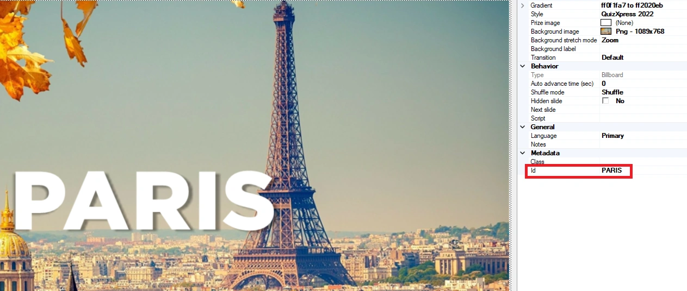
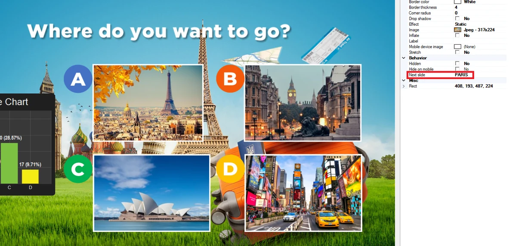
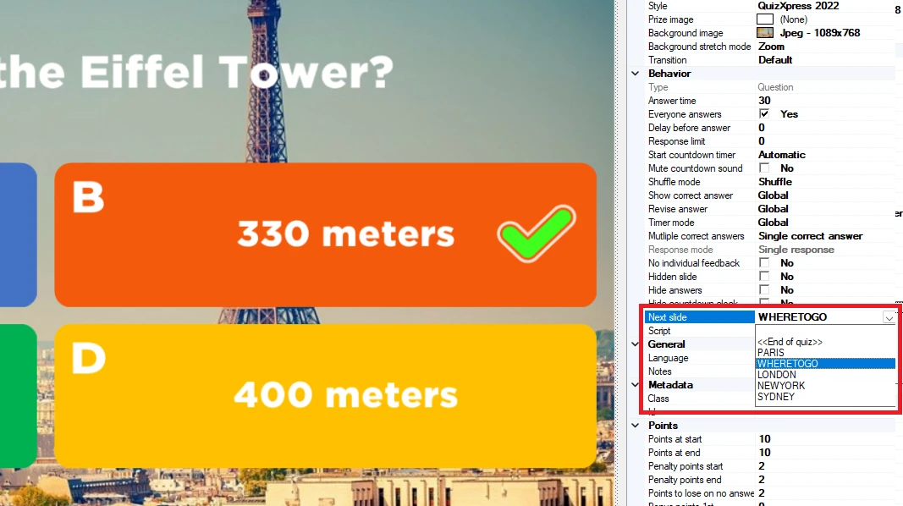
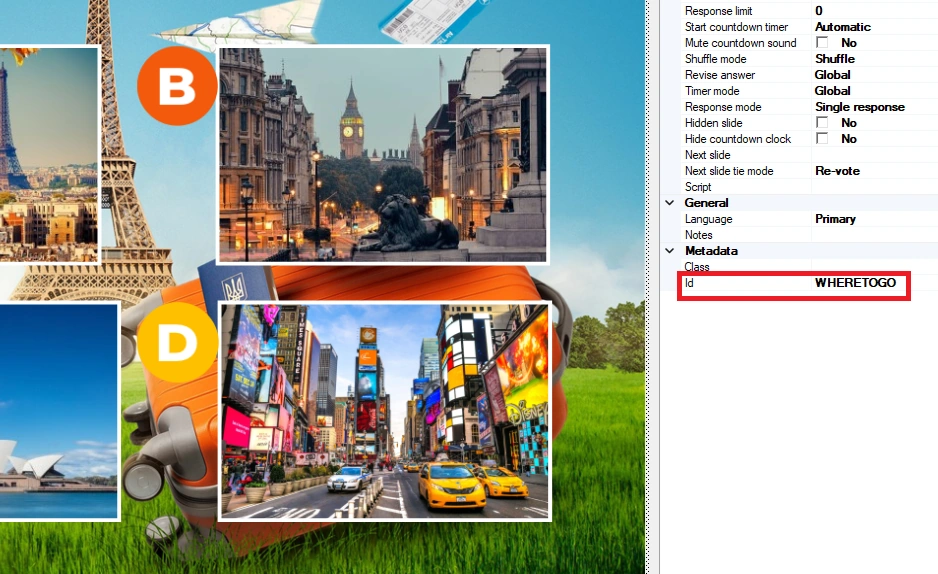

# Instradamento delle diapositive

Normalmente un quiz procede in modo lineare dalla diapositiva 1 fino alla fine. Con l'instradamento delle diapositive è possibile definire diversi "percorsi" nei quiz. I percorsi possono essere statici (ad esempio, la diapositiva 10 seguita sempre dalla diapositiva 20) oppure dinamici, in base al risultato di una diapositiva di votazione. Con l'opzione dinamica, è possibile lasciare che siano i giocatori a decidere come proseguire tramite i loro voti, ad esempio facendo scegliere un videoclip o un brano musicale da riprodurre, oppure il round di domande da affrontare.

Un visualizzatore integrato aiuta a visualizzare il flusso delle diapositive.

Per definire un percorso, assegnare un Id alla diapositiva di destinazione nelle proprietà della diapositiva. Può essere un nome qualsiasi, purché univoco e significativo per l'autore del quiz:

{ loading=lazy }

Quindi, fare riferimento a questo Id nella proprietà "Next slide" della risposta o dell'immagine in una diapositiva Audience Response/Majority Rules:

{ loading=lazy }

L'esempio precedente mostra una diapositiva Audience Response con 4 immagini. Quando l'opzione A (Parigi) ottiene il maggior numero di voti, il sistema passa alla diapositiva con Id "Paris".

Naturalmente può verificarsi un pareggio nella votazione, quando due o più risposte ottengono lo stesso numero di voti. Il comportamento in questo caso può essere definito nelle proprietà della diapositiva (quando l'instradamento è attivo su quella diapositiva) con la proprietà "Next slide tie mode". Le opzioni sono tre:

- Re-vote, la diapositiva viene ricaricata e la votazione viene ripetuta finché una risposta non ottiene la maggioranza

- Randomize, il sistema sceglie casualmente il percorso di una delle risposte più votate

- Prompt, viene mostrata al conduttore (sullo schermo principale) una richiesta di effettuare una scelta

Anche ogni diapositiva ha una propria proprietà "Next slide" che definisce la diapositiva successiva che il sistema presenterà. Se lasciata vuota, viene seguito il flusso predefinito (si passa alla diapositiva successiva in sequenza).

Per passare a una diapositiva diversa da quella successiva predefinita, compilare la proprietà "Next slide" della diapositiva stessa. Un esempio è quando si è alla fine di un round e si vuole tornare a una diapositiva di selezione del round. Applicando questo all'esempio precedente, l'ultima diapositiva del round Parigi può rimandare alla diapositiva di votazione.

{ width="298" loading=lazy } { width="271" loading=lazy }
