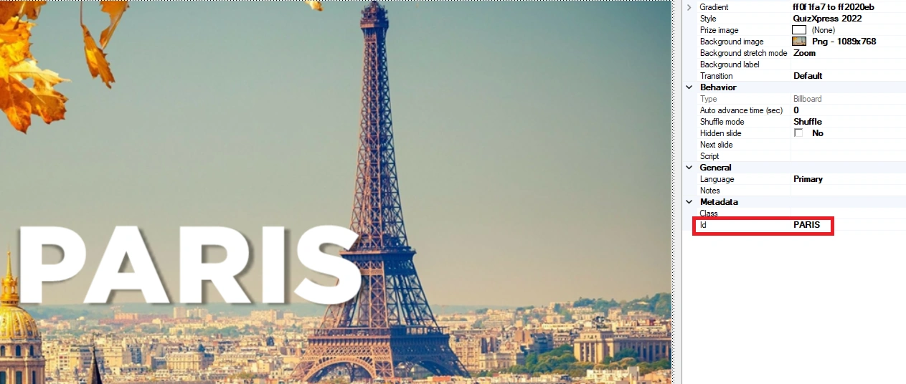
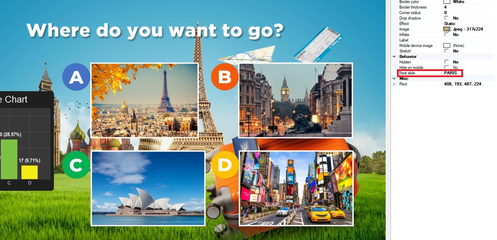
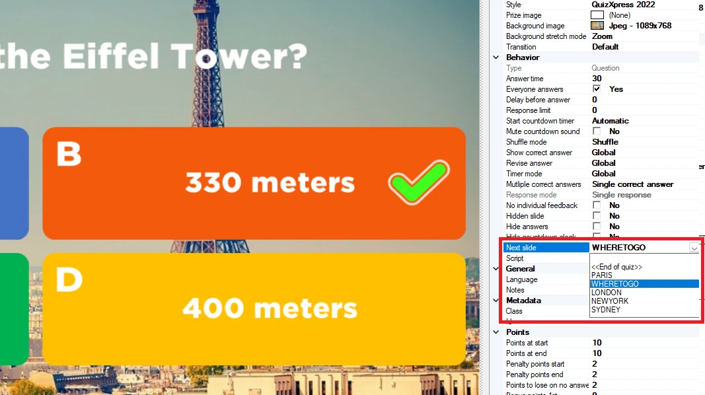
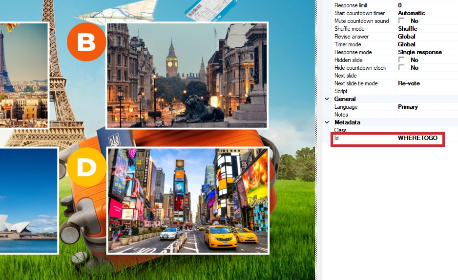

# Dia-routering

Normaal gesproken verloopt een quiz lineair van dia 1 tot het einde. Met dia-routering kunt u verschillende ‘routes’ in uw quizzen definiëren. Routes kunnen statisch zijn (bijvoorbeeld dia 10 wordt altijd gevolgd door dia 20) of dynamisch, op basis van de uitkomst van een stemdia. Met de dynamische optie laat u uw spelers via hun stemmen bepalen waar het vervolgens naartoe gaat, bijvoorbeeld door ze een videoclip of muziekstuk te laten kiezen, of welke vragenronde aan de beurt is.

Een ingebouwde viewer helpt u de dia-volgorde te visualiseren.

U definieert een route door de dia waarnaar u wilt springen een Id te geven in de eigenschappen van de dia. Dit kan een willekeurige maar unieke naam zijn die voor u als quizauteur zinvol is:

{ loading=lazy }

Verwijs vervolgens naar dit Id in de eigenschap ‘Volgende slide’ van het antwoord of de afbeelding op een dia van het type Vraag het publiek/Meerderheid bepaalt:

{ loading=lazy }

Het voorbeeld hierboven toont een dia van het type Vraag het publiek met 4 afbeeldingen. Als optie A (Parijs) de meeste stemmen krijgt, springt het systeem naar de dia met Id ‘Paris’.

Het kan natuurlijk gebeuren dat de stemming gelijk eindigt, doordat twee of meer antwoorden evenveel stemmen hebben. Het gedrag voor die situatie stelt u in via de eigenschappen van de dia (wanneer routering op die dia actief is) met de eigenschap ‘Volgende slide tie-modus’. Er zijn drie opties:

- Opnieuw stemmen, de dia wordt opnieuw geladen en er wordt opnieuw gestemd totdat één antwoord een meerderheid heeft

- Willekeurig, het systeem kiest willekeurig de route van een van de antwoorden met de meeste stemmen

- Vragen, de quizmaster krijgt (op het hoofdscherm) een prompt om een keuze te maken

Elke dia heeft zelf ook een eigenschap ‘Volgende slide’ die bepaalt welke dia het systeem als volgende toont. Als u dit leeg laat, wordt de standaardvolgorde gevolgd (naar de volgende dia in de rij).

Om naar een andere dia te springen dan de standaard ‘volgende in de rij’, vult u de eigenschap ‘Volgende slide’ van de dia zelf in. Een voorbeeld is wanneer u aan het einde van een ronde bent en terug wilt springen naar een dia voor de rondekeuze. Past u dit toe op het vorige voorbeeld, dan kan de laatste dia van de Parijs-ronde terugverwijzen naar de stemdia.

{ width="298" loading=lazy } { width="271" loading=lazy }
