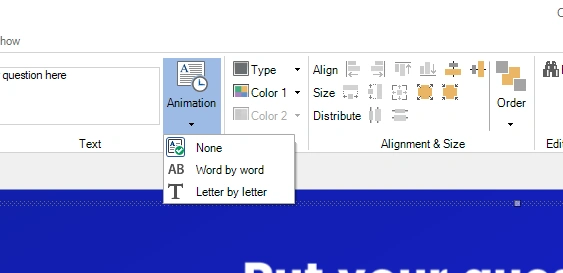
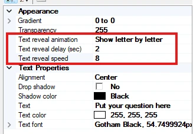

# Animations d'apparition du texte

Pour tous les éléments de question et de réponse, vous pouvez définir la manière dont ils apparaissent à l'écran :

- Show direct/None (par défaut)

- Word by Word

- Letter by Letter

{ width="563" loading=lazy }

Dans les propriétés avancées des textes de question ou de réponse, vous pouvez ajuster l'animation avec les propriétés de délai de démarrage et de vitesse :

{ width="327" loading=lazy }

Vous pouvez utiliser cette fonction si vous souhaitez lire la question à voix haute sans la révéler immédiatement, ou pour mettre les joueurs sur une fausse piste en affichant directement les réponses pendant que la question apparaît progressivement (les joueurs risquent de choisir la mauvaise réponse en faisant des suppositions sur la question).

Si vous voulez prévisualiser l'apparition du texte, appuyez sur F5 pour afficher un aperçu de la diapositive en plein écran.
