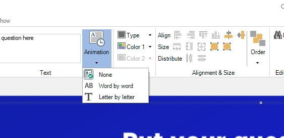
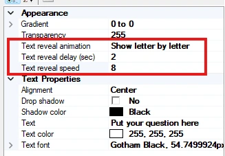

# Animaties voor het onthullen van tekst

Voor alle vraag- en antwoorditems kunt u bepalen hoe ze op het scherm verschijnen:

- Direct tonen/Geen (standaard)

- Woord voor woord

- Letter voor letter

{ width="563" loading=lazy }

In de geavanceerde eigenschappen van de vraag- of antwoordteksten kunt u de animatie bijstellen met de eigenschappen voor startvertraging en snelheid:

{ width="327" loading=lazy }

U kunt deze functie gebruiken als u de vraag hardop wilt voorlezen zonder hem meteen te onthullen, of om spelers op het verkeerde been te zetten door de antwoorden direct te tonen terwijl de vraag zich gaandeweg opbouwt (spelers kunnen het verkeerde antwoord kiezen door aannames te doen over de vraag).

Als u de tekstonthulling wilt bekijken, drukt u op F5 om een voorbeeld van de dia op volledig scherm te tonen.

!!! tip
    Als u de vraag en de antwoorden als geheel wilt laten invliegen, infaden of inspringen, zie dan [Intro-animaties](entrance-animations.md).
