# QuizXpress e l'IA

QuizXpress offre l'accesso a un proprio autore virtuale di quiz basato sull'IA. È possibile generare domande, completare le domande a risposta multipla con opzioni plausibili, creare sondaggi Trivia Feud o generare immagini!

!!! tip
    Si preferisce una conversazione? È anche possibile lasciare che un assistente IA come Claude crei e modifichi il quiz in Quiz Studio al posto proprio: vedere [Assistenti IA](../advanced/ai-assistants/index.md).

## Generatore di quiz IA

Il generatore di quiz IA aiuta a generare vari tipi di domande. È possibile avviarlo facendo clic sul pulsante nella scheda HOME.

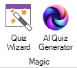{ width="112" loading=lazy }

Dopo aver fatto clic sul pulsante, viene visualizzata la finestra Trivia generator.

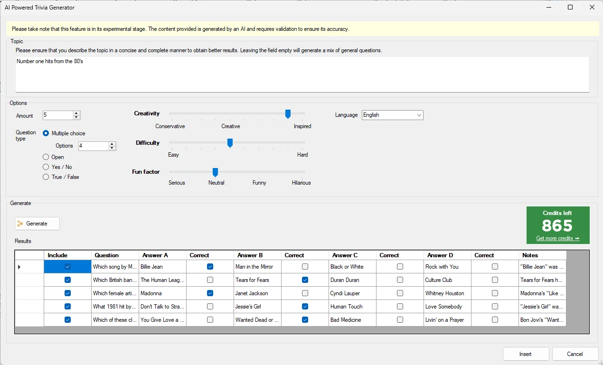{ loading=lazy }

Nel campo Topic, inserire l'argomento desiderato. Essere il più specifici possibile. Ad esempio:

"Domande di musica" produrrà domande di musica molto generiche, e ripetere la stessa richiesta può generare le stesse domande. Provare invece con "Domande di musica sulle prime 10 hit degli anni novanta".

È possibile indicare quali tipi di domande si desidera generare:

- una domanda a risposta multipla – è possibile indicare il numero di risposte

- una domanda aperta

- una domanda Sì/No

- una domanda Vero/Falso

È inoltre possibile regolare i cursori Creativity/Difficulty e Fun Factor che, a seconda dell'argomento, hanno un'influenza maggiore o minore.

Ora premere il pulsante "Generate" e osservare come le domande vengono generate, complete di note dettagliate che il Quizmaster può usare durante la conduzione.

Le domande generate sono presentate in formato elenco insieme alle risposte corrispondenti. Nel caso delle domande a risposta multipla, il sistema di IA genera anche alternative plausibili alla risposta corretta. Questa funzione semplifica il processo di creazione del quiz e garantisce che i contenuti siano coinvolgenti e completi.

## Completamento IA per le domande a risposta multipla

Questa funzione aiuta a creare le opzioni di una domanda a risposta multipla mantenendo il controllo sulla domanda. Per usarla, digitare la domanda come di consueto, fare clic con il pulsante destro del mouse sulla diapositiva e selezionare "Complete with AI" dal menu contestuale. Le opzioni a risposta multipla verranno compilate e la risposta corretta impostata, insieme a note che spiegano la risposta corretta.

Di seguito un esempio:

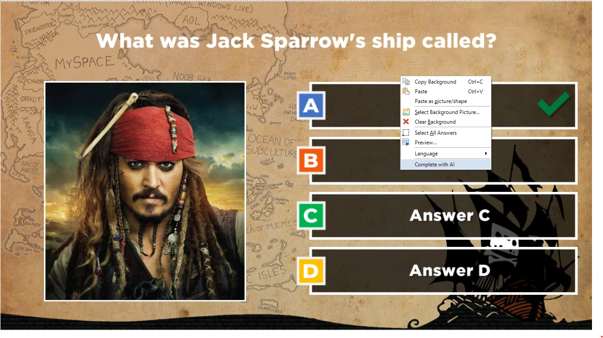{ loading=lazy }

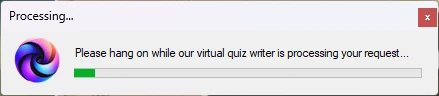{ width="331" loading=lazy }

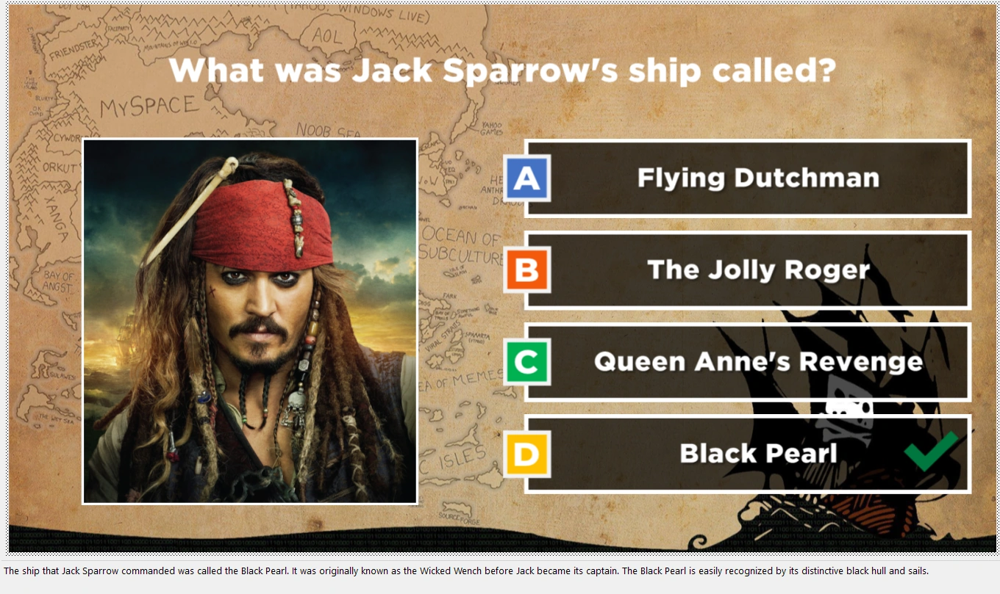{ loading=lazy }

## Generazione di sondaggi Trivia Feud

È possibile usare l'IA anche per generare sondaggi Trivia Feud. Basta inserire la domanda del sondaggio e premere il pulsante "Complete with AI".

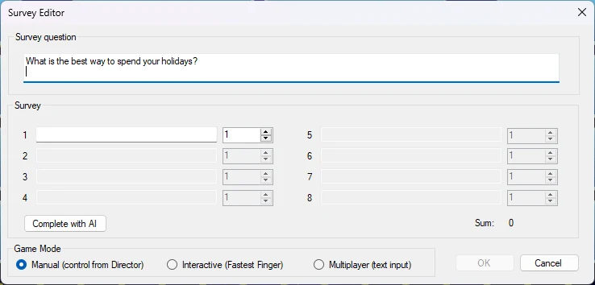{ width="455" loading=lazy }

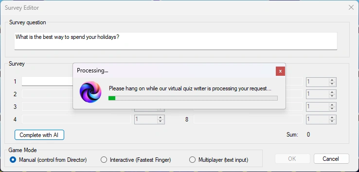{ width="452" loading=lazy }

Le risposte del sondaggio verranno ora generate, con percentuali plausibili.

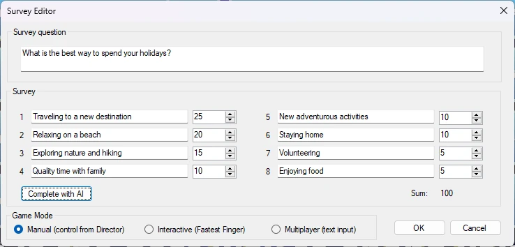{ width="464" loading=lazy }

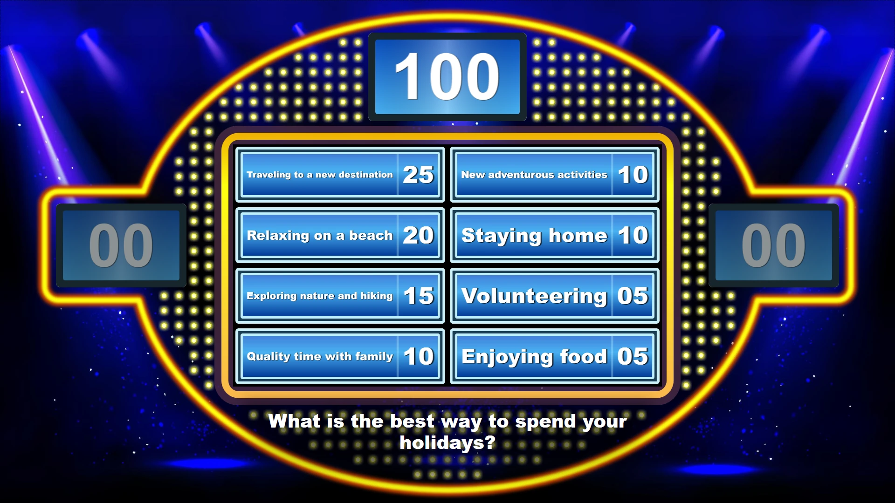{ loading=lazy }

## Generatore di immagini IA

È possibile usare il "QuizXpress AI co-pilot" anche per generare immagini per le diapositive o lo sfondo di una diapositiva.

Ad esempio, generare un'immagine in un segnaposto per immagini: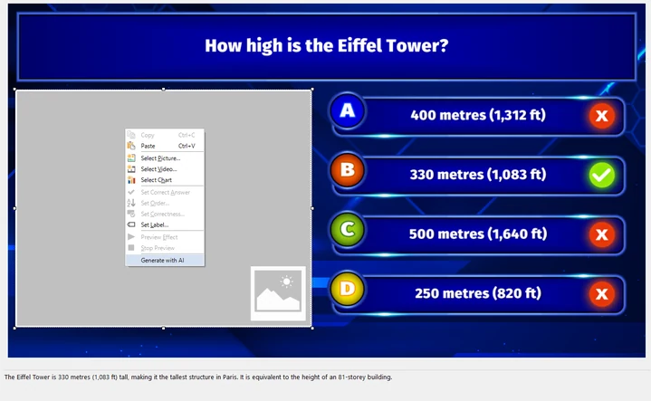{ loading=lazy }

Una descrizione dettagliata e un contesto ricco producono immagini migliori. È anche possibile specificare lo stile desiderato, ad esempio "3D rendering", "abstract art", "comic", ecc.

Nell'esempio seguente vengono generate quattro immagini della Torre Eiffel sotto la neve.

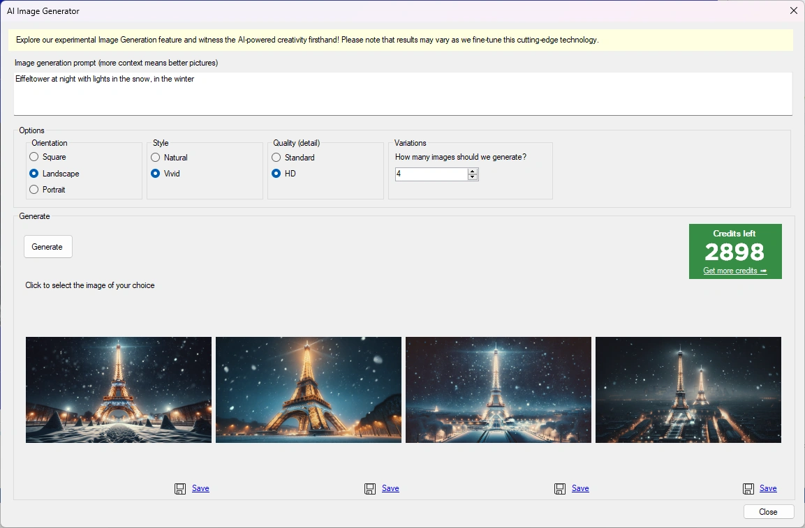{ width="439" loading=lazy }

Scegliere una delle quattro immagini generate e verrà inserita nel segnaposto per immagini.

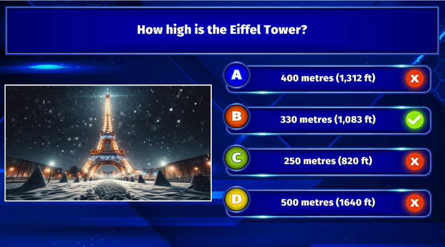{ loading=lazy }

Lo stesso vale per gli sfondi delle diapositive. Fare clic con il pulsante destro del mouse sullo sfondo e scegliere "Generate with AI". L'esempio seguente genera uno sfondo per un round di musica con la descrizione "female quizmaster announcing a music round, pointing towards the audience, with headphones, in front of a stage".

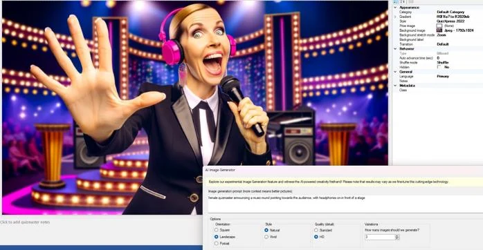{ width="440" loading=lazy }

## Verificare con Google

È possibile fare clic con il pulsante destro del mouse su qualsiasi domanda o risposta ed eseguire immediatamente una ricerca Google online sul testo dell'elemento selezionato. Si apre un browser con i risultati della ricerca, utile per ricontrollare i contenuti generati dall'IA.

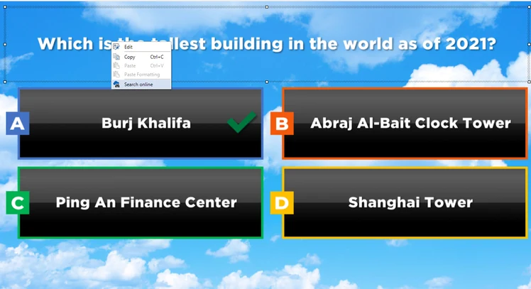{ loading=lazy }

## Crediti

La funzionalità IA è accessibile tramite un sistema di crediti a consumo. È possibile acquistare i crediti (collegati alla propria chiave di licenza) per questa funzione nel nostro negozio online [qui](https://www.quizxpress.com/product/quizxpress-credits/).

## AI roast

Per chi ha voglia di divertirsi, ora è possibile lasciare che l'IA prenda in giro pubblicamente un giocatore dopo una risposta sbagliata durante un quiz. Questa opzione è disponibile in Director (desktop) nella scheda "Players / Teams". Consultare [La vista Teams](../live/quizxpress-director/the-teams-view.md) per ulteriori informazioni.

## Impostazioni generali per l'IA

La funzionalità di completamento IA ha alcune impostazioni che si trovano in HOME->Options:

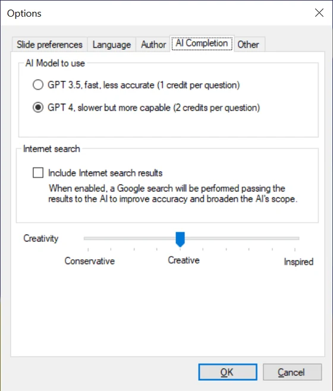{ width="280" loading=lazy }

Poiché l'IA attuale ha una certa data limite di conoscenza, non sa nulla di ciò che è accaduto di recente. Tuttavia, QuizXpress può eseguire una ricerca su Internet sulla domanda data e inviare i risultati all'IA affinché li includa nel proprio ragionamento. È possibile attivare questa funzionalità nel modulo Options.
