# QuizXpress en AI

QuizXpress biedt toegang tot uw eigen virtuele quizschrijver op basis van AI. U kunt vragen genereren, meerkeuzevragen aanvullen met geschikte opties, Trivia Feud-enquêtes maken of afbeeldingen genereren!

!!! tip
    Liever een gesprek? U kunt ook een AI-assistent zoals Claude uw quiz in Quiz Studio laten bouwen en bewerken: zie [AI-assistenten](../advanced/ai-assistants/index.md).

## AI-quizgenerator

De AI-quizgenerator helpt u verschillende soorten vragen te genereren. U start hem door op de knop op het tabblad START te klikken.

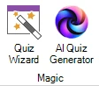{ width="112" loading=lazy }

Na het klikken op de knop verschijnt het venster Trivia-generator.

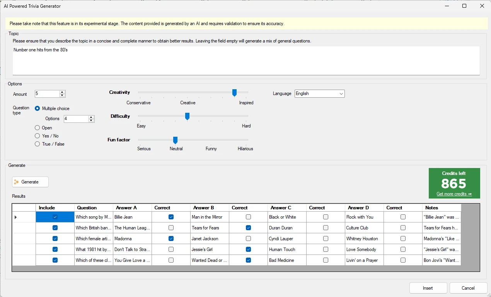{ loading=lazy }

Voer in het veld Onderwerp het gewenste onderwerp in. Wees zo specifiek mogelijk. Bijvoorbeeld:

“Muziekvragen” levert zeer algemene muziekvragen op, en als u dezelfde vraag nogmaals stelt, kunnen dezelfde vragen worden gegenereerd. Probeer in plaats daarvan “Muziekvragen over de top 10-hits uit de jaren negentig”.

U kunt aangeven welke soorten vragen u wilt genereren:

- een meerkeuzevraag – u kunt het aantal antwoorden opgeven

- een open vraag

- een ja/nee-vraag

- een waar/onwaar-vraag

U kunt ook spelen met de schuifregelaars Creativiteit/Niveau en Fun-factor, die afhankelijk van het onderwerp meer of minder invloed hebben.

Druk nu op de knop ‘Genereer’ en zie hoe de vragen voor u worden gegenereerd, compleet met uitgebreide notities die de quizmaster kan gebruiken tijdens het presenteren van de quiz.

De gegenereerde vragen worden in een lijst weergegeven naast de bijbehorende antwoorden. Bij meerkeuzevragen genereert het AI-systeem ook geschikte alternatieven voor het juiste antwoord. Deze functie stroomlijnt het maken van een quiz en zorgt ervoor dat uw content boeiend en compleet is.

## AI-voltooiing voor meerkeuzevragen

Deze functie helpt u meerkeuzeopties te maken terwijl u de controle over de vraag behoudt. Om haar te gebruiken typt u de vraag zoals u gewend bent, klikt u met de rechtermuisknop op de dia en kiest u ‘Aanvullen met AI’ in het contextmenu. De meerkeuzeopties worden ingevuld en het juiste antwoord wordt ingesteld, samen met notities die het juiste antwoord toelichten.

Hieronder ziet u een voorbeeld:

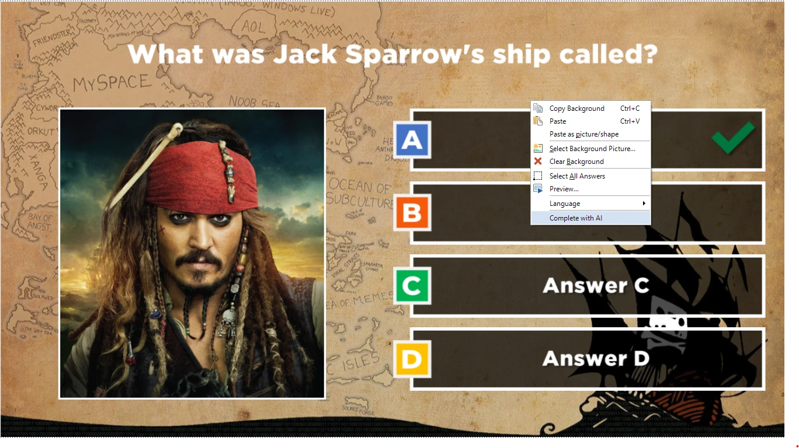{ loading=lazy }

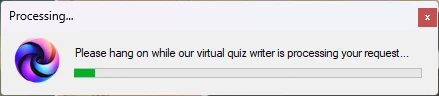{ width="331" loading=lazy }

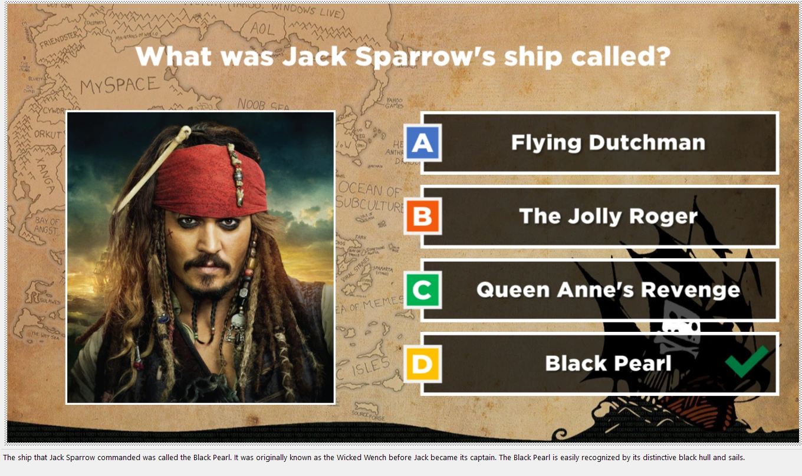{ loading=lazy }

## Trivia Feud-enquêtes genereren

U kunt AI ook gebruiken om Trivia Feud-enquêtes te genereren. Voer gewoon de enquêtevraag in en druk op de knop ‘Aanvullen met AI’.

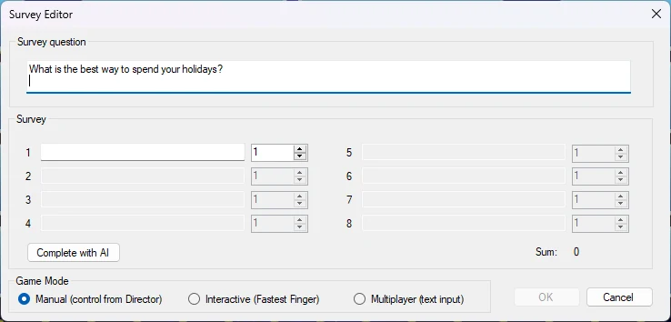{ width="455" loading=lazy }

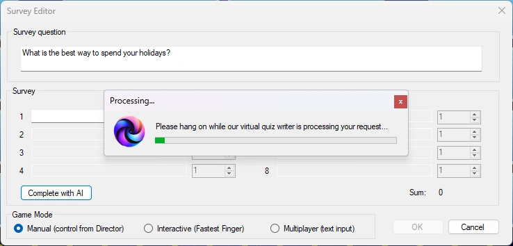{ width="452" loading=lazy }

De enquêteantwoorden worden nu voor u gegenereerd, inclusief geloofwaardige percentages.

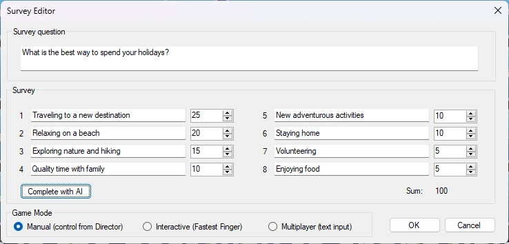{ width="464" loading=lazy }

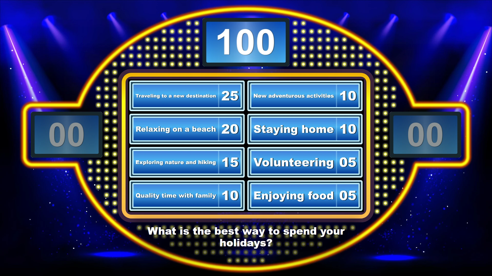{ loading=lazy }

## AI-beeldgenerator

U kunt de ‘QuizXpress AI co-pilot’ ook gebruiken om diabeelden of een diaachtergrond te genereren.

Genereer bijvoorbeeld een afbeelding in een afbeeldingsplaatshouder: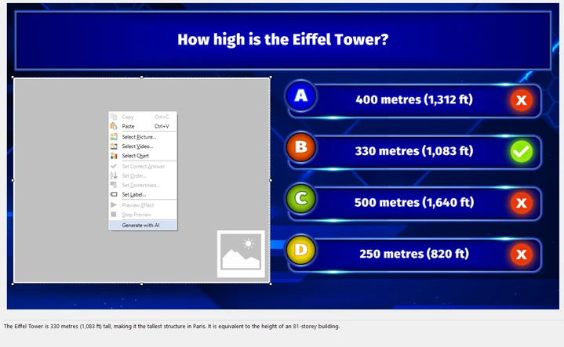{ loading=lazy }

Een gedetailleerde beschrijving en rijke context leveren betere afbeeldingen op. U kunt ook de gewenste stijl opgeven, zoals ‘3D-rendering’, ‘abstracte kunst’, ‘strip’, enzovoort.

In het onderstaande voorbeeld worden vier afbeeldingen van de Eiffeltoren in de sneeuw gegenereerd.

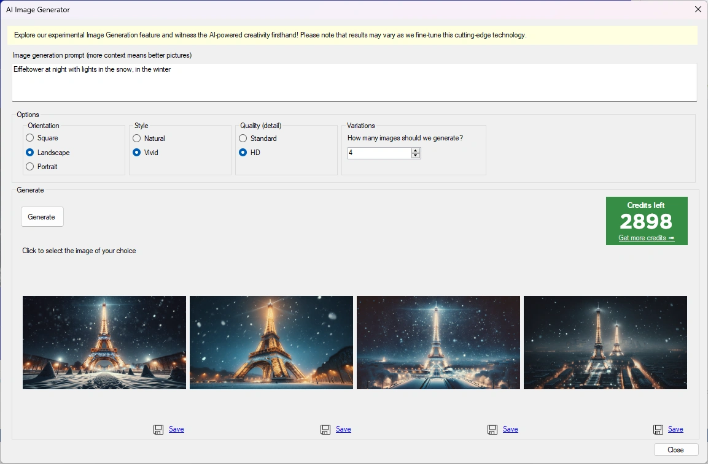{ width="439" loading=lazy }

Kies een van de vier gegenereerde afbeeldingen en die wordt in de afbeeldingsplaatshouder ingevoegd.

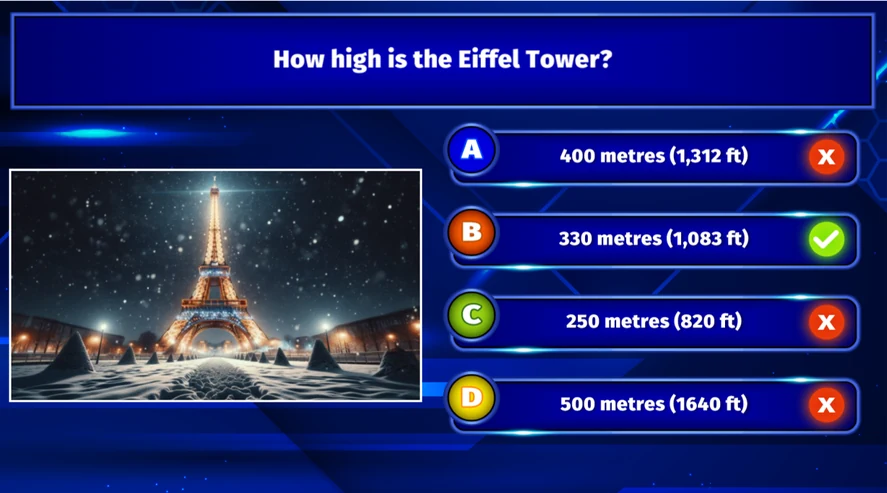{ loading=lazy }

Hetzelfde kunt u doen voor diaachtergronden. Klik met de rechtermuisknop op de achtergrond en kies ‘Genereer met AI’. In het onderstaande voorbeeld wordt een achtergrond voor een muziekronde gegenereerd met de beschrijving ‘vrouwelijke quizmaster kondigt een muziekronde aan, wijst naar het publiek, met koptelefoon, voor een podium’.

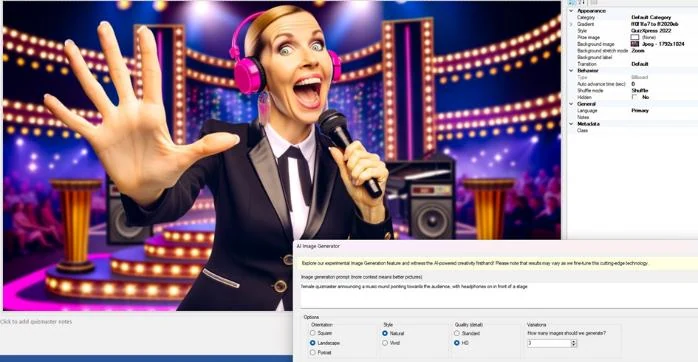{ width="440" loading=lazy }

## Valideren met Google

U kunt met de rechtermuisknop op elke vraag of elk antwoord klikken en direct online met Google zoeken op de tekst in het geselecteerde item. Er opent een browser met de zoekresultaten, zodat u de door AI gegenereerde content kunt dubbelchecken.

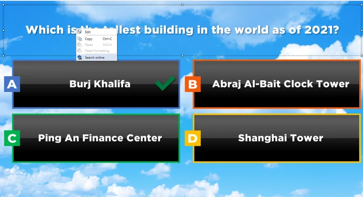{ loading=lazy }

## Credits

De AI-functionaliteit is toegankelijk via een credits-systeem waarbij u per gebruik betaalt. U kunt credits (gekoppeld aan uw licentiesleutel) voor deze functie aanschaffen in onze online shop [hier](https://www.quizxpress.com/product/quizxpress-credits/).

## AI-roast

Als u zin hebt in wat plezier, kunt u nu AI een speler publiekelijk laten roasten nadat die tijdens een quiz een fout antwoord heeft gegeven. Deze optie is beschikbaar in Director (desktop) op het tabblad ‘Spelers / Teams’. Zie [De weergave Teams](../live/quizxpress-director/the-teams-view.md) voor meer informatie.

## Algemene instellingen voor AI

De AI-voltooiingsfunctionaliteit heeft enkele instellingen die u kunt vinden in START->Opties:

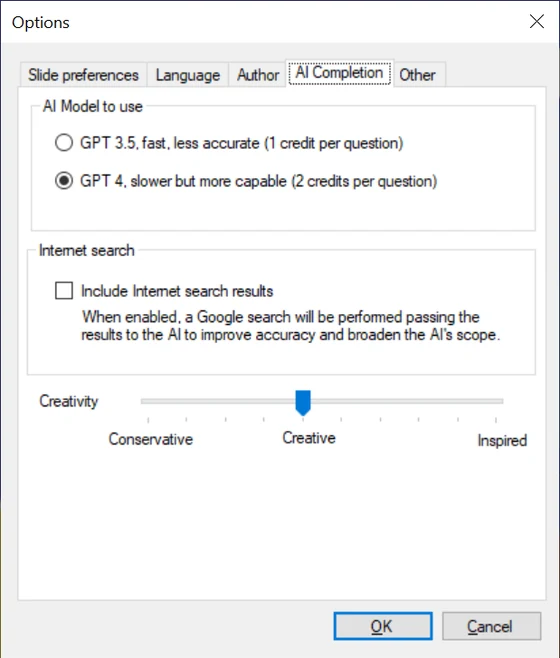{ width="280" loading=lazy }

Omdat de huidige AI een bepaalde kennisgrens heeft, weet ze niets van recente gebeurtenissen. QuizXpress kan echter een zoekopdracht op internet uitvoeren op de gegeven vraag en de resultaten naar de AI sturen, zodat ze die kan meenemen in haar redenering. U kunt deze functionaliteit inschakelen in het formulier Opties.
