# Bingo round

Questo tipo di diapositiva avvia una normale partita di Number Bingo, Emoji Bingo, Music Bingo o Trivia Bingo. Questo tipo di gioco può attualmente essere giocato solo quando il pubblico utilizza l'app Smart Buzzer per dispositivi mobili.

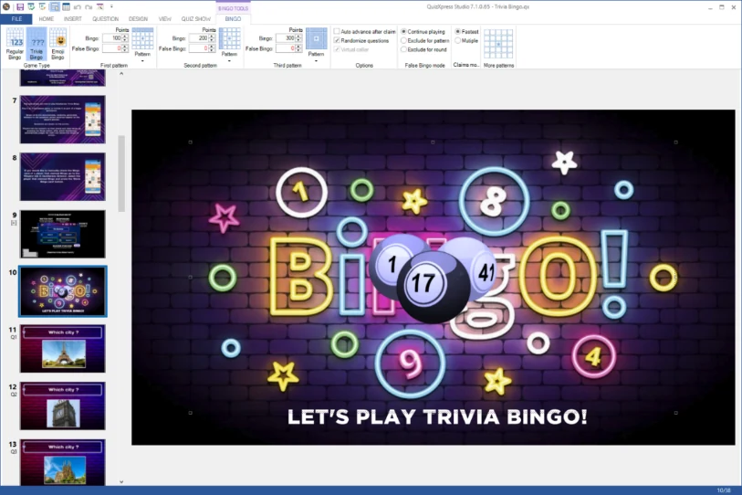{ width="518" loading=lazy }

Selezionando l'elemento delle palline del Bingo nella diapositiva, nella barra multifunzione compare la scheda contestuale Bingo, dove è possibile configurare i vari aspetti del nuovo gioco del bingo come descritto nella sezione [Proprietà del Bingo](../user-interface-overview/advanced-properties-grid.md#proprieta-del-bingo).

QuizXpress supporta i seguenti giochi di Bingo:

| 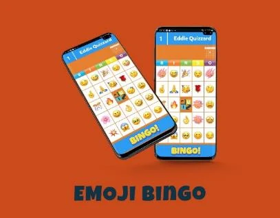{ width="257" loading=lazy } | 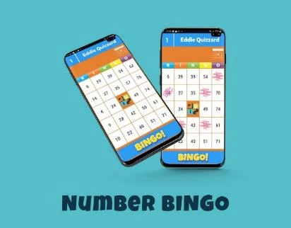{ width="259" loading=lazy } |
|------------------------------------------------------------------------------------------------------------------------------------------------------------------------|------------------------------------------------------------------------------------------------------------------------------------------------------------------------|
| 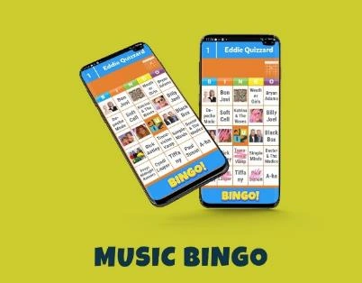{ width="257" loading=lazy }                                                                                       | 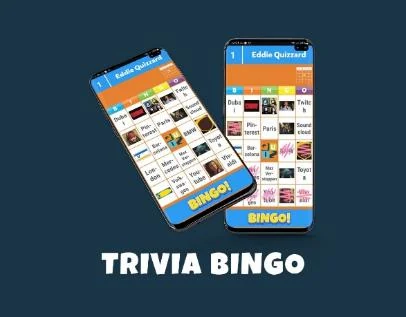{ width="259" loading=lazy }                                                                                       |

## Creare un gioco di Bingo

È possibile creare un nuovo round di bingo usando il Quiz Wizard oppure inserendo manualmente una diapositiva di bingo dal selettore Quiz Slides nella scheda INSERT della barra multifunzione.

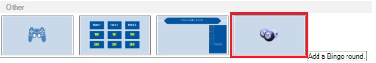{ width="604" loading=lazy }

Per un tradizionale gioco di Number Bingo o Emoji Bingo è sufficiente creare quella singola diapositiva. Basta fare clic sulle palline del Bingo e poi selezionare "Regular Bingo" o "Emoji Bingo".

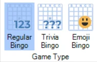{ width="190" loading=lazy }

Per un round di Trivia Bingo, invece, occorre creare anche le domande la cui risposta (che può essere un testo o un'immagine) comparirà nelle celle della cartella del bingo. Le domande devono essere inserite dopo la diapositiva Bingo e il round deve essere concluso con una diapositiva di *fine round*. Poiché ogni cartella ha 24 celle da riempire, servono almeno 24 domande. Creare più domande renderà le cartelle più casuali. Ad esempio, se si hanno solo 24 domande, ogni cartella avrà "Coverall" all'ultima domanda e tutti faranno Bingo. Se si creano più domande, come nel bingo normale, non tutte le risposte saranno presenti sulle cartelle.

I tipi di domande supportati in un round di Trivia Bingo sono le domande numeriche, di testo, a lettera e le domande aperte con una sola immagine (che produrrà una cella di bingo con immagine).

Per creare celle di testo sulla cartella del bingo, usare il modello di diapositiva "open question":

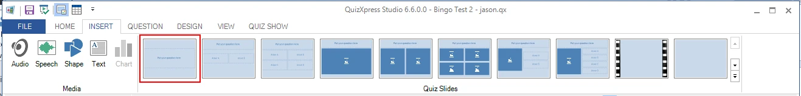{ loading=lazy }

E impostare l'Input mode su Number, Letter o Text:

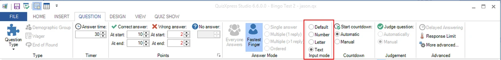{ loading=lazy }

Si otterrà una cella di bingo con la risposta corretta impostata per la domanda. Usare "Number" o "Text" non fa molta differenza, ma con il tipo "Letter" sulla cartella del bingo comparirà solo la prima lettera.

Per creare una cella della cartella del bingo con un'*immagine*, scegliere il layout seguente:

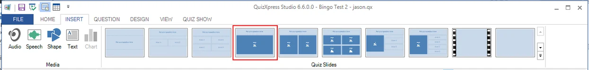{ loading=lazy }

Selezionare l'elemento immagine e spuntare l'opzione "Hidden" nella sezione "Adjust" della barra multifunzione.

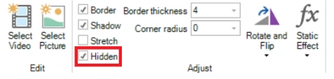{ width="298" loading=lazy }

In questo modo l'immagine resterà nascosta durante la presentazione del quiz al pubblico e comparirà sulla cartella del Bingo come cella immagine (è possibile scegliere di mostrare l'immagine anche sul grande schermo durante un quiz, ma in tal caso la risposta sarà molto facile da trovare sulla cartella del Bingo!).

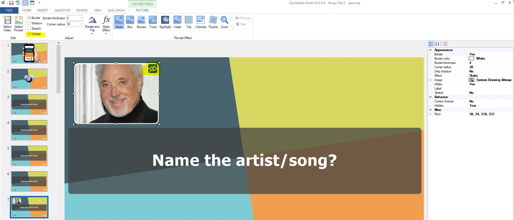{ loading=lazy }

Il Quiz Wizard aiuta anche a creare rapidamente un round di Trivia Bingo o Music Bingo. Basta avviare il Quiz Wizard (scheda HOME, pulsante Quiz Wizard) e premere "create a new round" seguito da "a Bingo round". È quindi possibile scegliere tra i quattro tipi di Bingo e indicare le proprie preferenze.

Quando si è terminata la creazione delle domande, è possibile visualizzare l'anteprima di una cartella (casuale) facendo clic con il pulsante destro del mouse sulla diapositiva del bingo e selezionando Preview (oppure premendo F5).

Di seguito un esempio di anteprima di una cartella di Trivia Bingo:

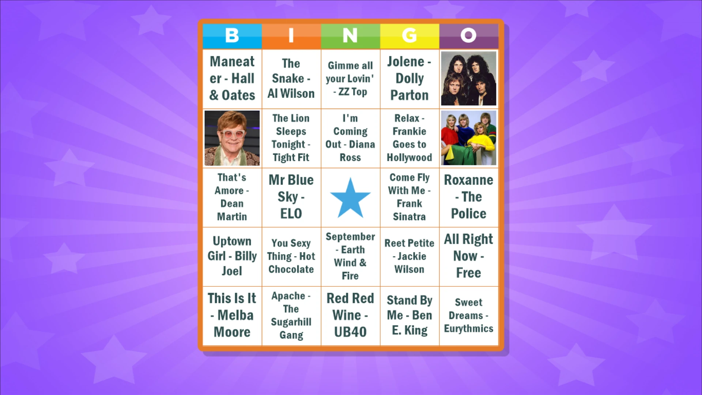{ loading=lazy }

Durante l'esecuzione del quiz, non appena viene presentata la diapositiva Bingo, il sistema crea un insieme di cartelle casuali e le distribuisce automaticamente ai giocatori.

Per il Trivia Bingo è disponibile un'opzione (nella scheda BINGO della barra multifunzione) per rendere casuale l'ordine delle diapositive del round di Bingo, in modo che compaiano in un ordine diverso ogni volta che si gioca il quiz:

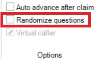{ width="158" loading=lazy }

È possibile personalizzare l'immagine mostrata al centro delle cartelle del Bingo nell'app mobile e usare un'immagine propria. A tale scopo, selezionare l'elemento Bingo nella diapositiva Bingo, aprire il riquadro delle proprietà avanzate (scheda VIEW, spuntare "Properties"), fare clic sulla proprietà "Center image" e quindi sul pulsante con i tre puntini per selezionare un file immagine:

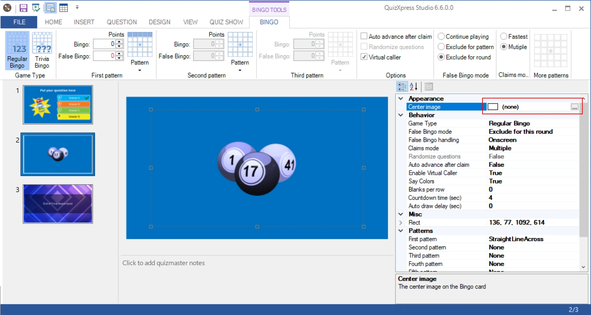{ loading=lazy }

Usare la propria immagine centrale per promuovere il proprio marchio tra i giocatori!

### Schemi di Bingo supportati

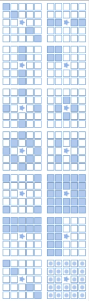{ width="146" loading=lazy }

È possibile definire fino a cinque schemi successivi che portano al Bingo. Si possono selezionare tre schemi facendo clic sui pulsanti "Pattern" nelle sezioni First pattern, Second pattern e Third pattern della scheda BINGO nella barra multifunzione. Per definire un quarto e un quinto schema, è possibile farlo nel riquadro Properties.

La selezione può avvenire tra 13 schemi predefiniti. È inoltre possibile definire schemi personalizzati.

All'apertura degli schemi, per quelli applicabili viene mostrata un'animazione (ad esempio, lo schema della linea orizzontale è valido per ogni linea orizzontale).

Durante una partita di Bingo, sia nel lettore dei quiz sia sul telefono cellulare viene mostrata un'animazione con lo schema corrente che dà Bingo.

Con la versione 7.1 è possibile creare propri schemi di bingo. Per farlo, scegliere lo schema personalizzato dalla barra multifunzione (ultima voce del selettore degli schemi), dopodiché compare l'editor degli schemi:

| 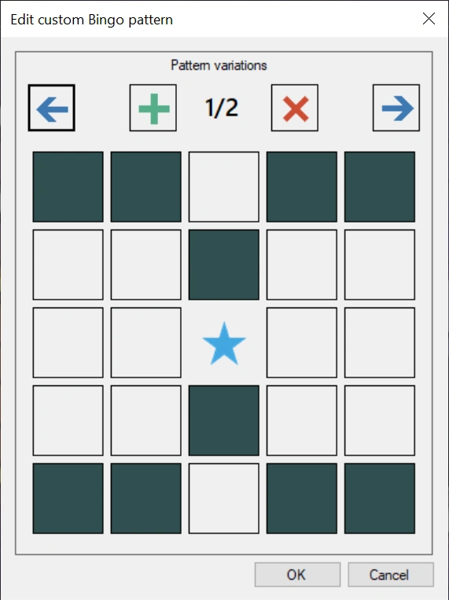{ width="203" loading=lazy } | 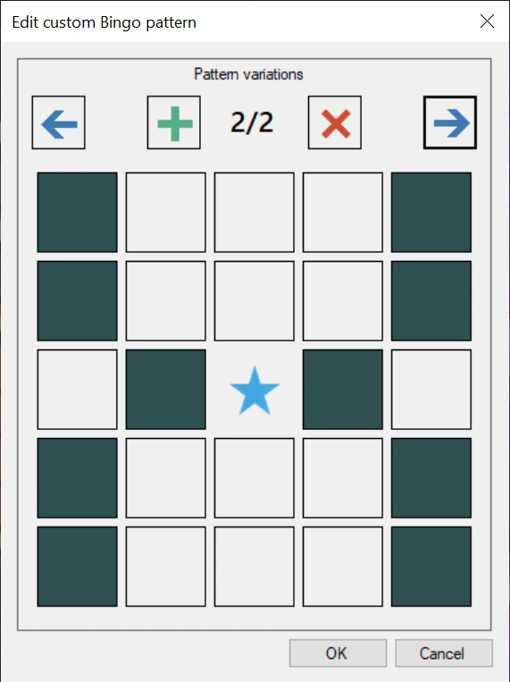{ width="205" loading=lazy } |
|---------------------------------------------------------------------------------|---------------------------------------------------------------------------------|
| Variante di schema 1                                                            | Variante di schema 2                                                            |

Lo schema si crea facendo clic sulle celle. Uno schema può avere più varianti che danno tutte un bingo valido (in modo analogo, ad esempio, a un Bingo con linea orizzontale, dove ogni linea orizzontale dà un Bingo). Nel lettore dei quiz e nell'app mobile le varianti vengono mostrate ai giocatori in un'animazione.

### Celle vuote per riga

Per attivare le celle vuote, aprire la vista delle proprietà in Studio (VIEW->Properties sulla barra multifunzione), selezionare la diapositiva Bingo e individuare la proprietà denominata Blanks per row:

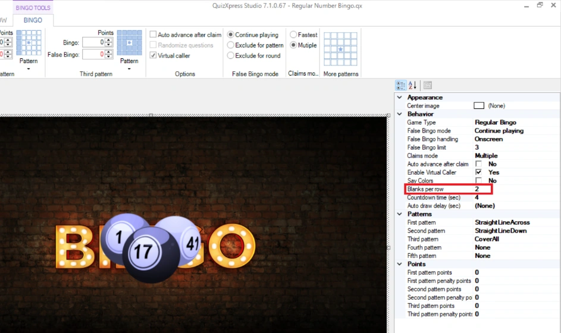{ width="605" loading=lazy }

Questo valore indica il numero di celle vuote per riga sulla cartella. Può essere un valore compreso tra 0 e 4. Specificando un valore di 2, la cartella del Bingo sul dispositivo mobile avrà questo aspetto:

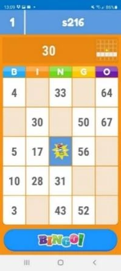{ width="128" loading=lazy }

Le celle vuote fungono da jolly nella valutazione di una dichiarazione di Bingo. Quindi, nella cartella di esempio a sinistra, segnando soltanto 30, 50 e 67 il giocatore potrebbe dichiarare un Bingo per una linea orizzontale. Quando si gioca con le celle vuote, occorre considerare quali schemi giocare. Ad esempio, giocare per una linea verticale potrebbe non essere una buona idea, poiché potrebbero esserci colonne con una sola cella da segnare. Inoltre, schemi più complessi, come una forma a rombo, potrebbero non essere mai raggiungibili con determinate cartelle.

### Opzioni avanzate

*Auto advance after claim* – quando questa opzione è attiva, il gioco prosegue automaticamente dopo una dichiarazione di Bingo. Quando non è attiva, il gioco attende che il Quizmaster proceda.

*Virtual caller* – quando è attiva, i numeri estratti vengono pronunciati dal computer (dal sintetizzatore vocale predefinito di Windows).

**Usare una voce personalizzata per il chiamatore del Bingo**

Quando si attiva l'opzione Virtual Caller, per impostazione predefinita per pronunciare i numeri viene usato il sintetizzatore vocale di Windows. È tuttavia possibile creare propri file vocali, ad esempio con l'aiuto di una celebrità locale. A tale scopo, creare nella cartella dei dati dell'applicazione QuizXpress (in Esplora risorse di Windows, digitare *%appdata%\quizxpress* nella barra di navigazione) una sottocartella denominata "bingo". In questa cartella, creare i file mp3 per ogni numero da pronunciare (ad es. 1.mp3, 2.mp3, 3.mp3, ecc.) e, facoltativamente, un file denominato "welcome.mp3" che verrà riprodotto all'avvio del gioco del Bingo. Il sistema riprodurrà questi file a ogni estrazione di una nuova pallina.

### Modalità False Bingo

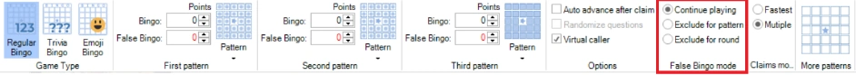{ width="604" loading=lazy }

È possibile indicare cosa deve accadere quando viene effettuata una dichiarazione di Bingo falsa. Le opzioni sono:

- Continue playing – il giocatore che ha effettuato una dichiarazione falsa può dichiarare un altro bingo per lo stesso schema.

- Exclude for patterns – il giocatore che ha effettuato una dichiarazione falsa non può più dichiarare bingo per lo stesso schema. Il giocatore deve attendere che qualcun altro faccia un bingo valido e che il sistema passi allo schema successivo.

- Exclude for round – il giocatore che ha effettuato una dichiarazione falsa non può più dichiarare bingo per il resto del round (che può essere l'intera partita se c'è un solo round di Bingo).

Nel riquadro delle proprietà sono disponibili due ulteriori impostazioni per le dichiarazioni di Bingo false:

False Bingo limit – imposta un limite al numero di dichiarazioni di Bingo false per giocatore. Raggiunto il limite, il giocatore viene escluso dal gioco.

False Bingo handling – determina come vengono gestite le dichiarazioni di Bingo false, On-Screen o Silent. In modalità silenziosa, nel lettore dei quiz vengono mostrate solo le dichiarazioni di Bingo che risulteranno in un Bingo valido.

### Gestione delle dichiarazioni

Esistono due opzioni per gestire una dichiarazione di Bingo:

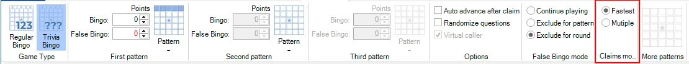{ width="605" loading=lazy }

Fastest: viene gestito solo il primo giocatore che dichiara un Bingo; le altre persone che premono Bingo a loro volta vengono bloccate. Quando il Bingo è valido, viene giocato lo schema successivo. Ora tutti i giocatori giocano per il nuovo schema.

Multiple: vengono gestite tutte le dichiarazioni effettuate nei pochi secondi successivi alla dichiarazione del primo giocatore. Se c'è stata una dichiarazione di Bingo valida, lo schema passa a quello successivo dopo la gestione di tutte le dichiarazioni.

### Vincoli al salvataggio di un quiz

Esistono alcuni vincoli nella creazione di un round di Bingo. Ad esempio, è importante che non ci siano celle duplicate sulla cartella. Il sistema dispone di un controllo delle regole integrato che verifica il quiz prima del salvataggio:

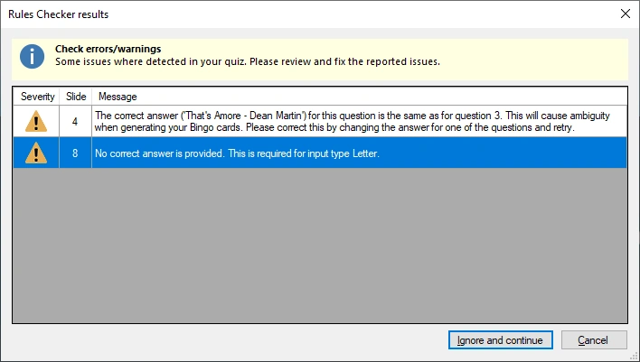{ width="475" loading=lazy }

Lo fa automaticamente per le domande di testo. Per le celle con immagine bisogna controllare personalmente; assicurarsi di non includere due domande con la stessa immagine.

## Giocare una partita di Bingo

Il lettore dei quiz si occupa di registrare le cartelle del Bingo di tutti i giocatori e di ascoltare le dichiarazioni di Bingo provenienti dai giocatori. Di seguito sono riportati esempi dei diversi giochi di Bingo.

### Tipi di giochi di Bingo

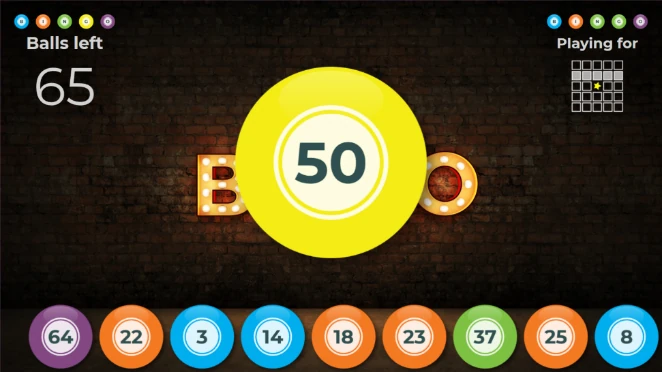{ width="424" loading=lazy }**Number Bingo**

Lo schermo mostra le ultime 9 palline estratte con il loro colore (che indica la sezione della cartella del Bingo) e l'ultima pallina estratta. Mostra quante palline restano da estrarre e lo schema corrente che porta al Bingo.

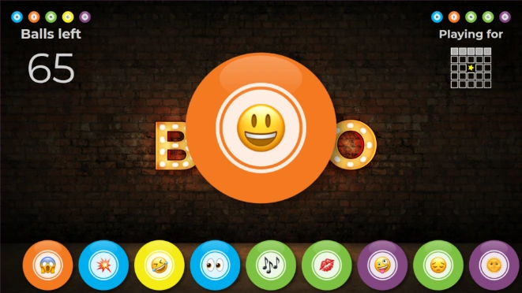{ width="423" loading=lazy }**Emoji Bingo**

L'Emoji Bingo è sostanzialmente uguale al Number Bingo, solo che al posto di 75 numeri vengono usate le 75 emoji più comunemente utilizzate.

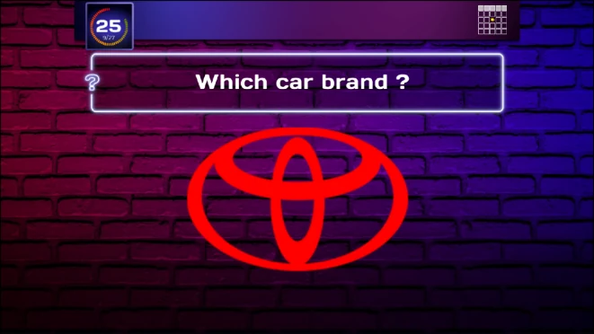{ width="422" loading=lazy }**Trivia Bingo**

Quando si gioca a Trivia Bingo, le domande vengono mostrate sul grande schermo insieme allo schema corrente e al conto alla rovescia. La risposta, che sia un testo o un'immagine, deve essere trovata sulla cartella (se le domande sono più dei numeri sulla cartella, può darsi che la risposta \*non\* sia su una cartella).

**Music Bingo**

Il Music Bingo (o anche Video Bingo) è sostanzialmente uguale al Trivia Bingo. Sullo schermo vengono mostrate domande con frammenti musicali e le risposte (testi o immagini) sono sulla cartella del Bingo.

Il Quiz Wizard include un supporto specifico per il Music Bingo. Consente di selezionare una cartella con file mp3, a partire dalla quale il round di Bingo viene costruito automaticamente.

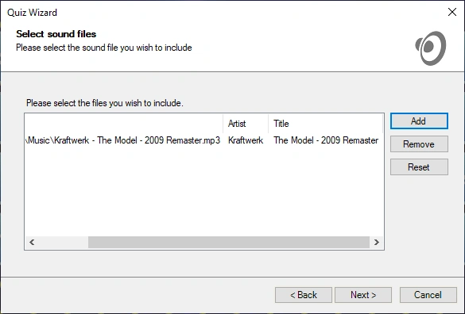{ width="585" loading=lazy }

### Dichiarare il Bingo

Quando un giocatore ha segnato abbastanza celle da completare uno schema, effettua la dichiarazione premendo il pulsante Bingo nell'app mobile. Il nome del giocatore compare così sullo schermo, con un conto alla rovescia di 3 secondi mentre il sistema convalida la dichiarazione. Non è necessario alcun controllo manuale.

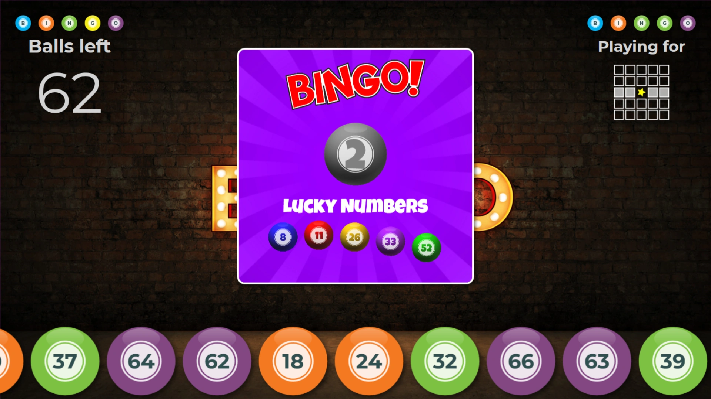{ loading=lazy }

Dopo la convalida, sul grande schermo e sul dispositivo mobile viene mostrato un pollice in su o un pollice in giù.

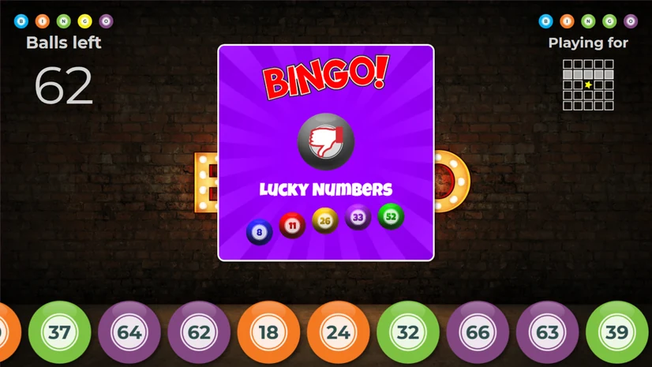{ loading=lazy } 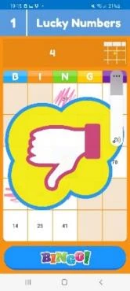{ width="103" loading=lazy }

In caso di Bingo valido, il giocatore vince punti (se configurati) e il sistema passa allo schema successivo.

Quando non ci sono altri schemi da giocare, il round termina e il quiz prosegue dalla diapositiva di fine round (quando c'è un solo round e nessuna diapositiva di fine round, il quiz mostra la schermata finale dei punteggi).

La gestione di più dichiarazioni si presenta così:

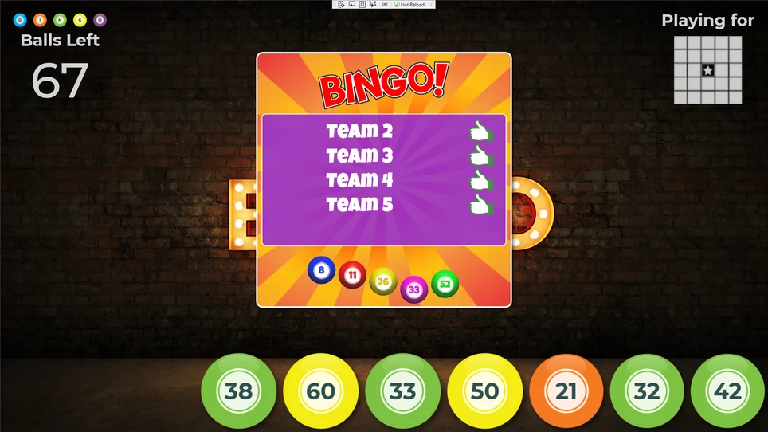{ loading=lazy }

Quando un giocatore si disconnette dal quiz o perde la connessione alla sessione, la cartella del Bingo e le celle segnate non vanno perse. Quando rientra nella partita, la cartella verrà presentata com'era al momento della disconnessione. Inoltre, se il lettore dei quiz dovesse bloccarsi, è possibile riavviare il quiz, ripristinare l'istantanea salvata e proseguire il round di Bingo.

### Vista in tempo reale delle cartelle

In QuizXpress Director, nella scheda "Teams", è presente un'opzione per visualizzare la cartella del Bingo attuale del giocatore selezionato. La cartella mostra anche quali celle sono già state giocate, contrassegnate in verde.

Per mostrare la cartella di un giocatore, selezionare il giocatore e premere il pulsante "Show bingo card". In caso di contestazione, è quindi sempre possibile ricontrollare.

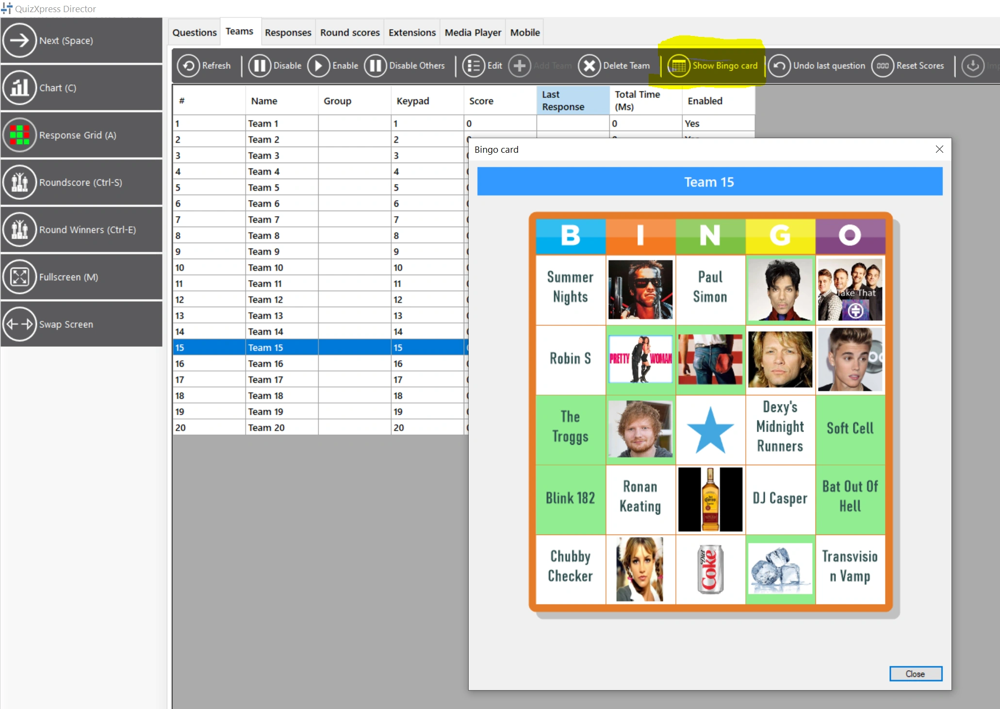{ loading=lazy }

### Modificare gli schemi di Bingo durante una sessione di Bingo

In QuizXpress Director è ora possibile modificare gli schemi di un round di Bingo, insieme ad alcune altre impostazioni del Bingo, durante un quiz (prima dell'avvio del round). A tale scopo, fare doppio clic sulla diapositiva Bingo nella scheda Questions per aprire le impostazioni di un round di Bingo.

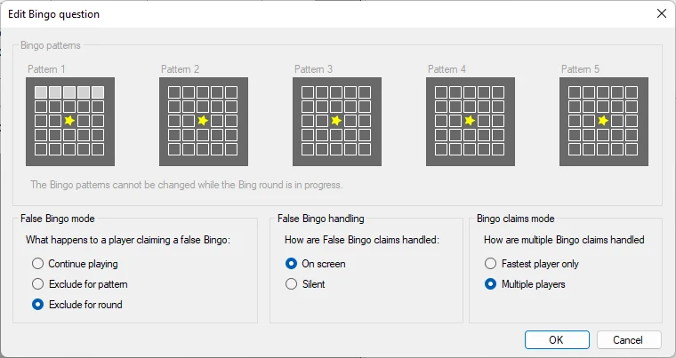{ width="605" loading=lazy }
