# Bingoronde

Met dit diatype start u een gewone Nummerbingo, Emoji Bingo, Muziekbingo of Triviabingo. Dit soort spel kan momenteel alleen worden gespeeld wanneer het publiek de Smart Buzzer-app voor mobiele apparaten gebruikt.

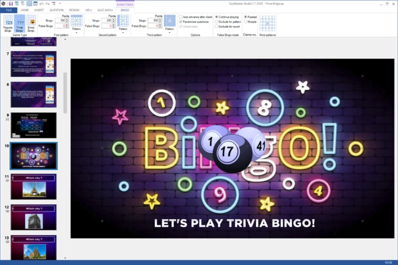{ width="518" loading=lazy }

Door het element met de Bingoballen op de dia te selecteren, verschijnt het contextuele tabblad Bingo in het lint en kunt u de verschillende aspecten van uw nieuwe bingospel configureren, zoals beschreven in de sectie [Bingo-eigenschappen](../user-interface-overview/advanced-properties-grid.md#bingo-eigenschappen).

QuizXpress ondersteunt de volgende Bingospellen:

| 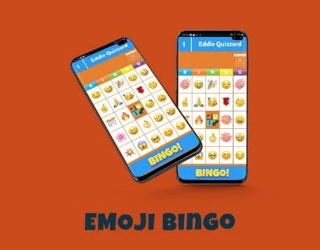{ width="257" loading=lazy } | 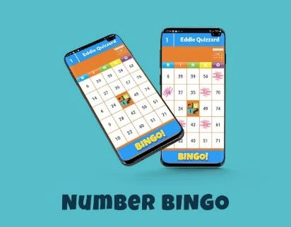{ width="259" loading=lazy } |
|------------------------------------------------------------------------------------------------------------------------------------------------------------------------|------------------------------------------------------------------------------------------------------------------------------------------------------------------------|
| 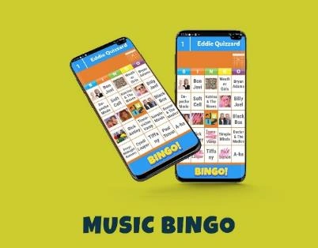{ width="257" loading=lazy }                                                                                       | 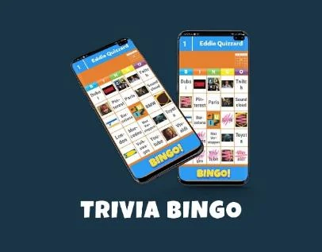{ width="259" loading=lazy }                                                                                       |

## Een Bingospel maken

U kunt een nieuwe bingoronde maken met de Quiz Wizard, of handmatig een bingodia invoegen vanuit de keuzelijst Quiz Vragen op het tabblad INVOEGEN van het lint.

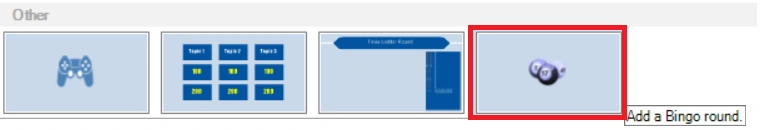{ width="604" loading=lazy }

Voor een traditioneel Nummerbingo- of Emoji Bingo-spel hoeft u alleen die ene dia te maken. Klik gewoon op de Bingoballen en selecteer vervolgens ‘Nummer Bingo’ of ‘Emoji Bingo’.

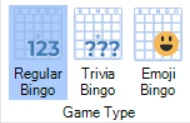{ width="190" loading=lazy }

Voor een ronde Triviabingo moet u echter ook de vragen maken waarvan het antwoord (een tekst of een afbeelding) in de cellen van de bingokaart verschijnt. De vragen moeten na de Bingodia worden ingevoegd en u moet de ronde afsluiten met een dia *einde ronde*. Omdat elke kaart 24 cellen heeft die gevuld moeten worden, hebt u minstens 24 vragen nodig. Meer vragen maken zorgt voor meer willekeur in de kaarten. Als u bijvoorbeeld maar 24 vragen hebt, heeft elke kaart bij de laatste vraag ‘Coverall’ en heeft iedereen Bingo. Als u meer vragen maakt, staan, net als bij gewone Bingo, niet alle antwoorden op de kaarten.

De vraagtypen die in een ronde Triviabingo worden ondersteund, zijn getal-, tekst-, letter- en open vragen met één afbeelding (dit levert een afbeeldingscel op de bingokaart op).

Om tekstcellen op uw bingokaart te maken, gebruikt u het dia-sjabloon ‘open vraag’:

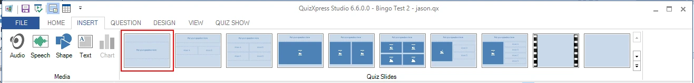{ loading=lazy }

Stel de Invoermodus in op Nummer, Letter of Tekst:

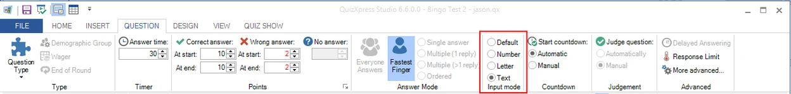{ loading=lazy }

Dit levert een bingocel op met het juiste antwoord zoals dat voor de vraag is ingesteld. Het maakt niet veel uit of u ‘Nummer’ of ‘Tekst’ gebruikt, maar bij het type ‘Letter’ verschijnt alleen de eerste letter op de bingokaart.

Om een *afbeeldings*cel op de bingokaart te maken, kiest u de volgende indeling:

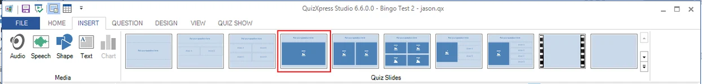{ loading=lazy }

Selecteer het afbeeldingselement en vink de optie ‘Verborgen’ aan in de sectie ‘Aanpassen’ van het lint.

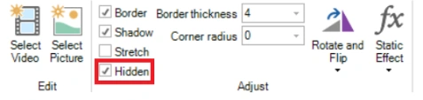{ width="298" loading=lazy }

Hierdoor is de afbeelding verborgen wanneer u de quiz aan het publiek presenteert en verschijnt hij als afbeeldingscel op de Bingokaart (u kunt ervoor kiezen de afbeelding tijdens een quiz ook op het grote scherm te tonen, maar dan is het antwoord heel makkelijk te vinden op de Bingokaart!).

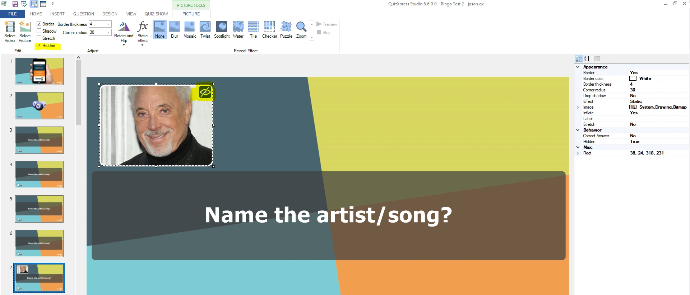{ loading=lazy }

De Quiz Wizard helpt ook bij het snel maken van een ronde Trivia- of Muziekbingo. Start de Quiz Wizard (tabblad START, knop Quiz Wizard) en druk op ‘een nieuwe ronde maken’ gevolgd door ‘een Bingoronde’. U kunt nu kiezen uit de vier soorten Bingo en uw voorkeuren opgeven.

Wanneer u klaar bent met het maken van uw vragen, kunt u een (willekeurige) kaart bekijken door met de rechtermuisknop op de bingodia te klikken en Voorbeeld te selecteren (of op F5 te drukken).

Hieronder ziet u een voorbeeld van een voorbeeldweergave van een Triviabingo-kaart:

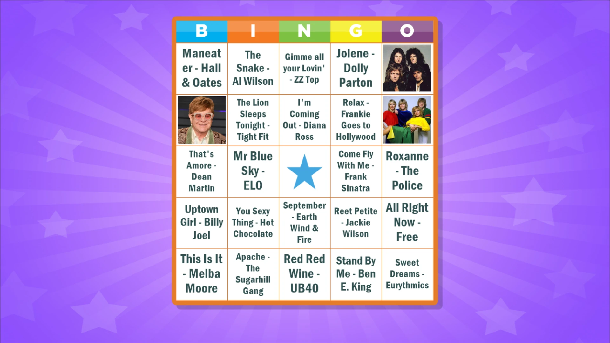{ loading=lazy }

Wanneer u uw quiz uitvoert, maakt het systeem zodra uw Bingodia wordt getoond een reeks willekeurige kaarten en deelt het die automatisch onder uw spelers uit.

Bij Triviabingo is er een optie (op het tabblad BINGO van het lint) om de dia’s in de Bingoronde in willekeurige volgorde te zetten, zodat ze elke keer dat u de quiz speelt in een andere volgorde verschijnen:

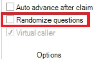{ width="158" loading=lazy }

U kunt de afbeelding die in het midden van de Bingokaarten in de mobiele app wordt getoond aanpassen en uw eigen afbeelding gebruiken. Selecteer hiervoor het Bingo-element op de Bingodia, open het venster met geavanceerde eigenschappen (tabblad BEELD, vink ‘Eigenschappen’ aan), klik op de eigenschap ‘Middenafbeelding’ en klik op de eigenschap met de drie puntjes om een afbeeldingsbestand te selecteren:

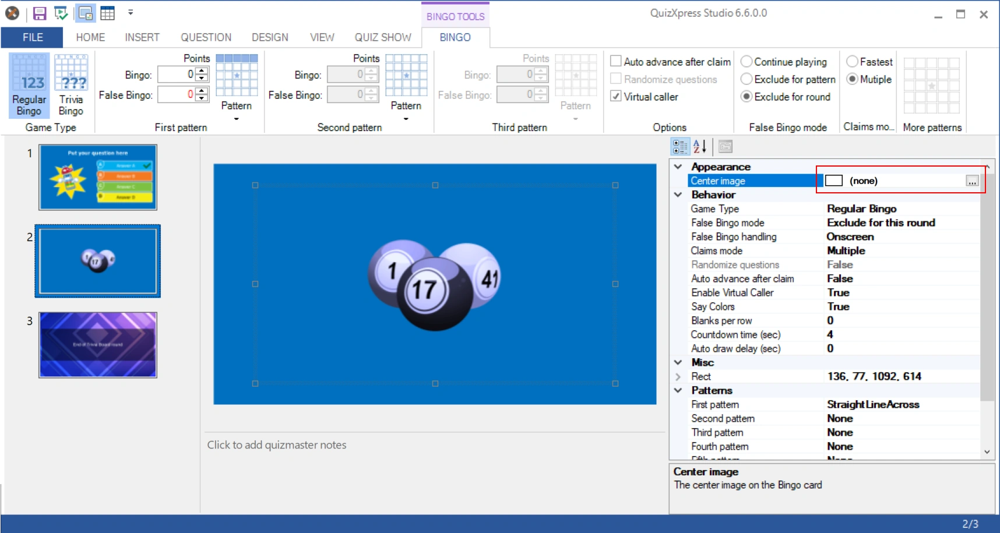{ loading=lazy }

Gebruik uw eigen middenafbeelding om uw merk onder de spelers te promoten!

### Ondersteunde Bingopatronen

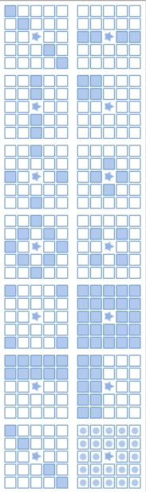{ width="146" loading=lazy }

U kunt tot vijf opeenvolgende patronen definiëren die tot Bingo leiden. U kunt drie patronen selecteren door te klikken op de knoppen ‘Patroon’ in de sectie Eerste patroon, Tweede patroon en Derde patroon op het tabblad BINGO in het lint. Als u een vierde en vijfde patroon wilt definiëren, kan dat in het venster Eigenschappen.

U kunt kiezen uit 13 vooraf gedefinieerde patronen. Het is ook mogelijk om eigen patronen te definiëren.

Bij het openen van de patronen wordt, waar van toepassing, een animatie van de patronen getoond (het patroon horizontale lijn is bijvoorbeeld geldig voor elke horizontale lijn).

Tijdens het spelen van een Bingospel wordt zowel in de quizspeler als op de mobiele telefoon een animatie getoond van het patroon dat op dat moment Bingo geeft.

Met versie 7.1 is het mogelijk om uw eigen bingopatronen te maken. Kies daarvoor het aangepaste patroon in het lint (laatste item in de patroonkiezer), waarna u de patrooneditor ziet:

| 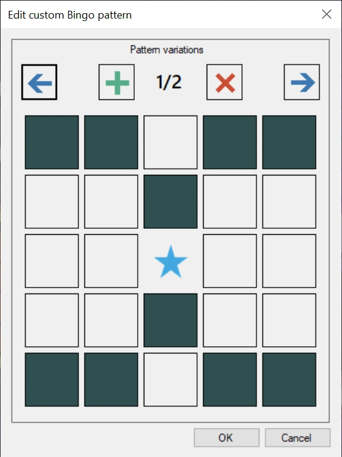{ width="203" loading=lazy } | 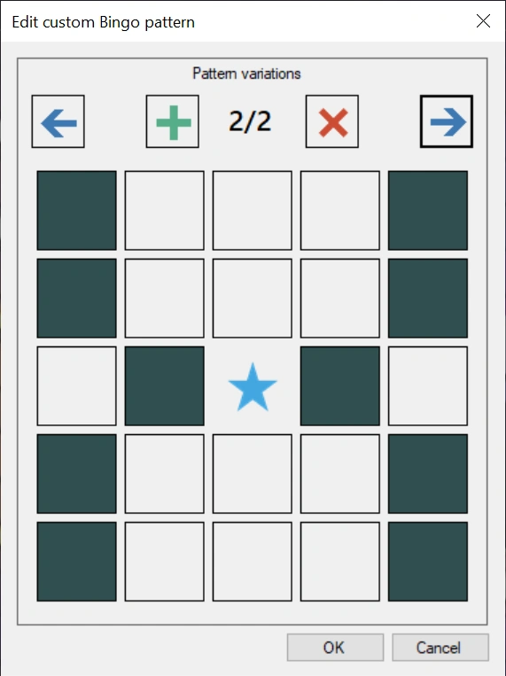{ width="205" loading=lazy } |
|---------------------------------------------------------------------------------|---------------------------------------------------------------------------------|
| Patroonvariatie 1                                                               | Patroonvariatie 2                                                               |

Door op de cellen te klikken, maakt u het patroon. Een patroon kan meerdere variaties hebben die allemaal een geldige bingo opleveren (vergelijkbaar met bijvoorbeeld een Bingo met een horizontale lijn, waarbij elke horizontale lijn een Bingo oplevert). In de quizspeler en in de mobiele app worden de variaties in een animatie aan de spelers getoond.

### Lege cellen per rij

Om lege cellen in te schakelen, opent u de eigenschappenweergave in Studio (BEELD->Eigenschappen in het lint), selecteert u de Bingodia en zoekt u de eigenschap Lege cellen per rij op:

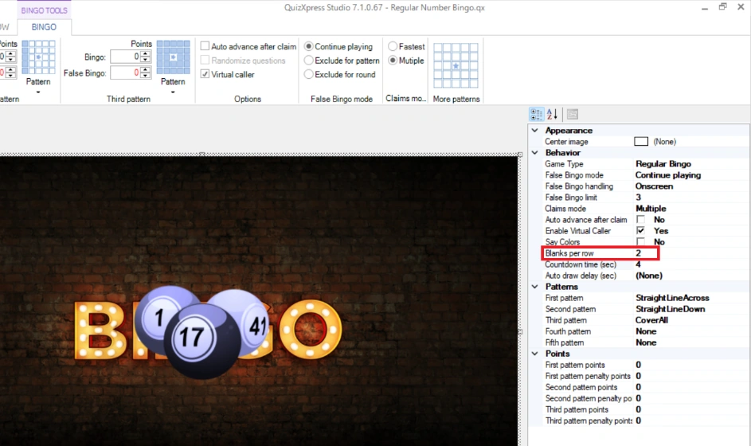{ width="605" loading=lazy }

Deze waarde geeft het aantal lege cellen per rij op uw kaart aan. Het kan een waarde tussen 0 en 4 zijn. Bij een waarde van 2 ziet de Bingokaart op het mobiele apparaat er zo uit:

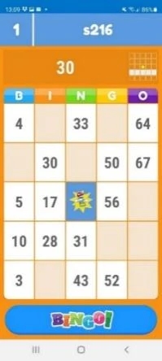{ width="128" loading=lazy }

De lege cellen fungeren als jokers bij het beoordelen van een Bingoclaim. In de voorbeeldkaart links kon de speler dus door alleen 30, 50 en 67 te markeren een Bingo voor een horizontale lijn claimen. Wanneer u met lege cellen speelt, moet u nadenken over welke patronen u speelt. Spelen voor een verticale lijn is bijvoorbeeld misschien geen goed idee, omdat er kolommen kunnen zijn met maar één cel om te markeren. Ook complexere patronen, zoals een ruitvorm, zijn met bepaalde kaarten mogelijk nooit haalbaar.

### Geavanceerde opties

*Automatisch verder na claim* – wanneer deze optie is ingeschakeld, gaat het spel na een Bingoclaim automatisch verder. Wanneer ze niet is ingeschakeld, wacht het spel tot de quizmaster verdergaat.

*Virtuele omroeper* – wanneer ingeschakeld, worden de gespeelde nummers door de computer uitgesproken (met de standaard spraaksynthesizer van Windows).

**Een eigen stem voor de Bingo-omroeper gebruiken**

Wanneer u de optie Virtuele omroeper inschakelt, wordt standaard de spraaksynthesizer van Windows gebruikt om de nummers uit te spreken. U kunt echter ook uw eigen stembestanden maken, bijvoorbeeld met hulp van een plaatselijke beroemdheid. Maak daarvoor in de gegevensmap van de QuizXpress-toepassing (voer in Windows Verkenner *%appdata%\quizxpress* in de navigatiebalk in) een submap met de naam ‘bingo’. Maak in deze map de mp3-bestanden voor elk uit te spreken nummer (bijv. 1.mp3, 2.mp3, 3.mp3, enz.) en eventueel een bestand met de naam ‘welcome.mp3’ dat wordt afgespeeld wanneer het Bingospel start. Het systeem speelt deze bestanden af wanneer een nieuwe bal wordt getrokken.

### Valse Bingo-modus

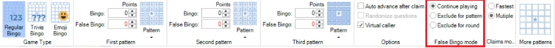{ width="604" loading=lazy }

U kunt aangeven wat er moet gebeuren wanneer een valse Bingoclaim wordt gedaan. De opties zijn:

- Doorspelen – de speler die een valse claim heeft gedaan, kan opnieuw een bingo claimen voor hetzelfde patroon.

- Uitsluiten voor patroon – de speler die een valse claim heeft gedaan, kan niet langer bingo claimen voor hetzelfde patroon. De speler moet wachten tot iemand anders een geldige bingo heeft en het systeem overschakelt naar het volgende patroon.

- Uitsluiten voor ronde – de speler die een valse claim heeft gedaan, kan voor de rest van de ronde niet langer bingo claimen (dat kan een heel spel zijn als er maar één Bingoronde is).

In het venster Eigenschappen zijn twee extra instellingen voor valse Bingoclaims beschikbaar:

Limiet voor valse bingo op het scherm – het maximale aantal valse Bingoclaims per patroon dat live op het scherm wordt getoond voordat het spel overschakelt op stille afhandeling. Stel dit in op 0 voor geen limiet.

Afhandeling van valse bingo – bepaalt hoe valse Bingoclaims worden afgehandeld, Op het scherm of Stil. In de stille modus worden in de quizspeler alleen Bingoclaims getoond die tot een geldige Bingo leiden.

### Claimafhandeling

Er zijn twee opties voor het afhandelen van een Bingoclaim:

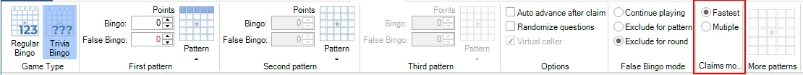{ width="605" loading=lazy }

Snelste: alleen de eerste speler die een Bingo claimt, wordt afgehandeld; anderen die ook op Bingo drukken, worden geblokkeerd. Wanneer het een geldige Bingo is, wordt het volgende patroon gespeeld. Alle spelers spelen nu voor het nieuwe patroon.

Meerdere: alle claims die in de paar seconden nadat de eerste speler Bingo claimde zijn gedaan, worden afgehandeld. Als er één geldige Bingoclaim was, schakelt het patroon na het afhandelen van alle claims over naar het volgende patroon.

### Beperkingen bij het opslaan van een quiz

Bij het maken van een Bingoronde gelden enkele beperkingen. Het is bijvoorbeeld belangrijk dat er geen dubbele cellen op de kaart staan. Het systeem heeft een ingebouwde regelcontrole die de quiz controleert voordat deze wordt opgeslagen:

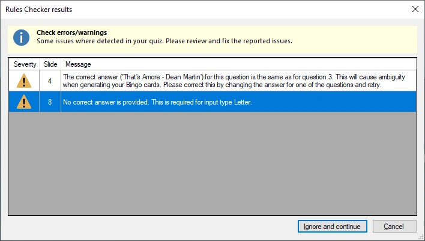{ width="475" loading=lazy }

Dit gebeurt automatisch voor tekstvragen. Voor afbeeldingscellen moet u dit zelf doen; zorg ervoor dat u niet twee vragen met dezelfde afbeelding opneemt.

## Een Bingospel spelen

De quizspeler zorgt voor de registratie van de Bingokaarten van alle spelers en luistert naar Bingoclaims van de spelers. Hieronder vindt u voorbeelden van de verschillende Bingospellen.

### Soorten Bingospellen

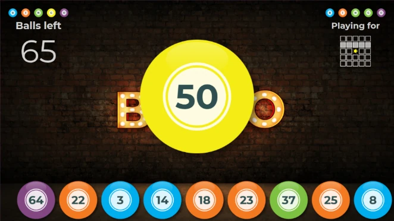{ width="424" loading=lazy }**Nummerbingo**

Het scherm toont de laatste 9 ballen die zijn gespeeld, met hun kleur (die het deel van de Bingokaart aangeeft), en de laatst getrokken bal. Het toont hoeveel ballen er nog getrokken moeten worden en het huidige patroon dat tot een Bingo leidt.

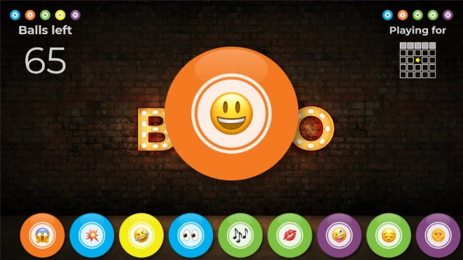{ width="423" loading=lazy }**Emoji Bingo**

Emoji Bingo is in principe hetzelfde als Nummerbingo, alleen worden in plaats van 75 nummers de 75 meest gebruikte emoji’s gebruikt.

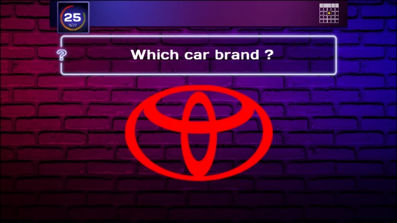{ width="422" loading=lazy }**Triviabingo**

Bij Triviabingo worden de vragen op het grote scherm getoond, samen met het huidige patroon en de aftelklok. Het antwoord, een tekst of een afbeelding, moet op de kaart worden gevonden (als er meer vragen zijn dan nummers op de kaart, kan het zijn dat het antwoord \*niet\* op een kaart staat).

**Muziekbingo**

Muziekbingo (of zelfs videobingo) is in principe hetzelfde als Triviabingo. Vragen met muziekfragmenten worden op het scherm getoond en de antwoorden (tekst of afbeeldingen) staan op de Bingokaart.

De Quiz Wizard biedt specifieke ondersteuning voor Muziekbingo. Hiermee kunt u een map met mp3-bestanden selecteren waaruit de Bingoronde automatisch wordt opgebouwd.

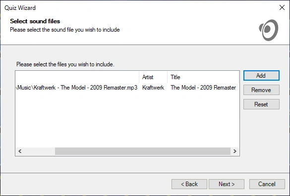{ width="585" loading=lazy }

### Bingo claimen

Wanneer een speler genoeg cellen heeft gemarkeerd om een patroon te voltooien, doet hij of zij een claim door op de knop Bingo in de mobiele app te drukken. Daardoor verschijnt de naam van de speler op het scherm en loopt er een aftelling van 3 seconden terwijl het systeem de claim valideert. Handmatig controleren is niet nodig.

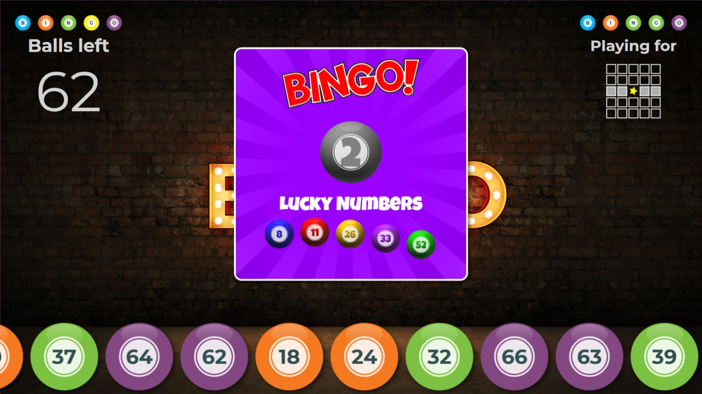{ loading=lazy }

Na de validatie wordt zowel op het grote scherm als op de mobiele telefoon een duim omhoog of een duim omlaag getoond.

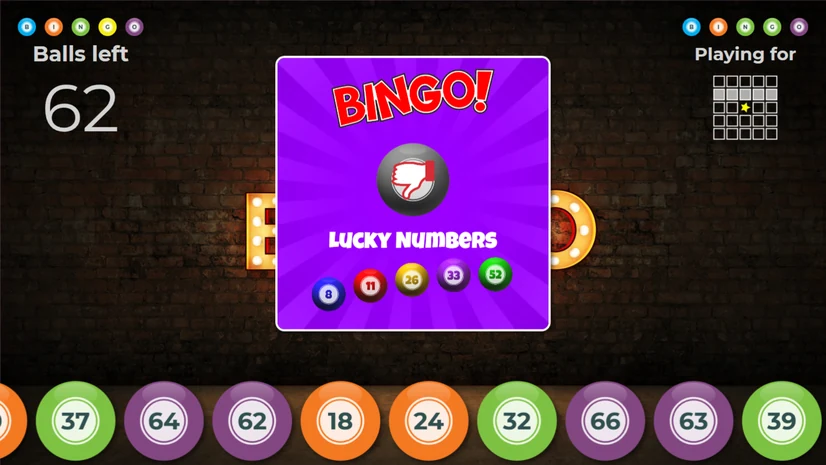{ loading=lazy } 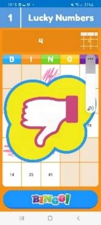{ width="103" loading=lazy }

Bij een geldige Bingo wint de speler punten (indien geconfigureerd) en schakelt het systeem over naar het volgende patroon.

Wanneer er geen volgend patroon meer te spelen is, eindigt de ronde en gaat de quiz verder bij de dia Einde ronde (wanneer er maar één ronde is en geen dia Einde ronde, toont de quiz het eindscorescherm).

Het afhandelen van meerdere claims ziet er zo uit:

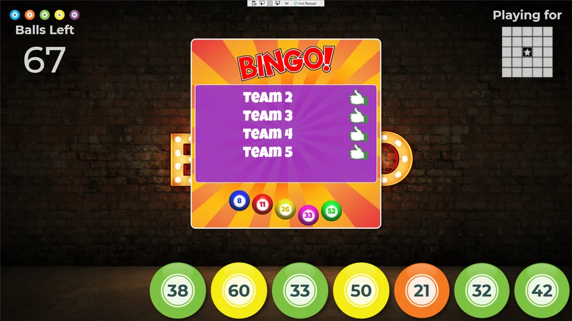{ loading=lazy }

Wanneer een speler de verbinding met uw quiz verbreekt of de verbinding met de sessie verliest, gaan de Bingokaart en de gemarkeerde cellen niet verloren. Wanneer de speler weer meedoet, wordt de kaart getoond zoals die was bij het verbreken van de verbinding. Mocht de quizspeler crashen, dan kunt u de quiz bovendien opnieuw starten, herstellen vanaf de opgeslagen momentopname en de Bingoronde voortzetten.

### Live kaartweergave

In QuizXpress Director is er op het tabblad ‘Teams’ een optie om de huidige Bingokaart van de geselecteerde speler te bekijken. De kaart toont ook welke cellen al zijn gespeeld, gemarkeerd in groen.

Om de kaart van een speler te tonen, selecteert u de speler en drukt u op de knop ‘Bingokaart tonen’. Zo kunt u bij een geschil altijd dubbelchecken.

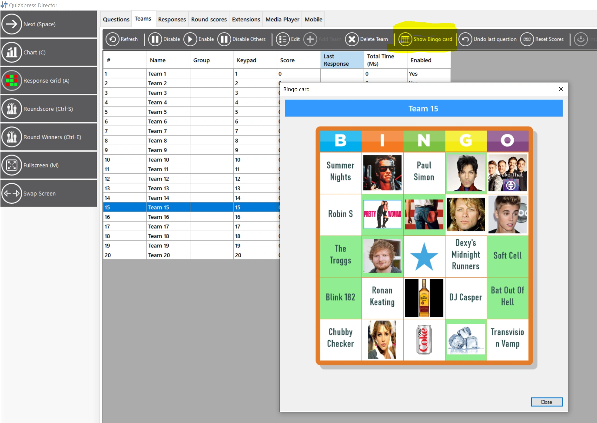{ loading=lazy }

### Bingopatronen wijzigen tijdens een Bingosessie

In QuizXpress Director is het nu mogelijk om tijdens een quiz (voordat de ronde start) de patronen van een Bingoronde te wijzigen, samen met enkele andere Bingo-instellingen. Dubbelklik hiervoor op de Bingodia op het tabblad Vragen om de instellingen voor een Bingoronde te openen.

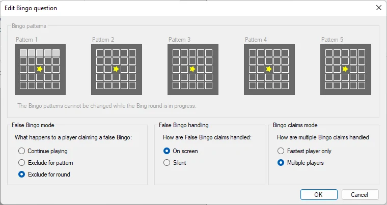{ width="605" loading=lazy }
