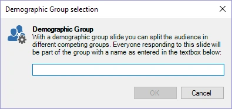

# Gruppi demografici

QuizXpress offre diversi modi per raggruppare i giocatori affinché possano sfidarsi in squadre (ad esempio: ragazzi contro ragazze). Il tipo di diapositiva "demographic groups" consente di raggruppare i giocatori "al volo" durante lo svolgimento di un quiz.

Scegliendo questo tipo di domanda, viene visualizzata una finestra in cui è possibile inserire il nome del gruppo/della squadra. Quando la diapositiva viene mostrata durante un quiz, i keypad premuti mentre è visualizzata la diapositiva demographic vengono registrati per quello specifico gruppo.

{ width="318" loading=lazy }

Nella diapositiva si consiglia di mostrare un testo che inviti i membri del gruppo interessato a premere il proprio buzzer o keypad ("tutti i ragazzi, premete il vostro keypad").

È anche possibile suddividere i giocatori in gruppi prima di un quiz in QuizXpress Setup. A tale scopo, consultare la sezione [QuizXpress Setup: raggruppamento dei keypad](../../setup/setting-up-teams-the-teams-tab-page.md#raggruppare-i-keypad).

Quando si gioca con i telefoni cellulari (con l'app Smart Buzzer o il sito web buzzerpad), è possibile giocare anche in gruppi. A tale scopo, consultare la sezione [Giocare in gruppi](../../setup/setting-up-mobile-keypad-support.md#giocare-in-gruppi).
