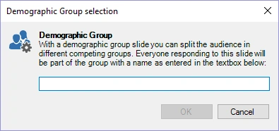

# Demografische groepen

QuizXpress biedt verschillende manieren om spelers te groeperen, zodat ze in teams tegen elkaar kunnen strijden (bijvoorbeeld: jongens tegen meisjes). Met het diatype ‘demografische groepen’ kunt u spelers tijdens een quiz ‘on the fly’ groeperen.

Wanneer u dit vraagtype kiest, verschijnt een venster waarin u de naam van de groep/het team invoert. Wanneer de dia tijdens een quiz wordt getoond, worden keypads die worden ingedrukt terwijl de demografische dia wordt getoond, geregistreerd bij die specifieke groep.

{ width="318" loading=lazy }

Op de dia raden we aan een tekst te tonen waarin de leden van de betreffende groep wordt gevraagd op hun buzzer of keypad te drukken (‘alle jongens, druk op uw keypad’).

U kunt spelers ook vóór een quiz in groepen indelen in QuizXpress Setup. Zie hiervoor de sectie [QuizXpress Setup: Keypads groeperen](../../setup/setting-up-teams-the-teams-tab-page.md#keypads-groeperen).

Wanneer u met mobiele telefoons speelt (met de Smart Buzzer-app of de buzzerpad-website), kunt u ook in groepen spelen. Zie hiervoor de sectie [In groepen spelen](../../setup/setting-up-mobile-keypad-support.md#spelen-in-groepen).
