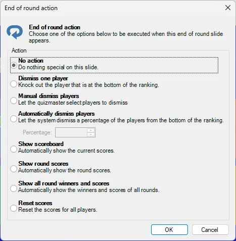
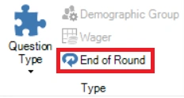

# Fin de ronda

En QuizXpress puede indicar que una diapositiva de quiz marca el ‘fin de una ronda’. Para ello, establezca el ‘Type’ de una diapositiva de quiz en ‘End of Round’ en QuizXpress Studio.

Cuando se muestra una diapositiva de fin de ronda durante un quiz, no se produce ninguna interacción con los participantes. Por ejemplo, puede usarla para mostrar el texto ‘Fin de la ronda 3’. De nuevo, puede diseñar la diapositiva de quiz como quiera, con vídeo, sonido e imágenes.

Además, puede elegir mostrar automáticamente la puntuación intermedia o de la ronda. En este caso, una diapositiva de tipo ‘End of Round’ es en realidad una diapositiva ‘Billboard’ que además muestra automáticamente las puntuaciones intermedias o de la ronda.

Al seleccionar ‘End of Round’ como tipo de pregunta, se muestra el cuadro de diálogo ‘End of round action’ con diferentes opciones que se ejecutan cuando aparece esa diapositiva:

{ width="303" loading=lazy }

Aquí puede establecer varias acciones automáticas que se producirán cuando aparezca la diapositiva de fin de ronda, como eliminar a un subconjunto de los jugadores, mostrar la clasificación general o los ganadores de esta ronda. Siempre puede cambiar estas opciones más adelante haciendo clic en el botón ‘End of Round’ situado junto al botón ‘Question Type’:

{ width="194" loading=lazy }

Consulte también [Fin de ronda](../../live/starting-a-quiz/the-quiz-screen-voting-everybody-answers.md#end-of-round) para más información sobre las diapositivas de fin de ronda
