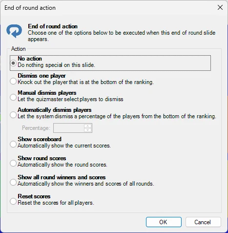
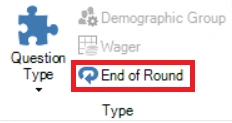

# Einde ronde

In QuizXpress kunt u aangeven dat een quizdia het ‘einde van een ronde’ markeert. Dat doet u door in QuizXpress Studio het ‘Vraag type’ van een quizdia in te stellen op ‘Einde ronde’.

Wanneer tijdens een quizshow een dia Einde ronde wordt getoond, vindt er geen interactie met de deelnemers plaats. U kunt hem bijvoorbeeld gebruiken om de tekst ‘Einde van ronde 3’ te tonen. Ook hier kunt u de quizdia naar eigen wens ontwerpen, met video, geluid en afbeeldingen.

U kunt er ook voor kiezen om automatisch de tussenscore of de rondescore te tonen. In dat geval is een dia van het type ‘Einde ronde’ in feite een ‘Billboard’-dia die ook automatisch de tussenscores of rondescores toont.

Wanneer u ‘Einde ronde’ kiest als vraagtype, verschijnt het dialoogvenster ‘Einde ronde-actie’ met verschillende opties die worden uitgevoerd wanneer die dia verschijnt:

{ width="303" loading=lazy }

Hier kunt u diverse automatische acties instellen die plaatsvinden wanneer de dia Einde ronde verschijnt, zoals een deel van de spelers laten afvallen, de totale ranglijst tonen of de winnaars van deze ronde. U kunt deze opties later altijd wijzigen door te klikken op de knop ‘Einde ronde’ naast de knop ‘Vraag Type’:

{ width="194" loading=lazy }

Zie ook [Einde ronde](../../live/starting-a-quiz/the-quiz-screen-voting-everybody-answers.md#einde-ronde) voor meer informatie over dia’s Einde ronde
