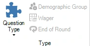

# Formats de diapositives et de jeux

Le système prend en charge différents formats de jeu. Les formats sont déterminés par le « Question Type » (que l'on trouve dans l'onglet QUESTION) qui est choisi.

{ width="184" loading=lazy }

Pour chaque option, veuillez également consulter [[Écran du quiz : vote (tout le monde répond)](../../live/starting-a-quiz/the-quiz-screen-voting-everybody-answers.md)](../../live/starting-a-quiz/the-quiz-screen-voting-everybody-answers.md) et les pages suivantes, qui expliquent plus en détail comment chaque réglage se manifeste dans QuizXpress Live!, le lecteur de quiz.
