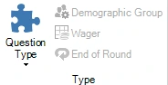

# Format di Gioco supportati

Il sistema supporta diversi format di gioco. I format sono determinati dalla ‘Tipologia Domanda’ selezionata (nella scheda DOMANDA).

{ width="184" loading=lazy }

Per ciascuna opzione, consultare anche [La schermata quiz: Votazione (tutti possono rispondere)](../../live/starting-a-quiz/the-quiz-screen-voting-everybody-answers.md) e le pagine successive, che spiegano meglio come ciascuna impostazione si manifesta in QuizXpress Live!, il riproduttore dei quiz.
