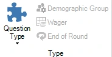

# Dia- en spelvormen

Het systeem ondersteunt verschillende spelvormen. De spelvormen worden bepaald door het gekozen ‘Vraag Type’ (te vinden op het tabblad VRAAG).

{ width="184" loading=lazy }

Zie voor elke optie ook [Het quizscherm: stemmen (iedereen antwoordt)](../../live/starting-a-quiz/the-quiz-screen-voting-everybody-answers.md) en verder, waarin meer wordt uitgelegd over hoe elke instelling in QuizXpress Live!, de quizspeler, tot uiting komt.
