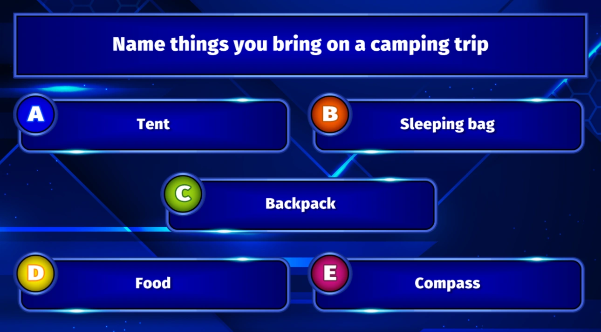

# Regole della maggioranza

In questo tipo di domanda, la risposta corretta dipende da ciò che ha scelto la maggioranza del pubblico. Quindi, i punti vengono assegnati solo se un giocatore ha scelto la stessa risposta della maggioranza del pubblico. Se più risposte hanno lo stesso numero di voti, tutte le risposte sono considerate corrette. Al termine della domanda, QuizXpress mostra nella diapositiva la risposta (o le risposte) corretta, cioè la più scelta.

Un esempio di domanda "majority rules" è:

{ loading=lazy }

Se si sceglie ciò che ha scelto la maggior parte del pubblico, si vincono i punti della domanda. Le domande Majority rules possono essere viste come una variante "dal vivo" di "Family Feud", in cui avviene un sondaggio istantaneo del pubblico e bisogna indovinare qual è la risposta più popolare tra il pubblico.
