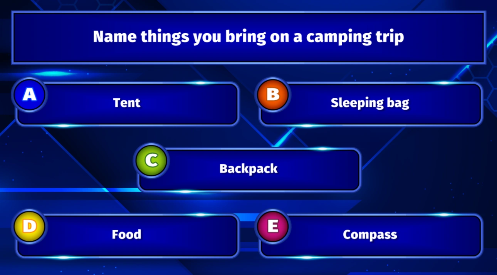

# Meerderheid bepaalt

Bij dit soort vraag hangt het juiste antwoord af van wat de meerderheid van het publiek heeft gekozen. Alleen als een speler hetzelfde antwoord heeft gekozen als de meerderheid van het publiek, worden er punten gewonnen. Als meerdere antwoorden evenveel stemmen hebben, worden al die antwoorden als juist beschouwd. Wanneer de vraag voorbij is, toont QuizXpress het juiste (meest gekozen) antwoord of de juiste antwoorden op de dia.

Een voorbeeld van een vraag ‘Meerderheid bepaalt’ is:

{ loading=lazy }

Als u kiest wat de meeste mensen in het publiek hebben gekozen, wint u de punten van de vraag. Vragen ‘Meerderheid bepaalt’ kunt u zien als een ‘live’ variant van ‘Family Feud’, waarbij een directe publieksenquête plaatsvindt en u moet raden wat het populairste antwoord van het publiek is.
