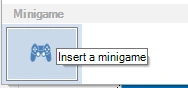
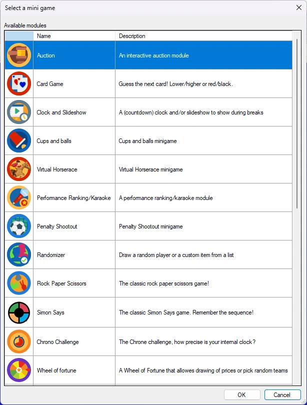
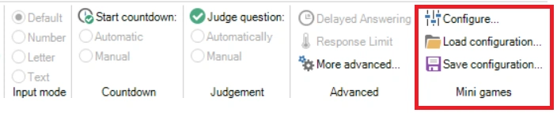
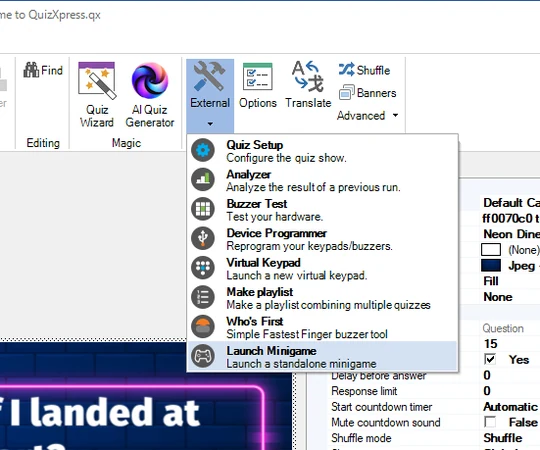
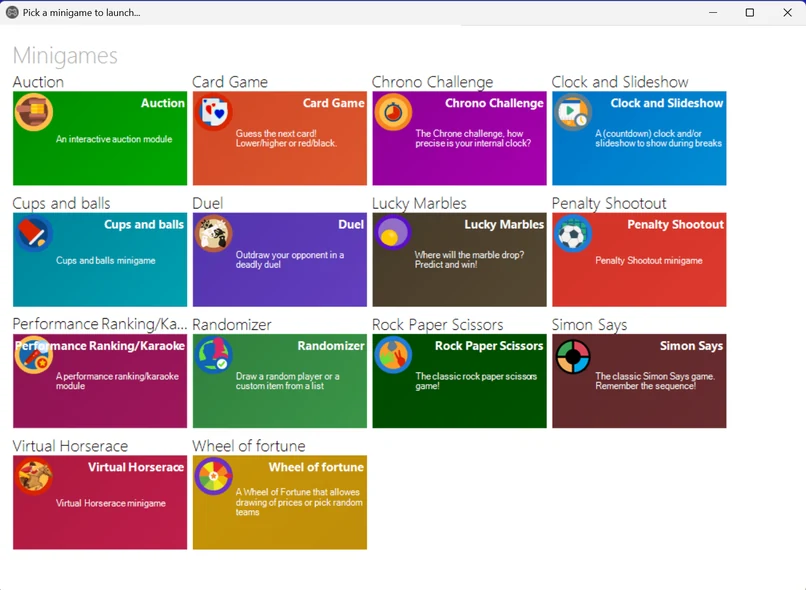

# Minigame

QuizXpress ofrece una variedad de minijuegos. Los minijuegos darán un toque especial a su programa de concursos o a su noche de preguntas al ofrecer algo diferente de las preguntas de cultura general. Con estos juegos se pueden ganar o perder puntos.

Los minijuegos pueden iniciarse manualmente (a petición) desde QuizXpress Director (el panel de control del presentador del quiz, del que hablaremos más adelante), utilizarse insertando una diapositiva de tipo 'Minigame' en el archivo del quiz, o ejecutarse de forma independiente desde el lanzador de minijuegos.

{ width="109" loading=lazy }Para insertar un minijuego en su quiz, seleccione el diseño de diapositiva 'minigame' en la galería de diseños de la pestaña de la cinta INSERT:

El siguiente paso es elegir el juego de la lista de juegos disponibles:

{ width="260" loading=lazy }

Se inserta una nueva diapositiva que iniciará el minijuego en QuizXpress Live! cuando el quiz llegue a esa diapositiva. Cada diapositiva de minijuego puede tener su propia configuración y su propia imagen de marca. Para configurar un minijuego, haga clic con el botón derecho en la diapositiva y haga clic en 'Configure…', o haga clic en 'Configure' en la cinta QUESTION:

{ width="605" loading=lazy }

Se abrirá el cuadro de diálogo de configuración de ese minijuego. También puede cargar y guardar configuraciones de minijuegos para reutilizarlas en distintos quizzes. [Minijuegos](../mini-games/index.md) ofrece una visión general de todos los minijuegos disponibles actualmente y de sus opciones de juego.

Para probar su minijuego, puede ejecutar el quiz completo o utilizar la función de vista previa de Studio pulsando F5 (o haciendo clic con el botón derecho en el minijuego y eligiendo 'Preview'). Esto iniciará el minijuego en una ventana aparte. Utilice la barra espaciadora para navegar por las distintas pantallas.

Como alternativa, puede iniciar minijuegos sobre la marcha durante un quiz desde QuizXpress Director. Consulte [La vista Round scores](../../live/quizxpress-director/the-round-scores-view.md) para obtener más información.

Por último, puede iniciar un minijuego de forma independiente (sin ejecutar un quiz en el reproductor del quiz) desde el lanzador de minijuegos. El lanzador de minijuegos puede iniciarse desde el menú Inicio de Windows (sección QuizXpress) o desde Studio.

{ width="270" loading=lazy }

Al iniciarse, se muestra una visión general de todos los minijuegos que se pueden iniciar:

{ loading=lazy }

Al hacer clic con el botón derecho en un icono, puede configurar el minijuego e incluso crear y guardar distintas configuraciones (que aparecerán como nuevos iconos independientes). Al iniciar un juego que requiere la interacción de los jugadores en mandos móviles, se muestra una pantalla de conexión con un código PIN y un código QR para que los pulsadores móviles puedan conectarse. Por ejemplo, puede utilizar el lanzador de minijuegos para organizar un juego rápido y regalar una bebida.
