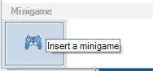
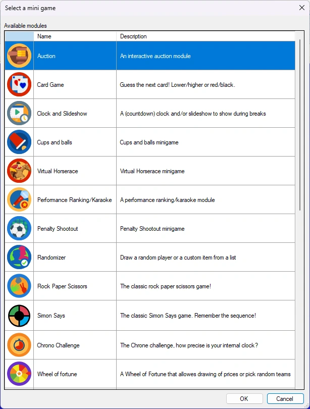
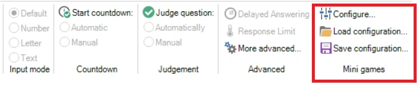
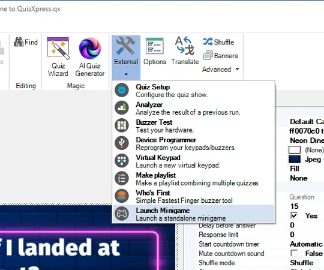
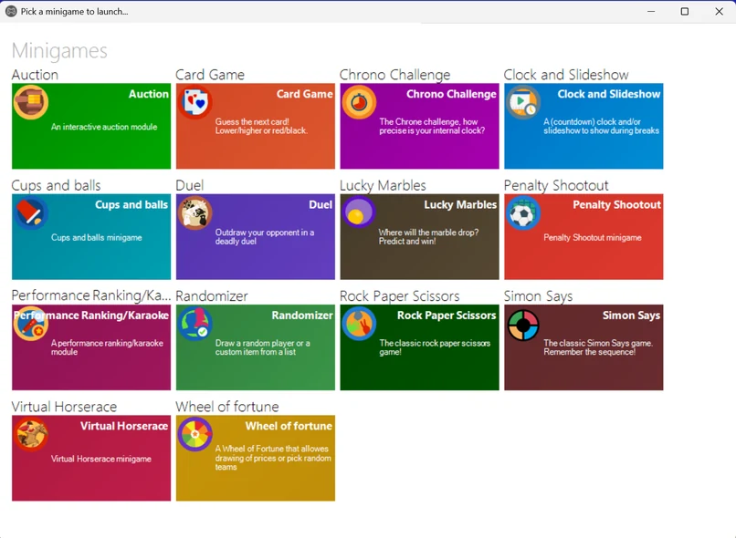

# Minigame

QuizXpress biedt een verscheidenheid aan minigames. Minigames geven uw gameshow of trivia-avond extra pit door iets anders te bieden dan trivia. Met de games kunnen punten worden gewonnen of verloren.

Minigames kunnen handmatig (op verzoek) worden gestart vanuit QuizXpress Director (het bedieningspaneel van de quizmaster, daarover later meer), worden gebruikt door een dia van het type ‘Minigame’ in het quizbestand in te voegen, of zelfstandig worden uitgevoerd vanuit de minigame-launcher.

{ width="109" align=left loading=lazy }Om een minigame in uw quiz in te voegen, selecteert u de diaindeling ‘minigame’ in de indelingengalerij op het lint-tabblad INVOEGEN:

De volgende stap is het kiezen van de game uit de lijst met beschikbare games:

{ width="260" loading=lazy }

Er wordt een nieuwe dia ingevoegd die de minigame in QuizXpress Live! start wanneer de quiz bij die dia komt. Elke minigame-dia kan een eigen unieke configuratie en huisstijl hebben. Om een minigame te configureren, klikt u met de rechtermuisknop op de dia en klikt u op ‘Configureren…’ of klikt u op ‘Configureren’ op het lint VRAAG:

{ width="605" loading=lazy }

Hiermee opent u het configuratievenster van die minigame. U kunt minigame-configuraties ook laden en opslaan om ze in meerdere quizzen te hergebruiken. [Minigames](../mini-games/index.md) geeft een overzicht van alle minigames die momenteel beschikbaar zijn en hun spelopties.

Om uw minigame te testen, kunt u uw volledige quiz uitvoeren of de voorbeeldfunctie in Studio gebruiken door op F5 te drukken (of met de rechtermuisknop op de minigame te klikken en ‘Voorbeeld’ te kiezen). Daarmee wordt de minigame in een apart venster gestart. Gebruik de spatiebalk om door de verschillende schermen te navigeren.

U kunt minigames ook ‘on the fly’ tijdens een quiz starten vanuit QuizXpress Director. Zie [De weergave Rondescores](../../live/quizxpress-director/the-round-scores-view.md) voor meer informatie.

Ten slotte kunt u een minigame zelfstandig starten (zonder een quiz in de quizspeler uit te voeren) vanuit de minigame-launcher. De minigame-launcher kunt u starten vanuit het startmenu van Windows (sectie QuizXpress) of vanuit Studio.

{ width="270" loading=lazy }

Na het starten ziet u een overzicht van alle beschikbare minigames die u kunt starten:

{ loading=lazy }

Door met de rechtermuisknop op een tegel te klikken, kunt u de minigame configureren en zelfs verschillende configuraties maken en opslaan (die als aparte nieuwe tegels verschijnen). Wanneer u een game start waarvoor spelersinteractie op mobiele keypads nodig is, verschijnt een verbindingsscherm met een pincode en QR-code waarmee de mobiele buzzers verbinding maken. U kunt de minigame-launcher bijvoorbeeld gebruiken om een snelle game te spelen om een gratis drankje weg te geven.
