# Domanda di abbinamento

In una Pairing Question, i giocatori associano etichette di testo a immagini (ad esempio paesi a bandiere o marchi a loghi). Sul buzzer mobile appare così:

| 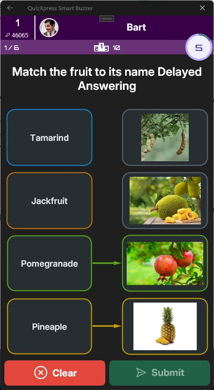{ width="159" loading=lazy } | 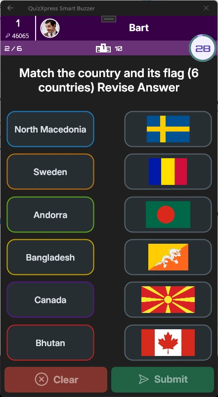{ width="161" loading=lazy } | 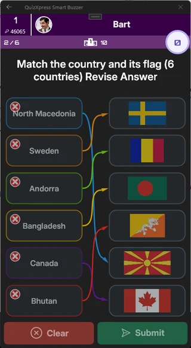{ width="160" loading=lazy } |
|--------------------------------------------------------------------------------|--------------------------------------------------------------------------------|--------------------------------------------------------------------------------|

Per creare questo tipo di domanda, selezionare un modello con almeno *tre* segnaposto per immagini e impostare il tipo di domanda su "Pairing Question". Quindi assegnare l'etichetta appropriata a ciascuna immagine:

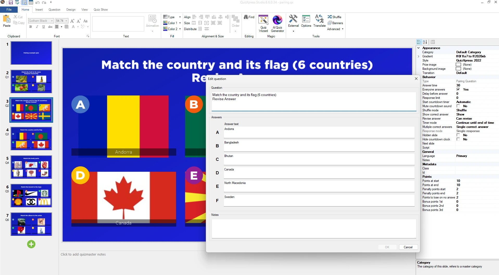{ loading=lazy }

In alternativa, è possibile usare il Quiz Wizard.

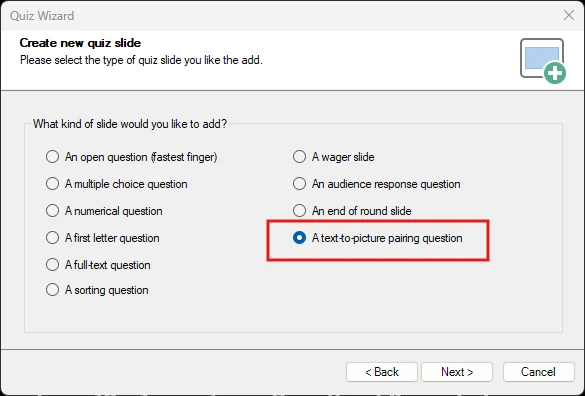{ width="390" loading=lazy }

Quindi compilare le etichette e selezionare le immagini corrispondenti:

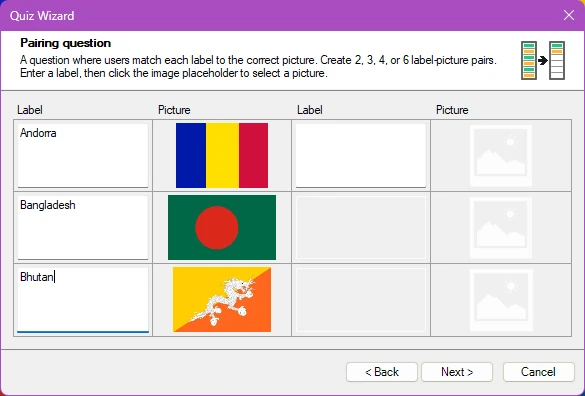{ width="390" loading=lazy }

Fare clic su **Next** e completare la procedura guidata per creare la pairing question.

## Hotspot questions

Con questo tipo di domanda, il giocatore deve contrassegnare un punto (o più punti) su un'immagine, e la risposta è corretta quando quel punto (o quei punti) ricade nell'area contrassegnata come corretta dall'autore del quiz.

Ad esempio, se si vuole che i giocatori trovino la Francia su una mappa, si sceglie un modello con una sola immagine:

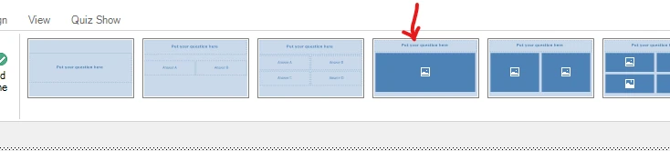{ width="602" loading=lazy }

Impostare il tipo di input su "Hotspot":

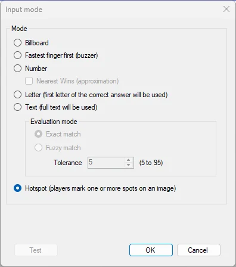{ width="251" loading=lazy }

Quindi inserire l'immagine di una mappa nel segnaposto e modificare le aree hotspot con l'**Hotspot Editor** (fare clic con il pulsante destro del mouse sull'immagine e selezionare **Edit Hotspots**):

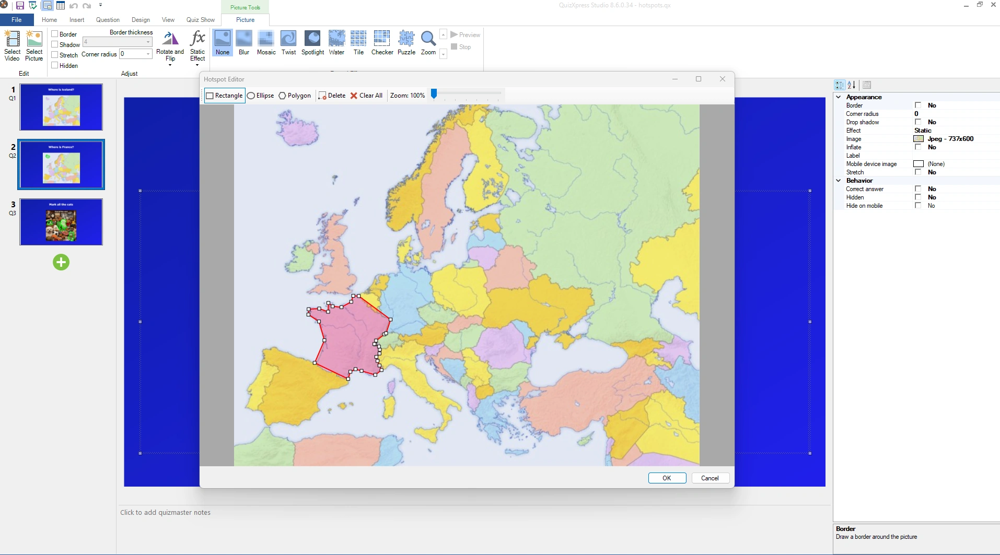{ loading=lazy }Ora contrassegnare l'area che costituisce la risposta corretta (qui in rosso). Le forme di area supportate comprendono aree rettangolari, ellittiche e a mano libera.

È possibile definire più aree corrette: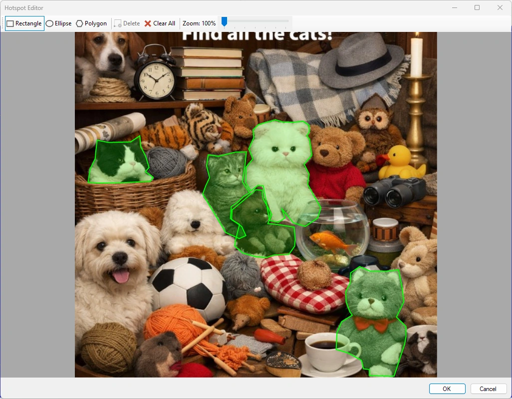{ width="602" loading=lazy }

Con più aree, nell'app Smart Buzzer appare così:

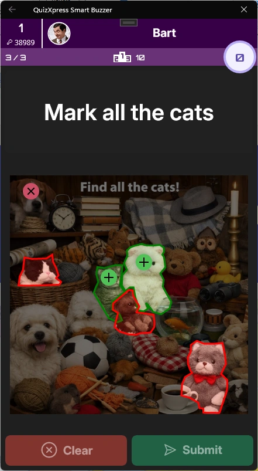{ width="185" loading=lazy }

Sullo schermo del quiz l'immagine rivelerà la risposta corretta in questo modo:

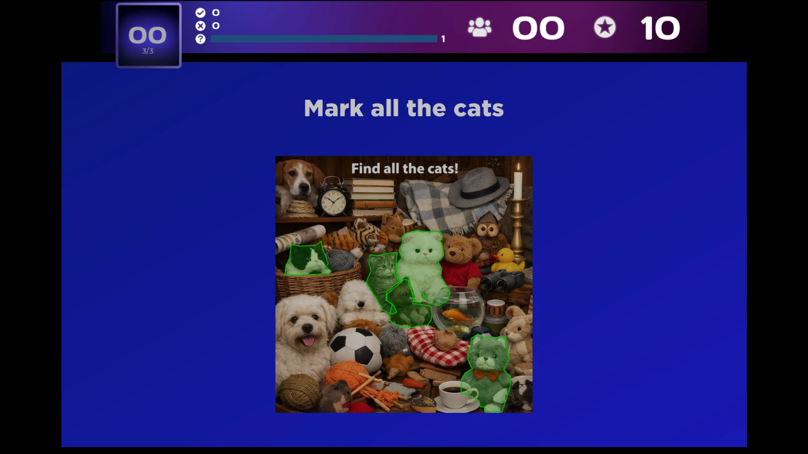{ loading=lazy }

!!! note

    quando si usano più aree e l'utente contrassegna più punti di quante siano le aree corrette, il suo punteggio diminuisce (per evitare risposte tirate a caso con molti indicatori).
