# Koppelingsvraag

Bij een Koppelingsvraag koppelen spelers tekstlabels aan afbeeldingen (bijvoorbeeld landen aan vlaggen of merken aan logo’s). Op de mobiele buzzer ziet dat er als volgt uit:

| 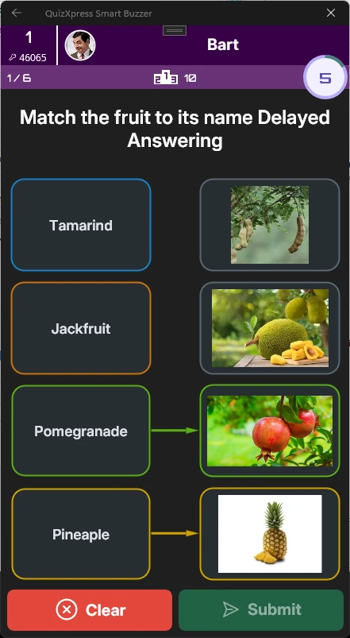{ width="159" loading=lazy } | 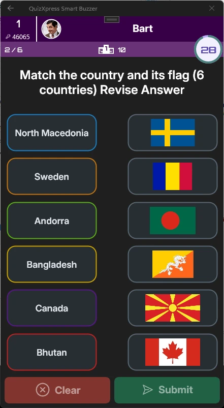{ width="161" loading=lazy } | 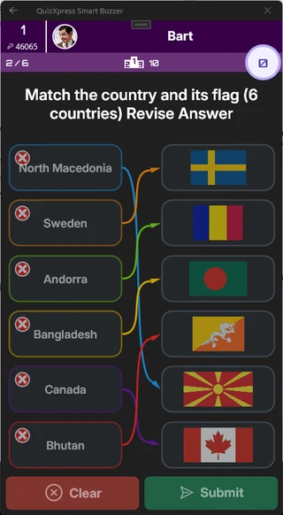{ width="160" loading=lazy } |
|--------------------------------------------------------------------------------|--------------------------------------------------------------------------------|--------------------------------------------------------------------------------|

Om dit soort vraag te maken, selecteert u een sjabloon met minstens *drie* afbeeldingsplaatshouders en stelt u het vraagtype in op ‘Koppelingsvraag’. Wijs daarna de juiste labels toe aan elke afbeelding:

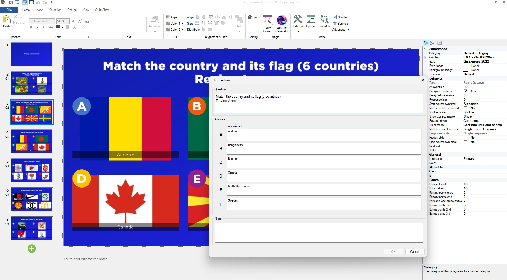{ loading=lazy }

U kunt ook de Quiz Wizard gebruiken.

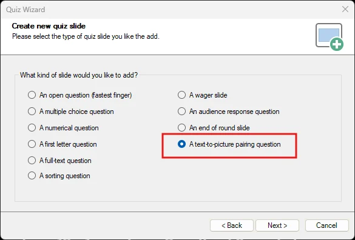{ width="390" loading=lazy }

Vul vervolgens de labels in en selecteer de bijpassende afbeeldingen:

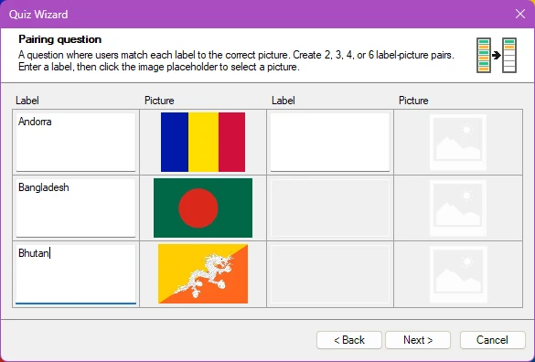{ width="390" loading=lazy }

Klik op **Volgende** en voltooi de wizard om de koppelingsvraag te maken.

## Hotspotvragen

Bij dit soort vraag moet de speler een plek (of meerdere plekken) op een afbeelding markeren, en is het antwoord juist wanneer die plek (of plekken) binnen het gebied valt dat de quizontwerper als juist heeft gemarkeerd.

Als we bijvoorbeeld willen dat de spelers Frankrijk op een kaart aanwijzen, kiezen we een sjabloon met één afbeelding:

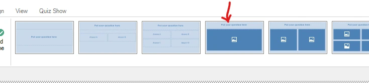{ width="602" loading=lazy }

Stel het invoertype in op ‘Hotspot’:

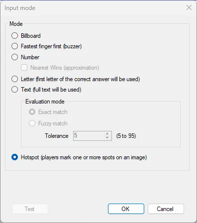{ width="251" loading=lazy }

Plaats vervolgens een afbeelding van een kaart in de afbeeldingsplaatshouder en bewerk de hotspotgebieden met de **Hotspot-editor** (klik met de rechtermuisknop op de afbeelding en selecteer **Hotspots bewerken**):

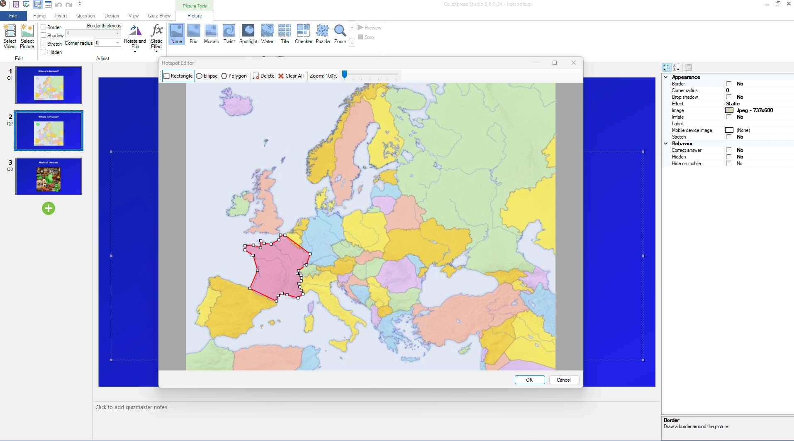{ loading=lazy }Markeer nu het gebied dat het juiste antwoord vormt (hier in rood). Ondersteunde gebiedsvormen zijn onder meer rechthoekige, elliptische en vrije vormen.

Er kunnen meerdere juiste gebieden worden gedefinieerd: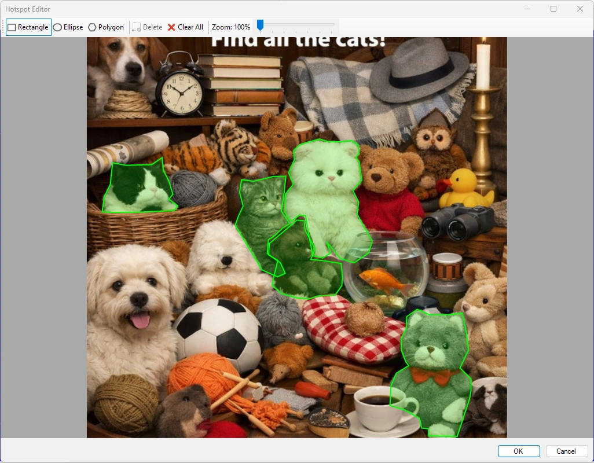{ width="602" loading=lazy }

Bij meerdere gebieden ziet het er in de Smart Buzzer-app zo uit:

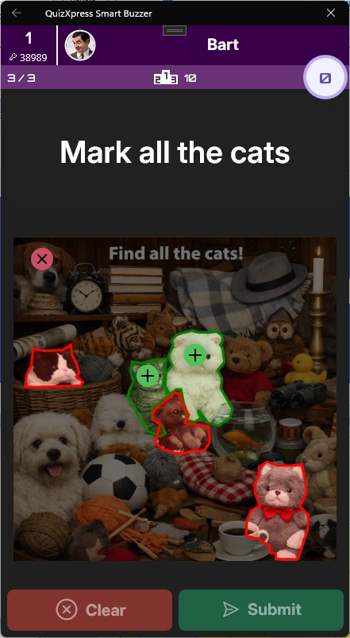{ width="185" loading=lazy }

Op het quizscherm onthult de afbeelding het juiste antwoord zo:

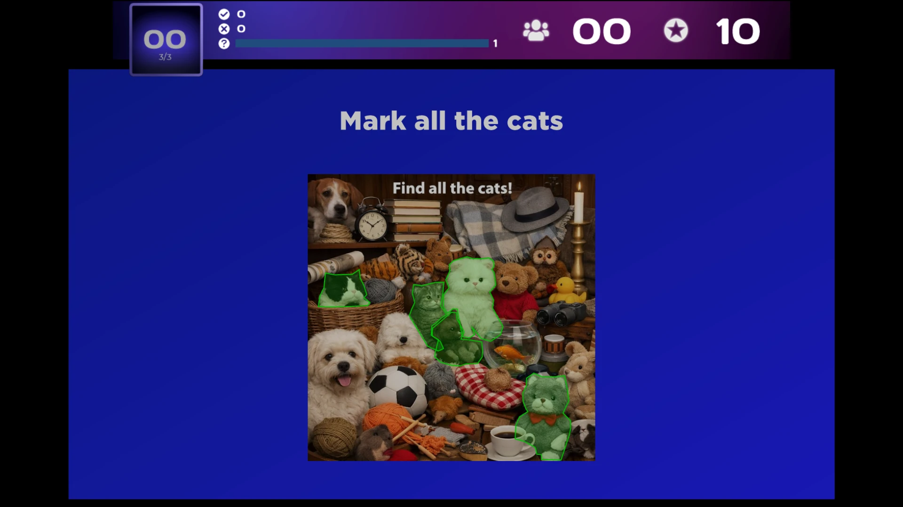{ loading=lazy }

!!! note

    wanneer u meerdere gebieden gebruikt en de gebruiker meer plekken markeert dan er juiste gebieden zijn, gaat zijn score omlaag (om wild gokken met veel markeringen te voorkomen).
