# Question

Questo tipo indica una normale domanda del quiz. Sono possibili le seguenti varianti:

- *Everyone Answers (detta anche votazione):* consente a tutti i giocatori di rispondere a una domanda.

- *Lock-out (detta anche Dito più Veloce)*: il giocatore che preme per primo un buzzer ha il diritto di rispondere a una domanda.

- *Domanda a scelta multipla*: domanda con più risposte tra cui i giocatori possono scegliere. Le risposte date vengono giudicate automaticamente dal sistema (cioè se ‘Judge question’ è impostato su ‘Automatically’). È possibile creare una domanda a scelta multipla andando alla scheda DESIGN e cambiando il layout con uno che preveda più risposte.

- *Domanda aperta (senza opzioni a scelta multipla)*: domanda a cui un giocatore/una squadra risponde a voce e che viene poi giudicata dal Quizmaster (tramite il telecomando da presentatore, la tastiera o QuizXpress Director). È possibile creare una domanda aperta andando al menu DESIGN e cambiando il layout con uno senza risposte. Nella sezione ‘input mode’, selezionare ‘default’ come modalità di input.

- Tipi di input estesi, che riguardano domande con risposte numeriche, a testo completo o con la prima lettera. A queste domande si può rispondere con l’app QuizXpress Smart Buzzer o con il sito web buzzerpad. È possibile creare una domanda aperta con risposta numerica, a lettera o a testo selezionando ‘number’, ‘letter’ o ‘text’ come modalità di input.

Nella sezione dei punti è possibile indicare il numero di punti da vincere per una risposta corretta, il numero di punti persi per una risposta errata e il numero di punti persi quando non viene data alcuna risposta. È inoltre possibile far diminuire i punti mentre il timer scorre durante una domanda. A tale scopo, inserire il numero di punti ‘At start’ e ‘At end’. Lo stesso vale per i punti di penalità (*Wrong answer* e *No answer*).

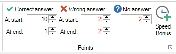{ width="222" loading=lazy }

Con queste opzioni è possibile premiare con più punti i giocatori che rispondono rapidamente. Allo stesso tempo, le risposte errate possono essere penalizzate maggiormente all’inizio di una domanda, per evitare che le persone tirino a indovinare/scommettano subito dopo l’inizio del conto alla rovescia.

Per una domanda a scelta multipla è possibile impostare dei punti bonus di velocità per i tre giocatori più veloci a rispondere correttamente. Si ottiene così una domanda ‘tutti possono rispondere’ con un elemento ‘Dito più Veloce’. Per accedere all’impostazione dei punti bonus, fare clic sul pulsante ‘Speed Bonus’ nella sezione Points, dopodiché si apre il seguente modulo:

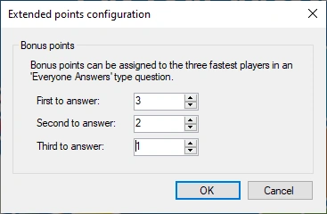{ width="201" loading=lazy }

Assegnare un valore maggiore di zero per ogni voce (se si desidera premiare solo il giocatore più veloce, compilare solo i punti del primo a rispondere). Durante il quiz, al termine della domanda compare sullo schermo un indicatore animato dei punti bonus che mette in evidenza i giocatori che hanno vinto i punti bonus.

Verrà riprodotto anche il jingle del vincitore del primo bonus (per ulteriori informazioni sui jingle, fare riferimento a [Configuring sounds – the Sounds tab page](../../setup/configuring-sounds-the-sounds-tab-page.md))

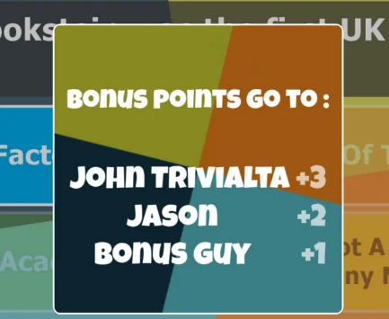{ width="275" loading=lazy }

## Domande a scelta multipla

Quando si crea una domanda a scelta multipla, in QuizXpress Studio è possibile indicare quale delle risposte è quella corretta. In questo caso, QuizXpress può giudicare la correttezza delle risposte date dalle squadre durante il quiz. Per indicare quale risposta è quella corretta, selezionare prima una delle risposte con il mouse e poi spuntare ‘Correct Answer’ nel pannello delle proprietà. È possibile anche usare il menu contestuale selezionando prima la risposta, quindi facendo clic con il pulsante destro e scegliendo ‘Set correct answer’. Inoltre, è possibile impostare le risposte corrette delle domande a scelta multipla nella rappresentazione ‘Table Mode’ delle domande (fare clic sulla scheda VIEW e poi su ‘Table Mode’). Nell’ultima colonna della griglia è possibile indicare la risposta corretta per le domande a scelta multipla (a risposta singola).

## Più risposte corrette

QuizXpress supporta la presenza di più risposte corrette. Sono disponibili le seguenti opzioni:

### Single correct

È la modalità predefinita, in cui una domanda a scelta multipla ha una sola risposta corretta.

### Multiple correct (one response)

In questa modalità la domanda può avere più risposte corrette, ma i giocatori possono sceglierne una sola. Per ogni risposta è possibile impostare, se applicabile, una diversa correttezza. Lo si può usare per creare domande in cui i giocatori possono ottenere più punti se sono ‘più vicini’ alla risposta corretta, come illustrato nella domanda qui sotto (2000 è la risposta esatta):

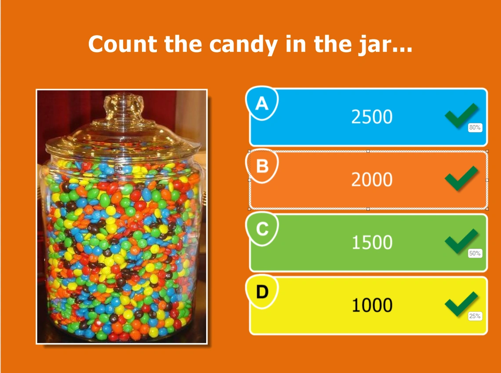{ width="449" loading=lazy }

La ‘correttezza’ (correctness) di una risposta si imposta facendo clic con il pulsante destro sulla risposta e selezionando ‘Set Correctness’ dal menu contestuale. La seguente finestra di dialogo aiuta a impostare il valore di correttezza:

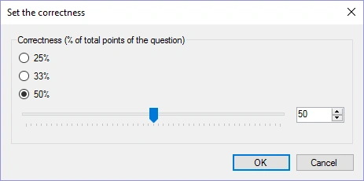{ width="311" loading=lazy }

Lo si può usare anche per creare domande in stile ‘Family Feud’ come quella qui sotto. Assegnando alle risposte una correttezza pari alle percentuali delle risposte di Family Feud, scegliere una risposta più popolare assegnerà al giocatore più punti. Se si imposta a 100 il punteggio della domanda, il numero di punti che un giocatore può vincere dando una certa risposta è la percentuale corrispondente.

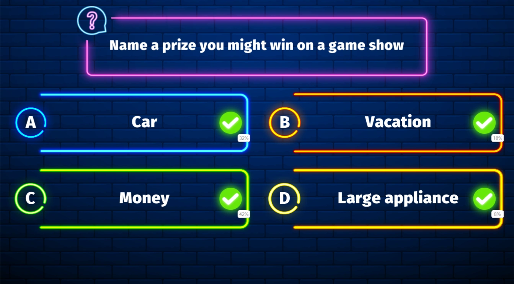{ loading=lazy }

### Multiple correct (multiple responses)

In questa modalità la domanda può avere più risposte corrette, ciascuna con una diversa ‘correttezza’, ma ora i giocatori possono selezionare più di una risposta. Quindi, ad esempio, quando le risposte A e C sono entrambe impostate come corrette (ciascuna con il 50% di correttezza), i giocatori possono ottenere il 100% dei punti rispondendo alla domanda con *entrambe* A e C. Se invece rispondessero con A e B, otterrebbero solo il 50% dei punti.

Se i giocatori devono rispondere con tutte le risposte corrette per vincere punti, selezionare la domanda e, nel pannello delle proprietà, impostare il ‘response mode’ su ‘multiple responses, exact match’.

### Ordered

In questa modalità un giocatore deve mettere le risposte nell’ordine corretto. È possibile creare domande come quella mostrata qui sotto (la risposta corretta sarebbe C->A->D->B).

Se si vuole che i giocatori indichino l’ordine esatto per vincere punti, selezionare la domanda e, nel pannello delle proprietà, impostare il ‘ordered answer mode’ su ‘exact match’ (che è il valore predefinito). Se anche un ordine parzialmente corretto deve far vincere punti, impostare il ‘ordered answer mode’ su ‘partial match’. In questo caso, la percentuale di risposte date nella posizione giusta darà la stessa percentuale dei punti che si possono vincere per la domanda. Ad esempio, se l’ordine corretto è ABCD e un giocatore risponde ACBD, otterrà il 50% dei punti che si possono vincere per la domanda.

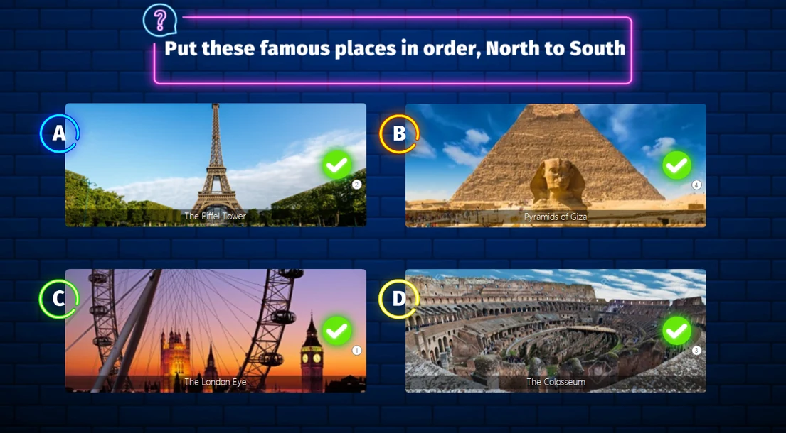{ loading=lazy }

Per cambiare l’ordine, fare clic con il pulsante destro su una delle risposte ordinate e fare clic su ‘Set Order’: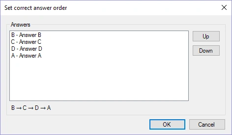{ width="284" loading=lazy }

## Domande numeriche, a testo completo e con la prima lettera

QuizXpress supporta tre tipi di input utilizzabili con l’app Smart Buzzer o con il sito web buzzerpad: numerico, testo completo e prima lettera. Questi tipi di input possono essere usati in combinazione con una domanda aperta. Le opzioni sono le seguenti:

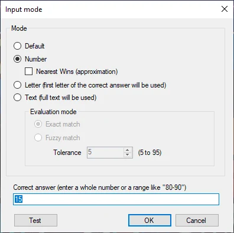{ width="286" loading=lazy }

Scegliendo *Default* per una domanda aperta si ottiene una normale domanda Dito più Veloce, che può essere giocata con buzzer o pulsantiere. Con l’app Smart Buzzer o il sito web buzzerpad, sullo schermo viene mostrato un buzzer. La persona che preme per prima blocca i buzzer di tutti gli altri giocatori e risponde a voce al Quizmaster.

### Input numerico

|     |
|-----|

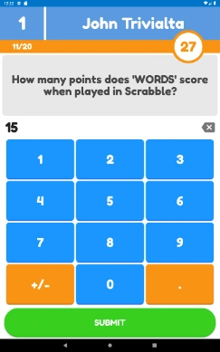{ width="126" loading=lazy }Per il tipo di input *Number*, l’app Smart Buzzer o il sito web buzzerpad presenta ai giocatori una schermata in cui possono inserire un valore numerico.

Per le domande numeriche è possibile specificare anche un intervallo come ‘80-90’. Ciò significa che tutte le risposte comprese (estremi inclusi) tra 80 e 90 sono giudicate corrette. Oppure è possibile trasformare la domanda in una domanda di approssimazione (ad es. ‘quante biglie ci sono nel barattolo’) in cui solo il giocatore con la risposta più vicina a quella corretta ottiene punti. In questo caso, spuntare ‘Nearest wins’. Quando ci sono più vincitori, i giocatori che hanno dato la risposta più rapidamente vincono i punti.

Nelle domande numeriche di tipo nearest-wins, un numero qualsiasi di giocatori può vincere punti. Il numero di vincitori si configura nella griglia delle proprietà modificando il campo ‘Nearest Wins’.

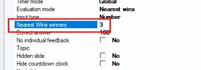{ width="413" loading=lazy }

In questo caso i primi 3 giocatori più vicini alla risposta corretta vincono punti.

### Input a testo completo

Il tipo *Full-Text* consente ai giocatori di inserire testo libero (senza distinzione tra maiuscole e minuscole).

Per le domande a testo completo è possibile indicare se si desidera una corrispondenza esatta con le risposte date, oppure usare la corrispondenza approssimativa (fuzzy matching) e impostare una tolleranza per ammettere piccoli errori di ortografia. Se si desidera consentire più risposte, è possibile inserire più testi nel campo ‘correct answer’ separati da un punto e virgola (ad esempio ‘Belgium;Belgique;Belgie’). Usare l’opzione Test per verificare che la tolleranza per le risposte di testo con ‘fuzzy match’ funzioni correttamente.

#### Domande a testo completo con risposte multiple

Le domande di testo possono avere anche più risposte. Ad esempio, è possibile riprodurre una canzone e chiedere l’artista e il titolo. Ogni risposta corretta darà il 50% dei punti. Supponiamo di riprodurre una canzone di Madonna intitolata Holiday e di voler far rispondere ai giocatori sia l’artista sia il titolo:

1)  Creare una domanda di testo standard con la risposta corretta: Madonna 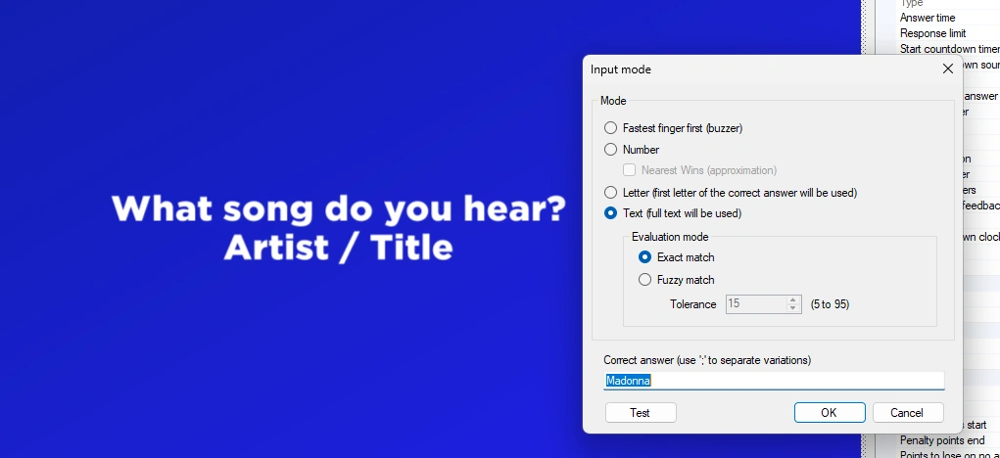{ width="602" loading=lazy }

2)  Andare nelle proprietà avanzate della diapositiva e cercare ‘Full-text answers’.

3)  Fare clic sui tre puntini \[…\] per aprire l’editor Full-text answer e aggiungere il titolo della canzone ‘Holiday’. Se necessario, è anche possibile impostare la corrispondenza approssimativa per ogni risposta o inserire varianti di risposta per ogni risposta corretta, separate da un punto e virgola:

Quando la domanda viene presentata, il giocatore vede la seguente schermata:

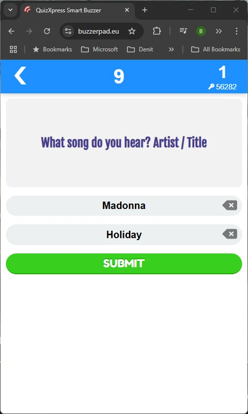{ width="335" loading=lazy }

Per impostazione predefinita, il giocatore vede tanti campi di input quante sono le risposte corrette definite, ma è possibile anche limitare il numero di campi con l’impostazione ‘Full-text response limit’:

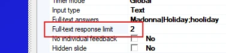{ width="377" loading=lazy }

Quindi, ad esempio, si potrebbe chiedere ‘Nomina 4 paesi che confinano con la Germania’, impostare il Full-text response limit su 4 e inserire tutti i 9 paesi confinanti come risposte corrette.

### Input a lettera

Per il tipo *Letter* viene presentata ai giocatori una griglia A-Z da cui scegliere una lettera.

Le domande con tipo di risposta lettera mostrano sul telefono una griglia con tutte le lettere dell’alfabeto. I giocatori scelgono la prima lettera di ciò che ritengono sia la risposta. Al termine della domanda il buzzer mostra se la risposta era corretta o errata, insieme alla risposta corretta completa.

Per le domande con la prima lettera è possibile anche mostrare la griglia delle lettere mescolata sul buzzer mobile (una volta o ogni 2 secondi) come sfida aggiuntiva per i giocatori. L’impostazione è disponibile nel pannello delle proprietà avanzate della diapositiva:

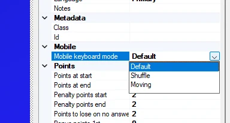{ width="231" loading=lazy }

Quando questa opzione è impostata su *Shuffle* o *Moving*, la griglia sul buzzer ha una disposizione casuale:

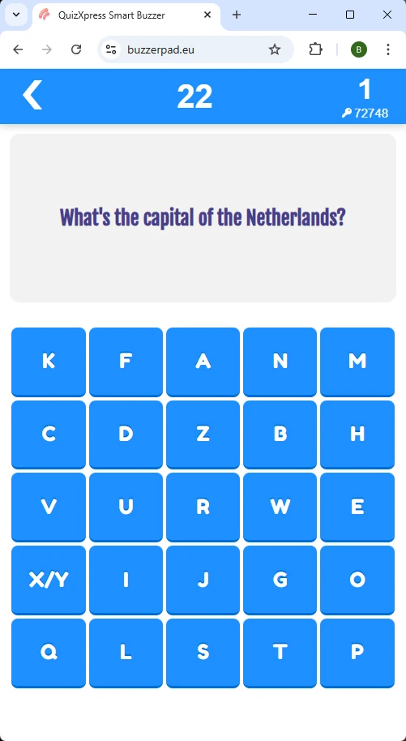{ width="187" loading=lazy }

## Domande di abbinamento
