# Vraag

Dit type staat voor een gewone quizvraag. De volgende varianten zijn mogelijk:

- *Iedereen antwoordt (ook wel stemmen genoemd):* laat elke speler een vraag beantwoorden.

- *Uitsluiting (ook wel snelste vinger genoemd)*: de speler die als eerste op een buzzer drukt, mag een vraag beantwoorden.

- *Meerkeuzevraag*: vraag met meerdere antwoorden waaruit de spelers kunnen kiezen. Gegeven antwoorden worden automatisch door het systeem beoordeeld (dat wil zeggen als ‘Vraag beoordelen’ is ingesteld op ‘Automatisch’). U maakt een meerkeuzevraag door naar het tabblad ONTWERP te gaan en de indeling te wijzigen in een indeling met meerdere antwoorden.

- *Open vraag (geen meerkeuzeopties)*: vraag die mondeling door een speler/team wordt beantwoord, waarna de quizmaster hem beoordeelt (met zijn presenter-afstandsbediening, het toetsenbord of QuizXpress Director). U maakt een open vraag door naar het menu ONTWERP te gaan en de indeling te wijzigen in een indeling zonder antwoorden. Selecteer in de sectie ‘Invoermodus’ ‘standaard’ als invoermodus.

- Uitgebreide invoertypen met vragen waarop met een getal, volledige tekst of eerste letter wordt geantwoord. Deze vragen kunnen worden beantwoord met de QuizXpress Smart Buzzer-app of via de buzzerpad-website. U maakt een open vraag met een getal-, letter- of tekstantwoord door ‘nummer’, ‘letter’ of ‘tekst’ als invoermodus te selecteren.

In de sectie Punten kunt u aangeven hoeveel punten er te winnen zijn voor een juist antwoord, hoeveel punten verloren gaan bij een onjuist antwoord en hoeveel punten verloren gaan wanneer er geen antwoord wordt gegeven. U kunt er ook voor kiezen dat de punten afnemen naarmate de klok tijdens een vraag aftelt. Voer hiervoor het aantal punten ‘Bij start’ en ‘Bij einde’ in. Hetzelfde kunt u doen voor strafpunten (*Onjuist antwoord* en *Geen antwoord*).

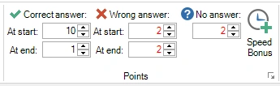{ width="222" loading=lazy }

Met deze opties kunt u spelers die snel antwoorden belonen met meer punten. Tegelijkertijd kunnen foute antwoorden aan het begin van een vraag zwaarder worden bestraft, om te voorkomen dat mensen direct nadat het aftellen is begonnen gaan gokken.

Bij een meerkeuzevraag kunt u snelheidsbonuspunten instellen voor de drie snelste spelers die de vraag juist beantwoorden. Dit resulteert in een vraag waarop iedereen kan antwoorden, met een element van ‘snelste vinger’. Om de instelling voor bonuspunten te openen, klikt u op de knop ‘Snelheidsbonus’ in de sectie Punten, waarna het volgende formulier opent:

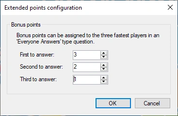{ width="201" loading=lazy }

Geef elk item een waarde groter dan nul (als u alleen de snelste speler wilt belonen, vult u alleen punten in voor de eerste die antwoordt). Tijdens de quiz verschijnt nadat de vraag voorbij is een geanimeerde bonuspuntenaanduiding op het scherm, die de speler(s) die de bonuspunten hebben gewonnen in het zonnetje zet.

De jingle van de winnaar van de bonuspunten op nummer één wordt ook afgespeeld (voor meer informatie over jingles zie [Geluiden configureren – het tabblad Geluiden](../../setup/configuring-sounds-the-sounds-tab-page.md))

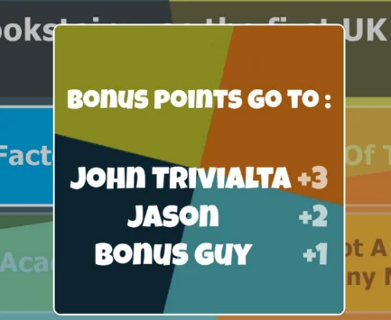{ width="275" loading=lazy }

## Antwoordtijd bij snelste-vingervragen { #time-to-answer-on-fastest-finger-questions }

Bij een vraag met snelste vinger kunt u beperken hoe lang de speler die heeft gebuzzerd de tijd heeft om zijn antwoord te geven. Selecteer de dia en stel ‘Bedenktijd’ (sectie Antwoorden van het eigenschappenvenster) in op een aantal seconden; 0, de standaardwaarde, betekent geen limiet. Zodra een tijd is ingesteld, wordt ook het veld ‘Punten aftrek bij geen antwoord’ getoond: dat zijn de punten die een speler verliest wanneer de tijd om is. Wat er tijdens de quiz gebeurt, wordt beschreven onder [Snelste vinger/Uitsluiting](../../live/starting-a-quiz/the-quiz-screen-voting-everybody-answers.md#time-to-answer).

## Meerkeuzevragen

Bij het maken van een meerkeuzevraag kunt u in QuizXpress Studio aangeven welke van de antwoorden het juiste is. Als u dat doet, kan QuizXpress de door teams gegeven antwoorden tijdens een quiz op juistheid beoordelen. U geeft aan welk antwoord het juiste is door eerst met de muis een van de antwoorden te selecteren en dan een vinkje te zetten voor ‘Goede antwoord’ in het eigenschappenvenster. U kunt ook het contextmenu gebruiken door eerst het antwoord te selecteren, dan met de rechtermuisknop te klikken en ‘Juiste antwoord instellen’ te kiezen. Daarnaast kunt u juiste antwoorden voor meerkeuzevragen instellen in de weergave ‘Tabel’ van de vragen (klik op het tabblad BEELD en vervolgens op ‘Tabel’). In de laatste kolom van het raster kunt u het juiste antwoord aangeven voor meerkeuzevragen (met één antwoord).

## Meerdere juiste antwoorden

QuizXpress ondersteunt meerdere juiste antwoorden. De volgende opties zijn beschikbaar:

### Eén juist antwoord

Dit is de standaardmodus, waarbij er één enkel juist antwoord is voor een meerkeuzevraag.

### Meerdere juiste antwoorden (één respons)

In deze modus kan de vraag meerdere juiste antwoorden hebben, maar kunnen de spelers slechts één van deze antwoorden kiezen. Voor elk antwoord kunt u, indien van toepassing, een andere juistheid instellen. Hiermee kunt u vragen maken waarbij spelers meer punten kunnen krijgen als ze ‘dichter bij’ het juiste antwoord zitten, zoals in de onderstaande vraag (2000 is het exacte antwoord):

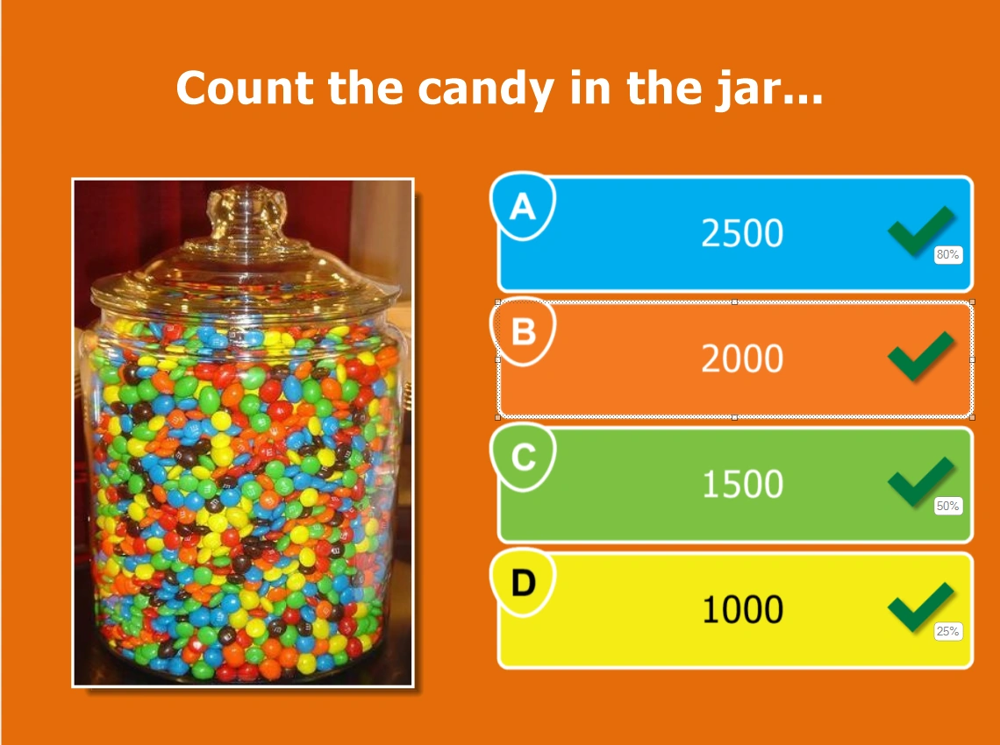{ width="449" loading=lazy }

De ‘juistheid’ van een antwoord stelt u in door met de rechtermuisknop op het antwoord te klikken en ‘Juistheid instellen’ te kiezen in het contextmenu. Het volgende dialoogvenster helpt u de juistheidswaarde in te stellen:

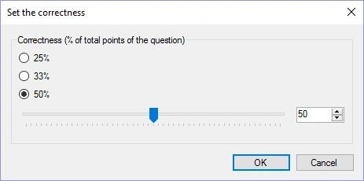{ width="311" loading=lazy }

U kunt dit ook gebruiken om vragen in de stijl van ‘Family Feud’ te maken, zoals hieronder. Door de antwoorden de juistheid van de percentages van de antwoorden uit Family Feud te geven, levert het kiezen van een populairder antwoord een speler meer punten op. Als u de punten voor de vraag op 100 instelt, is het aantal punten dat een speler kan winnen voor een bepaald antwoord het bijbehorende percentage.

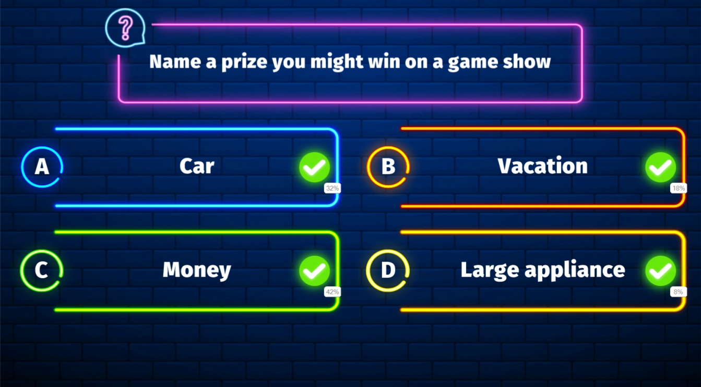{ loading=lazy }

### Meerdere juiste antwoorden (meerdere responsen)

In deze modus kan de vraag ook meerdere juiste antwoorden hebben, elk met een andere ‘juistheid’, maar kunnen de spelers nu meer dan één antwoord selecteren. Als bijvoorbeeld de antwoorden A en C allebei op juist zijn ingesteld (elk met 50% juistheid), kunnen spelers 100% van de punten verdienen door op de vraag te antwoorden met *zowel* A als C. Als ze in plaats daarvan met A en B antwoordden, zouden ze maar 50% van de punten krijgen.

Als spelers met alle juiste antwoorden moeten antwoorden om punten te winnen, selecteert u de vraag en stelt u in het eigenschappenvenster de ‘Respons mode’ in op ‘meerdere responsen, exacte overeenkomst’.

### Volgorde

In deze modus moet een speler de antwoorden in de juiste volgorde zetten. U kunt vragen maken zoals de onderstaande (het juiste antwoord zou C->A->D->B zijn).

Als u wilt dat de spelers de exacte volgorde geven om punten te winnen, selecteert u de vraag en stelt u in het eigenschappenvenster de ‘Volgorde antwoordmodus’ in op ‘exacte overeenkomst’ (de standaardwaarde). Als een gedeeltelijk juiste volgorde ook punten moet opleveren, stelt u de ‘Volgorde antwoordmodus’ in op ‘gedeeltelijke overeenkomst’. In dat geval levert het percentage antwoorden dat op de juiste plek staat hetzelfde percentage op van de punten die voor de vraag te winnen zijn. Als de juiste volgorde bijvoorbeeld ABCD is en een speler antwoordt ACBD, levert dat 50% op van de punten die voor de vraag te winnen zijn.

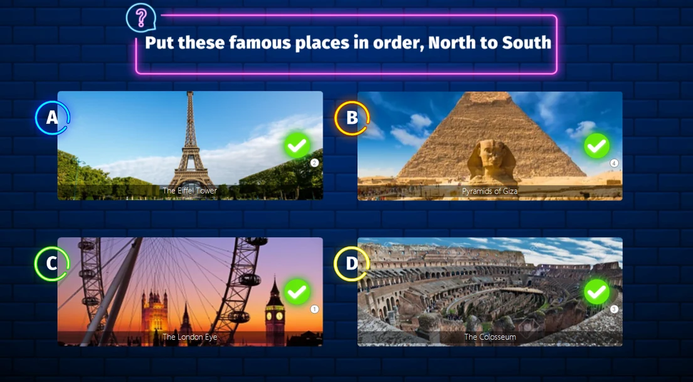{ loading=lazy }

Om de volgorde te wijzigen, klikt u met de rechtermuisknop op een van de geordende antwoorden en klikt u op ‘Volgorde instellen’: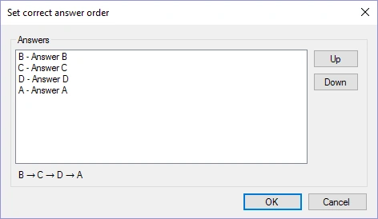{ width="284" loading=lazy }

## Vragen met getal, volledige tekst en eerste letter

QuizXpress ondersteunt drie invoertypen die met de Smart Buzzer-app of de buzzerpad-website kunnen worden gebruikt: getal, volledige tekst en eerste letter. U kunt deze invoertypen combineren met een open vraag. De opties zijn als volgt:

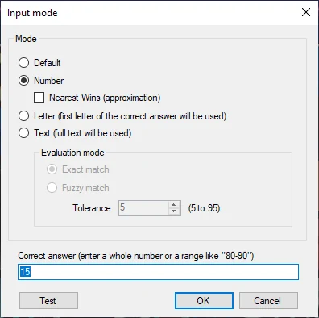{ width="286" loading=lazy }

Als u voor een open vraag *Standaard* kiest, ontstaat een gewone vraag met snelste vinger die met buzzers of keypads kan worden gespeeld. Bij gebruik van de Smart Buzzer-app of de buzzerpad-website wordt een buzzer op het scherm getoond. De persoon die als eerste drukt, sluit de buzzers van alle andere spelers uit en antwoordt mondeling aan de quizmaster.

### Getalinvoer

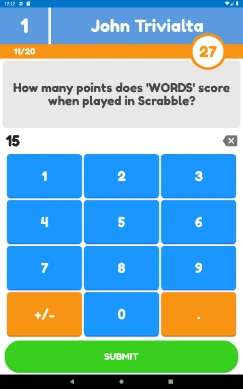{ width="126" align=left loading=lazy }Bij het invoertype *Nummer* toont de Smart Buzzer-app of de buzzerpad-website de spelers een scherm waarin ze een numerieke waarde kunnen invoeren.

Bij numerieke vragen kunt u ook een bereik opgeven zoals ‘80-90’. Dat betekent dat alle antwoorden tussen (inclusief) 80 en 90 als juist worden beoordeeld. Of u kunt de vraag veranderen in een benaderingsvraag (bijv. ‘hoeveel knikkers zitten er in de pot’) waarbij alleen de speler met het antwoord dat het dichtst bij het juiste antwoord ligt punten krijgt. Zet in dat geval een vinkje voor ‘Dichtstbijzijnde wint’. Wanneer er meerdere winnaars zijn, winnen de spelers die het snelst antwoordden de punten.

Bij numerieke vragen van het type dichtstbijzijnde wint kan een willekeurig aantal spelers punten winnen. Het aantal winnaars stelt u in het eigenschappenraster in door het veld ‘Benaderingsvraag’ te wijzigen.

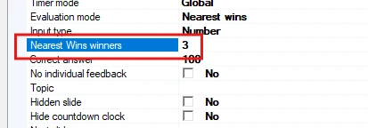{ width="413" loading=lazy }

In dit geval winnen de top 3 spelers die het dichtst bij het juiste antwoord zitten punten.

### Invoer van volledige tekst

Met het type *Volledige tekst* kunnen spelers vrije tekst invoeren (niet hoofdlettergevoelig; hoofdletters maken niet uit).

Bij vragen met volledige tekst kunt u aangeven of u een exacte overeenkomst met de gegeven antwoorden wilt, of u kunt fuzzy matching gebruiken en een tolerantie instellen om kleine spelfouten toe te staan. Als u meerdere antwoorden wilt toestaan, kunt u in het veld ‘juist antwoord’ meerdere teksten invoeren, gescheiden door een puntkomma (bijvoorbeeld ‘Belgium;Belgique;Belgie’). Gebruik de optie Testen om te controleren of de tolerantie voor ‘fuzzy match’-tekstantwoorden goed werkt.

#### Tekstvragen met meerdere responsen

Tekstvragen kunnen ook meerdere responsen hebben. U kunt bijvoorbeeld een liedje afspelen en vragen naar de artiest en de titel. Elk juist antwoord levert 50% van de punten op. Stel dat u een liedje van Madonna afspeelt met de titel Holiday en u wilt dat de spelers zowel de artiest als de titel antwoorden:

1)  Maak een standaard tekstvraag met het juiste antwoord: Madonna 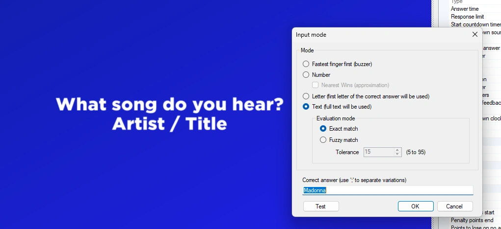{ width="602" loading=lazy }

2)  Ga naar de geavanceerde eigenschappen van de dia en zoek naar ‘Meerdere goede tekst antwoorden’.

3)  Klik op de drie puntjes \[…\] om de editor voor tekstantwoorden te openen en voeg de titel van het liedje ‘Holiday’ toe. Indien nodig kunt u ook per antwoord fuzzy matching instellen of per juist antwoord antwoordvarianten invoeren, gescheiden door een puntkomma:

Wanneer de vraag wordt gepresenteerd, ziet de speler het volgende scherm:

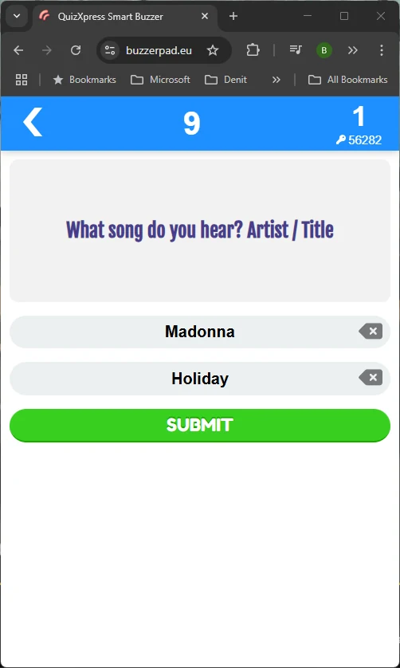{ width="335" loading=lazy }

Standaard ziet de speler evenveel invoervelden als er juiste antwoorden zijn gedefinieerd, maar u kunt het aantal invoervelden ook beperken met de instelling ‘Limiet voor tekstantwoorden’:

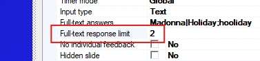{ width="377" loading=lazy }

U kunt dus bijvoorbeeld vragen ‘Noem 4 landen die aan Duitsland grenzen’, de Limiet voor tekstantwoorden op 4 instellen en alle 9 buurlanden als juiste antwoorden invoeren.

### Letterinvoer

Bij het type *Letter* wordt een A-Z-raster getoond waaruit spelers één letter kiezen.

Vragen met responstype letter tonen op de telefoon een raster met alle letters van het alfabet. Spelers kiezen de eerste letter van wat zij denken dat het antwoord is. Aan het einde van de vraag toont de buzzer of het antwoord juist of onjuist was, samen met het volledige juiste antwoord.

Bij vragen met eerste letter kunt u het lettergrid op de mobiele buzzer ook geshuffeld tonen (eenmalig of om de 2 seconden) als extra uitdaging voor de spelers. De instelling is beschikbaar in het venster met geavanceerde eigenschappen van de dia:

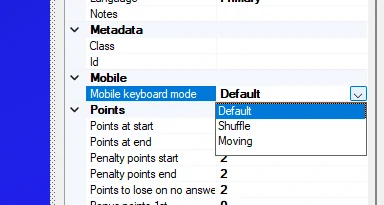{ width="231" loading=lazy }

Wanneer deze optie is ingesteld op *Shuffelen* of *Bewegend*, heeft het raster op de buzzer een willekeurige indeling:

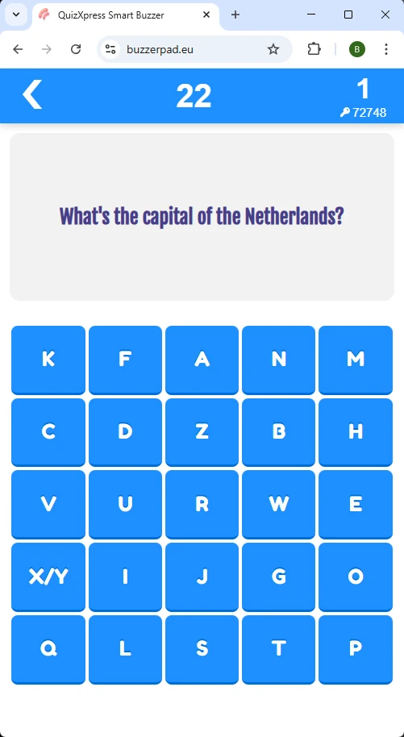{ width="187" loading=lazy }
