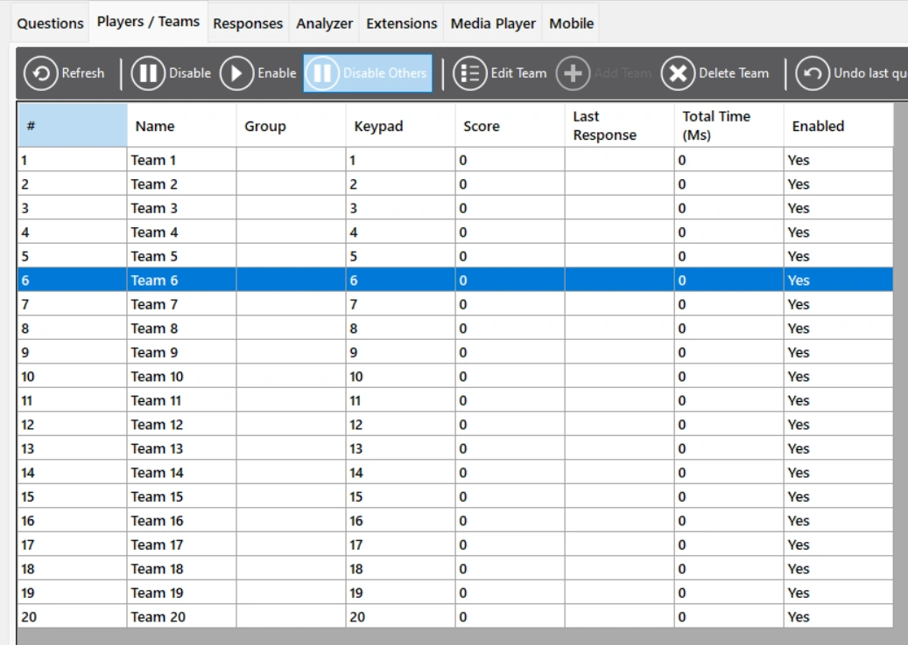
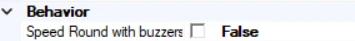

# Speed Round

En una Speed Round, un jugador debe responder al mayor número posible de preguntas dentro de un tiempo configurable. El presentador debe seleccionar manualmente a este jugador en QuizXpress Director.

*Para ello, vaya a QuizXpress Director. Seleccione el equipo que debe jugar la ronda de velocidad y pulse 'Disable Others'. (Recuerde habilitar a los demás jugadores, o cambiar el único jugador activo, según lo que desee hacer, una vez finalizada la Speed Round.)*

{ width="371" loading=lazy }

Tras terminar una pregunta, se presenta una nueva, pero el mismo reloj sigue corriendo. Para añadir una ronda de velocidad a su quiz, establezca la primera diapositiva de su Speed Round en el tipo de diapositiva 'Speed Round'. La ronda debe terminar con una diapositiva 'End of Round'. Tenga en cuenta que las diapositivas entre el comienzo y el final de la ronda NO deben establecerse en el tipo Speed Round. Hay dos maneras de jugar una ronda de velocidad: manualmente o con pulsadores. Cuando la Speed Round se juega manualmente, el presentador juzga las respuestas manualmente (pulsa Y si es correcta o N si es incorrecta). Cuando la Speed Round se juega con pulsadores, los jugadores pueden utilizar sus pulsadores/mandos/teléfonos para responder a las preguntas.

*El ajuste manual/pulsadores se encuentra en el panel de propiedades. False significa jugar manualmente, True significa jugar con pulsadores.*

{ width="284" loading=lazy }
