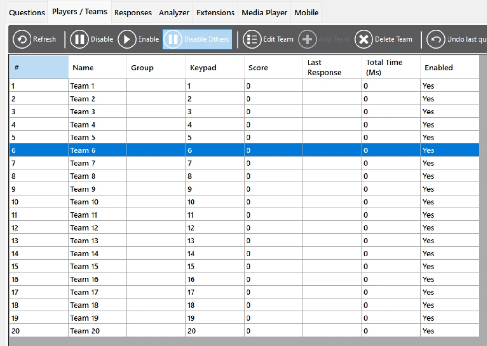
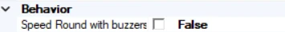

# Snelheidsronde

In een snelheidsronde moet één speler binnen een instelbare tijd zoveel mogelijk vragen beantwoorden. Deze speler moet door de quizmaster handmatig worden gekozen in QuizXpress Director.

*Ga hiervoor naar QuizXpress Director. Selecteer het team dat de snelheidsronde moet spelen en druk op ‘Sluit andere spelers uit’. (Denk eraan de andere spelers weer in te schakelen, of de enige actieve speler te wijzigen, al naargelang wat u wilt doen nadat de snelheidsronde is afgelopen.)*

{ width="371" loading=lazy }

Na het afronden van een vraag verschijnt een nieuwe, maar dezelfde klok blijft doortikken. Om een snelheidsronde aan uw quiz toe te voegen, stelt u de eerste dia van uw snelheidsronde in op het dia-type ‘Snelheidsronde’. De ronde moet eindigen met een dia ‘Einde ronde’. Let op: de dia’s tussen het begin en het einde van de ronde mogen NIET op het type Snelheidsronde staan. Een snelheidsronde kan op twee manieren worden gespeeld: handmatig of met buzzers. Wanneer de snelheidsronde handmatig wordt gespeeld, beoordeelt de quizmaster de antwoorden zelf (de quizmaster drukt op Y voor juist of op N voor onjuist). Wanneer de snelheidsronde met buzzers wordt gespeeld, kunnen spelers hun buzzers/keypads/telefoons gebruiken om de vragen te beantwoorden.

*De instelling voor handmatig/buzzers is de eigenschap ‘Snelheidsronde met buzzers’ in het gedeelte ‘Antwoorden’ van het eigenschappenvenster: uitgeschakeld betekent handmatig spelen, ingeschakeld betekent spelen met buzzers.*

{ width="284" loading=lazy }
