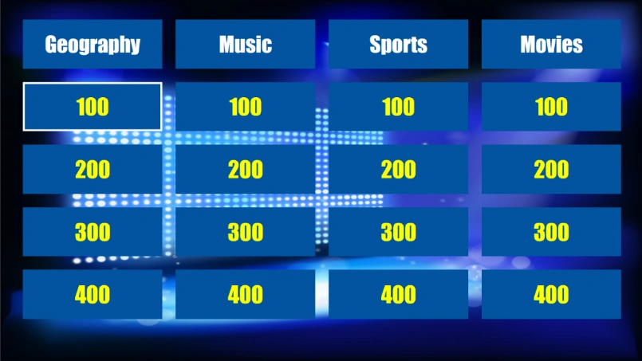
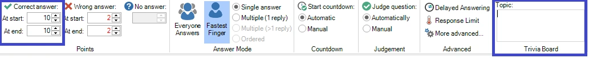
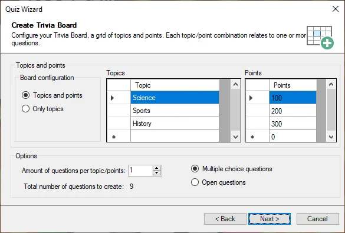
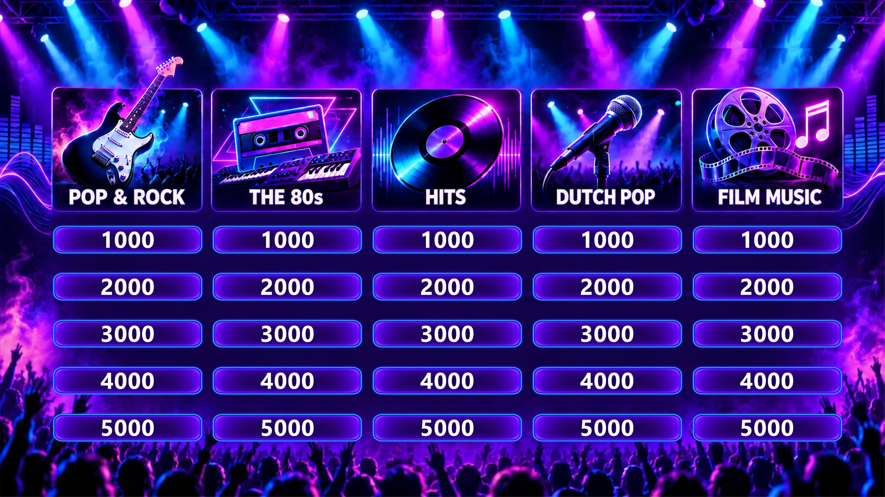
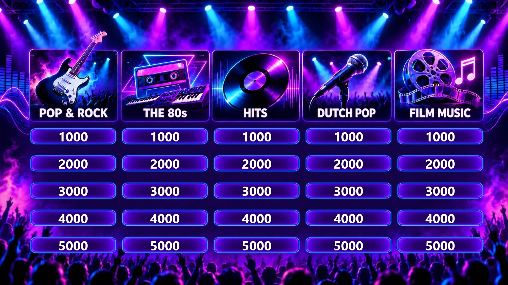
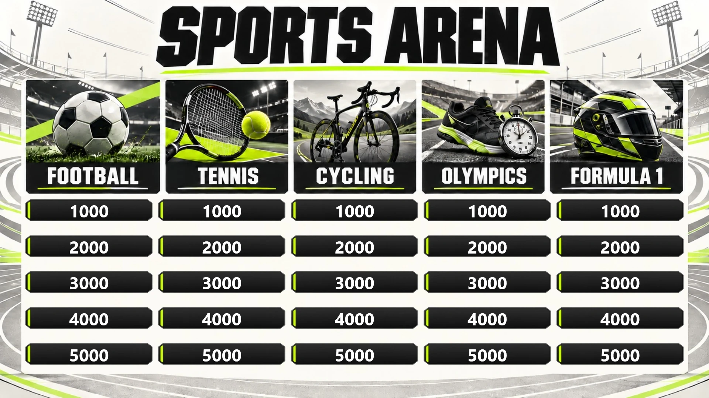
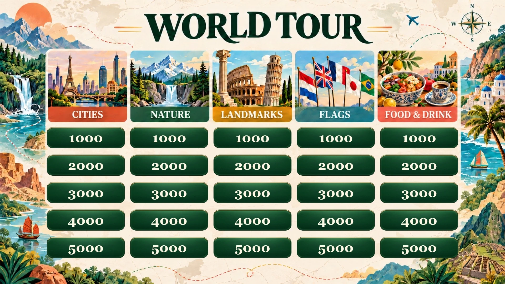
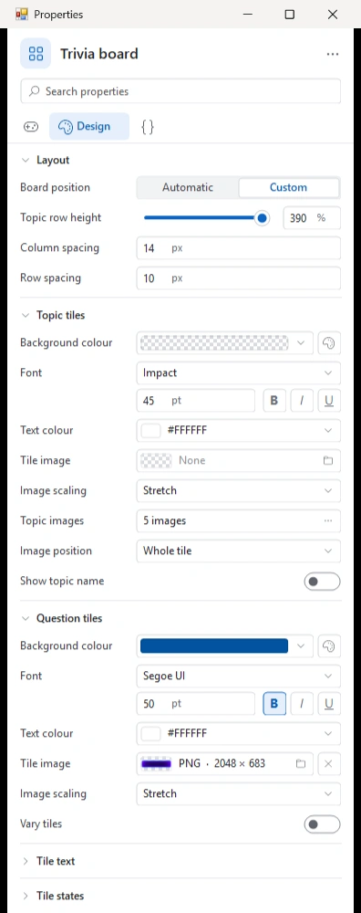
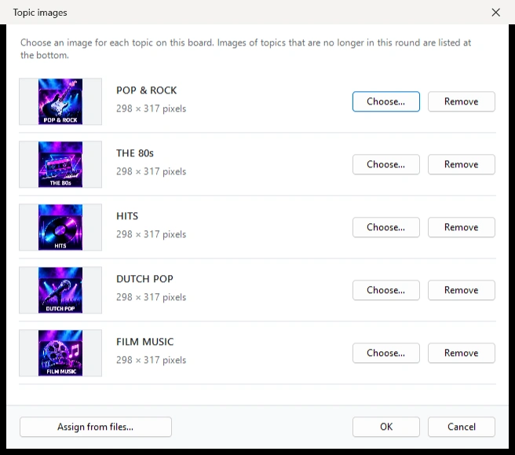
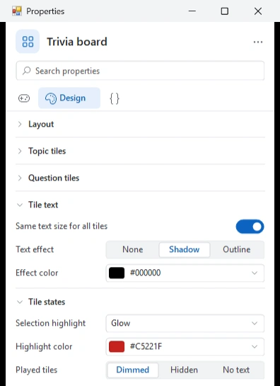

# Trivia Board round

Un Trivia Board round consente di creare un tabellone di domande in stile Jeopardy® con argomenti e domande di difficoltà/punteggio variabile.

{ width="513" loading=lazy }

Come le normali diapositive del quiz, un trivia board può essere completamente personalizzato nello stile (per maggiori dettagli sulle opzioni, fare riferimento alla sezione [Trivia Board properties](../user-interface-overview/advanced-properties-grid.md#proprieta-del-trivia-board)).

Durante il quiz, le domande sul tabellone possono essere scelte (con la tastiera, con il mouse o con il telecomando del conduttore del quiz) oppure estratte a caso; in tal caso un selettore casuale scorre sullo schermo e sceglie una delle caselle.

## Come creare un Trivia Board?

Per creare un trivia board, iniziare inserendo una diapositiva trivia board nel quiz (andare al menu INSERT, fare clic sull’elenco a discesa nella sezione Quiz Slides e scegliere il layout Trivia Board). Il trivia board verrà generato automaticamente dalle domande che lo seguono.

Per suddividere le domande in argomenti e punteggi (o solo in argomenti), assicurarsi di impostare le seguenti proprietà delle domande che seguono il trivia board:

- L’argomento (topic)

- I punti

Entrambi possono essere inseriti nella scheda QUESTION quando la domanda è selezionata:

{ width="604" loading=lazy }

In alternativa, è possibile inserire le proprietà anche nel pannello delle proprietà (se non è visibile, mostrarlo prima selezionando la scheda VIEW e spuntando ‘Properties’).

Un Trivia Board può essere combinato con altri formati di gioco di QuizXpress. Per creare un Trivia Board (round), QuizXpress deve sapere dove termina un round Trivia Board. Un round Trivia Board termina a uno dei seguenti tipi di diapositiva:

- una diapositiva ‘End of round’ (vedere anche 3.4.3)

- un’altra diapositiva Trivia Board

- una diapositiva Trivia Ladder

- la fine del quiz (ultimo round o gioco composto solo da un Trivia Board)

Durante il quiz, tutte le diapositive di un round Trivia Board vengono elaborate e raggruppate per argomento. All’interno di un argomento, le domande sono raggruppate per numero di punti. In questo modo, dietro ogni casella di punti del tabellone possono esserci più domande. Quando le domande dietro una certa casella sono esaurite, la casella diventa grigia e non può più essere scelta.

Le domande senza punti (ad esempio Audience response, Demographic, Wager) vengono ignorate durante la creazione del Trivia Board.

In alternativa, il Quiz Wizard può aiutare a creare un round Trivia Board completo in pochi clic! Avviare la procedura guidata (scheda HOME, quindi ‘Quiz Wizard’) e selezionare ‘create a new round’ seguito da ‘a Trivia Board round’. Quindi inserire gli argomenti, i punti e le altre preferenze.

{ width="499" loading=lazy }

Scegliere il tempo per le domande, i punti e lo stile da usare nelle pagine successive, quindi premere ‘Finish’ per creare il tabellone, le domande e la diapositiva finale di fine round. Naturalmente sarà ancora necessario inserire le domande vere e proprie, ma l’argomento e i punti corretti saranno già impostati.

## Anteprima di un Trivia Board

La diapositiva Trivia Board in QuizXpress Studio mostra il tabellone così come apparirà durante lo show: gli argomenti e i valori di punti reali del round, disposti secondo le impostazioni di design (posizione, spaziatura, immagini e testo). Impostando le opzioni di stile del Trivia Board e lo sfondo è possibile determinare l’aspetto del tabellone.

{ loading=lazy }

Per provare il tabellone come verrà giocato durante il game show, premere F5 e il tabellone verrà generato automaticamente dalle domande presenti nel round Trivia Board.

## Progettare il proprio tabellone

Oltre al classico tabellone blu, è possibile dare a un Trivia Board un design completamente personale: uno sfondo a tema, intestazioni degli argomenti illustrate e caselle personalizzate. Alcuni esempi:

{ loading=lazy }

{ loading=lazy }

{ loading=lazy }

Un design come questi è composto da alcune immagini:

- **Uno sfondo** per la diapositiva (1920 × 1080 per un quiz 16:9), con tutto ciò che non cambia durante il gioco: lo scenario, un titolo, una cornice intorno al tabellone.
- **Un’immagine per argomento** per le caselle degli argomenti, ad esempio un’illustrazione con il nome dell’argomento, come negli esempi qui sopra.
- **Un’immagine di casella** per le caselle dei punti, ad esempio un pulsante o una pennellata. Salvarla in formato PNG con gli angoli trasparenti, in modo che lo sfondo si veda attorno alla casella.

Tutte le impostazioni di design si trovano nella pagina 'Design' del pannello delle proprietà quando il tabellone è selezionato. Tutte le immagini sono memorizzate all’interno del file del quiz, quindi non è necessario copiarle insieme al quiz.

{ width="380" loading=lazy }

Il tabellone musicale qui sopra, ad esempio, ha una posizione personalizzata, un’altezza della riga degli argomenti del 390% per le intestazioni alte, un’immagine dell’argomento su tutta la casella per ogni argomento con il nome dell’argomento disattivato (le immagini lo contengono già), uno sfondo trasparente per le caselle degli argomenti e un’immagine di casella per le caselle dei punti.

### Posizione del tabellone

'Board position' stabilisce dove appare il tabellone:

- **Automatic** riempie lo schermo, come il tabellone classico. Le caselle usano quindi un colore di riempimento invece delle immagini.
- **Custom** colloca il tabellone dove si trova sulla diapositiva. Trascinare e ridimensionare il tabellone in Studio per adattarlo alla cornice dello sfondo. Le impostazioni delle immagini qui sotto sono disponibili solo con una posizione personalizzata.

Sotto 'Layout' è possibile impostare anche:

- **Topic row height**: l’altezza delle caselle degli argomenti rispetto alle caselle dei punti (ad esempio 250% per grandi intestazioni illustrate).
- **Column spacing** e **Row spacing**: lo spazio tra le caselle.

### Immagini delle caselle

- **Tile image** (in 'Topic tiles' e in 'Question tiles') sostituisce il colore di riempimento delle caselle con un’immagine.
- **Image scaling** stabilisce come l’immagine viene adattata a una casella: 'Stretch' (riempie esattamente la casella), 'Fit' (mantiene la forma dell’immagine), 'Fill' (mantiene la forma e taglia ciò che non entra) o 'Keep corners' (allunga la parte centrale dell’immagine e mantiene gli angoli così come sono, utile per le caselle con cornice).
- **Vary tiles** specchia l’immagine delle caselle dei punti in modo diverso su ogni casella, così che una casella con, ad esempio, schizzi di vernice non abbia lo stesso aspetto ovunque.

### Immagini degli argomenti

Fare clic sul pulsante accanto a 'Topic images' per dare a ogni argomento del round una propria immagine. La finestra di dialogo elenca gli argomenti delle domande che seguono il tabellone:

{ width="600" loading=lazy }

- Fare clic su 'Choose…' per scegliere un’immagine per un argomento, oppure trascinare un file immagine sulla sua riga.
- 'Assign from files…' assegna più immagini in una volta sola: ogni immagine viene assegnata all’argomento con lo stesso nome del file. Maiuscole e minuscole, accenti, spazi, trattini e trattini bassi non hanno importanza, quindi `dutch-pop.png` viene assegnato all’argomento 'Dutch Pop'.
- Le immagini degli argomenti che non fanno più parte del round sono elencate in fondo, così da poterle rimuovere.

'Image position' colloca l’immagine dell’argomento su tutta la casella, oppure a sinistra, a destra o sopra il nome dell’argomento. Quando le immagini contengono già il nome dell’argomento (come negli esempi qui sopra), disattivare 'Show topic name'.

!!! tip
    Le immagini degli argomenti sono associate a un argomento tramite il suo nome. Quando si rinomina un argomento nelle domande, scegliere di nuovo la sua immagine.

### Testo delle caselle

{ width="380" loading=lazy }

- **Same text size for all tiles**: quando è attivata, tutti i nomi degli argomenti hanno la stessa dimensione del testo e tutti i valori dei punti hanno la stessa dimensione del testo: la dimensione più grande alla quale ogni testo entra nella propria casella, ma mai superiore alla dimensione del carattere impostata. I nomi lunghi degli argomenti vengono distribuiti su due righe. Quando è disattivata, ogni testo viene ingrandito quanto consente la propria casella, quindi i testi brevi risultano più grandi di quelli lunghi.
- **Text effect** aggiunge un’ombra o un contorno attorno al testo delle caselle, nel colore 'Effect color'.

### Selezione e caselle giocate

- **Selection highlight** stabilisce come la selezione casuale mostra la casella scelta: 'Fill' copre la casella con il colore di evidenziazione (l’aspetto classico), 'Tint' la colora in parte, 'Outline' e 'Glow' disegnano un bordo colorato e lasciano visibile l’immagine della casella.
- **Highlight color** imposta il colore della selezione casuale.
- **Played tiles** stabilisce l’aspetto di una casella dopo che le sue domande sono state giocate: 'Dimmed', 'Hidden' o 'No text' (la casella resta, senza il valore dei punti).

### Video di sfondo

Anche una diapositiva Trivia Board può avere un [video di sfondo](../backgrounds.md#video-di-sfondo). Viene riprodotto dietro il tabellone con le impostazioni proprie del video (ripetizione, muto, volume) e va in pausa mentre viene mostrata una domanda.

!!! note
    Le versioni meno recenti di QuizXpress possono ancora aprire un quiz con un tabellone personalizzato, ma lo mostrano come un tabellone classico.
