# Trivia Bord-ronde

Met een Trivia Bord-ronde kunt u een vragenbord in de stijl van Jeopardy® maken, met onderwerpen en vragen van uiteenlopende moeilijkheid/punten.

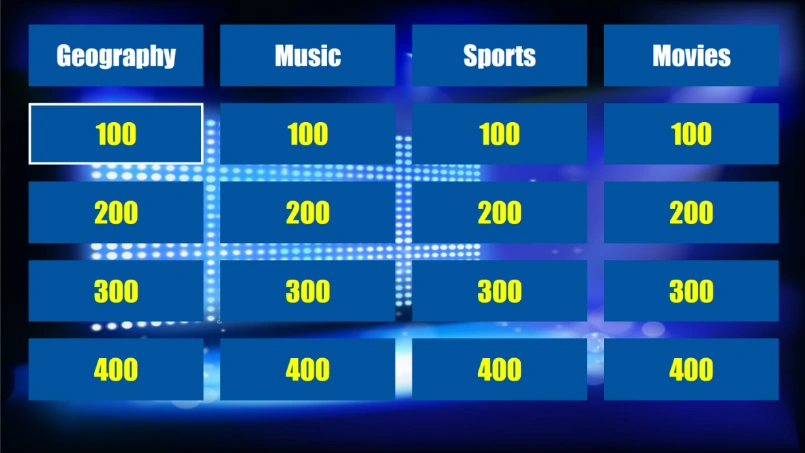{ width="513" loading=lazy }

Net als gewone quizdia’s kan een Trivia Bord volledig worden vormgegeven (zie het gedeelte [Trivia Bord-eigenschappen](../user-interface-overview/advanced-properties-grid.md#trivia-bord-eigenschappen) voor meer details over de opties).

Tijdens de quizshow kunnen de vragen op het bord worden gekozen (met het toetsenbord, de muis of de afstandsbediening van de quizmaster) of willekeurig worden gekozen, waarbij een willekeurige selector over het scherm springt en een van de tegels kiest.

## Hoe maakt u een Trivia Bord?

Om een Trivia Bord te maken, voegt u eerst een Trivia Bord-dia in de quiz in (ga naar het menu INVOEGEN, klik op de keuzelijst in het gedeelte Quiz Vragen en kies de indeling Trivia Bord). Het Trivia Bord wordt automatisch opgebouwd uit de vragen die erna volgen.

Om de vragen in te delen naar onderwerp en punten (of alleen onderwerp), stelt u de volgende eigenschappen in van de vragen die op het Trivia Bord volgen:

- Het onderwerp

- De punten

U kunt beide invoeren op het tabblad VRAAG terwijl de vraag is geselecteerd:

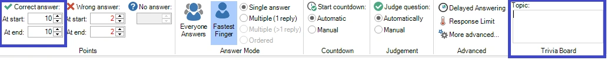{ width="604" loading=lazy }

U kunt de eigenschappen ook invoeren in het eigenschappenvenster (als dit niet zichtbaar is, toont u het eerst door het tabblad BEELD te selecteren en een vinkje voor ‘Eigenschappen’ te zetten).

Een Trivia Bord kan worden gecombineerd met andere QuizXpress-spelvormen. Om een Trivia Bord(-ronde) te maken, moet QuizXpress weten waar een Trivia Bord-ronde eindigt. Een Trivia Bord-ronde eindigt bij een van de volgende diatypen:

- een dia ‘Einde ronde’ (zie ook 3.4.3)

- een ander Trivia Bord-dia

- een Trivia Ladder-dia

- het einde van de quiz (laatste ronde of een spel met alleen een Trivia Bord)

Tijdens de quizshow worden alle dia’s van een Trivia Bord-ronde verwerkt en per onderwerp gegroepeerd. Binnen een onderwerp worden vragen gegroepeerd op het aantal punten. Zo kunnen er achter elke puntentegel op het bord meerdere vragen zitten. Zodra de vragen achter een bepaalde tegel op het bord op zijn, wordt de tegel grijs weergegeven en kan hij niet meer worden gekozen.

Vragen zonder punten (bijvoorbeeld Publieksantwoord, Demografisch, Weddenschap) worden genegeerd bij het maken van het Trivia Bord.

Als alternatief kan de Quiz Wizard u helpen om met een paar klikken een complete Trivia Bord-ronde te maken! Start de wizard (tabblad START gevolgd door ‘Quiz Wizard’) en selecteer ‘een nieuwe ronde maken’ gevolgd door ‘een Trivia Bord-ronde’. Vul nu de onderwerpen, punten en andere voorkeuren in.

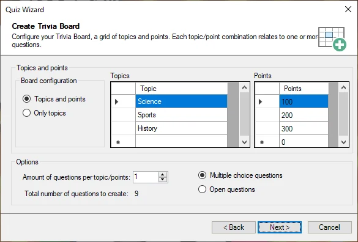{ width="499" loading=lazy }

Kies de vraagtijd, de punten en de stijl die op de volgende pagina’s worden gebruikt, en druk op ‘Voltooien’ om het bord, de vragen en de afsluitende dia voor het einde van de ronde voor u te laten maken. Natuurlijk moet u de eigenlijke vragen nog steeds zelf invullen, maar het juiste onderwerp en de juiste punten staan dan al voor u klaar.

## Billboards voor en na een vraag

Een klik op een tegel speelt de vraag erachter af en toont daarna het bord weer. Billboards (en minigames) kunnen met een vraag meespelen: ervoor als intro, of erna als outro. Bijvoorbeeld: een billboard dat het onderwerp aankondigt, de vraag, en een billboard met een leuk weetje, en dan terug naar het bord.

Selecteer het billboard en stel 'Trivia bord' in bij het gedeelte 'Metagegevens' op de pagina 'Geavanceerd' van het eigenschappenvenster:

- **Automatisch**: speelt na de vraag er direct voor, zoals in eerdere versies. Alle billboards en minigames direct na een vraag spelen met die vraag mee, tot aan een billboard met een ander onderwerp. Een billboard met een onderwerp is ook een eigen tegel.
- **Intro van volgende vraag**: speelt als eerste wanneer op de tegel van de volgende vraag wordt geklikt.
- **Outro van vorige vraag**: speelt na de vorige vraag, voordat het bord terugkomt.
- **Eigen tegel**: speelt alleen als een eigen tegel. Geef het een onderwerp, en punten voor zijn rij op het bord.

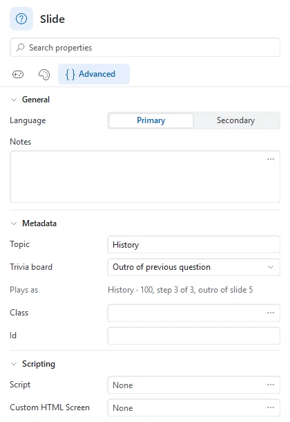{ width="380" loading=lazy }

Een intro of outro heeft geen onderwerp nodig: de vraag bepaalt waar de tegel op het bord staat. 'Speelt als' vertelt wat de geselecteerde dia doet, bijvoorbeeld "History · 100, stap 3 van 3, outro van dia 5".

### Zien wat een tegel afspeelt

De miniaturen tonen het voor elke Trivia Bord-ronde:

- Een balk in de kleur van het onderwerp loopt langs de dia’s die één klik afspeelt, met de tegel ("History · 100") erboven. Klik op de naam van de tegel om die dia’s te selecteren, zodat u ze samen kunt verplaatsen of kopiëren.
- Een dia die nooit vanaf het bord wordt afgespeeld, heeft een oranje onderbroken omlijning en een waarschuwingsteken. Wijs de miniatuur aan om te zien waarom, en waar een dia wordt afgespeeld.
- Om dit te verbergen, klikt u met de rechtermuisknop op de miniaturen en schakelt u 'Tegels van het Trivia bord tonen' uit.

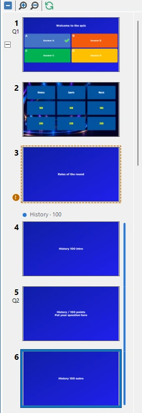{ width="280" loading=lazy }

In het voorbeeld van het bord (F5) toont een tegel in de hoek een stip per dia, één groep per klik: ●●● is één klik van drie dia’s, ● ●● twee klikken van één en twee dia’s. Een tegel met één klik van één dia heeft geen stippen. Wijs een tegel aan om de dia’s ervan te zien. Wanneer er iets mis is met de dia’s, wordt een oranje ! toegevoegd.

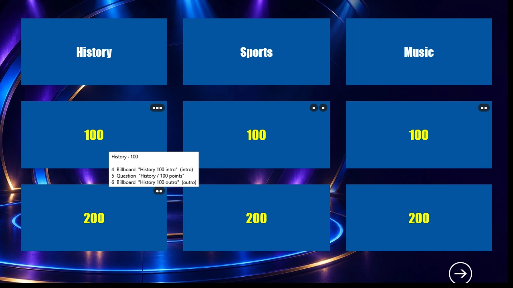{ loading=lazy }

U kunt het bord in het voorbeeld ook spelen, zoals in Quiz Show. Klik op een tegel om de dia’s ervan te zien: Spatie, → of een muisklik toont de volgende dia, ← de vorige, en na de laatste dia komt het bord terug. Druk op Esc om meteen terug te gaan naar het bord. Gespeelde tegels worden gedimd of verborgen (de instelling 'Gespeelde tegels'), en R speelt het bord opnieuw vanaf het begin.

Wanneer u de quiz opslaat, waarschuwt Studio voor billboards die nooit worden afgespeeld en voor dia’s die twee keer kunnen worden afgespeeld (bijvoorbeeld een billboard met een onderwerp dat ook na een vraag wordt afgespeeld).

!!! note
    Oudere versies van QuizXpress kunnen een quiz met deze instellingen openen, maar spelen elk billboard af als 'Automatisch'.

## Een Trivia Bord bekijken in het voorbeeld

De Trivia Bord-dia in QuizXpress Studio toont het bord zoals het er tijdens de show uit zal zien: de echte onderwerpen en puntwaarden van de ronde, ingedeeld volgens uw ontwerpinstellingen (positie, tussenruimte, afbeeldingen en tekst). Met de opmaakopties van het Trivia Bord en de achtergrond bepaalt u hoe het bord eruitziet.

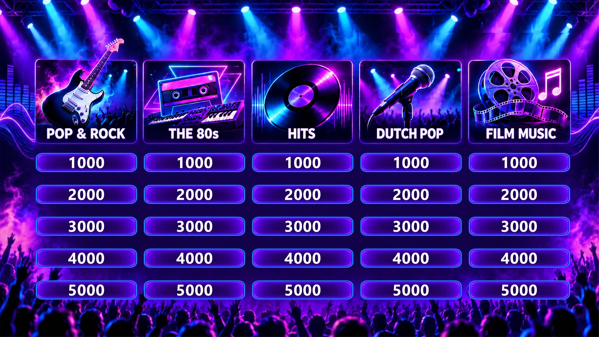{ loading=lazy }

Wanneer u het bord wilt uitproberen zoals het tijdens de quizshow wordt gespeeld, drukt u op F5 en wordt het bord automatisch opgebouwd uit de vragen in de Trivia Bord-ronde.

## Uw eigen bord ontwerpen

Naast het klassieke blauwe bord kunt u een Trivia Bord een volledig eigen ontwerp geven: een thematische achtergrond, geïllustreerde onderwerpkoppen en eigen tegels. Enkele voorbeelden:

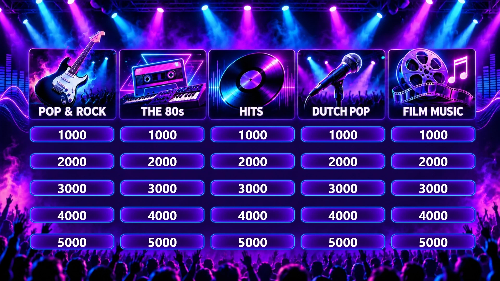{ loading=lazy }

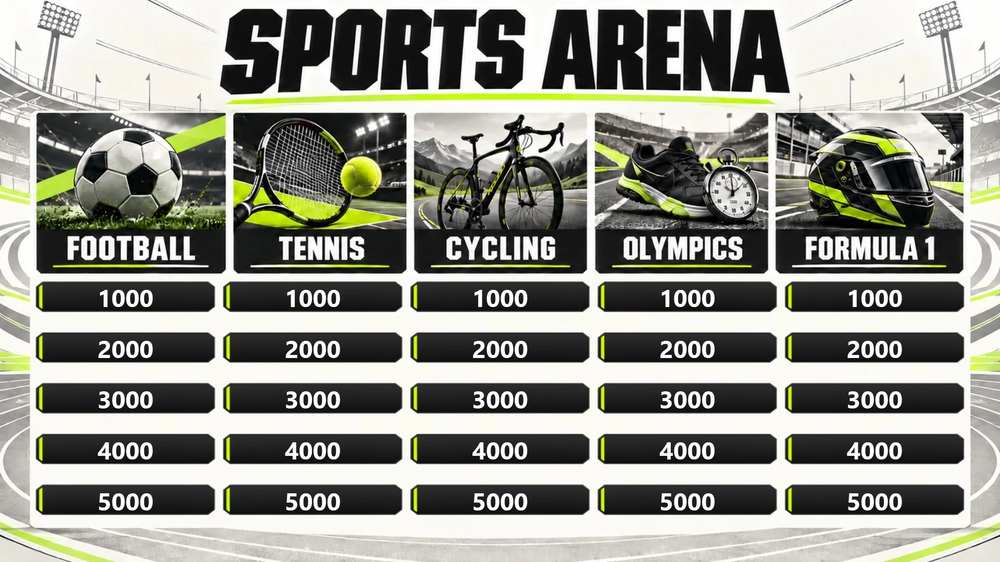{ loading=lazy }

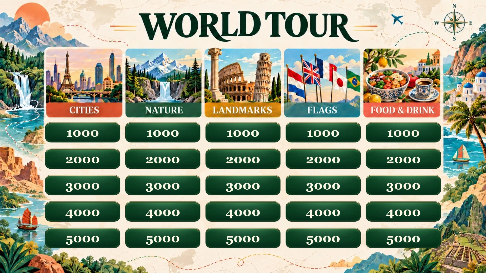{ loading=lazy }

Een ontwerp als deze bestaat uit enkele afbeeldingen:

- **Een achtergrond** voor de dia (1920 × 1080 voor een 16:9-quiz), met alles wat tijdens het spel niet verandert: het decor, een titel, een kader rond het bord.
- **Eén afbeelding per onderwerp** voor de onderwerptegels, bijvoorbeeld een illustratie met de naam van het onderwerp erin, zoals in de bovenstaande voorbeelden.
- **Eén tegelafbeelding** voor de puntentegels, bijvoorbeeld een knop of een penseelstreek. Sla deze op als PNG met transparante hoeken, zodat de achtergrond rond de tegel zichtbaar blijft.

Alle ontwerpinstellingen staan op de pagina 'Ontwerp' van het eigenschappenvenster wanneer het bord is geselecteerd. Alle afbeeldingen worden in het quizbestand opgeslagen, dus u hoeft ze niet samen met de quiz te kopiëren.

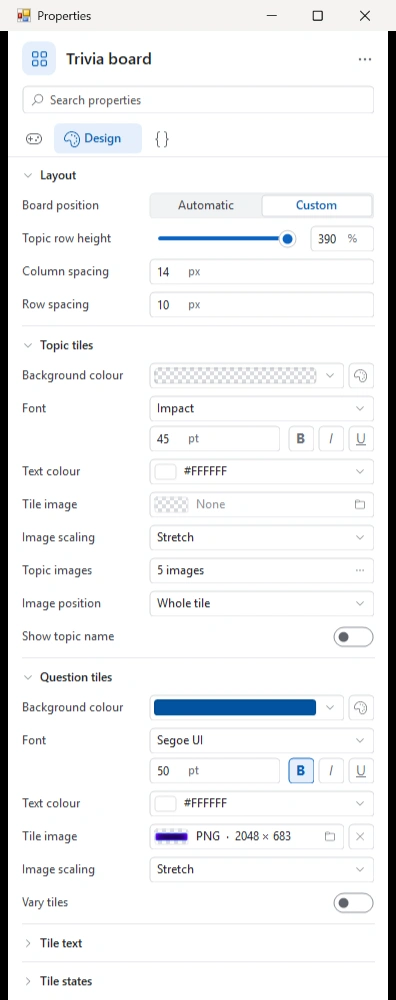{ width="380" loading=lazy }

Het muziekbord hierboven heeft bijvoorbeeld een eigen positie, een hoogte van de onderwerprij van 390% voor de hoge koppen, voor elk onderwerp een onderwerpafbeelding over de hele tegel met de onderwerpnaam uitgeschakeld (de afbeeldingen bevatten die al), een transparante achtergrond voor de onderwerptegels en een tegelafbeelding voor de puntentegels.

### Positie van het bord

'Positie van het bord' bepaalt waar het bord verschijnt:

- **Automatisch** vult het scherm, zoals het klassieke bord. De tegels gebruiken dan een vulkleur in plaats van afbeeldingen.
- **Aangepast** plaatst het bord waar het op de dia staat. Sleep het bord in Studio en pas het formaat aan zodat het in het kader van uw achtergrond past. De onderstaande afbeeldingsinstellingen zijn alleen beschikbaar met een aangepaste positie.

Onder 'Indeling' kunt u ook instellen:

- **Hoogte onderwerprij**: de hoogte van de onderwerptegels ten opzichte van de puntentegels (bijvoorbeeld 250% voor grote geïllustreerde koppen).
- **Kolomafstand** en **Rijafstand**: de ruimte tussen de tegels.

### Tegelafbeeldingen

- **Tegelafbeelding** (in 'Onderwerptegels' en in 'Vraagtegels') vervangt de vulkleur van de tegels door een afbeelding.
- **Schalen van afbeelding** bepaalt hoe de afbeelding in een tegel wordt ingepast: 'Vullen' (vul de tegel precies), 'Passend' (behoud de vorm van de afbeelding), 'Opvullen' (behoud de vorm en snijd af wat niet past) of 'Hoeken behouden' (rek het midden van de afbeelding uit en laat de hoeken zoals ze zijn, handig voor tegels met een kader).
- **Tegels variëren** spiegelt de afbeelding van de puntentegel op elke tegel anders, zodat een tegel met bijvoorbeeld verfspetters niet overal precies hetzelfde eruitziet.

### Onderwerpafbeeldingen

Klik op de knop naast 'Onderwerpafbeeldingen' om elk onderwerp van de ronde een eigen afbeelding te geven. Het dialoogvenster toont de onderwerpen van de vragen na het bord:

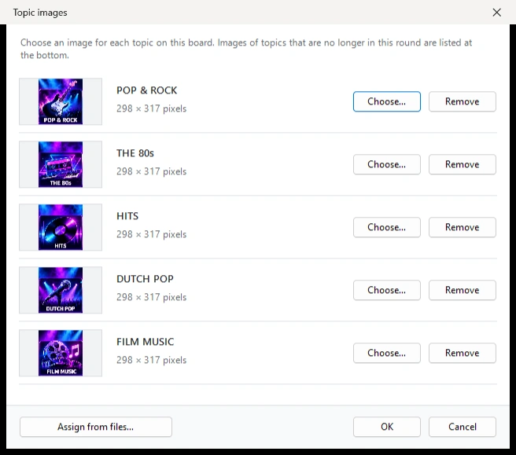{ width="600" loading=lazy }

- Klik op 'Kiezen…' om een afbeelding voor een onderwerp te kiezen, of sleep een afbeeldingsbestand naar de rij ervan.
- Met 'Toewijzen uit bestanden…' wijst u meerdere afbeeldingen in één keer toe: elke afbeelding gaat naar het onderwerp met dezelfde naam als het bestand. Hoofdletters en kleine letters, accenten, spaties, streepjes en underscores maken niet uit, dus `dutch-pop.png` gaat naar het onderwerp 'Dutch Pop'.
- Afbeeldingen van onderwerpen die niet meer in de ronde voorkomen, staan onderaan in de lijst, zodat u ze kunt verwijderen.

'Positie afbeelding' plaatst de onderwerpafbeelding over de hele tegel, of links van, rechts van of boven de onderwerpnaam. Wanneer uw afbeeldingen de onderwerpnaam al bevatten (zoals de bovenstaande voorbeelden), schakelt u 'Onderwerpnaam tonen' uit.

!!! tip
    Onderwerpafbeeldingen horen bij een onderwerp via de naam ervan. Wanneer u een onderwerp op de vragen hernoemt, kiest u de afbeelding ervan opnieuw.

### Tegeltekst

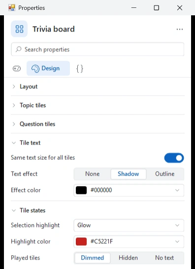{ width="380" loading=lazy }

- **Zelfde tekstgrootte voor alle tegels**: wanneer ingeschakeld, krijgen alle onderwerpnamen dezelfde tekstgrootte en alle puntwaarden dezelfde tekstgrootte: de grootste grootte waarbij elke tekst in zijn tegel past, maar nooit groter dan het lettertype dat u hebt ingesteld. Lange onderwerpnamen worden over twee regels verdeeld. Wanneer uitgeschakeld, wordt elke tekst zo groot gemaakt als zijn eigen tegel toelaat, zodat korte teksten groter worden dan lange.
- **Teksteffect** voegt een schaduw of een omlijning toe rond de tekst van de tegels, in de 'Effectkleur'.

### Selectie en gespeelde tegels

- **Selectiemarkering** bepaalt hoe de willekeurige selectie de gekozen tegel toont: 'Vullen' bedekt de tegel met de markeerkleur (de klassieke look), 'Tint' kleurt hem gedeeltelijk, 'Omlijning' en 'Gloed' tekenen een gekleurde rand en laten uw tegelafbeelding zichtbaar.
- **Markeerkleur** stelt de kleur van de willekeurige selectie in.
- **Gespeelde tegels** bepaalt hoe een tegel eruitziet nadat zijn vragen zijn gespeeld: 'Gedimd', 'Verborgen' of 'Zonder tekst' (de tegel blijft, zonder zijn puntwaarde).

### Achtergrondvideo

Een Trivia Bord-dia kan ook een [achtergrondvideo](../backgrounds.md#achtergrondvideo) hebben. Deze speelt achter het bord af met de eigen instellingen van de video (herhalen, stil, volume) en pauzeert terwijl een vraag wordt getoond.

!!! note
    Oudere versies van QuizXpress kunnen een quiz met een ontworpen bord nog steeds openen, maar tonen het als een klassiek bord.
