# Trivia Feud

Définissez le type de diapositive sur ‘Trivia Feud’ pour créer un jeu basé sur un sondage. Après avoir défini le type de diapositive sur Trivia Feud, l’éditeur de sondage (Survey editor) s’ouvre ; vous pouvez y saisir la question du sondage et les réponses du sondage avec les pourcentages correspondants :

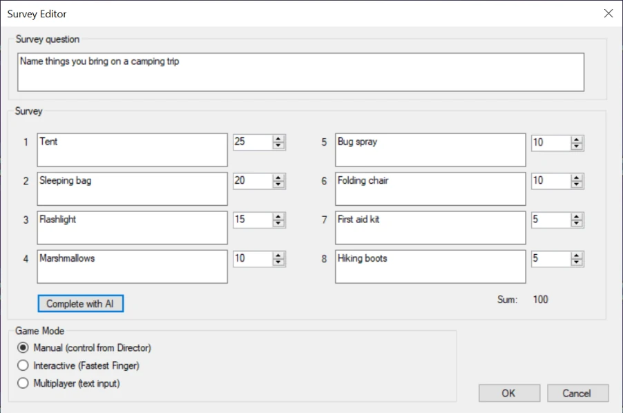{ width="578" loading=lazy }

Outre la saisie des détails du sondage et des réponses, vous pouvez régler le jeu sur trois modes différents : Manual, Interactive ou Multiplayer. Vous en saurez plus ci-dessous.

Vous pouvez utiliser la fonctionnalité d’intelligence artificielle de QuizXpress pour vous aider à générer des sondages. Après avoir saisi une question de sondage, appuyez sur le bouton ‘Complete with AI’ pour renseigner automatiquement les réponses du sondage et les pourcentages correspondants. Veuillez consulter [Mini games](../mini-games/index.md) pour plus d’informations.

Après avoir saisi les détails et appuyé sur OK, l’aperçu dans QuizXpress Studio se présente comme suit. L’arrière-plan de l’écran peut être modifié (pour inclure par exemple le nom de votre entreprise ou votre identité visuelle).

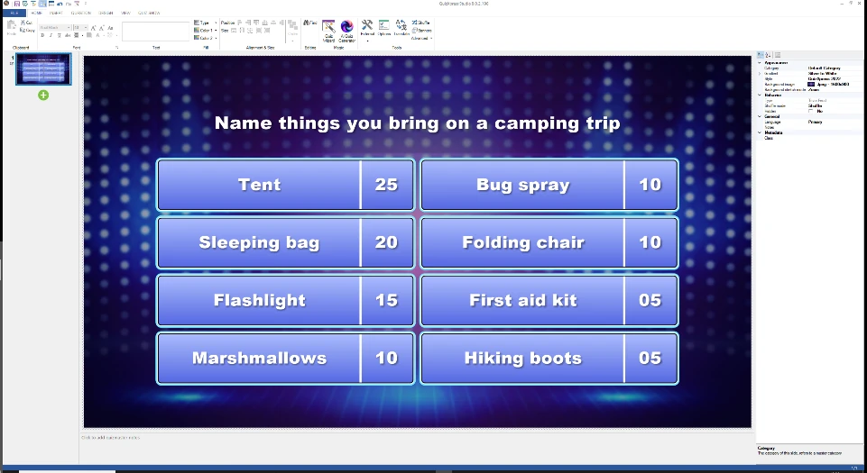{ width="615" loading=lazy }

Lorsque vous cliquez sur le sondage, l’onglet TRIVIA FEUD s’affiche dans le ruban. Le mode de jeu peut y être modifié, et l’éditeur de sondage peut être ouvert en cliquant sur ‘Edit Survey’.

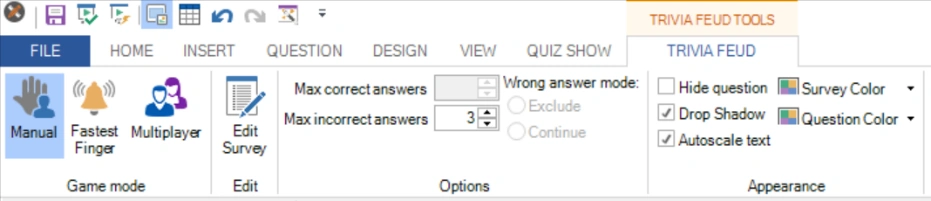{ width="592" loading=lazy }

De nombreuses options sont disponibles dans la barre d’outils et dans la fenêtre des propriétés avancées ; elles seront expliquées plus loin dans le contexte des différents modes disponibles.

Après le lancement du quiz, QuizXpress Live affiche le tableau Trivia Feud avec la question du sondage et les réponses du sondage masquées. Le tableau ci-dessous est un exemple de jeu Feud en mode Manual.

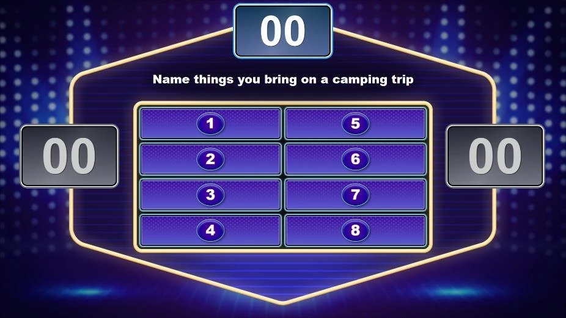{ width="591" loading=lazy }

Trivia Feud propose trois modes de jeu : **Manual**, **Interactive** (fastest finger) et **Multiplayer**.

## Mode Manual

En mode manuel, le jeu est entièrement contrôlé depuis un écran de QuizXpress Director, le panneau de contrôle de l’animateur de quiz, qui s’exécute sur l’écran de l’ordinateur portable tandis que le jeu est diffusé sur un grand écran.

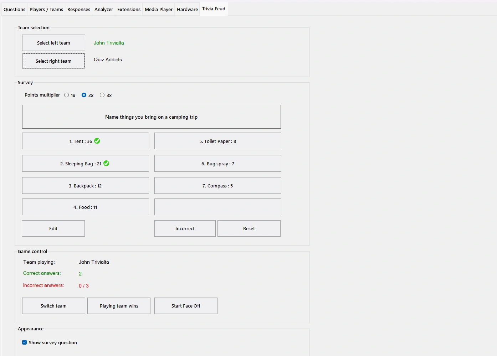{ loading=lazy }

Les réponses au sondage données par les joueurs peuvent être révélées manuellement en appuyant sur les boutons correspondants dans Director. Les points accumulés sont affichés en haut, et les scores sont affichés pour les deux équipes.

Vous pouvez aussi l’utiliser pour jouer exactement au format de l’émission télévisée en suivant les étapes ci-dessous :

- Commencez par un Faceoff entre les deux équipes en appuyant sur le bouton ‘Start Faceoff’ :

- Les joueurs utilisent leur buzzer (qui peut être un keypad, un buzzer ou un téléphone mobile) pour buzzer. Le joueur le plus rapide à buzzer est affiché à l’écran.

- Le joueur qui a buzzé en premier donne une réponse au sondage.

- L’animateur de quiz révèle la réponse (si elle figure sur le tableau) en appuyant sur le bouton correspondant dans QuizXpress Director. Les points de la réponse sont ajoutés aux points du tableau des scores du haut, qui indique les points que le joueur gagnant peut remporter.

- Appuyez sur le bouton ‘Switch team’.

- L’autre joueur donne maintenant lui aussi une réponse au sondage, que l’animateur de quiz révèle sur le tableau si elle y figure.

- Selon l’équipe qui a donné la réponse du rang le plus élevé, faites de cette équipe l’‘équipe qui joue’ (conservez donc l’équipe actuellement sélectionnée ou appuyez de nouveau sur ‘switch team’).

- Les membres de l’équipe qui joue (ou l’individu, s’il s’agit d’un duel entre deux personnes) essaient de citer autant de réponses que possible.

  - Si une réponse figure sur le tableau, cliquez sur la réponse correspondante pour la révéler sur le tableau et cumuler les points dans le total des points à gagner, affiché en haut du tableau.

> 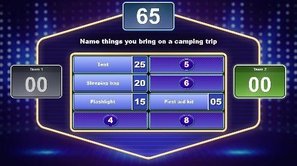{ width="317" loading=lazy }

- Si une réponse ne figure pas sur le tableau, cliquez sur le bouton ‘Incorrect’ pour afficher une croix à l’écran indiquant que la réponse était incorrecte. Le paramètre ‘max wrong answers’ du tableau, défini dans QuizXpress Studio pour la diapositive, détermine après combien de croix la main passe à l’équipe adverse :

> 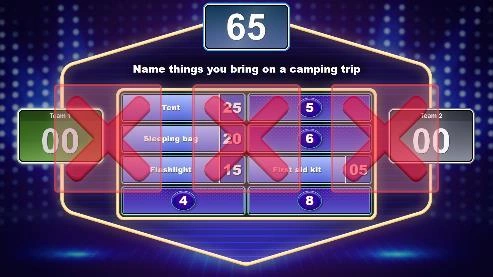{ width="316" loading=lazy }

- Comme dans l’émission officielle, l’équipe adverse a maintenant la possibilité de deviner l’une des réponses restantes. La réponse donnée est soit :

  - visible sur le tableau : cliquez sur la réponse correspondante dans Director pour la révéler. Cliquez ensuite sur le bouton ‘Playing team wins’ pour attribuer les points à l’équipe :

> 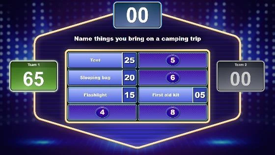{ width="358" loading=lazy }

- absente du tableau : cliquez sur le bouton ‘Incorrect’ pour afficher la croix rouge. Cliquez ensuite sur ‘switch team’ pour revenir à l’équipe qui jouait à l’origine, puis cliquez sur le bouton ‘Playing team wins’ pour attribuer les points à l’équipe.

- Enfin, vous pouvez révéler manuellement les réponses restantes aux joueurs et au public.

Le déroulé ci-dessus vous montre comment jouer de la même manière que dans le format télévisé d’origine. Comme le réglage manuel vous donne un contrôle total, vous pouvez aussi imaginer d’autres façons de jouer.

Si vous disposez d’un autre moyen de déterminer quelle équipe commencera la partie, vous pouvez aussi sélectionner une équipe manuellement en appuyant sur le message ‘team playing’ :

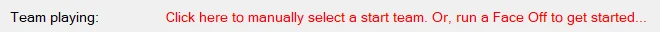{ width="596" loading=lazy }

Une fenêtre de sélection s’affiche, dans laquelle vous pouvez sélectionner l’équipe qui commence.

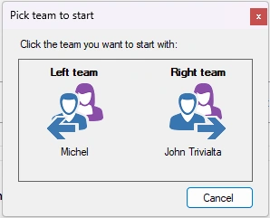{ width="170" loading=lazy }

Si plus de 2 joueurs/équipes participent, vous pouvez choisir quelles équipes s’affrontent en cliquant sur les boutons ‘select left team’ et ‘select right team’.

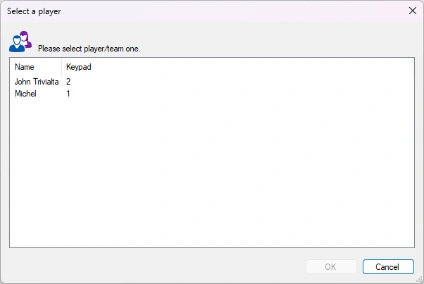{ width="271" loading=lazy }

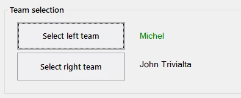{ width="317" loading=lazy }

Le panneau de contrôle de QuizXpress Director contient également un ‘points multiplier’. Choisir une valeur de 2 ou 3 récompense les joueurs avec respectivement 2 ou 3 fois plus de points. Vous pourriez l’appliquer par exemple pour une manche finale, où une équipe doit dépasser un certain nombre de points pour gagner.

## Mode Interactive (Fastest Finger)

Dans ce mode, tous les joueurs participent et peuvent buzzer pour donner leur réponse.

Le joueur le plus rapide à buzzer est affiché sur le grand écran avec son nombre de points actuel et a la possibilité de répondre au sondage.

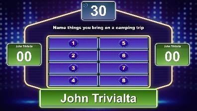{ width="255" loading=lazy }

Les joueurs disposent d’un temps limité pour donner une réponse. Il est indiqué par un compte à rebours en haut. Le temps peut être configuré dans la propriété Answer Time (disponible dans la grille de propriétés). Si un joueur ne répond pas dans le temps imparti, trois croix apparaissent et des points de pénalité sont déduits du joueur.

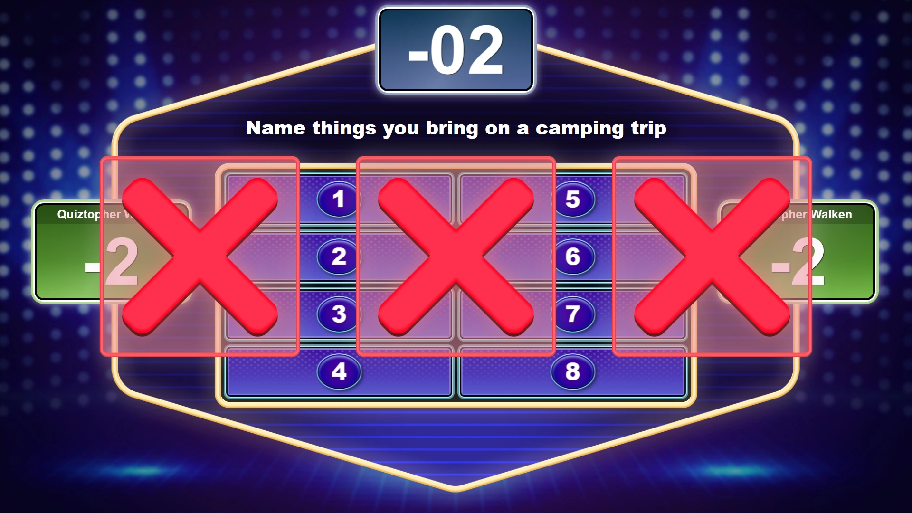{ loading=lazy }

Si la réponse donnée figure sur le tableau, l’animateur de quiz la révèle en cliquant sur le bouton correspondant dans QuizXpress Director. Les points sont affichés en haut, puis ajoutés au total du joueur.

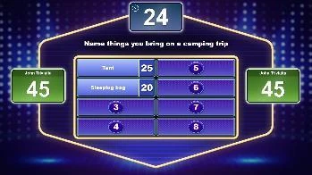{ width="223" loading=lazy } 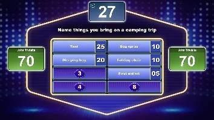{ width="227" loading=lazy }

Si la réponse donnée ne figure pas sur le tableau, cliquez sur la croix dans Director, qui s’affiche alors sur le grand écran. Les points indiqués pour ‘wrong answer’ dans l’onglet QUESTION seront alors soustraits.

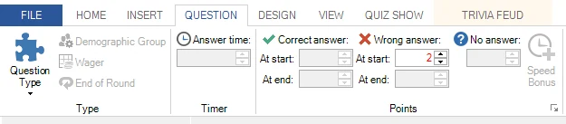{ width="568" loading=lazy }

Lors de la création de la diapositive Trivia Feud en mode Fastest Finger, vous pouvez indiquer combien de réponses un joueur peut donner après avoir buzzé (max correct answers), combien de réponses incorrectes peuvent être données avant que le tour du joueur ne se termine (max incorrect answers), et si un joueur est exclu du tableau en cours ou peut buzzer à nouveau (Exclude ou Continue).

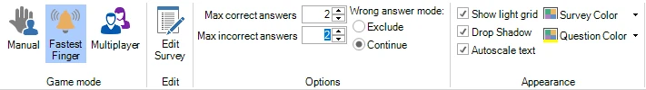{ width="605" loading=lazy }

Vous pouvez aussi modifier les paramètres ci-dessus dans le panneau des propriétés avancées, que vous pouvez afficher en cliquant sur l’onglet VIEW et en cochant ‘Properties’. Dans ce panneau, vous verrez tous les paramètres qui s’appliquent au Trivia Feud dès que vous cliquez dessus.

L’option auto reveal indique si les réponses restantes qui n’ont pas été citées seront automatiquement affichées lorsque tous les joueurs sont éliminés, ou si l’animateur les révélera manuellement une par une en cliquant sur les réponses dans QuizXpress Director.

## Mode Multiplayer

Lorsque le tableau est en mode multiplayer, tout le public peut participer.

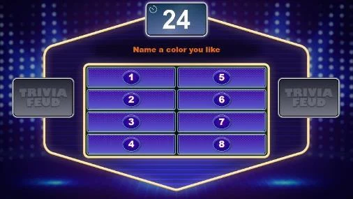{ width="321" loading=lazy }

Un compte à rebours est affiché en haut du tableau Trivia Feud. Dans QuizXpress Studio, dans l’onglet QUESTION, le ‘Answer time’ peut être configuré de la même manière que pour une question classique.

Les joueurs envoient leurs réponses depuis leur téléphone mobile pendant le compte à rebours, en saisissant et en envoyant plusieurs textes.

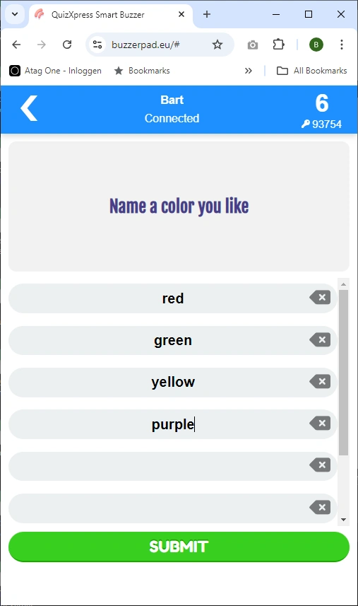{ width="385" loading=lazy }

Dans la fenêtre des propriétés de Studio (si elle n’est pas visible, affichez-la en cliquant sur l’onglet VIEW puis en cochant Properties), vous verrez les options suivantes qui s’appliquent au mode multiplayer :

**Response limit** : spécifie le nombre maximal de réponses qu’un joueur peut envoyer.

**Tolerance** : spécifie la tolérance utilisée par QuizXpress pour juger les réponses données. Une tolérance plus élevée admet davantage de fautes d’orthographe.

**Auto reveal** : indique si, à la fin du compte à rebours, les réponses seront affichées automatiquement ou si l’animateur les révélera manuellement une par une en cliquant sur les réponses dans QuizXpress Director.

Dans ce mode, vous pouvez spécifier plusieurs réponses correctes, séparées par un point-virgule :

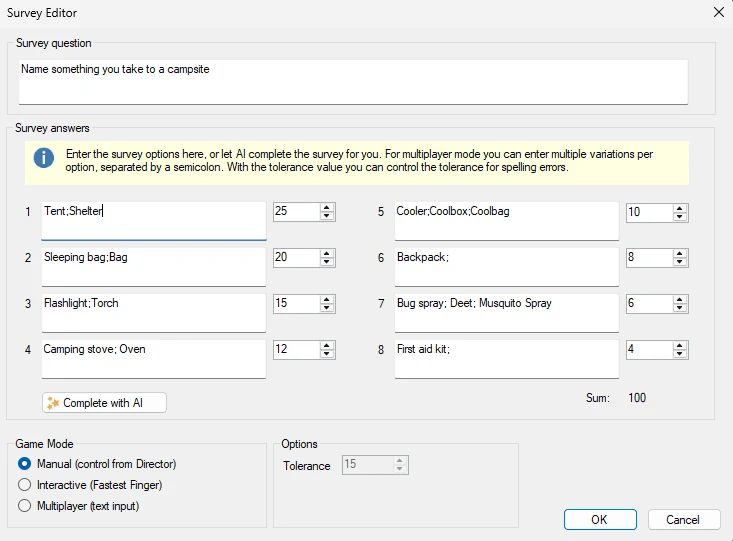{ width="430" loading=lazy }

La saisie des joueurs est comparée à chaque entrée avec la tolérance définie.
