# Trivia Feud

Stel het diatype in op ‘Trivia Feud’ om een spel op basis van een enquête te maken. Nadat u het diatype op Trivia Feud hebt ingesteld, verschijnt de enquête-editor waarin u de enquêtevraag en de enquêteantwoorden met de bijbehorende percentages invoert:

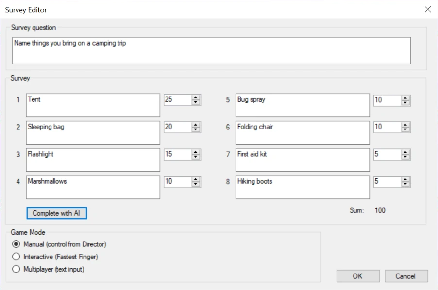{ width="578" loading=lazy }

Naast het invoeren van de enquêtegegevens en antwoorden kunt u het spel op drie verschillende modi instellen: Handmatig, Interactief of Multiplayer. Hieronder leest u hier meer over.

U kunt de kunstmatige intelligentie van QuizXpress gebruiken om enquêtes te laten genereren. Druk na het invoeren van een enquêtevraag op de knop ‘Aanvullen met AI’ om de enquêteantwoorden en de bijbehorende percentages automatisch in te vullen. Zie [Minigames](../mini-games/index.md) voor meer informatie.

Nadat u de gegevens hebt ingevoerd en op OK hebt gedrukt, ziet het voorbeeld in QuizXpress Studio er als volgt uit. De achtergrond van het scherm kunt u wijzigen (bijvoorbeeld om uw bedrijfsnaam of huisstijl toe te voegen).

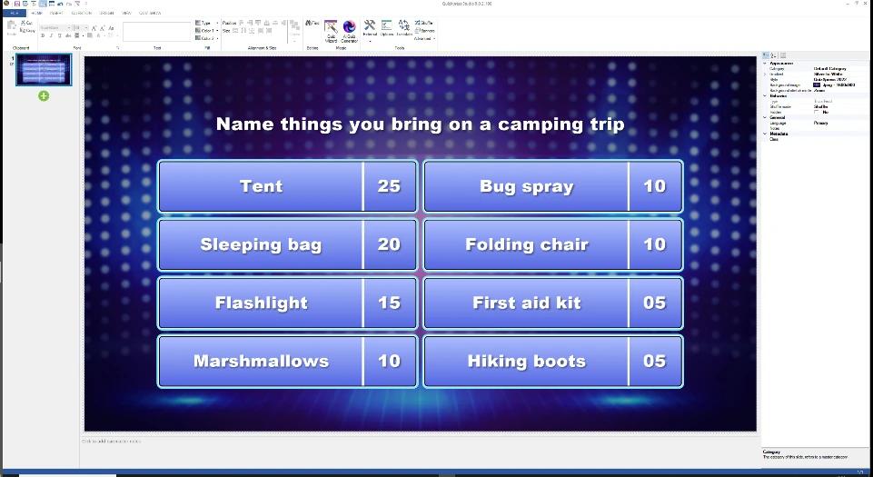{ width="615" loading=lazy }

Wanneer u op de enquête klikt, wordt het lint-tabblad TRIVIA FEUD getoond. Hier kunt u de spelmodus wijzigen en de enquête-editor openen door op ‘Enquête bewerken’ te klikken.

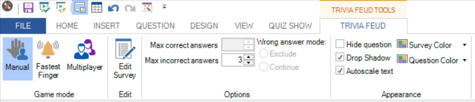{ width="592" loading=lazy }

Er zijn diverse opties beschikbaar in de werkbalk en in het venster met geavanceerde eigenschappen. Deze worden later toegelicht in de context van de verschillende beschikbare modi.

Nadat u de quizshow hebt gestart, toont QuizXpress Live het Trivia Feud-bord met de enquêtevraag en de verborgen enquêteantwoorden. Het onderstaande bord is een voorbeeld van een Feud-spel in Handmatige modus.

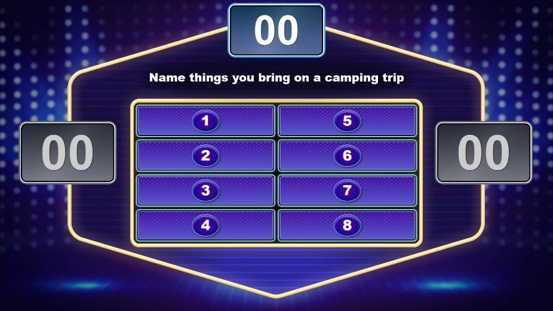{ width="591" loading=lazy }

Trivia Feud heeft drie spelmodi: **Handmatig**, **Interactief** (snelste drukker) en **Multiplayer**.

## Handmatige modus

In de handmatige modus wordt het spel volledig bediend vanuit een scherm in QuizXpress Director, het bedieningspaneel van de quizmaster, dat op het laptopscherm draait terwijl de quizshow op een groot scherm draait.

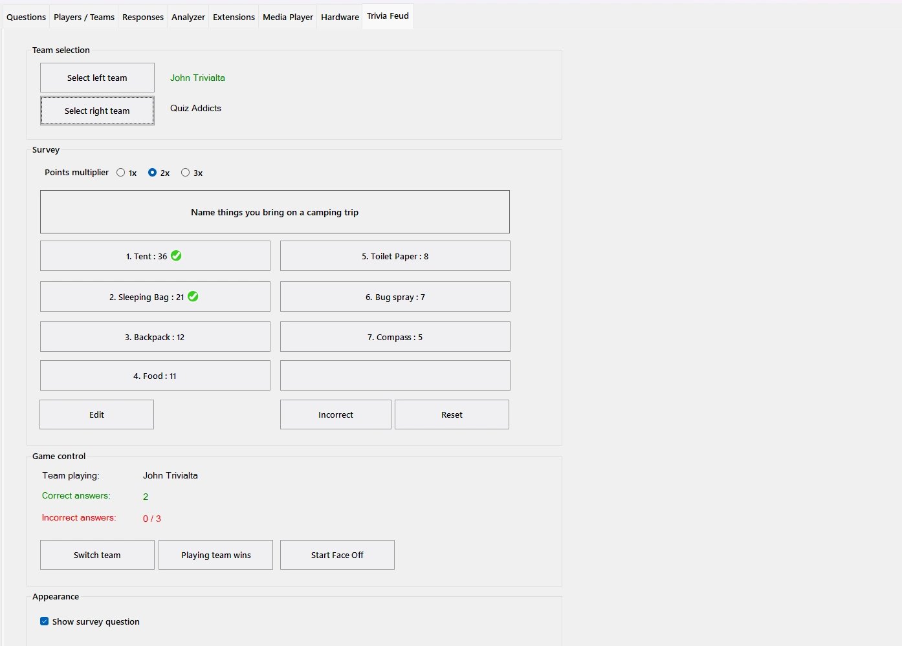{ loading=lazy }

Enquêteantwoorden die de spelers geven, kunt u handmatig onthullen door op de bijbehorende knoppen in Director te drukken. Opgebouwde punten worden bovenaan getoond en de scores worden voor beide teams getoond.

U kunt het ook gebruiken om precies het spelformat uit de tv-show te spelen door de volgende stappen te volgen:

- Begin met een Faceoff tussen de twee teams door op de knop ‘Faceoff starten’ te drukken:

- Spelers gebruiken hun buzzer (dit kan een keypad, buzzer of mobiele telefoon zijn) om af te drukken. De snelste speler die afdrukt, wordt op het scherm getoond.

- De speler die als eerste afdrukte, geeft een antwoord op de enquête.

- De quizmaster onthult het antwoord (als het op het bord staat) door op de bijbehorende knop in QuizXpress Director te drukken. De punten van het antwoord worden opgeteld bij de punten van het bovenste scorebord, dat de punten toont die de winnende speler kan winnen.

- Druk op de knop ‘Van team wisselen’.

- De andere speler geeft nu ook een antwoord op de enquête, dat de quizmaster op het bord onthult als het erop staat.

- Maak, afhankelijk van welk team het hoogst gerangschikte antwoord gaf, dit team het ‘spelende team’ (dus houd het huidige geselecteerde team aan of druk nogmaals op ‘Van team wisselen’).

- De leden van het spelende team (of de individuele speler, in het geval van een onderling duel tussen twee personen) proberen zoveel mogelijk antwoorden te noemen.

  - Als een antwoord op het bord staat, klikt u op het bijbehorende antwoord om het op het bord te onthullen en de punten op te tellen bij het totaal te winnen aantal punten, dat bovenaan het bord wordt getoond.

> 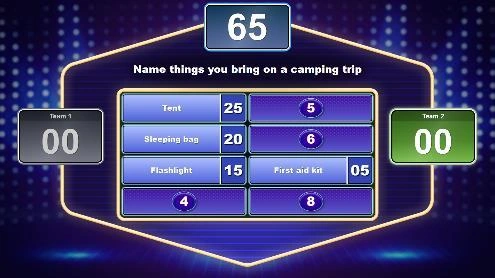{ width="317" loading=lazy }

- Als een antwoord er niet bij staat, klikt u op de knop ‘Niet correct’ om een kruis op het scherm te tonen dat aangeeft dat het antwoord onjuist was. De instelling ‘max. aantal foute antwoorden’ van het bord, die u in QuizXpress Studio voor de dia hebt aangegeven, bepaalt na hoeveel kruisen de beurt naar het tegenstanderteam gaat:

> 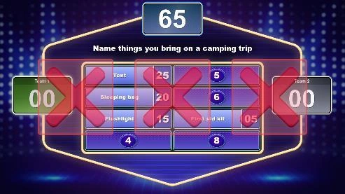{ width="316" loading=lazy }

- Net als in de officiële tv-show krijgt het tegenstanderteam nu de kans om een van de resterende antwoorden te raden. Het gegeven antwoord is of:

  - zichtbaar op het bord - klik in Director op het bijbehorende antwoord om het te onthullen. Klik daarna op de knop ‘Spelend team wint’ om de punten aan het team toe te kennen:

> 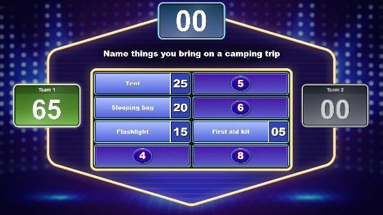{ width="358" loading=lazy }

- niet aanwezig op het bord - klik op de knop ‘Niet correct’ om het rode kruis te tonen. Klik nu op ‘Van team wisselen’ om terug te schakelen naar het team dat oorspronkelijk speelde en klik daarna op de knop ‘Spelend team wint’ om de punten aan het team toe te kennen.

- Ten slotte kunt u de resterende antwoorden handmatig onthullen voor de spelers en het kijkende publiek.

Bovenstaande schets laat zien hoe u het spel op dezelfde manier speelt als het oorspronkelijke tv-format. Omdat de handmatige instelling u volledige controle geeft, kunt u ook alternatieve manieren bedenken om het spel te spelen.

Als u een andere manier hebt om te bepalen welk team het spel begint, kunt u ook handmatig een team selecteren door op de melding ‘spelend team’ te drukken:

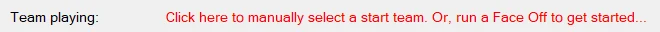{ width="596" loading=lazy }

Hierdoor verschijnt een selectievenster waarin u het startende team kunt kiezen.

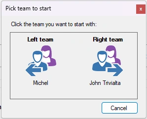{ width="170" loading=lazy }

Als er meer dan 2 spelers/teams meespelen, kunt u kiezen welke teams tegen elkaar spelen door op de knoppen ‘Selecteer linker team’ en ‘Selecteer rechter team’ te klikken.

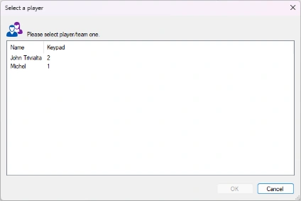{ width="271" loading=lazy }

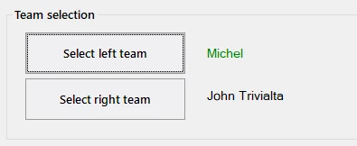{ width="317" loading=lazy }

Het bedieningspaneel in QuizXpress Director bevat ook een ‘puntenvermenigvuldiger’. Als u de waarde 2 of 3 kiest, ontvangen spelers respectievelijk 2 of 3 keer zoveel punten. U kunt dit bijvoorbeeld gebruiken voor een finaleronde, waarin een team een bepaald aantal punten moet halen om te winnen.

## Interactieve modus (snelste drukker)

In deze modus doen alle spelers mee en kunnen ze afdrukken om hun antwoord te geven.

De snelste speler die afdrukt, wordt op het grote scherm getoond met het huidige aantal punten en krijgt de kans om de enquête te beantwoorden.

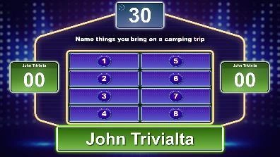{ width="255" loading=lazy }

Spelers hebben beperkte tijd om een antwoord te geven. Dit wordt aangegeven door een aftelklok bovenaan. De tijd kunt u instellen met de eigenschap Antwoordtijd (beschikbaar in het eigenschappenraster). Als een speler niet binnen de tijd antwoordt, verschijnen er drie kruisen en worden strafpunten van de speler afgetrokken.

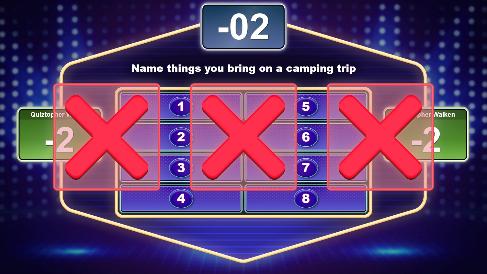{ loading=lazy }

Als het gegeven antwoord op het bord staat, onthult de quizmaster het antwoord door op de bijbehorende knop in QuizXpress Director te klikken. De punten worden bovenaan getoond en daarna bij het totaal van de speler opgeteld.

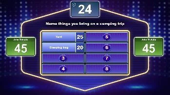{ width="223" loading=lazy } 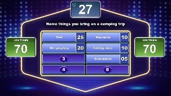{ width="227" loading=lazy }

Als het gegeven antwoord er niet bij staat, klikt u in Director op het kruis, dat vervolgens op het grote scherm wordt getoond. De punten die op het tabblad VRAAG voor ‘onjuist antwoord’ zijn ingesteld, worden in dat geval afgetrokken.

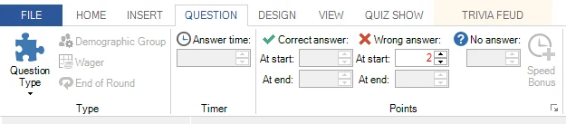{ width="568" loading=lazy }

Wanneer u de Trivia Feud-dia in de modus Snelste drukker maakt, kunt u aangeven hoeveel antwoorden een speler mag geven na het afdrukken (max. goede antwoorden), hoeveel onjuiste antwoorden er mogen worden gegeven voordat de beurt van de speler voorbij is (max. foutieve antwoorden), en of een speler van het huidige bord wordt uitgesloten of opnieuw mag afdrukken (Uitsluiten of Doorgaan).

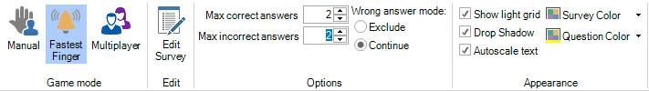{ width="605" loading=lazy }

U kunt bovenstaande instellingen ook wijzigen in het deelvenster Geavanceerde eigenschappen, dat u toont door op het tabblad BEELD te klikken en een vinkje voor ‘Eigenschappen’ te zetten. In dit deelvenster ziet u alle instellingen die van toepassing zijn op de Trivia Feud zodra u erop klikt.

De optie ‘Onthullingsmodus’ (‘Automatisch’ of ‘Handmatig’) geeft aan of de resterende antwoorden die niet zijn genoemd automatisch worden getoond zodra alle spelers uit het spel zijn, of dat de quizmaster ze een voor een handmatig onthult door in QuizXpress Director op de antwoorden te klikken.

## Multiplayer-modus

Wanneer het bord in de multiplayer-modus staat, kan iedereen in het publiek meespelen.

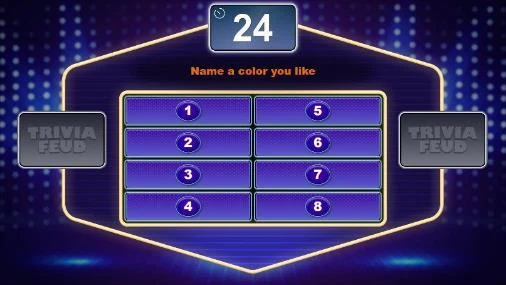{ width="321" loading=lazy }

Bovenaan het Trivia Feud-bord wordt een aftelklok getoond. In QuizXpress Studio kunt u op het tabblad VRAAG de ‘Antwoordtijd’ op dezelfde manier instellen als bij een gewone vraag.

Spelers sturen hun antwoorden in via hun mobiele telefoon terwijl het aftellen loopt, door meerdere teksten in te voeren en te verzenden.

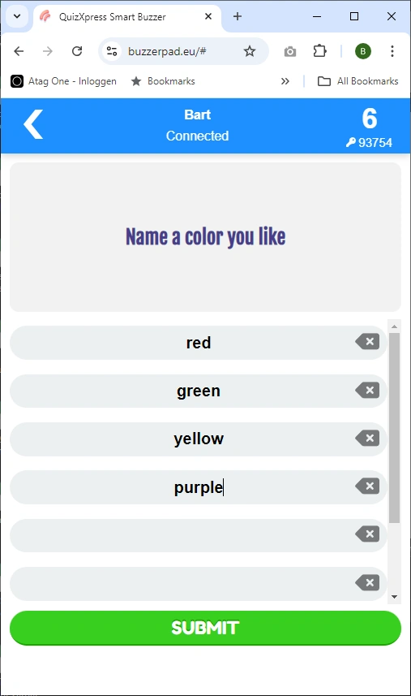{ width="385" loading=lazy }

In het eigenschappenvenster in Studio (als het niet zichtbaar is, toont u het door op het tabblad BEELD te klikken en een vinkje voor Eigenschappen te zetten) ziet u de volgende opties die van toepassing zijn op de multiplayer-modus:

**Respons limiet** – geeft het maximale aantal antwoorden aan dat een speler kan insturen.

**Tolerantie** – geeft de tolerantie aan die QuizXpress gebruikt bij het beoordelen van de gegeven antwoorden. Met een hogere tolerantie worden meer spelfouten toegestaan.

**Onthullingsmodus** (Automatisch of Handmatig) – geeft aan of de antwoorden aan het einde van het aftellen automatisch worden getoond, of dat de quizmaster ze een voor een handmatig onthult door in QuizXpress Director op de antwoorden te klikken.

In deze modus kunt u meerdere juiste antwoorden opgeven, gescheiden door een puntkomma:

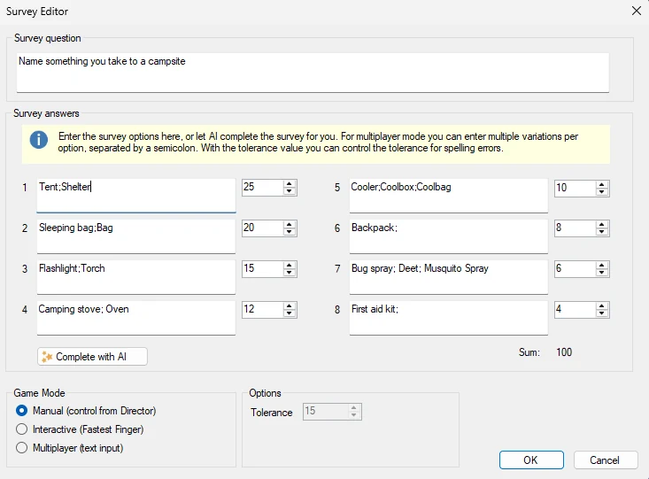{ width="430" loading=lazy }

De invoer van de spelers wordt met de ingestelde tolerantie vergeleken met elk item.
