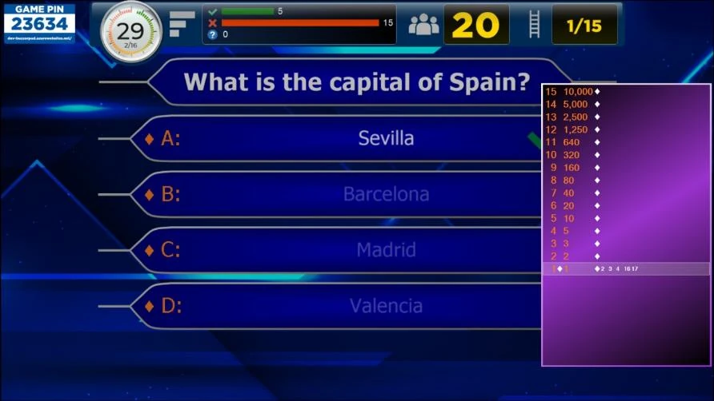
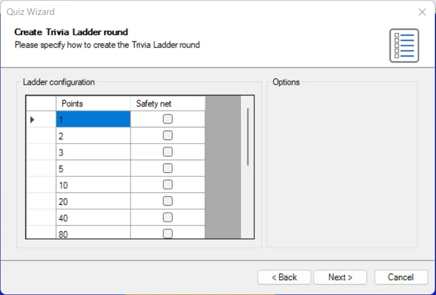
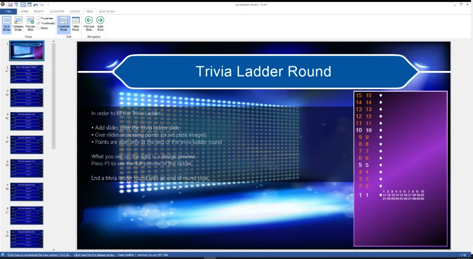

# Round Trivia Ladder

Un Trivia Ladder round consente di creare un round in stile ‘Chi vuol essere milionario?®’ (‘Who Wants to Be a Millionaire®’) in cui uno o più giocatori cercano di salire una scala rispondendo correttamente alle domande.

{ width="570" loading=lazy }

Come le normali diapositive del quiz, un Trivia Ladder può essere completamente personalizzato nello stile (per maggiori dettagli su tutte le opzioni, fare riferimento a [Trivia Ladder properties](../user-interface-overview/advanced-properties-grid.md#proprieta-del-trivia-ladder)).

## Come creare un Trivia Ladder?

Per creare un Trivia Ladder, iniziare inserendo una diapositiva Trivia Ladder nel quiz (andare al menu INSERT, fare clic sull’elenco a discesa nella sezione Quiz Slides e scegliere il layout Trivia Ladder). Il Trivia Ladder verrà generato automaticamente dalle domande che lo seguono.

!!! note

    a differenza di tutti gli altri tipi di diapositiva, la diapositiva Trivia Ladder non viene mostrata di per sé durante il quiz. Il suo unico scopo è creare la scala, che verrà mostrata su ogni diapositiva del round Trivia Ladder durante il quiz.

Per riempire la scala, creare *dopo* la diapositiva Trivia Ladder tante domande quanti sono i gradini desiderati. Qui sotto è visibile un gradino della scala.

{ width="425" loading=lazy }

Gradino della scala

I numeri delle domande sono mostrati sul lato sinistro della scala. I punti visualizzati a destra del numero della domanda sono definiti dai punti delle rispettive domande del round Trivia Ladder. È anche possibile aggiungere dei premi alla scala al posto dei punti. Sul lato destro di ogni gradino vengono mostrati i keypad che si trovano su quel gradino.

Il separatore più a sinistra (un rombo) indica se la domanda del gradino è stata giocata.

Solo alla fine, quando l’ultima domanda della scala è terminata, ogni giocatore (keypad) riceve i punti del gradino su cui si trova.

I gradini di sicurezza della scala sono in genere colorati in modo diverso (ad esempio in bianco nell’immagine qui sotto) per indicare a quali gradini i giocatori retrocedono quando rispondono in modo errato (nel caso in cui la *wrong answer action* della scala sia impostata su ‘Fall to safety net’).

Come il Trivia Board, un Trivia Ladder può essere combinato con altri formati di gioco di QuizXpress. Per creare un Trivia Ladder (round), QuizXpress deve sapere dove termina un round Trivia Ladder. Un round Trivia Ladder termina a uno dei seguenti tipi di diapositiva:

- una diapositiva ‘End of round’ (vedere anche 3.4.3)

- un’altra diapositiva Trivia Ladder

- una diapositiva Trivia Board

- la fine del quiz (ultimo round o gioco composto solo da un Trivia Ladder)

Le domande senza punti (ad esempio Audience response, Demographic, Wager) vengono ignorate durante la creazione del Trivia Ladder.

In alternativa, il Quiz Wizard può aiutare a creare un round Trivia Ladder completo in pochi clic! Avviare la procedura guidata (scheda HOME, quindi ‘Quiz Wizard’) e selezionare ‘create a new round’ seguito da ‘a Trivia Ladder round’. Quindi inserire i punti e indicare dove si trovano i gradini di sicurezza.

{ width="544" loading=lazy }

Scegliere il tempo per le domande, i punti e lo stile da usare nelle pagine successive, quindi premere ‘Finish’ per creare la scala, le domande e la diapositiva finale di fine round. Naturalmente sarà ancora necessario inserire le domande vere e proprie, ma i punti, i gradini di sicurezza e la struttura della scala saranno già impostati.

## Posizione sul Trivia Ladder

Quando un giocatore risponde correttamente a una domanda in un round Trivia Ladder, avanza di un gradino sulla scala. Quando una domanda riceve una risposta errata, può accadere quanto segue in base alla ‘Wrong answer action’:

- Same step – il giocatore rimane sullo stesso gradino della scala.

- One step down – il giocatore scende di un gradino.

- Fall to safety net – il giocatore retrocede al primo gradino di sicurezza incontrato.

- Back to bottom – il giocatore cade dalla scala e deve ricominciare.

## Anteprima di un Trivia Ladder

Il Trivia Ladder in QuizXpress Studio, così come appare nella diapositiva Trivia Ladder, viene utilizzato solo a scopo di progettazione. Impostando le opzioni di stile del Trivia Ladder è possibile determinarne l’aspetto (per maggiori dettagli sulle opzioni, fare riferimento a [Trivia Ladder properties](../user-interface-overview/advanced-properties-grid.md#proprieta-del-trivia-ladder)).

{ width="596" loading=lazy }

Per vedere l’anteprima della scala così come verrà mostrata durante il gioco, premere F5 (oppure fare clic con il pulsante destro sulla scala e premere ‘Preview’) e la scala verrà generata automaticamente dalle domande presenti nel round Trivia Ladder.
