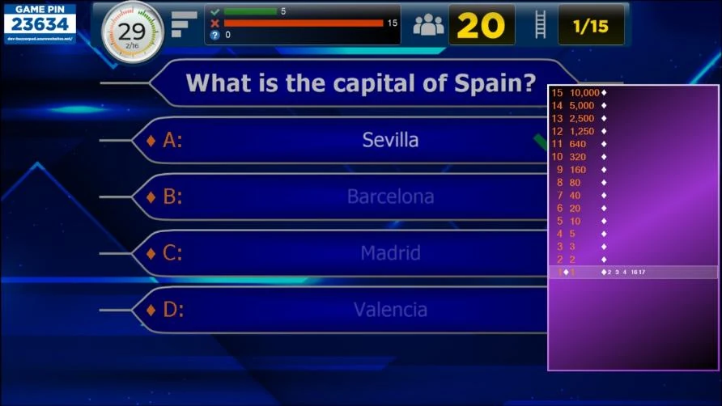
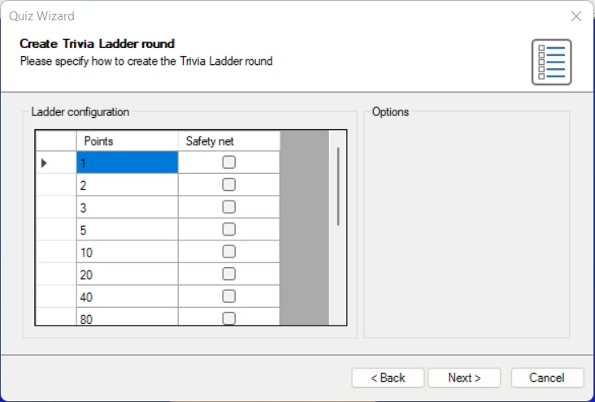
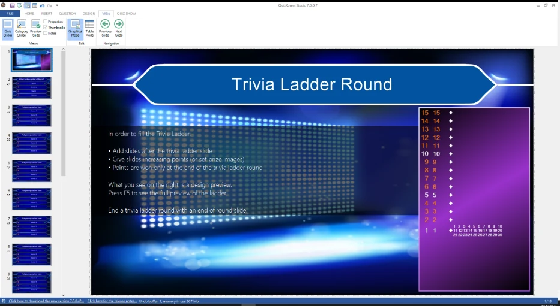

# Trivia Ladder-ronde

Met een Trivia Ladder-ronde kunt u een ronde in de stijl van ‘Who Wants to Be a Millionaire®’ maken, waarin (een) speler(s) probeert/proberen omhoog te klimmen op een ladder door vragen juist te beantwoorden.

{ width="570" loading=lazy }

Net als gewone quizdia’s kan een Trivia Ladder volledig worden vormgegeven (zie [Trivia Ladder-eigenschappen](../user-interface-overview/advanced-properties-grid.md#trivia-ladder-eigenschappen) voor meer details over alle opties).

## Hoe maakt u een Trivia Ladder?

Om een Trivia Ladder te maken, voegt u eerst een Trivia Ladder-dia in de quiz in (ga naar het menu INVOEGEN, klik op de keuzelijst in het gedeelte Quiz Vragen en kies de indeling Trivia Ladder). De Trivia Ladder wordt automatisch opgebouwd uit de vragen die erna volgen.

!!! note

    in tegenstelling tot alle andere diatypen wordt de Trivia Ladder-dia tijdens de quizshow niet zelf getoond. Hij dient alleen om de ladder te maken, die tijdens de quiz op elke dia van de Trivia Ladder-ronde wordt getoond.

Om de ladder te vullen, maakt u *na* de Trivia Ladder-dia zoveel vragen als u treden op de ladder wilt hebben. Hieronder ziet u één trede van de ladder.

{ width="425" loading=lazy }

Ladder-trede

De vraagnummers staan links op de ladder. De punten rechts van het vraagnummer worden bepaald door de punten van de betreffende vragen in de Trivia Ladder-ronde. Het is ook mogelijk om in plaats van punten prijzen aan de ladder toe te voegen. Aan de rechterkant van elke trede worden de keypads getoond die zich op die trede bevinden.

Het meest linkse scheidingsteken (ruit) geeft aan of de vraag op de trede al is gespeeld.

Pas aan het einde, wanneer de laatste laddervraag is afgerond, ontvangt elke speler (keypad) de punten van de trede waarop hij of zij zich bevindt.

De vangnettreden op de ladder hebben meestal een andere kleur (bijvoorbeeld wit in de onderstaande afbeelding) om aan te geven op welke treden spelers terugvallen wanneer ze onjuist antwoorden (als de *actie bij onjuist antwoord* van de ladder is ingesteld op ‘Terug naar vangnet’).

Net als het Trivia Bord kan een Trivia Ladder worden gecombineerd met andere QuizXpress-spelvormen. Om een Trivia Ladder(-ronde) te maken, moet QuizXpress weten waar een Trivia Ladder-ronde eindigt. Een Trivia Ladder-ronde eindigt bij een van de volgende diatypen:

- een dia ‘Einde ronde’ (zie ook 3.4.3)

- een andere Trivia Ladder-dia

- een Trivia Bord-dia

- het einde van de quiz (laatste ronde of een spel met alleen een Trivia Ladder)

Vragen zonder punten (bijvoorbeeld Publieksantwoord, Demografisch, Weddenschap) worden genegeerd bij het maken van de Trivia Ladder.

Als alternatief kan de Quiz Wizard u helpen om met een paar klikken een complete Trivia Ladder-ronde te maken! Start de wizard (tabblad START gevolgd door ‘Quiz Wizard’) en selecteer ‘een nieuwe ronde maken’ gevolgd door ‘een Trivia Ladder-ronde’. Vul nu de punten in en geef aan waar de vangnetten zitten.

{ width="544" loading=lazy }

Kies de vraagtijd, de punten en de stijl die op de volgende pagina’s worden gebruikt, en druk op ‘Voltooien’ om de ladder, de vragen en de afsluitende dia voor het einde van de ronde voor u te laten maken. Natuurlijk moet u de eigenlijke vragen nog steeds zelf invullen, maar de punten, vangnetten en het raamwerk van de ladder staan dan al voor u klaar.

## Positie op de Trivia Ladder

Wanneer een speler in een Trivia Ladder-ronde een vraag juist beantwoordt, gaat hij of zij één trede omhoog op de ladder. Wanneer een vraag onjuist wordt beantwoord, kan het volgende gebeuren, afhankelijk van de ‘Actie onjuist antwoord’:

- Zelfde trede – de speler blijft op dezelfde trede van de ladder.

- Eén trede omlaag – de speler gaat één trede omlaag op de ladder.

- Terug naar vangnet – de speler valt terug naar het eerste vangnet dat hij of zij tegenkomt.

- Start overnieuw – de speler valt van de ladder en moet opnieuw beginnen.

## Een Trivia Ladder bekijken in het voorbeeld

De Trivia Ladder in QuizXpress Studio zoals getoond op de Trivia Ladder-dia wordt alleen voor ontwerpdoeleinden gebruikt. Met de opmaakopties van de Trivia Ladder bepaalt u hoe de ladder eruitziet (zie [Trivia Ladder-eigenschappen](../user-interface-overview/advanced-properties-grid.md#trivia-ladder-eigenschappen) voor meer details over de opties).

{ width="596" loading=lazy }

Wanneer u de ladder wilt bekijken zoals hij tijdens de quizshow wordt getoond, drukt u op F5 (of klikt u met de rechtermuisknop op de ladder en kiest u ‘Voorbeeld’) en wordt de ladder automatisch opgebouwd uit de vragen in de Trivia Ladder-ronde.
