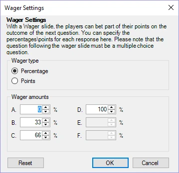

# Scommessa

Con le domande Wager, i giocatori possono puntare (una percentuale dei) propri punti sulla domanda che seguirà la diapositiva della puntata. Quando il tipo di una domanda è impostato su ‘Wager’, viene mostrata la finestra qui sotto. Durante un quiz, i giocatori puntano (una percentuale dei) propri punti in base a quanto ritengono di sapere su un argomento. Sulla diapositiva stessa è possibile modificare il testo o il design per fare riferimento all’argomento della domanda successiva (ad esempio: ‘La prossima domanda riguarda lo sport, quanti punti desiderate puntare?’).

| { width="253" loading=lazy } | È sempre possibile modificare queste opzioni premendo il pulsante ‘Wager’ accanto al pulsante ‘Question Type’ (oppure utilizzando la griglia delle proprietà di QuizXpress). |
|--------------------------------------------------------------------------------|---------------------------------------------------------------------------------------------------------------------------------------------------|
