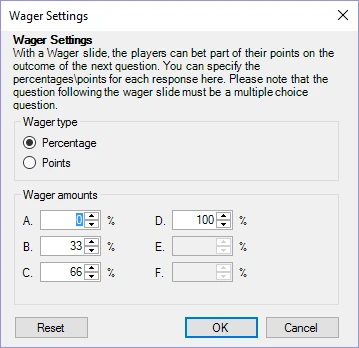

# Weddenschap

Bij weddenschapvragen kunnen spelers (een percentage van) hun punten inzetten op de vraag die na de weddenschapdia volgt. Wanneer het type van een vraag wordt ingesteld op ‘Weddenschap’, verschijnt het onderstaande venster. Tijdens een quiz zetten spelers (een percentage van) hun punten in op basis van hoeveel ze denken te weten over een onderwerp. Op de dia zelf kunt u de tekst of het ontwerp aanpassen zodat het verwijst naar het onderwerp van de vraag die volgt (bijvoorbeeld: ‘De volgende vraag gaat over sport, hoeveel punten wilt u inzetten?’).

| { width="253" loading=lazy } | U kunt deze opties altijd wijzigen met de knop ‘Weddenschap’ naast de knop ‘Vraag Type’ (of via het QuizXpress-eigenschappenraster). |
|--------------------------------------------------------------------------------|---------------------------------------------------------------------------------------------------------------------------------------------------|
