# Estilos

A una diapositiva de quiz se le pueden asignar varios estilos. Esta es una selección de los estilos disponibles:

| 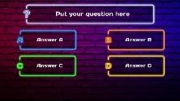{ width="142" loading=lazy } | 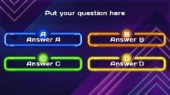{ width="136" loading=lazy } | 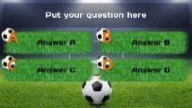{ width="137" loading=lazy } | 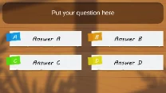{ width="133" loading=lazy }  |
|----------------------------------------------------------------------------------|----------------------------------------------------------------------------------|----------------------------------------------------------------------------------|----------------------------------------------------------------------------------|
| Neon Street                                                                      | Neon Tubes                                                                       | Sports                                                                           | Paper Sheets                                                                     |
| 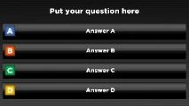{ width="137" loading=lazy } | 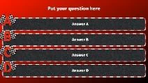{ width="136" loading=lazy } | 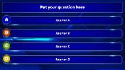{ width="135" loading=lazy } | 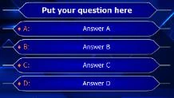{ width="140" loading=lazy } |
| Black-Color                                                                      | Formula 1                                                                        | TV Show                                                                          | Millionaire                                                                      |
| 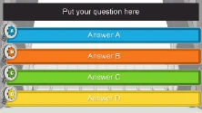{ width="142" loading=lazy }   | 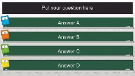{ width="142" loading=lazy }  | 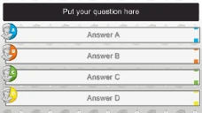{ width="146" loading=lazy }  | 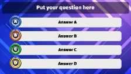{ width="144" loading=lazy }    |
| Film                                                                             | Math                                                                             | History                                                                          | Music Speaker                                                                    |
| 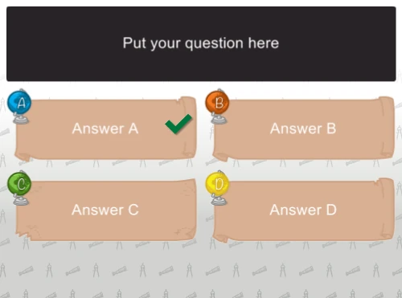{ width="145" loading=lazy }  | 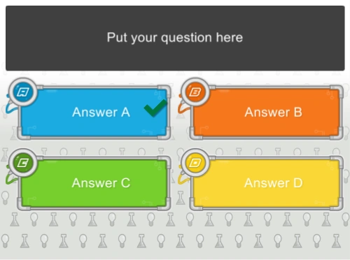{ width="145" loading=lazy }  | 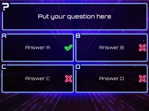{ width="145" loading=lazy }  | *En la versión que tiene instalada hay más estilos disponibles…*                 |
| Geo                                                                              | Tech                                                                             | Techno                                                                           |                                                                                  |

!!! note

    el estilo ‘Just Text’ se puede utilizar para ‘superponer’ texto sobre una imagen de fondo personalizada que usted proporcione, por ejemplo, cuando desee utilizar un diseño creado en PowerPoint.*

Puede cambiar el estilo de la diapositiva haciendo clic en un estilo de la galería de estilos de la pestaña DESIGN de la cinta de opciones, o seleccionando el estilo que prefiera en la cuadrícula de propiedades (nombre de la propiedad: Style). El cambio es visible de inmediato.

Puede organizar su espacio de trabajo filtrando los estilos (y fondos) que no utilice. Accede al filtro desde el botón del ‘iniciador de cuadro de diálogo’ de la sección Style de la cinta Design en QuizXpress Studio.

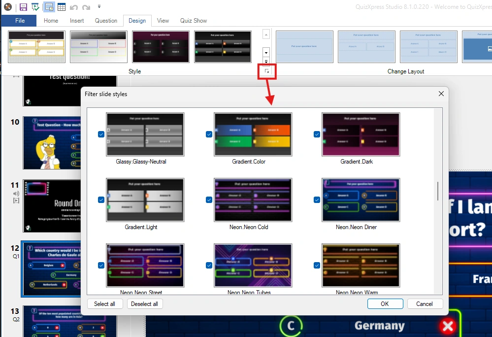{ width="549" loading=lazy }

También hay tres diseños de diapositiva con el llamado diseño de ‘tercio inferior’. Este tipo de diseños puede utilizarse, por ejemplo, cuando se usa QuizXpress como superposición sobre la señal de una cámara de televisión (mediante un color de croma).

| 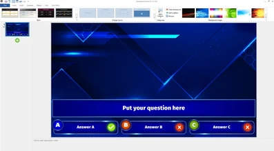{ loading=lazy } | 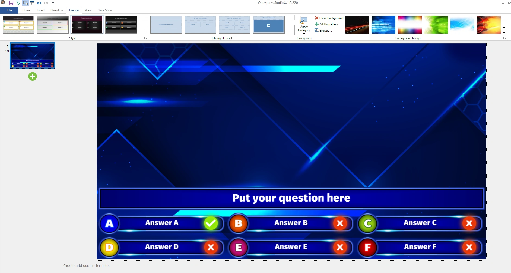{ loading=lazy } | 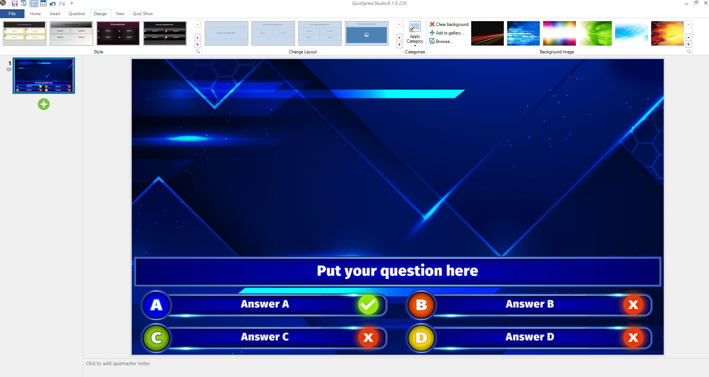{ loading=lazy } |
|----------------------------------------------------------------------------------------------------------------------------------------------------------------------------------------------------|-----------------------------------------------------------------------------------------------------------------------------------------------------------------------------------------------|----------------------------------------------------------------------------------------------------------------------------------------------------------------------------------------------------|

Los nuevos estilos personalizados se pueden diseñar con una herramienta avanzada llamada Style Maker. Encontrará esta herramienta en el menú Inicio de Windows, en QuizXpress. El sistema de estilos se basa en las llamadas imágenes de 9 parches (9-patch). En este sistema, una imagen base se divide en 9 secciones (esquinas y partes centrales) y 8 bloques repetibles que ‘pegan’ estas secciones cuando el panel se estira. Vea el ejemplo a continuación:

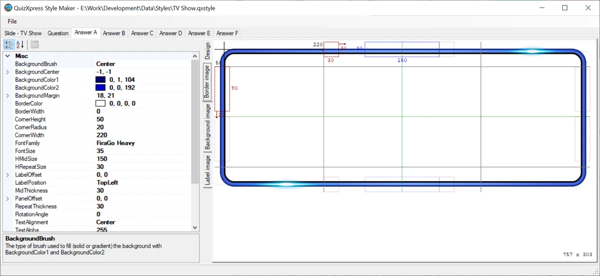{ loading=lazy }
