# Stijlen

Aan een quizdia kunnen verschillende stijlen worden toegewezen. Hier ziet u een selectie van de beschikbare stijlen:

| 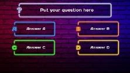{ width="142" loading=lazy } | 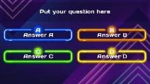{ width="136" loading=lazy } | 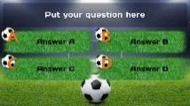{ width="137" loading=lazy } | 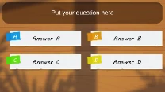{ width="133" loading=lazy }  |
|----------------------------------------------------------------------------------|----------------------------------------------------------------------------------|----------------------------------------------------------------------------------|----------------------------------------------------------------------------------|
| Neon Street                                                                      | Neon Tubes                                                                       | Sports                                                                           | Paper Sheets                                                                     |
| 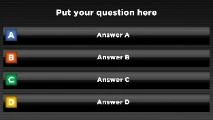{ width="137" loading=lazy } | 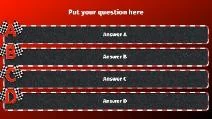{ width="136" loading=lazy } | 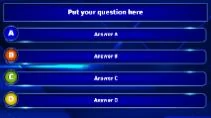{ width="135" loading=lazy } | 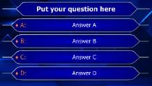{ width="140" loading=lazy } |
| Black-Color                                                                      | Formula 1                                                                        | TV Show                                                                          | Millionaire                                                                      |
| 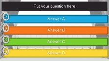{ width="142" loading=lazy }   | 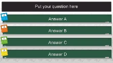{ width="142" loading=lazy }  | 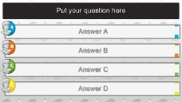{ width="146" loading=lazy }  | 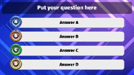{ width="144" loading=lazy }    |
| Film                                                                             | Math                                                                             | History                                                                          | Music Speaker                                                                    |
| 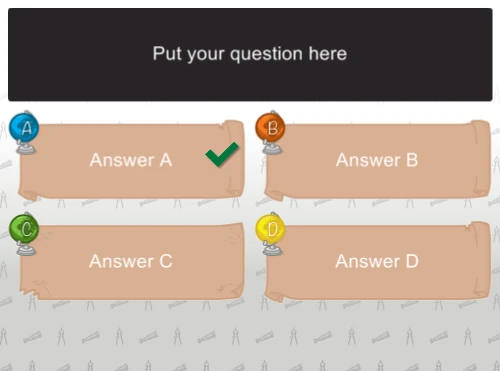{ width="145" loading=lazy }  | 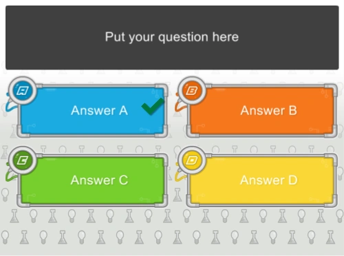{ width="145" loading=lazy }  | 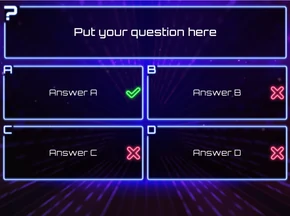{ width="145" loading=lazy }  | *In de versie die u hebt geïnstalleerd zijn meer stijlen beschikbaar…*                   |
| Geo                                                                              | Tech                                                                             | Techno                                                                           |                                                                                  |

!!! note

    de stijl ‘Just Text’ kan worden gebruikt om tekst te ‘overlayen’ op een eigen achtergrondafbeelding die u aanlevert, bijvoorbeeld wanneer u een in PowerPoint ontworpen indeling wilt gebruiken.*

U kunt de dia-stijl wijzigen door op een stijl in de stijlgalerij op het lint-tabblad ONTWERPEN te klikken, of door de gewenste stijl te selecteren in het eigenschappenraster (eigenschapsnaam: Stijl). De wijziging is meteen zichtbaar.

U kunt uw werkruimte overzichtelijk houden door stijlen (en achtergronden) die u niet gebruikt weg te filteren. U opent het filter via de knop ‘dialoogvensterstarter’ in het gedeelte Stijl van het lint Ontwerpen in QuizXpress Studio.

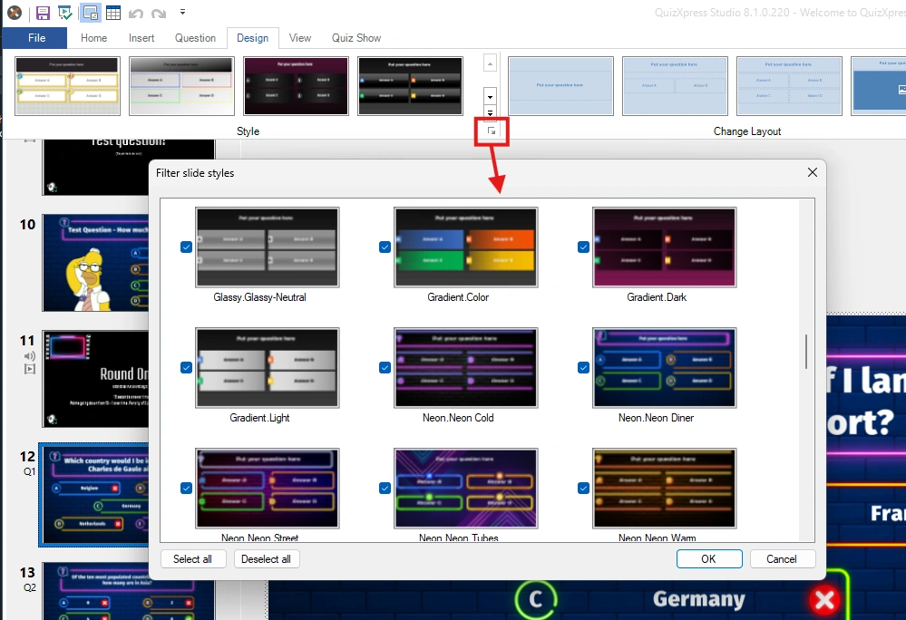{ width="549" loading=lazy }

Er zijn ook drie diaindelingen met een zogeheten ‘lower third’-indeling. Dit soort indelingen kan bijvoorbeeld worden gebruikt wanneer u QuizXpress als overlay op een tv-camerabeeld gebruikt (met een chroma key-kleur).

| 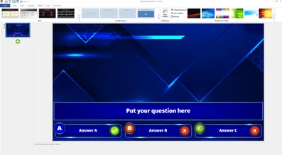{ loading=lazy } | 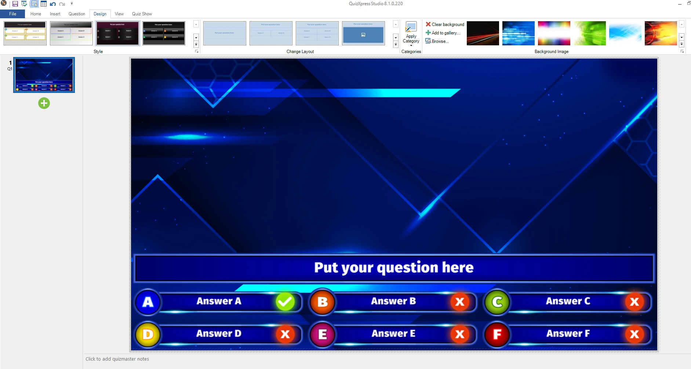{ loading=lazy } | 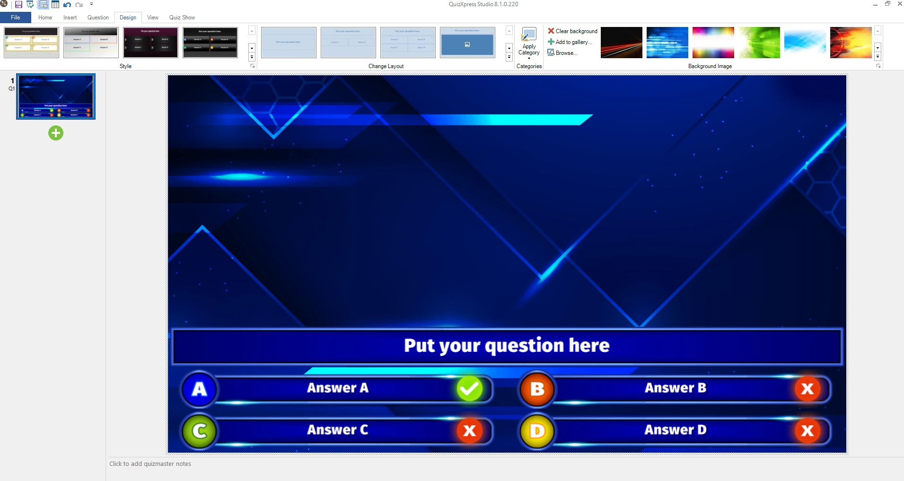{ loading=lazy } |
|----------------------------------------------------------------------------------------------------------------------------------------------------------------------------------------------------|-----------------------------------------------------------------------------------------------------------------------------------------------------------------------------------------------|----------------------------------------------------------------------------------------------------------------------------------------------------------------------------------------------------|

Nieuwe, eigen stijlen kunt u ontwerpen in een geavanceerd hulpprogramma met de naam Style Maker. U vindt dit programma in het Windows Startmenu onder QuizXpress. Het stijlsysteem is gebaseerd op zogeheten 9-patch-afbeeldingen. In dit systeem wordt een basisafbeelding opgedeeld in 9 delen (hoeken en middelste delen) en 8 herhaalbare blokken die deze delen aan elkaar ‘lijmen’ wanneer het paneel wordt uitgerekt. Zie het onderstaande voorbeeld:

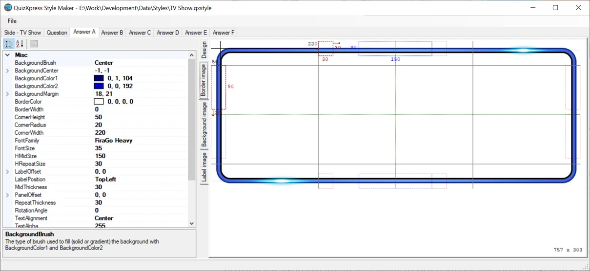{ loading=lazy }
