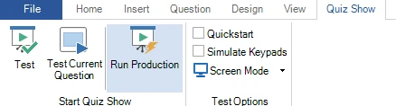

# Uw quiz testen

Wanneer u klaar bent met het ontwerpen van de quizinhoud, kunt u beginnen met testen. Om de quizspeler vanuit Studio te starten, activeert u het lint-tabblad QUIZ SHOW:

{ width="390" loading=lazy }

Zoals u ziet, zijn er hier drie opties om de quizspeler te starten:

**Test:** speel de hele quiz af in testmodus, met de opties zoals ingesteld in het gedeelte *Test opties*

**Test huidige vraag:** start de quiz in testmodus vanaf de huidige vraag.

**Start Productie: start de quiz in productiemodus. In deze modus worden de Test opties genegeerd en worden de scherminstellingen enzovoort gebruikt zoals ze globaal in Quiz Setup zijn geconfigureerd. Gebruik altijd deze modus wanneer u uw quiz voor een live publiek speelt.**

In testmodus kunt u tijd besparen door het welkomstscherm en de aftelvideo over te slaan met het selectievakje Snelstart. En als u de quiz niet zelf wilt bedienen, kunt u Keypads simuleren gebruiken om de hele quiz automatisch af te spelen, alsof er een publiek en een quizmaster zijn. U hoeft alleen maar achterover te leunen en te controleren of elke quizdia zich gedraagt en eruitziet zoals u bedoeld had.

!!! note

    gebruik nooit een van de testmodi om uw quiz in productie te spelen. Alleen in productiemodus gebruikt de quizspeler een speciale herstelfunctie om uw quiz terug te zetten naar het punt waarop het misging, bijvoorbeeld bij een computer- of programmacrash.*
