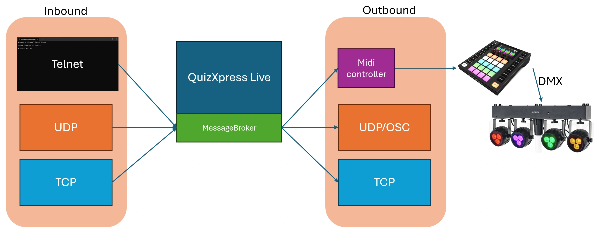

# Le module Message Broker

Message Broker est un plugin QuizXpress optionnel qui connecte votre quiz à des appareils et applications externes. Les événements de QuizXpress peuvent déclencher des messages MIDI, par exemple pour modifier l’éclairage DMX lorsqu’une réponse est correcte. Des programmes externes peuvent également piloter le quiz ou écouter ses événements via UDP, TCP ou Telnet.

{ loading=lazy }

Message Broker se configure depuis QuizXpress Director pendant l’exécution d’un quiz : appuyez sur 'D' et ouvrez l’onglet 'Extensions'.

Pour la documentation complète, consultez [Message Broker](../advanced/message-broker/index.md) dans la section Avancé.

!!! note
    Message Broker est un module complémentaire sous licence pour QuizXpress et nécessite un achat unique.
