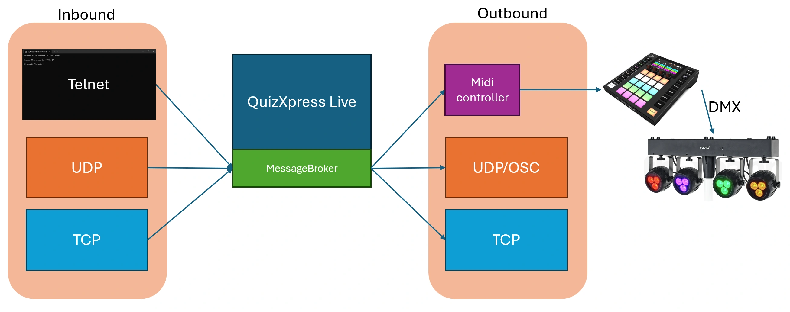

# De Message Broker-module

Message Broker is een optionele QuizXpress-plug-in die uw quiz verbindt met externe apparaten en toepassingen. QuizXpress-gebeurtenissen kunnen MIDI-berichten activeren, bijvoorbeeld om de DMX-verlichting te wijzigen wanneer een antwoord juist is. Externe programma’s kunnen de quiz ook besturen, of naar quizgebeurtenissen luisteren, via UDP, TCP of Telnet.

{ loading=lazy }

Message Broker wordt geconfigureerd vanuit QuizXpress Director terwijl een quiz draait: druk op 'D' en open het tabblad 'Extensies'.

Zie [Message Broker](../advanced/message-broker/index.md) in het gedeelte Geavanceerd voor de volledige documentatie.

!!! note
    Message Broker is een gelicentieerde add-on voor QuizXpress en vereist een eenmalige aankoop.
