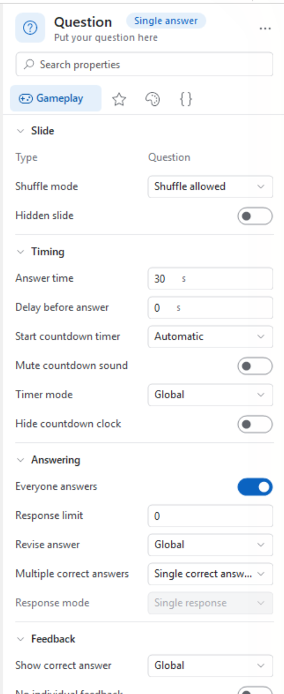
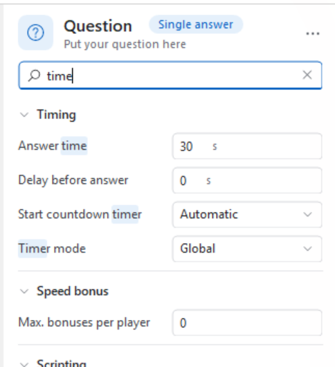
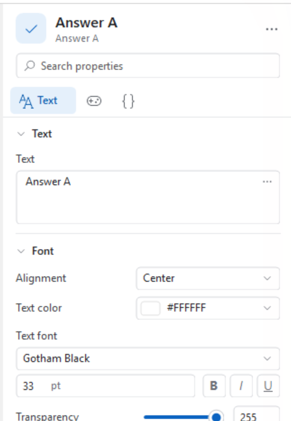
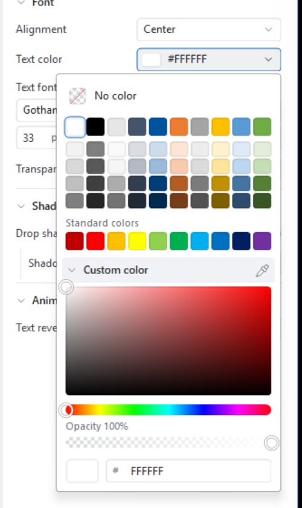
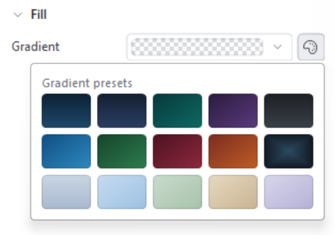
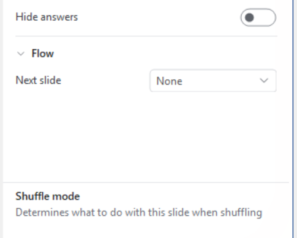
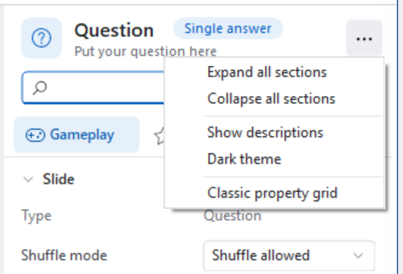
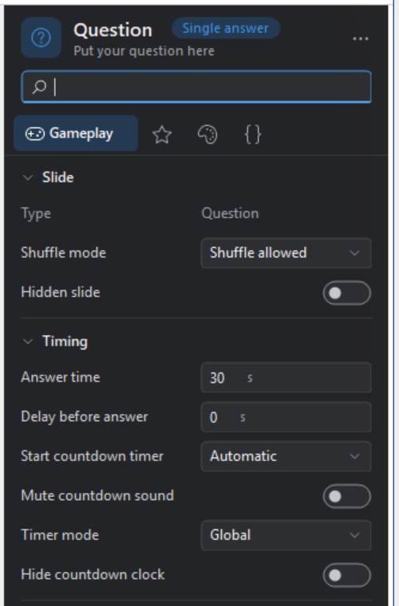
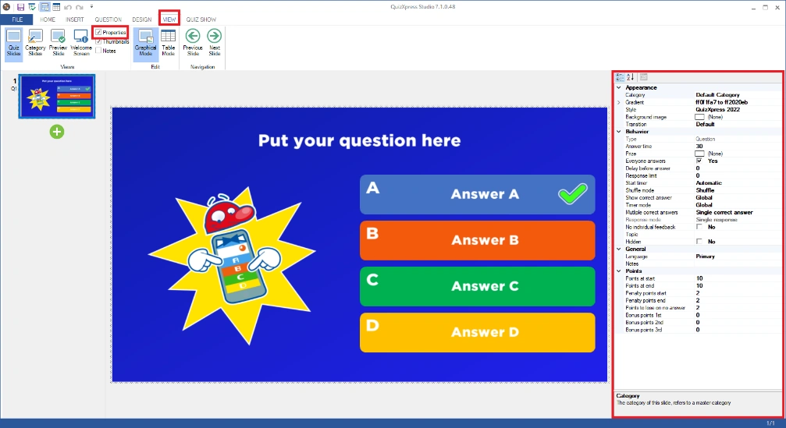

# Griglia delle proprietà avanzate

Il pannello delle proprietà è il luogo in cui è possibile impostare rapidamente tutte le proprietà dettagliate degli elementi selezionati. Ogni elemento (come domanda, risposta, diapositiva, video e immagine) ha proprietà individuali. Non è strettamente necessario utilizzarlo, poiché le impostazioni più importanti sono accessibili dalla barra multifunzione, ma per gli utenti esperti può essere un modo più rapido per portare a termine il lavoro. (alcune proprietà più avanzate o meno note sono accessibili solo dal pannello delle proprietà). Nei capitoli seguenti si trova una spiegazione delle proprietà più importanti. Per visualizzare il pannello delle proprietà, andare al menu VISTA e inserire un segno di spunta davanti a ‘Proprietà’ (nella sezione ‘Viste’).

QuizXpress mostra queste proprietà nel **pannello delle proprietà**, disponibile per impostazione predefinita, e offre ancora la **griglia delle proprietà classica** utilizzata dalle versioni precedenti. Entrambi mostrano esattamente le stesse proprietà ed è possibile passare dall’uno all’altra in qualsiasi momento, quindi i capitoli seguenti valgono per entrambi.

## Il pannello delle proprietà

{ width="322" loading=lazy }

Invece di un lungo elenco alfabetico, il pannello raggruppa le proprietà dell’elemento selezionato in pagine e sezioni e assegna a ogni proprietà un controllo adatto: un interruttore per un’impostazione sì/no, un cursore per una trasparenza, un campione di colore per un colore e così via. Ogni modifica viene applicata immediatamente alla diapositiva.

**Che cosa è selezionato**

La parte superiore del pannello indica che cosa si sta modificando: un’icona, il tipo di elemento e una seconda riga con il suo contenuto (il testo di una risposta, il nome file di un’immagine). Quando si selezionano più elementi contemporaneamente — per esempio tutte e quattro le risposte di una domanda — il titolo riporta ‘4 oggetti selezionati’ e il pannello mostra le proprietà che hanno in comune. Le proprietà i cui valori differiscono tra gli elementi selezionati sono mostrate vuote o come ‘Misto’; non appena se ne imposta una, tutti gli elementi selezionati ricevono il nuovo valore.

**Pagine**

Sotto la casella di ricerca si trova una riga di pagine: *Gioco*, *Punteggio*, *Aspetto*, *Testo*, *Media* e *Avanzate*. Vengono mostrate solo le pagine che hanno effettivamente proprietà per la selezione corrente, e la pagina più importante per l’elemento selezionato compare per prima — la pagina *Testo* per un elemento di testo, *Gioco* per una diapositiva del quiz. La pagina *Avanzate* (la scheda `{}`) raccoglie le proprietà tecniche: metadati, impostazioni dei dispositivi mobili e script. Fare clic su una scheda per cambiare pagina; il pannello ricorda la scelta per ogni tipo di elemento.

**Sezioni e altre opzioni**

Ogni pagina è suddivisa in sezioni come ‘Tempistica’, ‘Risposte’ o ‘Bordo’. Fare clic sul titolo di una sezione per comprimerla e usare *Espandi tutte le sezioni* / *Comprimi tutte le sezioni* nel menu delle opzioni per espandere o comprimere tutte le sezioni in una volta. Le sezioni che contengono anche proprietà usate raramente mostrano in basso un collegamento **Altre opzioni**; fare clic su di esso per mostrarle e su **Meno opzioni** per nasconderle di nuovo. Il pannello ricorda quali sezioni sono state compresse e quali mostrano le opzioni aggiuntive.

**Trovare una proprietà**

{ width="322" loading=lazy }

Se non si sa dove si trovi una proprietà, digitare una parola nella casella di ricerca in alto (oppure premere *Ctrl+F*). Il pannello mostra quindi tutte le proprietà corrispondenti di tutte le pagine contemporaneamente, con la parte corrispondente del nome evidenziata. La ricerca considera anche le descrizioni, quindi una parola che compare solo nella spiegazione di una proprietà permette comunque di trovarla. Fare clic sulla ✕ nella casella di ricerca per tornare alla visualizzazione normale.

### Modificare i valori

{ width="322" loading=lazy }

La maggior parte delle proprietà si spiega da sé: digitare in una casella, azionare un interruttore, scegliere da un elenco a discesa. Alcune meritano di essere segnalate.

I **numeri** possono essere digitati, modificati a passi con le piccole frecce a destra della casella o — spesso più rapidamente — *trascinando il nome della proprietà* a sinistra e a destra. Tenere premuto *Maiusc* durante il trascinamento per passi più grandi e *Alt* per passi più fini. Le proprietà con un minimo e un massimo sensati, come una trasparenza, hanno un cursore con una casella numerica accanto; i due rimangono sincronizzati.

I **caratteri** si impostano con un elenco a discesa che mostra l’anteprima di ogni carattere installato, una casella per la dimensione e pulsanti per grassetto, corsivo e sottolineato.

Le **proprietà raggruppate**, come una sfumatura o una dimensione, mostrano un riepilogo su una sola riga. Fare clic sul nome della proprietà per aprire sotto di essa le singole impostazioni (per una sfumatura: Da, A e Tipo).

### Colori

{ width="333" loading=lazy }

Una proprietà di colore mostra un campione con il suo valore esadecimale. Facendo clic su di esso si ottiene:

- **Nessun colore**, per le proprietà che possono essere lasciate vuote (per esempio uno sfondo trasparente).
- Una **palette** di tonalità in alto e una riga di **Colori standard** sotto di essa.
- **Colori recenti** — i colori usati in precedenza, così riutilizzare un colore su più elementi richiede un solo clic. Vengono ricordati finché QuizXpress Studio è in esecuzione.
- **Colore personalizzato**, che apre un quadrato saturazione/luminosità, una barra della tonalità, una barra dell’opacità e una casella in cui digitare o incollare un valore esadecimale come `#1E4A6B`.

Il piccolo contagocce a destra del titolo ‘Colore personalizzato’ preleva un colore **da qualsiasi punto dello schermo** — anche dall’esterno di QuizXpress. Facendo clic su di esso lo schermo si blocca; una lente d’ingrandimento segue il mouse e mostra i singoli pixel con il colore sotto il cursore. Fare clic per prendere quel colore, usare i tasti freccia per spostarsi di un pixel alla volta (tenere premuto *Maiusc* per dieci) oppure premere *Esc* per annullare. Poiché lo schermo non ha trasparenza, viene mantenuta l’opacità del colore che si aveva.

### Sfumature { #gradienti }

{ width="313" loading=lazy }

Una proprietà di sfumatura mostra un’anteprima della sfumatura. Accanto si trova un pulsante a forma di tavolozza che apre un insieme di **Sfumature predefinite** già pronte — un clic dà a uno sfondo di diapositiva o a una casella di testo un aspetto rifinito. Per conservare una sfumatura creata personalmente, fare clic con il pulsante destro sulla proprietà di sfumatura e scegliere *Aggiungi alle mie sfumature*; comparirà quindi sotto **Le mie sfumature** nel selettore (fino a cinque). Fare clic con il pulsante destro su una delle proprie sfumature nel selettore per rimuoverla. Le proprie sfumature vengono conservate tra una sessione e l’altra.

### Ripristinare, copiare e incollare

Fare clic con il pulsante destro su una qualsiasi proprietà per ottenere:

- **Ripristina predefinito** — riporta la proprietà al valore che ha in una nuova diapositiva.
- **Copia valore** e **Incolla valore** — utili per trasferire un colore, un carattere o una sfumatura da un elemento a un altro. *Ctrl+C* e *Ctrl+V* fanno lo stesso per la proprietà in cui si sta lavorando, quindi è possibile copiare un colore qui e incollarlo direttamente in un altro programma come `#1E4A6B`, o viceversa.

### Descrizioni

{ width="333" loading=lazy }

Passando il mouse sul nome di una proprietà viene mostrato un suggerimento che ne spiega la funzione. Se si preferisce avere questa spiegazione sempre in vista, attivare *Mostra descrizioni* nel menu delle opzioni: in fondo al pannello compare una barra con il nome e la spiegazione della proprietà su cui si trova il mouse.

### Opzioni

{ width="333" loading=lazy }

Il pulsante **…** nell’angolo in alto a destra del pannello contiene le impostazioni del pannello stesso: espandere e comprimere tutte le sezioni, mostrare le descrizioni, il tema scuro e il passaggio alla griglia delle proprietà classica.

### Tema scuro

{ width="333" loading=lazy }

*Tema scuro* nel menu delle opzioni assegna al pannello una combinazione di colori scuri, più riposante per gli occhi quando si progettano diapositive chiare o si lavora in una stanza poco illuminata. La scelta viene ricordata al successivo avvio di QuizXpress Studio e riguarda solo il pannello delle proprietà.

## La griglia delle proprietà classica

{ width="644" loading=lazy }

La griglia utilizzata dalle versioni precedenti di QuizXpress è ancora disponibile. Elenca tutte le proprietà dell’elemento selezionato in gruppi alfabetici ed è il modo più rapido per vedere tutto in una volta. Scegliere *Griglia delle proprietà classica* dal menu **…** del pannello delle proprietà per passare alla griglia e il pulsante *Passa al nuovo pannello delle proprietà* a destra della barra degli strumenti della griglia per tornare indietro. QuizXpress ricorda quale dei due si preferisce.

## Proprietà delle diapositive del quiz

Queste proprietà vengono visualizzate facendo clic sullo sfondo della diapositiva. Le proprietà sono suddivise in cinque gruppi:

- *Aspetto*, definisce come viene visualizzata la domanda.

- *Comportamento*, definisce il comportamento della domanda durante il game show

- *Generale*, definisce le proprietà generali della diapositiva

- *Metadati*, metadati per questa diapositiva (Id e Classe)

- *Punti*, Sezione di Assegnazione dei Punti

<table>
<colgroup>
<col style="width: 100%" />
</colgroup>
<tbody>
<tr class="odd">
<td><table>
<colgroup>
<col style="width: 19%" />
<col style="width: 80%" />
</colgroup>
<thead>
<tr class="header">
<th>Proprietà</th>
<th>Descrizione</th>
</tr>
</thead>
<tbody>
<tr class="odd">
<td>Tempo Risposta</td>
<td>La durata del conto alla rovescia in secondi. Specificare un valore di 0 per una domanda senza tempo. In questo caso, è possibile porre fine alla domanda premendo la barra spaziatrice. Il conto alla rovescia può essere interrotto premendo il tasto 'P' in QuizXpress Live. Premendolo nuovamente, il tempo riprenderà a scorrere.</td>
</tr>
<tr class="even">
<td>Valutazione Automatica</td>
<td>Questa impostazione è applicabile per una domanda di tipo “dito più veloce” ('Votazione' = No) e che sia a scelta multipla. Attivando questa impostazione, la domanda sarà automaticamente valutata da QuizXpress Live! (confrontandola con la risposta contrassegnata come quella corretta), quando si preme un pulsante a scelta multipla di una pulsantiera o di uno slammer (per gli slammers a singola scelta, l’impostazione sarà automaticamente impostata su 'No').</td>
</tr>
<tr class="odd">
<td>Avanzamento Automatico a fine Audio/Video</td>
<td>Passa automaticamente alla diapositiva successiva quando un video o un audio su un tabellone termina. Utile per creare quiz ad avanzamento automatico. Questa opzione è disponibile solo se sulla diapositiva è presente un elemento multimediale e se il tipo di diapositiva è di tipo **Tabellone**.</td>
</tr>
<tr class="even">
<td>Immagine Sfondo</td>
<td>L'immagine di sfondo della diapositiva quiz.</td>
</tr>
<tr class="odd">
<td>Adattamento Sfondo</td>
<td>Indica come l'immagine di sfondo verrà adattata sulla diapositiva. Può essere di tipo ‘Riempi’ per riempire l'intera diapositiva con l'immagine (il rapporto di formato non verrà mantenuto) o di tipo ‘Ingrandisci’ per mantenere le proporzioni corrette (ma perdendo alcune parti dell'immagine)</td>
</tr>
<tr class="odd">
<td>Video Sfondo</td>
<td>
Un video che viene riprodotto dietro la diapositiva durante il quiz. Un’immagine o un video in un segnaposto viene riprodotto sopra di esso. Una volta impostato, sotto compaiono queste impostazioni: <em>Tipo Archivio Video</em> (incorporato o collegato), <em>File Collegato</em> (per un video collegato), <em>Ripeti</em> (attivo per impostazione predefinita), <em>Silenzioso</em> (attivo per impostazione predefinita) e, sotto ‘Altre opzioni’, <em>Sincronizza con il quiz</em> (mette in pausa il video quando una squadra preme il buzzer, il conto alla rovescia è in pausa o la domanda termina).

Su una categoria, il video di sfondo viene applicato a ogni diapositiva formattata con quella categoria. Vedere <a href="../../backgrounds/#video-di-sfondo">Video di sfondo</a>.
</td>
</tr>
<tr class="even">
<td>Punti Bonus</td>
<td>I punti bonus per il 1°, 2° e 3° giocatore più veloci a rispondere correttamente</td>
</tr>
<tr class="odd">
<td>Classe</td>
<td>Un testo definibile dall’utente per classificare il tipo di diapositiva. Questi dati verranno esportati nel file dei punteggi dell’Analyzer e inviati a MessageBroker, in modo da poter essere usati per attivare un comportamento particolare</td>
</tr>
<tr class="even">
<td>Categoria</td>
<td>La categoria della diapositiva quiz attuale. Selezionando una categoria predefinita, si definisce la formattazione grafica della diapositiva. Nota: è possibile creare proprie categorie personalizzate. Per maggiori informazioni, si veda <a href="../../using-categories/">Usare le categorie</a>.</td>
</tr>
<tr class="odd">
<td>Continua dopo una risposta corretta</td>
<td>Quando viene data una risposta corretta ad una domanda “Dito più Veloce” (di tipo "predefinito", la risposta viene data a voce e giudicata corretta) il conto alla rovescia continua e gli altri giocatori possono premere (spesso usato per giochi durante un evento che si svolge al di fuori di un quiz).</td>
</tr>
<tr class="even">
<td>Risposta Corretta</td>
<td>La risposta corretta per questa diapositiva. Applicabile solo quando la modalità di immissione è di tipo "numerica", “Iniziale" o "testuale".</td>
</tr>
<tr class="odd">
<td>Schermata HTML Personalizzata</td>
<td>Una pagina HTML personalizzata da mostrare sui dispositivi mobili quando questa diapositiva viene caricata (uso avanzato)</td>
</tr>
<tr class="even">
<td>Ritardo Risposte</td>
<td>Tempo in secondi che ritarda l’esposizione delle risposte. Questa impostazione consente al quizmaster la possibilità di leggere la domanda ad alta voce prima che le vengano mostrate risposte.</td>
</tr>
<tr class="odd">
<td>Ritardo tra le Risposte*</td>
<td>Questa proprietà viene visualizzata una volta impostata le funzionalità 'Ritardo prima della risposta' e ‘Nascondi e mostra una alla volta’. Essa definisce in secondi, il ritardo che intercorrerà tra la visualizzazione di una risposta e la successiva.</td>
</tr>
<tr class="even">
<td>Gruppo Demografico*</td>
<td>Questa proprietà può essere impostata quando il Tipo di diapositiva è impostato su ‘**Demografica**’. Definisce un gruppo demografico. Durante l’esecuzione di un quiz, i partecipanti premendo la propria pulsantiera quando è mostrata una diapositiva quiz di tipo demografico, faranno parte del gruppo indicato da questa proprietà. Per maggiori informazioni sui gruppi demografici, si veda <a href="../../slide-and-game-formats/demographic-groups/">Gruppi demografici</a>.</td>
</tr>
<tr class="odd">
<td>Azione di Fine Round*</td>
<td>Questa proprietà può essere impostata quando il Tipo di diapositiva è impostato su **'Fine del Round’**. È possibile scegliere per esempio, ‘Escludi un Perdente, nel qual caso è eliminato il partecipante con il minor numero di punti o ‘Quizmaster seleziona i perdenti’, in cui sarà il Quizmaster a scegliere i partecipanti da eliminare, uno ad uno.</td>
</tr>
<tr class="even">
<td>Modalità Valutazione</td>
<td>Indica se la valutazione di una risposta numerica è "Corrispondenza Esatta" (la risposta data deve corrispondere esattamente alla risposta corretta della domanda) o "Nearest Wins" (il giocatore che si avvicina di più alla risposta vince i punti in palio).</td>
</tr>
<tr class="odd">
<td>Sfumatura</td>
<td>Il riempimento sfumato per lo sfondo della diapositiva. Questa proprietà si applica solo se non è presente alcuna immagine sullo sfondo. Una sfumatura si crea indicando 'Da' che colore 'A' che colore e scegliendo una tipologia ‘Tipo’.</td>
</tr>
<tr class="even">
<td>Id</td>
<td>Un ID univoco per identificare questa diapositiva (per esempio per l’instradamento statico delle diapositive con la proprietà Diapositiva Successiva)</td>
</tr>
<tr class="odd">
<td>Tipologia Input</td>
<td>In una domanda “aperta” è possibile scegliere tra la modalità "predefinita" (domanda “Dito più Veloce”) o una risposta "Numerica", "Iniziale" o "Testuale". Queste ultime tre modalità si applicano solo quando si utilizzano i Dispositivi Mobili (poiché le Pulsantiere e i Buzzers non offrono la possibilità di inserire numeri o testi).</td>
</tr>
<tr class="even">
<td>Lingua</td>
<td>La lingua di visualizzazione (di modifica) corrente della diapositiva per i quiz bilingue.</td>
</tr>
<tr class="odd">
<td>Escludi se Sbagliata</td>
<td>Imposta la modalità di esclusione per una domanda “dito più veloce”. Il giocatore viene escluso dopo una risposta sbagliata oppure il giocatore può riprovare.</td>
</tr>
<tr class="even">
<td>Risposte Corrette Multiple</td>
<td>Indica se la domanda ha più di una risposta corretta e se più risposte corrette sono da fornire in un ordine specifico</td>
</tr>
<tr class="odd">
<td>Disattiva Audio Countdown</td>
<td>Disattiva il suono del conto alla rovescia per la domanda attuale.</td>
</tr>
<tr class="even">
<td>Diapositiva successiva</td>
<td>L’ID della diapositiva da mostrare dopo questa (instradamento statico delle diapositive)</td>
</tr>
<tr class="odd">
<td>Note</td>
<td>È possibile inserire un testo per il Quizmaster che sarà incluso nell’esportazione PDF</td>
</tr>
<tr class="even">
<td>Modalità Risposta Ordinata</td>
<td>Per le risposte da ordinare, si può indicare se si vuole che le risposte corrispondano esattamente all'ordine (Corrispondenza esatta) o se anche una risposta parzialmente corretta possa riconoscere dei punti (una percentuale dei punti, a seconda di quante risposte sono nell’ordine giusto).</td>
</tr>
<tr class="odd">
<td>Punti Penalità finali</td>
<td>Numero di punti sottratti ai partecipanti in caso di risposta errata alla fine del conto alla rovescia. (interpolati tra inizio e fine)</td>
</tr>
<tr class="even">
<td>Punti Penalità iniziali</td>
<td>Numero di punti sottratti ai partecipanti in caso di risposta errata all'inizio del conto alla rovescia.</td>
</tr>
<tr class="odd">
<td>Punti a fine tempo</td>
<td>Numero di punti assegnati ai partecipanti alla fine del conto alla rovescia. Normalmente devono essere minori o uguali ai 'punti all’inizio del tempo’. I punti sono interpolati tra l'inizio e la fine del contatore. Quando i punti alla fine tempo sono inferiori ai punti all’inizio del tempo, i punti assegnati diminuiscono con il passare del tempo. Quando i due valori sono uguali, i punti che si possono ottenere saranno gli stessi durante tutto il conto alla rovescia.</td>
</tr>
<tr class="even">
<td>Punti a inizio tempo</td>
<td>Numero di punti che vengono assegnati ai partecipanti all'inizio del conto alla rovescia.</td>
</tr>
<tr class="odd">
<td>Punti Nessuna Risposta</td>
<td>I punti che vengono sottratti quando un partecipante non fornisce una risposta (applicabile solo per domande di tipo ‘Votazione’)</td>
</tr>
<tr class="even">
<td>Ruba punti</td>
<td>Quando l'opzione Ruba Punti è attiva in una domanda "dito più veloce" (buzzer), il giocatore che dà una risposta errata non perde punti. Al contrario, i punti di penalità configurati per la diapositiva vengono assegnati a tutti gli altri giocatori e la domanda termina immediatamente.</td>
</tr>
<tr class="odd">
<td>Limite Risposte</td>
<td>È Il numero massimo di squadre/partecipanti per cui il sistema accetterà le risposte. Ad esempio se si gioca con 100 squadre, è possibile impostare questo valore a 25 in modo che solo le prime 25 squadre abbiano diritto di rispondere alla domanda</td>
</tr>
<tr class="even">
<td>Modalità Risposta</td>
<td>Indica se la domanda accetta una sola risposta per ogni giocatore o multipla (usato in combinazione con ‘Risposte Corrette Multiple’). Quando si imposta questa opzione su "risposte multiple, corrispondenza esatta", la risposta multipla deve corrispondere esattamente alle risposte corrette per ottenere punti.</td>
</tr>
<tr class="odd">
<td>Risposta Rivedibile</td>
<td>Qui puoi modificare l’impostazione che permette ai giocatori di rivedere e cambiare la propria risposta (impostazione definita in “Configurazione quiz” per tutte le diapositive).</td>
</tr>
<tr class="even">
<td>Traguardo Salvezza*</td>
<td>Usato per le domande Trivia Ladder. Quando in un round di Trivia Ladder un giocatore risponde in modo errato, torna indietro al Traguardo Salvezza più prossimo sulla scaletta.</td>
</tr>
<tr class="odd">
<td>Script</td>
<td>Comportamento personalizzato della diapositiva scritto in JavaScript (uso avanzato)</td>
</tr>
<tr class="even">
<td>Mostra Azioni Risposta*</td>
<td>Quando è impostato ‘Ritardo Risposte’, questa proprietà compare. Impostandola su ‘Mostra e Nascondi Insieme’, le risposte vengono mostrate tutte insieme una volta trascorso il tempo di ritardo. Impostandola su ‘Nascondi e Mostra una alla volta’, le risposte vengono mostrate una per una una volta trascorso il tempo di ritardo.</td>
</tr>
<tr class="odd">
<td>Mostra Risposta Corretta</td>
<td>Modalità per mostrare la risposta corretta nella diapositiva. Segue l'impostazione globale in Quiz Setup, oppure non mostra mai la risposta corretta oppure mostra sempre la risposta corretta</td>
</tr>
<tr class="even">
<td>Modalità Mescola</td>
<td>Determina cosa fare accadere quando il quiz viene mischiato</td>
</tr>
<tr class="odd">
<td>Modalità Countdown</td>
<td>Indica se il conto alla rovescia per la domanda inizierà immediatamente (automatico) o dopo aver premuto la barra spaziatrice (Manuale)</td>
</tr>
<tr class="odd">
<td>Stile</td>
<td>Lo stile di rendering della diapositiva. È possibile trovare maggiori informazioni sugli stili nel capitolo "Stili"</td>
</tr>
<tr class="even">
<td>Valutazione Testo</td>
<td>Indica se la valutazione di una risposta di testo è a " Corrispondenza Esatta" (la risposta data deve corrispondere esattamente alla risposta corretta della domanda) o a " Corrispondenza Approssimata" (viene utilizzato un algoritmo che consente una certa percentuale di differenza tra la risposta data e la risposta corretta. Questo consente ai giocatori di commettere errori di ortografia).</td>
</tr>
<tr class="odd">
<td>Tolleranza</td>
<td>Variazione consentita tra la risposta corretta e le risposte date. Si applica alle domande con risposta di tipo "testuale" con "Valutazione Testo" impostato su "Corrispondenza Approssimata".</td>
</tr>
<tr class="even">
<td>Argomento*</td>
<td>L'argomento della domanda. Viene utilizzato per generare automaticamente un Tabellone Trivia precedente.</td>
</tr>
<tr class="odd">
<td>Transizione</td>
<td>L’animazione di transizione specifica quando si passa alla diapositiva successiva (per impostazione predefinita, il sistema seleziona una transizione casuale)</td>
</tr>
<tr class="even">
<td>Tipo</td>
<td>
Campo di sola visualizzazione che mostra il tipo di diapositiva:

<ul>
<li>
<em>Domanda</em>: la diapositiva è una normale domanda del quiz.
</li>
<li>
<em>Tabellone</em>: la diapositiva è solo da visualizzare.
</li>
<li>
<em>Fine Round</em>: la diapositiva indica la fine di un round del quiz. Vengono mostrati i punteggi intermedi e il Quizmaster ha la possibilità di eliminare le squadre. Vedere anche la proprietà: ‘End of Round’.
</li>
<li>
<em>Domanda Test</em>: diapositiva usata per dimostrare il sistema ai partecipanti. Non vengono aggiunti né sottratti punti.
</li>
<li>
<em>Demografica</em>: questa diapositiva serve a suddividere tutti i partecipanti in gruppi in competizione. Vedere anche la proprietà ‘Demographic group’.
</li>
<li>
<em>Ultimo Uomo</em>: la diapositiva è una domanda del quiz. I partecipanti che rispondono in modo errato alla domanda vengono eliminati dal quiz.
</li>
<li>
<em>Audience Response</em>: diapositiva per raccogliere semplicemente una risposta dal pubblico senza modificare i punteggi del quiz. I dati delle risposte possono essere mostrati in un grafico.
</li>
<li>
<em>Scommessa</em>: consente al pubblico di puntare una percentuale dei propri punteggi sulla domanda successiva.
</li>
<li>
<em>Regole Maggioranza</em>: una diapositiva in cui la risposta corretta dipende da ciò che il pubblico sceglie più spesso
</li>
<li>
<em>Domanda di Abbinamento</em>: i giocatori abbinano etichette di testo a immagini (per esempio paesi e bandiere).
</li>
<li>
<em>Modulo Gioco</em>: una diapositiva che avvia il Modulo Gioco selezionato
</li>
<li>
<em>Tabellone Trivia</em>: una diapositiva che avvia un round in cui le domande sono organizzate per Topic/Points e presentate come una griglia
</li>
<li>
<em>Trivia Ladder:</em> avvia un round Trivia Ladder in cui i giocatori salgono di un gradino della scala a ogni risposta corretta
</li>
<li>
<em>Speed Round:</em> avvia un round in cui un giocatore deve rispondere al maggior numero possibile di domande in un tempo prestabilito.
</li>
<li>
<em>Round Bingo:</em> avvia un round di Bingo, costruito dalle diapositive del quiz successive oppure come un tradizionale gioco di Bingo a numeri.
</li>
<li>
<em>Trivia Feud:</em> una diapositiva in cui i giocatori rispondono a una domanda di tipo sondaggio.
</li>
</ul></td>
</tr>
<tr class="odd">
<td>Votazione</td>
<td>Indica se tutti i partecipanti possono rispondere (‘SI’) o se può rispondere solo il partecipante che preme per primo il pulsante (‘No’).</td>
</tr>
</tbody>
</table>

* la visibilità della proprietà dipende da altre proprietà
</td>
</tr>
</tbody>
</table>

## Proprietà della domanda

Queste proprietà sono mostrate quando si fa clic su una casella della domanda in una diapositiva.

| Proprietà | Descrizione |
|---|---|
| Allineamento | L’allineamento del testo della domanda |
| Ombra Esterna | Indica se sotto il testo della domanda viene applicata un’ombra |
| Sfumatura | Riempimento sfumato per lo sfondo della domanda. |
| Colore Ombra | Indica il colore dell’ombreggiatura |
| Testo | Il testo della domanda |
| Colore Testo | Il colore del testo della domanda |
| Font Testo | Il font usato per il testo della domanda |
| Rivelazione Testo | Come viene rivelato il testo: *Mostra Tutto* (predefinito: viene mostrato direttamente), *Lettera per Lettera* o *Parola per Parola* |
| Ritardo Rivelazione Testo (sec) | Il ritardo, in secondi, dopo il quale il testo viene mostrato. |
| Velocità Rivelazione Testo | Velocità con cui il testo viene mostrato |
| Trasparenza | Trasparenza dello sfondo della domanda |

## Proprietà delle risposte

Queste proprietà sono mostrate quando si fa clic su una casella di risposta in una diapositiva.

| Proprietà | Descrizione |
|---|---|
| Allineamento | L’allineamento del testo della risposta |
| Risposta Corretta | Indica se la risposta selezionata è la risposta corretta. Impostare su ‘Sì’ se la risposta selezionata è la risposta corretta. |
| Correttezza | Applicabile alle domande con più risposte corrette, questo valore imposta la correttezza della risposta (in percentuale del totale dei punti della domanda). |
| Ombra Esterna | Indica se sotto il testo della risposta viene applicata un’ombra |
| Sfumatura | Il riempimento sfumato per lo sfondo della risposta. L’applicabilità di questa proprietà dipende dallo stile utilizzato. |
| Colore Ombra | Indica il colore dell’ombreggiatura |
| Testo | Il testo della risposta |
| Rivelazione Testo | Come viene rivelato il testo: *Mostra Tutto* (predefinito: viene mostrato direttamente), *Lettera per Lettera* o *Parola per Parola* |
| Ritardo Rivelazione Testo (sec) | Il ritardo, in secondi, dopo il quale il testo viene mostrato. |
| Velocità Rivelazione Testo | Velocità con cui il testo viene mostrato |
| Colore Testo | Il colore del testo della risposta |
| Font Testo | Il font usato per il testo della risposta |
| Trasparenza | Trasparenza dello sfondo della risposta |

## Proprietà delle immagini

Queste proprietà sono mostrate quando si fa clic su una casella immagine in una diapositiva.

| Proprietà | Descrizione |
|---|---|
| Bordo | Indica se deve essere visibile un bordo intorno all'immagine |
| Colore Bordo | Il colore del bordo, se abilitato |
| Spessore Bordo | Spessore in pixel del bordo, se abilitato |
| Raggio Angoli | Raggio degli angoli della linea del bordo per creare un bordo arrotondato |
| Risposta Corretta | Indica se l'immagine contiene la risposta corretta. Può essere impostata solo per le immagini, se la diapositiva contiene solo immagini e se la diapositiva è a scelta multipla. |
| Ombra Esterna | Indica se è richiesta un'ombra sotto l'immagine |
| Effetto | Imposta un effetto sull’immagine. Vedere [Applicare gli effetti](../adding-multimedia-content/pictures.md#applicare-gli-effetti) per una spiegazione più dettagliata degli effetti. |
| Nascosta | Nasconde l’immagine durante il quiz |
| Nascondi su Mobile | Indica se l'immagine mostrata su una diapositiva del quiz deve essere nascosta sul telefono cellulare. Lo scenario per l'utilizzo di questa opzione è quando si desidera mostrare sul cellulare un'immagine diversa da quella mostrata sul grande schermo al pubblico. Ad esempio, si desidera che l'immagine sul cellulare abbia un altro rapporto di aspetto. In questo caso, non si vuole mostrare l'immagine visualizzata sullo schermo anche sul cellulare. |
| Immagine | Visualizza una miniatura dell'immagine. Fare clic sul pulsante sfoglia (...) di questa proprietà per cercare una foto. |
| Ingrandisci | Ingrandisce l’immagine fino ai bordi dell’area mantenendo le proporzioni; le parti che escono possono essere tagliate. |
| Etichetta | Una descrizione testuale dell'immagine (da usare quando l'immagine non può essere mostrata) |
| Immagine Dispositivi Mobili | Una versione alternativa dell'immagine da utilizzare sui Dispositivi Mobili |
| Riempi | Allunga l'immagine in entrambe le direzioni per riempire l'area (potrebbe distorcere l'immagine) |

## Proprietà dei suoni

Queste proprietà sono mostrate quando si clicca su un elemento Audio in una diapositiva.

| Proprietà | Descrizione |
|---|---|
| Durata | La durata del file audio. Inizialmente è mostrata la durata totale. |
| Pausa Intro | Il tempo di attesa prima che il file audio inizi. In questo modo il quizmaster avrà la possibilità di leggere prima la domanda. |
| Continua Riproduzione | Per impostazione predefinita, l’audio inserito in una diapositiva si interrompe alla fine del conto alla rovescia. Con questa opzione attiva, l’audio continuerà la riproduzione fino al passaggio alla diapositiva successiva. |
| Tono (-12 - +12 semitoni) | Il tono del suono all’inizio del conto alla rovescia |
| Rimuovi Vocals | Effetto per rimuovere le voci dal file audio (i risultati possono variare) |
| Ripeti | Indica se il file audio deve ripetersi o no. |
| Replay | Riproduce nuovamente il suono dopo che la risposta corretta è stata rivelata nella domanda. |
| Ritardo Replay | Viene visualizzato quando il Replay è abilitato. Mostra il numero di secondi dopo i quali inizia la ripetizione. |
| Inizio Replay | Imposta il momento in cui il frammento sonoro inizierà a essere riprodotto |
| Fine Replay | Imposta il momento in cui il frammento sonoro smetterà di essere riprodotto |
| Audio Invertito | Riproduce il frammento sonoro al contrario |
| Tipo Archivio Audio | Indica se il file audio è incorporato nel quiz o collegato dal disco locale. Incorporare un file audio significa integrarlo nel file del quiz; collegarlo significa fare riferimento a un file presente sul computer. In generale si raccomanda il collegamento. Nota: quando si collega un file audio, non rimuoverlo dal computer; quando si sposta il quiz su un altro computer, i file audio devono essere copiati nella stessa cartella del file del quiz. |
| Percentuale Velocità | Indica la velocità del file audio quando inizia la riproduzione. |
| Inizia da | La posizione del file Audio da cui verrà avviato il suono. |
| Termina a | La posizione del file audio in cui il suono verrà interrotto. |
| Tonalità Target (-12 - +12 semitoni) | Il tono del suono alla fine del conto alla rovescia (il tono viene interpolato dall’inizio alla fine) |
| Percentuale Velocità target | La velocità del file audio quando termina la riproduzione. Nota: con ‘Percentuale Velocità’ e ‘Percentuale Velocità target’ è possibile riprodurre i suoni ‘da lento a normale’ o ‘da veloce a normale’. Impostando entrambe le percentuali al 100%, il frammento audio viene riprodotto dall’inizio alla fine a velocità normale. |
| Volume | Il volume con cui riprodurre il file Audio |
| Dissolvenza Volume | Dissolvenza in entrata/uscita all’avvio/arresto della musica |

## Proprietà dei Moduli Gioco { #proprieta-dei-minigiochi }

| Proprietà | Descrizione |
|---|---|
| Titolo del Modulo Gioco | Per impostazione predefinita, la pulsantiera/buzzer mobile mostra sullo schermo il nome del Modulo Gioco. Puoi sostituirlo inserendo un testo personalizzato: così, invece di “Corsa di cavalli”, puoi mostrare qualcosa di più coinvolgente. |

## Proprietà dei video

Queste proprietà sono mostrate quando si clicca su un elemento Video in una diapositiva.

| Proprietà | Descrizione |
|---|---|
| Proporzioni | (sola lettura) Le proporzioni del video |
| Codec | (sola lettura) Il decoder video utilizzato |
| Durata | (sola lettura) La durata del video |
| Effetto | Effetto facoltativo applicato al video |
| Fine | La posizione in cui il video verrà interrotto |
| Pausa Intro | Il tempo di attesa tra la visualizzazione della diapositiva e l’avvio del video. In questo modo il Quizmaster può leggere prima la domanda. |
| File Collegato | Il nome del file video esterno (se collegato) |
| Ripeti | Ripete il video una volta concluso |
| Replay | Riproduce nuovamente il video dopo che la risposta corretta è stata rivelata nella domanda. |
| Ritardo Replay | Viene visualizzato quando il Replay è abilitato. Indica il numero di secondi dopo i quali inizia la ripetizione. |
| Inizio Replay | Imposta il momento in cui il video inizierà a essere riprodotto |
| Fine Replay | Imposta il momento in cui il video smetterà di essere riprodotto |
| Silenzioso | Silenzia l’audio del video |
| Inizio | La posizione da cui verrà avviato il video |
| Altezza | (sola lettura) L’altezza del video |
| Tipo Archivio Video | Indica se il file video è incorporato nel quiz o collegato. Incorporare un file video significa integrarlo nel file del quiz; collegarlo significa fare riferimento a un file presente sul computer. In generale si raccomanda il collegamento. *Nota: quando si collega un file video, non rimuoverlo dal computer; quando si sposta il quiz su un altro computer, i video devono essere copiati nella stessa cartella del file del quiz.* |
| Larghezza | (sola lettura) La larghezza del video |

## Proprietà delle forme

Queste proprietà vengono visualizzate quando si fa clic su una forma immagine o su una forma testo in una diapositiva.

| Proprietà | Descrizione |
|---|---|
| Allineamento | L'allineamento del testo della forma testo |
| Trasparenza Sfondo | Applicabile alle forme di testo. Imposta la trasparenza del colore utilizzato per lo sfondo (proprietà Sfumatura). |
| Colore Bordo | Il colore del bordo di una forma di testo |
| Spessore Bordo | La larghezza del bordo di una forma di testo |
| Raggio Angoli | Il raggio del bordo di una forma di testo. Consente di creare angoli arrotondati. |
| Ombra Esterna | Indica se utilizzare un'ombra esterna in una forma di testo. |
| Sfumatura | Il riempimento sfumato per lo sfondo della forma di testo. È possibile selezionare un colore di sfumatura ‘Da’ e un colore di sfumatura ‘A’, oltre a un ‘Tipo’ di sfumatura. |
| Immagine | Applicabile alle forme Immagine. Una miniatura dell'immagine. Fare clic sul pulsante Sfoglia (...) per cercare un'immagine. |
| Angolo Rotazione | L'angolo di rotazione dell'immagine o del testo |
| Colore Ombra | Il colore dell'ombra in una forma di testo |
| Riempi | Applicabile alle forme immagine. Allunga l’immagine per coprire l’intera area del riquadro di selezione circostante (può deformarla). |
| Testo | Il testo della forma di testo |
| Colore Testo | Il colore del testo di una forma di testo |
| Font Testo | Il carattere utilizzato per la forma di testo |
| Trasparenza | Imposta la trasparenza dell'immagine o del testo |
| Visibilità | Indica se una forma (immagine o testo) è sempre visibile, diventa visibile quando viene rivelata una risposta, è nascosta quando viene rivelata una risposta o è temporizzata (appare in un determinato momento durante il conto alla rovescia). |

## Proprietà della sintesi vocale

Queste proprietà vengono visualizzate quando si fa clic su un elemento Parlato in una diapositiva.

| Proprietà | Descrizione |
|---|---|
| Pausa Intro | Indica il numero di secondi di attesa prima che inizi la lettura del testo. |
| Velocità | La velocità di lettura del testo dell’elemento parlato |
| Testo | Il testo da leggere |
| Voce | La voce da utilizzare (scegliere una delle voci installate in Windows) |
| Volume | Il volume del testo parlato |

## Proprietà dei grafici

Queste proprietà vengono mostrate quando si fa clic su un grafico in una diapositiva.

| Proprietà | Descrizione |
|---|---|
| Allineamento | L’allineamento del titolo del grafico |
| Sfondo Area | Imposta il colore di sfondo dell'area dei dati del grafico |
| Colore Assi | Il colore utilizzato per gli assi |
| Auto-Dimensione Etichette Assi | Imposta automaticamente la dimensione delle etichette sull'asse. Se non sono impostate, è possibile scegliere esplicitamente un carattere e una dimensione per le etichette. |
| Colore Etichette Assi | Il colore utilizzato per le etichette degli assi. |
| Sfondo Grafico | Imposta il colore di sfondo dell'area esterna ai dati del grafico |
| Tipologia Grafico | Il tipo di grafico. È possibile scegliere tra *Barre*, *Colonna*, *Ciambella* o *Torta*. |
| Raggio Angoli | Imposta l’arrotondamento degli angoli dell’elemento grafico. |
| Scostamento Ombra | Mostra un'ombra per l'area dei dati del grafico |
| Colore Griglia | Il colore utilizzato per la griglia nell'area dei dati del grafico |
| Colore Etichetta | Colore delle etichette visualizzate per ogni elemento del grafico |
| Modalità Visualizzazione Etichetta | Per le etichette, indica se mostrare i valori assoluti, le percentuali o entrambi (*Assoluto*, *Percentuale*, *Entrambi*). |
| Font Etichetta | Il carattere utilizzato per le Etichette |
| Stile Etichetta | Indica dove posizionare le etichette |
| Modalità | Indica il tipo di dati mostrati nel grafico: *Risposta* (percentuale di ogni risposta data) o *Corrette/Errate* (percentuale di giocatori che hanno risposto correttamente o in modo errato). |
| Mostra 3D | Visualizza una rappresentazione 3D del grafico |
| Mostra Legenda | Visualizza una legenda per i dati del grafico (percentuale di risposte per ogni risposta). |
| Titolo | Il titolo del grafico |
| Colore Titolo | Il colore del titolo del grafico |
| Font Titolo | Il carattere utilizzato per il titolo del grafico |
| Visibilità | Indica se il grafico è sempre visibile (con aggiornamenti in tempo reale durante il conto alla rovescia) o solo dopo la chiusura della domanda. |

## Proprietà dei Word Game { #proprieta-dei-giochi-di-parole }

Queste proprietà vengono mostrate quando si fa clic su un Word Game in una diapositiva.

| Proprietà | Descrizione |
|---|---|
| Allineamento | L’allineamento del testo |
| Riempimento Sfondo | Il riempimento sfumato per lo sfondo del Word Game. È possibile selezionare un colore di sfumatura ‘Da’ e un colore di sfumatura ‘A’, oltre a un ‘Tipo’ di sfumatura. |
| Centra Indice | Per il gioco della Word Wheel, indica la lettera che comparirà al centro. |
| Ombra Esterna | Indica se utilizzare un’ombra per le lettere del Word Game. |
| Fine Rivelazione a | La percentuale del tempo del conto alla rovescia in cui la rivelazione si conclude |
| Font | Il carattere utilizzato per il testo |
| Intervallo | Per i Word Game da decifrare o da svelare, controlla il tempo che intercorre tra le fasi del gioco: *Lineare*, *Rallentato* o *Molto Rallentato*. |
| Layout | Per i Word Game da svelare o da decifrare: *Griglia Lettere Dinamica* o *Griglia Lettere Fissa (52 celle)*. |
| Riempimento Sfondo Carattere | Il riempimento sfumato per lo sfondo delle caselle delle lettere del Word Game. È possibile selezionare un colore di sfumatura 'da' e un colore di sfumatura 'a', nonché il tipo di sfumatura. |
| Raggio Carattere | Il raggio degli angoli delle caselle delle lettere del Word Game |
| Spaziatura Carattere | Lo spazio tra le lettere del Word Game |
| Controllo Manuale | Indica se le lettere vengono rivelate automaticamente o manualmente dal Quizmaster da QuizXpress Director. |
| Spaziatura Interna | Lo spazio interno attorno alle lettere della griglia |
| Inverti | Nel gioco della Word Wheel, inverte la direzione delle lettere |
| Colore Ombra | Colore dell'ombra delle lettere |
| Ruota | Fa girare la Word Wheel per una sfida aggiuntiva |
| Angolo Inizio | Per il gioco della Word Wheel, l'angolo iniziale in cui compare la prima lettera della parola |
| Inizio Rivelazione a | La percentuale di tempo del countdown in cui la rivelazione ha inizio |
| Testo | Il testo del Word Game |
| Colore Testo | Il colore del testo del Word Game |
| Trasparenza Testo | La trasparenza del testo del Word Game |

## Proprietà del Tabellone Trivia { #proprieta-del-trivia-board }

Queste proprietà vengono mostrate quando è selezionato un Tabellone Trivia. Le proprietà contrassegnate con *Personalizzata* vengono mostrate solo quando ‘Posizione del tabellone’ è impostata su ‘Personalizzata’; vedere [Progettare il proprio tabellone](../slide-and-game-formats/trivia-board-round.md#progettare-il-proprio-tabellone).

| Proprietà | Descrizione |
|---|---|
| Selezione Automatica | Seleziona automaticamente una casella a caso, con un’animazione, quando viene selezionato il tabellone. |
| Durata Animazione (sec) | Durata, in secondi, dell’animazione di selezione casuale. |
| Intervallo Animazione (sec) | Intervallo tra i cambi di selezione durante l’animazione di selezione casuale. |
| Colore Sfondo (Caselle Argomento) | Imposta il colore di sfondo delle caselle degli argomenti |
| Colore Sfondo (Caselle Domanda) | Imposta il colore di sfondo delle caselle delle domande |
| Posizione del tabellone | *Automatica* riempie lo schermo (il tabellone classico). *Personalizzata* posiziona il tabellone dove si trova nella diapositiva, così puoi spostarlo e ridimensionarlo per adattarlo allo sfondo. |
| Caselle Tonde (Caselle Argomento) | Rende circolari le caselle (per impostazione predefinita sono rettangolari) |
| Spaziatura colonne | Lo spazio tra le colonne di caselle |
| Colore effetto | Il colore dell’ombra o del contorno del testo |
| Font (Caselle Argomento) | Imposta il font delle caselle degli argomenti |
| Font (Caselle Domanda) | Imposta il font delle caselle delle domande |
| Colore evidenziazione | Il colore della selezione casuale |
| Posizione immagine (Caselle Argomento) | *Personalizzata.* Dove va l’immagine dell’argomento: sull’intera casella, oppure a sinistra, a destra o sopra il nome dell’argomento |
| Ridimensionamento immagine | *Personalizzata.* Come l’immagine viene adattata alla casella: *Estendi*, *Adatta*, *Riempi* o *Mantieni angoli* |
| Numero Massimo Domande | Il numero massimo di domande da giocare, oppure 0 per giocarle tutte |
| Caselle giocate | Come appare una casella dopo che tutte le sue domande sono state giocate: *Attenuate*, *Nascoste* o *Senza testo* |
| Selezione Casuale | Se a una casella sono collegate più domande, ne verrà selezionata una a caso. Se l’opzione ‘Selezione Casuale’ non è attiva, le domande collegate alla casella verranno presentate nell’ordine in cui compaiono nel quiz. |
| Spaziatura righe | Lo spazio tra le righe di caselle |
| Stessa dimensione del testo per tutte le caselle | Una dimensione del testo per tutti i nomi degli argomenti e una per tutti i valori dei punti, mai superiore alla dimensione del carattere; i nomi di argomento lunghi vanno a capo su due righe. Quando è disattivata, ogni testo riempie la propria casella |
| Evidenziazione selezione | Come la selezione casuale evidenzia una casella: *Riempi*, *Tinta*, *Contorno* o *Bagliore* |
| Mostra nome argomento (Caselle Argomento) | *Personalizzata.* Mostra il nome dell’argomento sulla casella; disattivalo quando le immagini degli argomenti contengono già il nome |
| Colore Testo (Caselle Domanda) | Imposta il colore del testo delle caselle delle domande |
| Colore Testo (Caselle Argomento) | Imposta il colore del testo delle caselle degli argomenti |
| Effetto testo | Un’ombra o un contorno attorno al testo delle caselle (*Nessuno*, *Ombra*, *Contorno*) |
| Immagine casella | *Personalizzata.* Un’immagine per le caselle degli argomenti o delle domande, al posto del colore di sfondo |
| Immagini argomenti (Caselle Argomento) | *Personalizzata.* Un’immagine diversa per ogni argomento del tabellone |
| Altezza riga argomenti | L’altezza della riga degli argomenti rispetto a una riga di caselle delle domande |
| Solo Argomenti | Mostra solo gli argomenti sul tabellone |
| Varia caselle (Caselle Domanda) | *Personalizzata.* Specchia l’immagine in modo diverso su ogni casella |

## Proprietà del Trivia Ladder

Queste sono le proprietà mostrate quando si seleziona una diapositiva Trivia Ladder.

| Proprietà | Descrizione |
|---|---|
| Colore Sfondo | Imposta il colore di sfondo della scaletta Trivia Ladder |
| Immagine Sfondo | Imposta l’immagine di sfondo della scaletta Trivia Ladder |
| Adattamento Sfondo | Modalità di estensione dell'immagine di sfondo |
| Colore Bordo | Imposta il colore del bordo della scaletta Trivia Ladder |
| Modalità Visualizzazione | Imposta dove mostrare la scaletta sullo schermo: *Mostra a Destra* (scorre dal lato destro), *Mostra al Centro* (scorre al centro dello schermo), *Schermo Intero dopo la domanda* oppure *Sempre Visibile* (sul lato destro dello schermo). |
| Colore Pulsantiere | Imposta il colore del numero delle pulsantiere dei partecipanti |
| Stile Scala | Imposta lo stile grafico della scaletta, per esempio *Millionaire (viola)* |
| Colore Traguardo Salvezza | Imposta il colore dei gradini Traguardo Salvezza della scaletta Trivia Ladder |
| Colore Separatori | Imposta il colore dei separatori della scaletta Trivia Ladder |
| Mostra Bordo | Visualizza il bordo della scaletta Trivia Ladder |
| Colore Gradini | Imposta il colore dei gradini della scaletta Trivia Ladder |
| Azione Risposta Errata | Indica cosa fare quando un giocatore risponde in modo errato: *Un Gradino Indietro*, *Resta Fermo* (sullo stesso gradino), *Torna in Fondo* (riparte dall’inizio della scala) o *Cade nel Traguardo Salvezza* (il più vicino). |

## Proprietà del Bingo

Quando si configura il gioco del Bingo, sono disponibili le seguenti proprietà:

| Proprietà | Descrizione |
|---|---|
| Avanzamento Automatico | Se una richiesta di Bingo viene gestita sullo schermo e questa opzione è attiva, il gioco prosegue automaticamente dopo la richiesta. Altrimenti il gioco attende che il Quizmaster prosegua. |
| Celle vuote per riga | Il numero di celle vuote per riga sulla cartella del Bingo. Questa funzionalità può essere usata per velocizzare il gioco |
| Immagine Centrale | L'immagine centrale (bonus) che appare sulla cartella del Bingo mobile |
| Modalità Chiamata | Indica se viene gestito solo il primo giocatore che dichiara Bingo o tutti i giocatori |
| Tempo Countdown (sec) | Il tempo in secondi del conto alla rovescia quando si gestisce una richiesta di Bingo sullo schermo. |
| Abilita Annunciatore Virtuale | Abilita il sintetizzatore vocale di Windows per annunciare le palline o i colori quando si gioca al Bingo Standard o all’Emoji Bingo |
| Gestione Falso Bingo | Come viene gestito un falso Bingo: *Sullo schermo* (davanti al pubblico) o *Silenzioso* |
| Limite Falso Bingo sullo Schermo | Il numero massimo di falsi Bingo per schema mostrati sullo schermo prima di passare alla modalità silenziosa. Con 0 non c’è nessun limite. |
| Modalità Falso Bingo | Che cosa succede quando un giocatore dichiara un falso Bingo |
| Primo Schema … Quinto Schema | Gli schemi da giocare (in un round si possono giocare fino a 5 schemi diversi) |
| Modalità di Gioco | Permette di scegliere tra *Trivia Bingo*, *Bingo Standard* (con i numeri, tradizionale) o *Emoji Bingo* |
| Punti Penalità Schema | I punti di penalità per un falso Bingo (per schema) |
| Punti Schema | I punti in palio per un Bingo valido (per schema) |
| Casualizza Domande | Quando si gioca a Trivia Bingo, le domande vengono giocate in ordine casuale |
| Annuncia Colori | Il sintetizzatore vocale annuncia i colori delle colonne insieme ai numeri (per esempio ‘Blu 4’) |

## Proprietà del Trivia Feud

Quando si configura una diapositiva Trivia Feud, sono disponibili le seguenti proprietà:

<table>
<colgroup>
<col style="width: 28%" />
<col style="width: 71%" />
</colgroup>
<thead>
<tr class="header">
<th>Proprietà</th>
<th>Descrizione</th>
</tr>
</thead>
<tbody>
<tr class="odd">
<td>Adatta Testo</td>
<td>Ridimensiona il testo delle risposte in modo che si adattino alle caselle (il risultato è una diversa dimensione dei caratteri per le risposte).</td>
</tr>
<tr class="even">
<td>Ombra Testo</td>
<td>Aggiunge un’ombra ai testi delle risposte</td>
</tr>
<tr class="odd">
<td>Zeri iniziali</td>
<td>Mostra gli zeri iniziali nei punteggi del sondaggio</td>
</tr>
<tr class="even">
<td>Font Domanda</td>
<td>Carattere della domanda del sondaggio</td>
</tr>
<tr class="odd">
<td>Colore Testo Domanda</td>
<td>Colore della domanda del sondaggio</td>
</tr>
<tr class="even">
<td>Mostra Griglia Luminosa</td>
<td>Mostra una griglia luminosa sullo sfondo</td>
</tr>
<tr class="odd">
<td>Sondaggio</td>
<td>Modifica le risposte al sondaggio</td>
</tr>
<tr class="even">
<td>Domanda Sondaggio</td>
<td>Modifica la domanda del sondaggio</td>
</tr>
<tr class="odd">
<td>Allineamento Testo Sondaggio</td>
<td>Modifica l’allineamento del testo del sondaggio</td>
</tr>
<tr class="even">
<td>Colore Testo Sondaggio</td>
<td>Colore delle risposte del sondaggio</td>
</tr>
<tr class="odd">
<td>Modalità di Gioco</td>
<td>*Manuale*, *Dito più Veloce* o *Multigiocatore*</td>
</tr>
<tr class="even">
<td>Nascondi Domanda Sondaggio</td>
<td>Nasconde la domanda del sondaggio (se il Quizmaster preferisce leggerla ad alta voce)</td>
</tr>
<tr class="odd">
<td>Max Risposte Corrette</td>
<td>Il numero massimo di risposte corrette che un giocatore può dare (solo modalità Dito più Veloce).</td>
</tr>
<tr class="even">
<td>Max Risposte Errate</td>
<td>
Il numero massimo di risposte errate che un giocatore può dare prima che il conto alla rovescia riprenda (modalità Dito più Veloce)

Il numero massimo di risposte errate prima che il turno passi all’altra squadra (modalità Manuale)
</td>
</tr>
<tr class="odd">
<td>Punti Penalità</td>
<td>Il numero di punti di penalità quando una risposta data è errata (modalità Dito più Veloce)</td>
</tr>
<tr class="even">
<td>Moltiplicatore Punti</td>
<td>Applica un moltiplicatore x2 o x3 alle risposte del sondaggio, in modo che un giocatore possa vincere 2 o 3 volte i punti in palio</td>
</tr>
<tr class="odd">
<td>Ordine Rivelazione</td>
<td>L’ordine in cui vengono rivelati i pannelli rimanenti: *Dal primo all’ultimo* o *Dall’ultimo al primo*</td>
</tr>
<tr class="even">
<td>Ritardo Rivelazione (ms)</td>
<td>Il ritardo, in millisecondi, tra la rivelazione di una risposta del sondaggio e l’altra. Permette al Quizmaster di leggere le risposte una alla volta mentre vengono mostrate.</td>
</tr>
<tr class="odd">
<td>Modalità Risposta Errata</td>
<td>Quando un giocatore ha dato il numero di risposte errate definito in ‘Max Risposte Errate’, questa modalità indica se il giocatore viene escluso per questa domanda (*Escludi Giocatore/Squadra*) o può premere di nuovo il buzzer (*Continua a Giocare*) (modalità Dito più Veloce)</td>
</tr>
</tbody>
</table>
