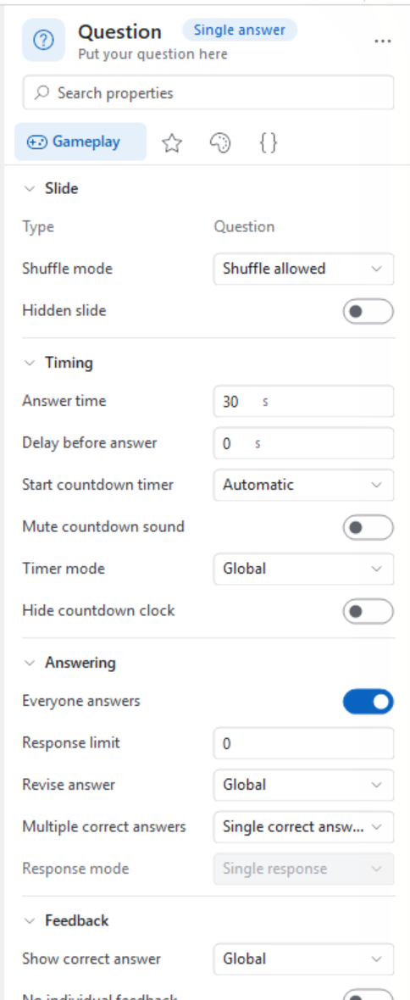
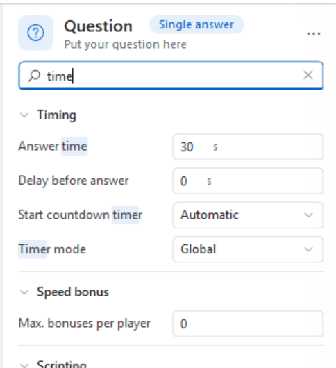
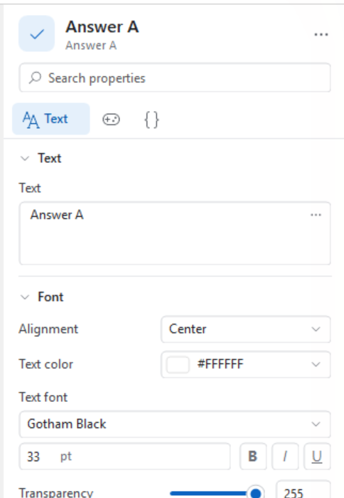
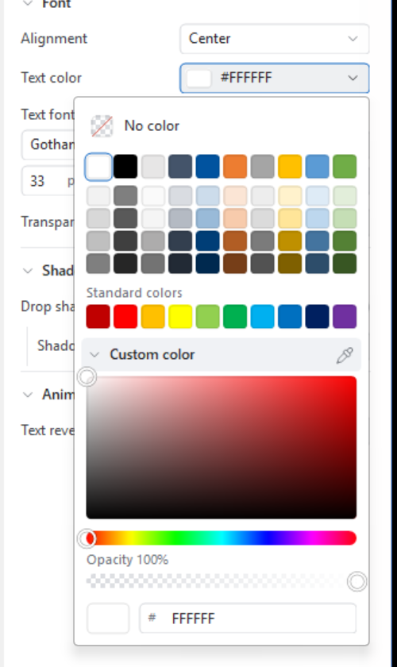
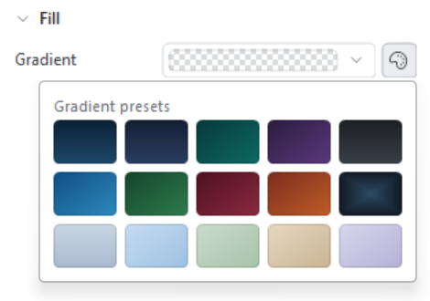
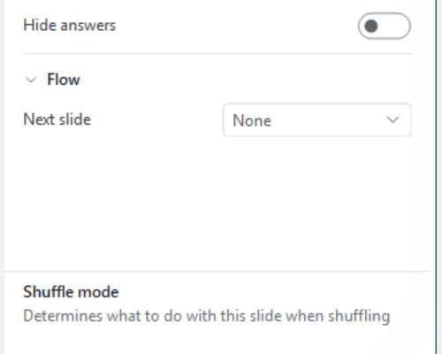
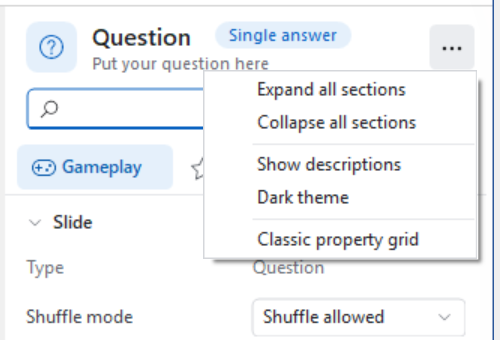
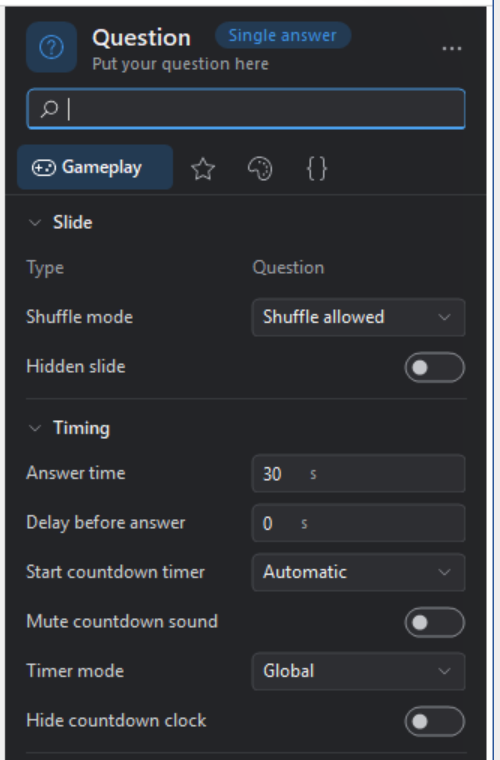
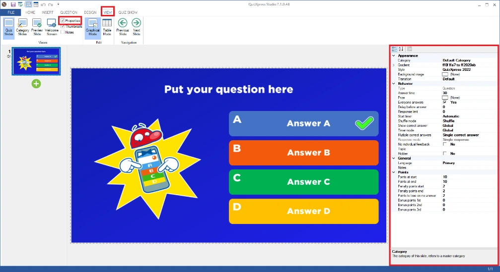

# Advanced properties grid

Il pannello delle proprietà è il luogo in cui è possibile impostare rapidamente tutte le proprietà dettagliate degli elementi selezionati. Ogni elemento (come domanda, risposta, diapositiva, video e immagine) ha proprietà individuali. Non è strettamente necessario utilizzarlo, poiché le impostazioni più importanti sono accessibili dalla barra multifunzione, ma per gli utenti esperti può essere un modo più rapido per portare a termine il lavoro. (alcune proprietà più avanzate o meno note sono accessibili solo dal pannello delle proprietà). Nei capitoli seguenti si trova una spiegazione delle proprietà più importanti. Per visualizzare il pannello delle proprietà, andare al menu VIEW e inserire un segno di spunta davanti a ‘Properties’ (nella sezione ‘Views’).

QuizXpress mostra queste proprietà nel **pannello delle proprietà**, disponibile per impostazione predefinita, e offre ancora la **griglia delle proprietà classica** utilizzata dalle versioni precedenti. Entrambi mostrano esattamente le stesse proprietà ed è possibile passare dall’uno all’altra in qualsiasi momento, quindi i capitoli seguenti valgono per entrambi.

## Il pannello delle proprietà

{ width="322" loading=lazy }

Invece di un lungo elenco alfabetico, il pannello raggruppa le proprietà dell’elemento selezionato in pagine e sezioni e assegna a ogni proprietà un controllo adatto: un interruttore per un’impostazione sì/no, un cursore per una trasparenza, un campione di colore per un colore e così via. Ogni modifica viene applicata immediatamente alla diapositiva.

**Che cosa è selezionato**

La parte superiore del pannello indica che cosa si sta modificando: un’icona, il tipo di elemento e una seconda riga con il suo contenuto (il testo di una risposta, il nome file di un’immagine). Quando si selezionano più elementi contemporaneamente — per esempio tutte e quattro le risposte di una domanda — il titolo riporta ‘4 objects selected’ e il pannello mostra le proprietà che hanno in comune. Le proprietà i cui valori differiscono tra gli elementi selezionati sono mostrate vuote o come ‘Mixed’; non appena se ne imposta una, tutti gli elementi selezionati ricevono il nuovo valore.

**Pagine**

Sotto la casella di ricerca si trova una riga di pagine: *Gameplay*, *Scoring*, *Design*, *Text*, *Media* e *Advanced*. Vengono mostrate solo le pagine che hanno effettivamente proprietà per la selezione corrente, e la pagina più importante per l’elemento selezionato compare per prima — la pagina *Text* per un elemento di testo, *Gameplay* per una diapositiva del quiz. La pagina *Advanced* (la scheda `{}`) raccoglie le proprietà tecniche: metadati, impostazioni dei dispositivi mobili e script. Fare clic su una scheda per cambiare pagina; il pannello ricorda la scelta per ogni tipo di elemento.

**Sezioni e altre opzioni**

Ogni pagina è suddivisa in sezioni come ‘Timing’, ‘Answering’ o ‘Border’. Fare clic sul titolo di una sezione per comprimerla e usare *Expand all sections* / *Collapse all sections* nel menu delle opzioni per espandere o comprimere tutte le sezioni in una volta. Le sezioni che contengono anche proprietà usate raramente mostrano in basso un collegamento **More options**; fare clic su di esso per mostrarle e su **Fewer options** per nasconderle di nuovo. Il pannello ricorda quali sezioni sono state compresse e quali mostrano le opzioni aggiuntive.

**Trovare una proprietà**

{ width="322" loading=lazy }

Se non si sa dove si trovi una proprietà, digitare una parola nella casella di ricerca in alto (oppure premere *Ctrl+F*). Il pannello mostra quindi tutte le proprietà corrispondenti di tutte le pagine contemporaneamente, con la parte corrispondente del nome evidenziata. La ricerca considera anche le descrizioni, quindi una parola che compare solo nella spiegazione di una proprietà permette comunque di trovarla. Fare clic sulla ✕ nella casella di ricerca per tornare alla visualizzazione normale.

### Modificare i valori

{ width="322" loading=lazy }

La maggior parte delle proprietà si spiega da sé: digitare in una casella, azionare un interruttore, scegliere da un elenco a discesa. Alcune meritano di essere segnalate.

I **numeri** possono essere digitati, modificati a passi con le piccole frecce a destra della casella o — spesso più rapidamente — *trascinando il nome della proprietà* a sinistra e a destra. Tenere premuto *Shift* durante il trascinamento per passi più grandi e *Alt* per passi più fini. Le proprietà con un minimo e un massimo sensati, come una trasparenza, hanno un cursore con una casella numerica accanto; i due rimangono sincronizzati.

I **caratteri** si impostano con un elenco a discesa che mostra l’anteprima di ogni carattere installato, una casella per la dimensione e pulsanti per grassetto, corsivo e sottolineato.

Le **proprietà raggruppate**, come un gradiente o una dimensione, mostrano un riepilogo su una sola riga. Fare clic sul nome della proprietà per aprire sotto di essa le singole impostazioni (per un gradiente: From, To e Type).

### Colori

{ width="333" loading=lazy }

Una proprietà di colore mostra un campione con il suo valore esadecimale. Facendo clic su di esso si ottiene:

- **No color**, per le proprietà che possono essere lasciate vuote (per esempio uno sfondo trasparente).
- Una **palette** di tonalità in alto e una riga di **Standard colors** sotto di essa.
- **Recent colors** — i colori usati in precedenza, così riutilizzare un colore su più elementi richiede un solo clic. Vengono ricordati finché QuizXpress Studio è in esecuzione.
- **Custom color**, che apre un quadrato saturazione/luminosità, una barra della tonalità, una barra dell’opacità e una casella in cui digitare o incollare un valore esadecimale come `#1E4A6B`.

Il piccolo contagocce a destra del titolo ‘Custom color’ preleva un colore **da qualsiasi punto dello schermo** — anche dall’esterno di QuizXpress. Facendo clic su di esso lo schermo si blocca; una lente d’ingrandimento segue il mouse e mostra i singoli pixel con il colore sotto il cursore. Fare clic per prendere quel colore, usare i tasti freccia per spostarsi di un pixel alla volta (tenere premuto *Shift* per dieci) oppure premere *Esc* per annullare. Poiché lo schermo non ha trasparenza, viene mantenuta l’opacità del colore che si aveva.

### Gradienti

{ width="313" loading=lazy }

Una proprietà di gradiente mostra un’anteprima del gradiente. Accanto si trova un pulsante a forma di tavolozza che apre un insieme di **gradient presets** già pronti — un clic dà a uno sfondo di diapositiva o a una casella di testo un aspetto rifinito. Per conservare un gradiente creato personalmente, fare clic con il pulsante destro sulla proprietà di gradiente e scegliere *Add to my gradients*; comparirà quindi sotto **My gradients** nel selettore (fino a cinque). Fare clic con il pulsante destro su uno dei propri gradienti nel selettore per rimuoverlo. I propri gradienti vengono conservati tra una sessione e l’altra.

### Ripristinare, copiare e incollare

Fare clic con il pulsante destro su una qualsiasi proprietà per ottenere:

- **Reset to default** — riporta la proprietà al valore che ha in una nuova diapositiva.
- **Copy value** e **Paste value** — utili per trasferire un colore, un carattere o un gradiente da un elemento a un altro. *Ctrl+C* e *Ctrl+V* fanno lo stesso per la proprietà in cui si sta lavorando, quindi è possibile copiare un colore qui e incollarlo direttamente in un altro programma come `#1E4A6B`, o viceversa.

### Descrizioni

{ width="333" loading=lazy }

Passando il mouse sul nome di una proprietà viene mostrato un suggerimento che ne spiega la funzione. Se si preferisce avere questa spiegazione sempre in vista, attivare *Show descriptions* nel menu delle opzioni: in fondo al pannello compare una barra con il nome e la spiegazione della proprietà su cui si trova il mouse.

### Opzioni

{ width="333" loading=lazy }

Il pulsante **…** nell’angolo in alto a destra del pannello contiene le impostazioni del pannello stesso: espandere e comprimere tutte le sezioni, mostrare le descrizioni, il tema scuro e il passaggio alla griglia delle proprietà classica.

### Tema scuro

{ width="333" loading=lazy }

*Dark theme* nel menu delle opzioni assegna al pannello una combinazione di colori scuri, più riposante per gli occhi quando si progettano diapositive chiare o si lavora in una stanza poco illuminata. La scelta viene ricordata al successivo avvio di QuizXpress Studio e riguarda solo il pannello delle proprietà.

## La griglia delle proprietà classica

{ width="644" loading=lazy }

La griglia utilizzata dalle versioni precedenti di QuizXpress è ancora disponibile. Elenca tutte le proprietà dell’elemento selezionato in gruppi alfabetici ed è il modo più rapido per vedere tutto in una volta. Scegliere *Classic property grid* dal menu **…** del pannello delle proprietà per passare alla griglia e il pulsante *Switch to the new properties panel* a destra della barra degli strumenti della griglia per tornare indietro. QuizXpress ricorda quale dei due si preferisce.

## Proprietà delle diapositive del quiz

Queste proprietà vengono mostrate facendo clic sullo sfondo di una domanda. Le proprietà sono suddivise in gruppi diversi:

- *Appearance*, definisce come viene visualizzata la domanda.

- *Behavior*, definisce il comportamento della domanda durante lo show.

- *General*, proprietà generali.

- *Metadata, metadati per questa diapositiva (Id e Class)*

- *Points,* sezione di assegnazione dei punti.

<table>
<colgroup>
<col style="width: 100%" />
</colgroup>
<tbody>
<tr class="odd">
<td><table>
<colgroup>
<col style="width: 19%" />
<col style="width: 80%" />
</colgroup>
<thead>
<tr class="header">
<th>Proprietà</th>
<th>Descrizione</th>
</tr>
</thead>
<tbody>
<tr class="odd">
<td>Answer time</td>
<td>La durata del conto alla rovescia in secondi. Specificare il valore 0 per una domanda senza limite di tempo. In tal caso è possibile terminare la domanda premendo la barra spaziatrice. Il conto alla rovescia può essere messo in pausa premendo ‘P’ in QuizXpress Live.</td>
</tr>
<tr class="even">
<td>Auto judge</td>
<td>Questa impostazione è valida per una domanda a dito più veloce (Voting = no) e a scelta multipla. In questo caso, l’impostazione ‘Auto judge’ indica se una domanda verrà giudicata automaticamente da QuizXpress Live quando su un buzzer/keypad viene premuto un pulsante di scelta multipla (per i buzzer senza scelta multipla l’auto-judge è sempre impostato automaticamente su ‘No’).</td>
</tr>
<tr class="odd">
<td>Auto advance when media ends</td>
<td>Passa automaticamente alla diapositiva successiva quando termina un video o un suono su un billboard. Questo aiuta a creare quiz che si svolgono da soli. Questa proprietà è disponibile quando sulla diapositiva è presente un elemento multimediale e il Type della diapositiva è billboard.</td>
</tr>
<tr class="even">
<td>Background image</td>
<td>L’immagine di sfondo della diapositiva del quiz.</td>
</tr>
<tr class="odd">
<td>Background stretch mode</td>
<td>Indica come l’immagine di sfondo viene adattata alla diapositiva. Può essere ‘Fill’ per riempire semplicemente l’intera diapositiva con l’immagine (le proporzioni non vengono mantenute) oppure ‘Zoom’ per mantenere le proporzioni corrette perdendo eventualmente alcune parti dell’immagine</td>
</tr>
<tr class="odd">
<td>Background video</td>
<td>
Un video che viene riprodotto dietro la diapositiva durante il quiz. Un’immagine o un video in un segnaposto viene riprodotto sopra di esso. Una volta impostato, sotto compaiono queste impostazioni: <em>Video storage type</em> (embedded or linked), <em>Linked file</em> (per un video collegato), <em>Loop</em> (attivo per impostazione predefinita), <em>Silent</em> (attivo per impostazione predefinita) e, sotto ‘More options’, <em>Sync with quiz</em> (mette in pausa il video quando una squadra preme il buzzer, il conto alla rovescia è in pausa o la domanda termina).

Su una categoria, il video di sfondo viene applicato a ogni diapositiva formattata con quella categoria. Vedere <a href="../../backgrounds/">Background video</a>.
</td>
</tr>
<tr class="even">
<td>Bonus points</td>
<td>I punti bonus per il 1°, il 2° e il 3° giocatore più veloce a rispondere correttamente.</td>
</tr>
<tr class="odd">
<td>Class</td>
<td>Un testo definibile dall’utente per classificare il tipo di diapositiva. Questi dati verranno esportati nel file dei punteggi dell’Analyzer e inviati a MessageBroker, in modo da poter essere usati per attivare un comportamento particolare</td>
</tr>
<tr class="even">
<td>Category</td>
<td>La categoria di questa diapositiva del quiz. Selezionando una categoria si definisce la formattazione grafica. Nota: è possibile definire categorie personalizzate! Per una spiegazione delle categorie fare riferimento alla sezione 3.3</td>
</tr>
<tr class="odd">
<td>Continue after correct answer</td>
<td>Quando viene data una risposta corretta a una domanda a dito più veloce (di tipo ‘default’, la risposta viene data a voce e giudicata corretta) il conto alla rovescia continua e gli altri giocatori possono premere (spesso usato per giochi durante un evento che si svolge al di fuori di un quiz).</td>
</tr>
<tr class="even">
<td>Correct answer</td>
<td>La risposta corretta per questa diapositiva. Applicabile solo quando la modalità di input (vedere sotto) è ‘numeric’, ‘letter’ o ‘text’.</td>
</tr>
<tr class="odd">
<td>Custom HTML Screen</td>
<td>Una pagina HTML personalizzata da mostrare sui dispositivi mobili quando questa diapositiva viene caricata <em>(uso avanzato)</em></td>
</tr>
<tr class="even">
<td>Delay before answer</td>
<td>Tempo in secondi che trascorre prima che vengano mostrate le risposte. Questo dà al conduttore del quiz la possibilità di leggere la domanda ad alta voce prima che compaiano le risposte.</td>
</tr>
<tr class="odd">
<td>Delay between answers*</td>
<td>Se sono stati impostati sia ‘Delay before answer’ sia ‘hide and show one by one’, questa proprietà compare. Definisce l’intervallo di tempo che trascorre tra una risposta e l’altra che appare.</td>
</tr>
<tr class="even">
<td>Demographic group*</td>
<td>Questa proprietà può essere impostata quando il <strong>Type</strong> della diapositiva è ‘Demographic’. Definisce un gruppo demografico. Quando il quiz viene eseguito, le persone che premono il buzzer mentre viene mostrata una diapositiva di quiz demografico apparterranno al gruppo indicato da questa proprietà. Fare riferimento anche alla sezione 5.4.5.5 per maggiori informazioni sui gruppi demografici.</td>
</tr>
<tr class="odd">
<td>End of round action*</td>
<td>Questa proprietà può essere impostata quando il <strong>Type</strong> della diapositiva è ‘End of round’. I valori possibili sono ‘Disable one loser’, nel qual caso il partecipante con meno punti viene eliminato, e ‘Quizmaster selects losers’, nel qual caso il conduttore del quiz può selezionare uno per uno i partecipanti che verranno eliminati.</td>
</tr>
<tr class="even">
<td>Evaluation mode</td>
<td>Indica se la valutazione di una risposta numerica è ‘exact match’ (la risposta data deve corrispondere esattamente alla risposta corretta della domanda) o ‘nearest wins’ (il giocatore più vicino alla risposta vince i punti indicati).</td>
</tr>
<tr class="odd">
<td>Gradient</td>
<td>Il gradiente di riempimento per lo sfondo della diapositiva. Questa proprietà si applica solo se non c’è un’immagine di sfondo. È possibile selezionare un colore di gradiente ‘from’ e un colore di gradiente ‘to’, oltre a un tipo di gradiente.</td>
</tr>
<tr class="even">
<td>Id</td>
<td>Un ID univoco per identificare questa diapositiva (per esempio per l’instradamento statico delle diapositive con la proprietà <em>Next slide</em>)</td>
</tr>
<tr class="odd">
<td>Input type</td>
<td>Per una domanda aperta è possibile scegliere tra ‘default’ (domanda a dito più veloce) oppure una risposta ‘number’, ‘letter’ o ‘text’. Le ultime tre modalità si applicano solo quando si usano telefoni cellulari (poiché keypad e buzzer non offrono input numerico o testuale).</td>
</tr>
<tr class="even">
<td>Language</td>
<td>La lingua di visualizzazione (di modifica) corrente della diapositiva per i quiz bilingue.</td>
</tr>
<tr class="odd">
<td>Lock-out on wrong answer</td>
<td>Imposta la modalità di blocco per una domanda a dito più veloce. Il giocatore viene bloccato in caso di risposta errata, oppure può riprovare.</td>
</tr>
<tr class="even">
<td>Multiple correct answers</td>
<td>Indica se questa domanda ha più di una risposta corretta e se le risposte corrette multiple seguono un ordine specifico</td>
</tr>
<tr class="odd">
<td>Mute countdown sound</td>
<td>Disattiva il suono del conto alla rovescia per questa domanda</td>
</tr>
<tr class="even">
<td>Next slide</td>
<td>L’ID della diapositiva da mostrare dopo questa (instradamento statico delle diapositive)</td>
</tr>
<tr class="odd">
<td>Notes</td>
<td>Un testo (suggerimenti) per il conduttore del quiz che verrà incluso nell’esportazione PDF</td>
</tr>
<tr class="even">
<td>Ordered answer mode</td>
<td>Per le risposte ordinate, è possibile indicare se si vuole che le risposte corrispondano esattamente all’ordine (Exact match) o se anche una risposta parzialmente corretta dà punti (una percentuale dei punti, a seconda di quante risposte sono al posto giusto).</td>
</tr>
<tr class="odd">
<td>Penalty points end</td>
<td>Numero di punti sottratti quando un partecipante risponde in modo errato alla fine del conto alla rovescia (interpolazione tra inizio – fine)</td>
</tr>
<tr class="even">
<td>Penalty points start</td>
<td>Numero di punti sottratti quando un partecipante risponde in modo errato all’inizio del conto alla rovescia</td>
</tr>
<tr class="odd">
<td>Points at end</td>
<td>Numero di punti aggiunti quando un partecipante risponde correttamente alla fine del conto alla rovescia. Deve essere minore o uguale a ‘points at start time’. I punti vengono interpolati tra l’inizio e la fine del contatore. Quindi, quando i punti alla fine sono inferiori ai punti all’inizio, il numero di punti guadagnabili diminuisce mentre il conto alla rovescia procede. Quando i due valori sono uguali, i punti guadagnabili restano gli stessi per tutta la durata del conto alla rovescia.</td>
</tr>
<tr class="even">
<td>Points at start</td>
<td>Numero di punti aggiunti quando un partecipante risponde correttamente all’inizio del conto alla rovescia.</td>
</tr>
<tr class="odd">
<td>Points to lose on no answer</td>
<td>I punti sottratti quando non viene data alcuna risposta (applicabile solo alle domande a votazione)</td>
</tr>
<tr class="even">
<td>Steal Points</td>
<td>Quando l’opzione steal points è attiva per una domanda a dito più veloce (buzzer), un giocatore che dà una risposta errata non perde punti. Invece, i punti di penalità configurati per la diapositiva vengono assegnati a tutti gli altri giocatori e la domanda termina immediatamente.</td>
</tr>
<tr class="odd">
<td>Response limit</td>
<td>Il numero massimo di squadre di cui il sistema accetterà le risposte. Per esempio, se si gioca con 100 squadre, è possibile impostare questo valore a 25 in modo che solo le prime 25 squadre possano rispondere alla domanda.</td>
</tr>
<tr class="even">
<td>Response mode</td>
<td>Indica se questa domanda accetta una sola risposta per giocatore o più risposte (usato in combinazione con ‘Multiple correct answers’). Impostando questa opzione su ‘multiple responses, exact match’, la risposta multipla deve corrispondere esattamente alle risposte corrette per vincere punti.</td>
</tr>
<tr class="odd">
<td>Revise answer</td>
<td>Qui è possibile sovrascrivere l’opzione globale che consente ai giocatori di rivedere la propria risposta (impostata globalmente in Quiz Setup per tutte le diapositive).</td>
</tr>
<tr class="even">
<td>Safety net*</td>
<td>Usato per le domande della scala di trivia (trivia ladder). In un round di scala di trivia, quando un giocatore risponde in modo errato, ricade sulla rete di sicurezza più vicina della scala di trivia.</td>
</tr>
<tr class="odd">
<td>Script</td>
<td>Comportamento personalizzato della diapositiva scritto in JavaScript <em>(uso avanzato)</em></td>
</tr>
<tr class="even">
<td>Show answers action*</td>
<td>Quando è stato impostato ‘Delay before answer’, questa proprietà compare. Impostandola su ‘hide and show at once’, le risposte vengono mostrate tutte insieme una volta trascorso il tempo di ritardo. Impostandola su ‘hide and show one by one’, le risposte vengono mostrate una per una una volta trascorso il tempo di ritardo.</td>
</tr>
<tr class="odd">
<td>Show correct answer</td>
<td>Modalità di visualizzazione della risposta corretta su questa diapositiva. Seguire l’impostazione globale indicata in Quiz Setup, non mostrare mai la risposta corretta, oppure mostrarla sempre.</td>
</tr>
<tr class="even">
<td>Shuffle mode</td>
<td>Determina che cosa succede quando il quiz viene mescolato</td>
</tr>
<tr class="odd">
<td>Start timer</td>
<td>Indica se il timer del conto alla rovescia deve partire automaticamente quando compare la domanda o tramite un’azione manuale.</td>
</tr>
<tr class="even">
<td>Steal points</td>
<td>Applicabile alle domande a dito più veloce. Quando è abilitato, tutti gli altri giocatori rubano i punti al giocatore che ha premuto il buzzer quando la risposta fornita è sbagliata.</td>
</tr>
<tr class="odd">
<td>Style</td>
<td>Lo stile di rendering della domanda. Maggiori informazioni sugli stili si trovano nel capitolo “Styles”.</td>
</tr>
<tr class="even">
<td>Text evaluation</td>
<td>Indica se la valutazione di una risposta testuale è ‘exact match’ (la risposta data deve corrispondere esattamente alla risposta corretta) o ‘fuzzy match’ (un algoritmo consente una certa percentuale di differenza tra la risposta data e quella corretta, così i giocatori possono commettere piccoli errori di ortografia).</td>
</tr>
<tr class="odd">
<td>Tolerance</td>
<td>Variazione consentita tra la risposta corretta e le risposte date. Si applica alle domande con input type ‘text’ e ‘text evaluation’ impostato su ‘fuzzy match’.</td>
</tr>
<tr class="even">
<td>Topic*</td>
<td>L’argomento della domanda. Viene usato per generare automaticamente un Trivia Board precedente.</td>
</tr>
<tr class="odd">
<td>Transition</td>
<td>L’animazione di transizione specifica quando si passa alla diapositiva successiva (per impostazione predefinita, il sistema seleziona una transizione casuale)</td>
</tr>
<tr class="even">
<td>Type</td>
<td>
Campo di sola visualizzazione che mostra il tipo di diapositiva:

<ul>
<li>
<em>Question</em>: la diapositiva è una normale domanda del quiz.
</li>
<li>
<em>Billboard</em>: la diapositiva è solo da visualizzare.
</li>
<li>
<em>End of round</em>: la diapositiva indica la fine di un round del quiz. Vengono mostrati i punteggi intermedi e il conduttore del quiz ha la possibilità di eliminare le squadre. Vedere anche la proprietà: ‘End of Round’.
</li>
<li>
<em>Test question</em>: diapositiva usata per dimostrare il sistema ai partecipanti. Non vengono aggiunti né sottratti punti.
</li>
<li>
<em>Demographic</em>: questa diapositiva serve a suddividere tutti i partecipanti in gruppi in competizione. Vedere anche la proprietà ‘Demographic group’.
</li>
<li>
<em>Last Man Standing</em>: la diapositiva è una domanda del quiz. I partecipanti che rispondono in modo errato alla domanda vengono eliminati dal quiz.
</li>
<li>
<em>Audience Response</em>: diapositiva per raccogliere semplicemente una risposta dal pubblico senza modificare i punteggi del quiz. I dati delle risposte possono essere mostrati in un grafico.
</li>
<li>
<em>Wager</em>: consente al pubblico di puntare una percentuale dei propri punteggi sulla domanda successiva.
</li>
<li>
<em>Majority Rules</em>: una diapositiva in cui la risposta corretta dipende da ciò che il pubblico sceglie più spesso
</li>
<li>
<em>Minigame</em>: una diapositiva che avvia il minigioco selezionato
</li>
<li>
<em>Trivia Board</em>: una diapositiva che avvia un round in cui le domande sono organizzate per Topic/Points e presentate come una griglia
</li>
<li>
<em>Trivia Ladder:</em> avvia un round Trivia Ladder in cui i giocatori salgono di un gradino della scala a ogni risposta corretta
</li>
<li>
<em>Speed Round:</em> avvia un round in cui un giocatore deve rispondere al maggior numero possibile di domande in un tempo prestabilito.
</li>
<li>
<em>Trivia Bingo:</em> avvia un round di Bingo, costruito dalle diapositive del quiz successive oppure come un tradizionale gioco di Bingo a numeri.
</li>
<li>
<em>Trivia Feud:</em> una diapositiva in cui i giocatori rispondono a una domanda di tipo sondaggio.
</li>
</ul></td>
</tr>
<tr class="odd">
<td>Voting</td>
<td>Indica se tutti i partecipanti possono rispondere o se può rispondere solo il primo partecipante a premere il buzzer.</td>
</tr>
</tbody>
</table>

* la visibilità della proprietà dipende da altre proprietà
</td>
</tr>
</tbody>
</table>

## Proprietà della domanda

Queste proprietà vengono mostrate facendo clic sulla casella della domanda in una diapositiva

| Proprietà | Descrizione |
|---|---|
| Alignment | L’allineamento del testo della domanda |
| Drop shadow | Indica se sotto il testo della domanda viene applicata un’ombra |
| Gradient | Il gradiente di riempimento per lo sfondo della domanda. |
| Shadow color | Indica il colore dell’ombra |
| Text | Il testo della domanda |
| Text Color | Il colore del testo della domanda |
| Text font | Il carattere usato per il testo della domanda |
| Text reveal animation | Come viene rivelato il testo. Show (predefinito: viene mostrato direttamente), Show letter by letter o Show word by word |
| Text reveal delay (sec) | Il ritardo dopo il quale il testo viene mostrato |
| Text reveal speed | Velocità di rivelazione del testo |
| Transparency | Trasparenza dello sfondo della domanda |

## Proprietà delle risposte

Queste proprietà vengono mostrate facendo clic sulla casella di una risposta in una diapositiva

| Proprietà | Descrizione | |
|---|---|---|
| Alignment | | L’allineamento del testo della risposta |
| Correct answer | | Indica se la risposta selezionata è la risposta corretta. Impostare su ‘true’ se la risposta selezionata è quella corretta. |
| Correctness | | Applicabile alle domande con più risposte corrette, questo valore imposta la correttezza (come percentuale dei punti totali della domanda) della risposta. |
| Drop shadow | | Indica se sotto il testo della domanda viene applicata un’ombra |
| Gradient | | Il gradiente di riempimento per lo sfondo della domanda. L’applicabilità di questa proprietà dipende dallo stile utilizzato. |
| Shadow color | | Il colore dell’ombra esterna |
| Text | | Il testo della risposta |
| Text reveal animation | | Come viene rivelato il testo. Show (predefinito: viene mostrato direttamente), Show letter by letter o Show word by word |
| Text reveal delay (sec) | | Il ritardo dopo il quale il testo viene mostrato |
| Text reveal speed | | Velocità di rivelazione del testo |
| Text color | | Il colore del testo della risposta |
| Text font | | Il carattere del testo della risposta |
| Transparency | | Trasparenza dello sfondo del pannello della risposta |

## Proprietà delle immagini

Queste proprietà vengono mostrate facendo clic sulla casella di un’immagine in una diapositiva

| Proprietà | Descrizione |
|---|---|
| Border | Indica se intorno all’immagine viene tracciato un bordo |
| Border color | Il colore del bordo, se abilitato |
| Border thickness | Spessore in pixel del bordo (se abilitato) |
| Corner radius | Raggio degli angoli della linea del bordo per creare un bordo arrotondato |
| Correct answer | Indica se l’immagine contiene la risposta corretta. Può essere impostato per le immagini solo quando la diapositiva contiene soltanto immagini ed è una diapositiva a scelta multipla. |
| Drop shadow | Indica se sotto l’immagine viene applicata un’ombra |
| Effect | Imposta un effetto sull’immagine. Vedere [Ritaglio](../adding-multimedia-content/pictures.md#ritaglio) per una spiegazione più dettagliata degli effetti. |
| Hidden | Nasconde l’immagine durante il quiz |
| Hidden on mobile | Indica se un’immagine mostrata su una diapositiva del quiz deve essere nascosta sul telefono cellulare. Uno scenario di utilizzo è quando si vuole mostrare un’immagine diversa sul telefono cellulare rispetto al grande schermo per il pubblico. Per esempio, si potrebbe volere che l’immagine per dispositivi mobili abbia proporzioni diverse. In tal caso, non si vuole che l’immagine mostrata sul grande schermo compaia anche sul telefono cellulare. |
| Image | Una miniatura dell’immagine. Fare clic sul pulsante Sfoglia (…) di questa proprietà per cercare un’immagine. |
| Inflate | Determina se l’immagine deve riempire l’intera area ingrandendosi |
| Label | Una descrizione testuale dell’immagine (usata quando l’immagine non può essere mostrata) |
| Mobile device image | Una versione alternativa dell’immagine da usare sui dispositivi mobili |
| Stretch | Allunga l’immagine in entrambe le direzioni per riempire l’area (può deformare l’immagine) |

## Proprietà dei suoni

Queste proprietà vengono mostrate facendo clic su un elemento sonoro in una diapositiva

| Proprietà | Descrizione |
|---|---|
| Duration | La durata del suono. Inizialmente viene mostrata la durata completa. |
| Intro pause | Il tempo di attesa prima che il suono parta. Questo dà al conduttore del quiz la possibilità di leggere prima la domanda. |
| Keep playing | Per impostazione predefinita, la musica inserita in una diapositiva si ferma quando termina il timer del conto alla rovescia. Con questo flag è possibile lasciare la musica in riproduzione fino al passaggio alla diapositiva successiva. |
| Pitch | L’altezza del suono all’inizio del conto alla rovescia |
| Remove vocals | Effetto per rimuovere le voci (i risultati possono variare) |
| Repeat | Indica se il suono deve ripetersi. |
| Replay | Riproduce di nuovo il suono dopo che la risposta corretta è stata rivelata nella domanda. |
| Replay delay | Mostrato quando replay è abilitato. Indica il numero di secondi dopo i quali inizia la ripetizione |
| Replay start | Imposta il momento in cui il frammento sonoro inizierà a essere riprodotto |
| Replay end | Imposta il momento in cui il frammento sonoro smetterà di essere riprodotto |
| Reverse audio | Riproduce il frammento sonoro al contrario |
| Sound Storage Type | Indica se i dati del suono sono memorizzati incorporati nel file del quiz (embedded) o sul disco locale (linked) |
| Speed percentage | La velocità del suono quando inizia la riproduzione. |
| Start at | La posizione nel file audio da cui il suono verrà avviato. |
| Stop at | Il momento in cui fermare il suono |
| Target Pitch | L’altezza del suono alla fine del conto alla rovescia (l’altezza viene interpolata dall’inizio alla fine) |
| Target speed percentage | La velocità del suono quando termina la riproduzione. Nota: giocando con ‘speed percentage’ e ‘target speed percentage’ è possibile riprodurre i suoni ‘da lento a normale’ o ‘da veloce a normale’. Impostando entrambe le percentuali al 100% il frammento sonoro viene semplicemente riprodotto dall’inizio alla fine a velocità normale. |
| Volume | Il volume al quale riprodurre la musica |
| Volume fade | Dissolvenza in entrata/uscita all’avvio/arresto della musica |

## Proprietà dei minigiochi

| Proprietà | Descrizione |
|---|---|
| Minigame title | Per impostazione predefinita il buzzer mobile mostra a schermo il nome del minigioco. È possibile sostituirlo e fornire un testo personalizzato. Così, invece di vedere “Horse race”, è possibile mostrare qualcosa di più emozionante. |

## Proprietà dei video

Queste proprietà vengono mostrate facendo clic su un video in una diapositiva

| Proprietà | Descrizione |
|---|---|
| Aspect Ratio | (sola lettura) proporzioni |
| Codec | (sola lettura) decoder video in uso |
| Duration | (sola lettura) lunghezza del video |
| Effect | Effetto facoltativo sul video |
| End | Momento in cui terminare il video |
| Intro Pause | Ritardo tra la visualizzazione della diapositiva e l’avvio del video |
| Linked File | Nome file del file video esterno, se collegato |
| Loop | Ripete il video dopo che si è fermato |
| Replay | Riproduce di nuovo il video dopo che la risposta corretta è stata rivelata nella domanda. |
| Replay delay | Il numero di secondi dopo i quali inizia la ripetizione |
| Replay start | Imposta il momento di riproduzione in cui il video inizierà |
| Replay end | Imposta il momento di riproduzione in cui il video terminerà |
| Silent | Elimina l’audio del video |
| Start | Momento in cui avviare il video |
| Video Height | (sola lettura) altezza del video |
| Video storage type | Indica se il frammento video è incorporato (embedded) o collegato (linked). Incorporare un frammento video in un quiz significa che il frammento video viene integrato nel file del quiz. Collegare un frammento video significa che dal file del quiz viene creato un riferimento a un video presente nel file system. In generale si consiglia di collegare i video. *Nota: quando si collegano i video, assicurarsi di non rimuovere i file video dal file system. Quando si sposta il quiz su un altro computer, i video devono essere copiati nella stessa cartella del file del quiz.* |
| (sola lettura) larghezza del video | (sola lettura) larghezza del video |

## Proprietà delle forme

Queste proprietà vengono mostrate facendo clic su una forma immagine o su una forma di testo in una diapositiva.

| Proprietà | Descrizione |
|---|---|
| Alignment | L’allineamento del testo della forma di testo |
| Background transparency | Applicabile alle forme di testo. Imposta la trasparenza del colore usato per lo sfondo (la proprietà Gradient). |
| Border color | Il colore del bordo di una forma di testo |
| Border width | Lo spessore del bordo di una forma di testo |
| Corner radius | Il raggio del bordo di una forma di testo. Permette di ottenere angoli arrotondati. |
| Drop shadow | Indica se usare un’ombra esterna per una forma di testo |
| Gradient | Il gradiente di riempimento per lo sfondo di una forma di testo. È possibile selezionare un colore di gradiente ‘from’ e un colore di gradiente ‘to’, oltre a un tipo di gradiente. |
| Picture | Applicabile alle forme immagine. Una miniatura dell’immagine. Fare clic sul pulsante Sfoglia (…) per cercare un’immagine. |
| Rotation Angle | L’angolo di rotazione dell’immagine o del testo |
| Shadow color | Colore dell’ombra esterna di una forma di testo |
| Stretch | Applicabile alle forme immagine. Allunga l’immagine per coprire l’intera area del riquadro di selezione circostante |
| Text | Il testo della forma di testo |
| Text color | Il colore del testo di una forma di testo |
| Text font | Il carattere usato per la forma di testo |
| Transparency | Imposta la trasparenza dell’immagine o del testo |
| Visibility | Indica se una forma (immagine o testo) è sempre visibile, diventa visibile quando una risposta viene rivelata, viene nascosta quando una risposta viene rivelata, oppure è temporizzata (compare in un momento preciso durante il conto alla rovescia). |

## Proprietà della sintesi vocale

Queste proprietà vengono mostrate facendo clic su un elemento di sintesi vocale in una diapositiva.

| Proprietà | Descrizione |
|---|---|
| PreRoll | Indica il numero di secondi di attesa prima che inizi la lettura vocale |
| Rate | La velocità con cui viene letto il testo dell’elemento vocale |
| Text | Il testo da leggere |
| Voice | La voce da usare (sceglierne una tra le voci installate in Windows) |
| Volume | Il volume del testo parlato |

## Proprietà dei grafici

Queste proprietà vengono mostrate facendo clic su un grafico in una diapositiva

| Proprietà | Descrizione |
|---|---|
| Alignment | Allineamento del titolo del grafico |
| Area background | Imposta il colore di sfondo dell’area dei dati del grafico |
| Axis color | Il colore usato per l’asse |
| Axis label autosize | Imposta automaticamente la dimensione delle etichette sull’asse. Se non è impostato, è possibile scegliere esplicitamente un carattere e una dimensione per le etichette |
| Axis label color | Il colore usato per le etichette sull’asse |
| Chart background | Imposta il colore di sfondo dell’area esterna ai dati del grafico |
| Chart type | Il tipo di grafico. Scegliere tra Bar, Column, Doughnut o Pie. |
| Corner radius | Raggio degli angoli dell’elemento grafico |
| Dropshadow offset | Mostra un’ombra esterna per l’area dei dati del grafico |
| Grid color | Il colore usato per la griglia nell’area dei dati del grafico |
| Label color | Colore delle etichette mostrate per ogni elemento del grafico |
| Label display mode | Per le etichette, mostra i valori assoluti, le percentuali o entrambi |
| Label font | Carattere delle etichette |
| Label style | Indica dove posizionare le etichette |
| Mode | Indica il tipo di dati mostrati nel grafico: response (percentuale di ogni risposta data) o right/wrong (percentuale di giocatori che hanno risposto correttamente/in modo errato) |
| Show 3D | Mostra una rappresentazione 3D del grafico |
| Show legend | Mostra una legenda per i dati del grafico (percentuale di risposte per ciascuna risposta) |
| Title | Titolo del grafico |
| Title color | Colore del titolo del grafico |
| Title font | Carattere del titolo del grafico |
| Visibility | Indica se il grafico è sempre visibile (con aggiornamenti in tempo reale durante il conto alla rovescia) o solo dopo la chiusura della domanda |

## Proprietà dei giochi di parole

Queste proprietà vengono mostrate facendo clic su un gioco di parole in una diapositiva

| Proprietà | Descrizione |
|---|---|
| Alignment | Allineamento del testo |
| Background fill | Il gradiente di riempimento per lo sfondo del gioco di parole. È possibile selezionare un colore di gradiente ‘from’ e un colore di gradiente ‘to’, oltre a un tipo di gradiente. |
| Center index | Per un gioco a ruota di lettere (word wheel), indica la lettera che compare al centro |
| Drop shadow | Indica se usare un’ombra esterna per le lettere del gioco di parole |
| End reveal at | Percentuale del tempo del conto alla rovescia in cui termina la rivelazione |
| Font | Il carattere usato per il testo |
| Interval | Per i giochi di parole unscramble e reveal, controlla il tempo tra i passaggi del gioco: lineare, rallentato o molto rallentato. |
| Layout | Per i giochi di parole reveal o unscramble: griglia di lettere dinamica o griglia di lettere fissa con 52 celle. |
| Letter background fill | Il gradiente di riempimento per lo sfondo delle caselle delle lettere del gioco di parole. È possibile selezionare un colore di gradiente ‘from’ e un colore di gradiente ‘to’, oltre a un tipo di gradiente. |
| Letter corner radius | Raggio degli angoli del gioco di parole |
| Letter spacing | Spazio tra le lettere del gioco di parole |
| Manual control | Indica se le lettere vengono rivelate automaticamente o se vengono rivelate manualmente dal conduttore del quiz da QuizXpress Director |
| Padding | Spaziatura interna attorno alle lettere della griglia |
| Reverse | Per un gioco a ruota di lettere (word wheel), inverte la direzione delle lettere |
| Shadow color | Colore dell’ombra esterna delle lettere |
| Spin | Fa ruotare le lettere della ruota di lettere per una sfida in più |
| Start angle | Per un gioco a ruota di lettere (word wheel), l’angolo iniziale in cui compare la prima lettera della parola |
| Start reveal at | Percentuale del tempo del conto alla rovescia in cui inizia la rivelazione |
| Text | Il testo del gioco di parole |
| Text color | Il colore del testo |
| Text transparency | La trasparenza del testo |

## Proprietà del Trivia Board

Queste proprietà vengono mostrate quando è selezionato un trivia board. Le proprietà contrassegnate con *Custom* vengono mostrate solo quando 'Board position' è Custom; vedere [Progettare il proprio tabellone](../slide-and-game-formats/trivia-board-round.md#progettare-il-proprio-tabellone).

| Proprietà | Descrizione |
|---|---|
| Auto select | Seleziona automaticamente una tessera a caso con un’animazione quando il tabellone viene selezionato |
| Animation duration (sec) | Durata in secondi dell’animazione di selezione casuale |
| Animation interval (sec) | Intervallo tra i cambi di selezione durante l’animazione di selezione casuale |
| Background color (Topic Tiles) | Imposta il colore di sfondo delle tessere degli argomenti |
| Background color (Question Tiles) | Imposta il colore di sfondo delle tessere delle domande |
| Board position | Automatic riempie lo schermo (il tabellone classico). Custom posiziona il tabellone dove si trova nella diapositiva, in modo da poterlo spostare e ridimensionare per adattarlo allo sfondo |
| Circular tiles (Topic tiles) | Rende le tessere circolari (per impostazione predefinita sono rettangolari) |
| Column spacing | Lo spazio tra le colonne di tessere |
| Effect color | Il colore dell’ombra o del contorno del testo |
| Font (Topic Tiles) | Imposta il carattere delle tessere degli argomenti |
| Font (Question Tiles) | Imposta il carattere delle tessere delle domande |
| Highlight color | Il colore della selezione casuale |
| Image position (Topic Tiles) | *Custom.* Dove va l’immagine dell’argomento: sull’intera tessera, oppure a sinistra, a destra o sopra il nome dell’argomento |
| Image scaling | *Custom.* Come l’immagine di una tessera viene adattata alla tessera: Stretch, Fit, Fill o Keep corners |
| Max. questions to play | Il numero massimo di domande da giocare, oppure 0 per tutte le domande |
| Played tiles | Come appare una tessera dopo che tutte le sue domande sono state giocate: Dimmed, Hidden o No text |
| Randomize questions | Se a una tessera sono collegate più domande, ne verrà selezionata una a caso. Tuttavia, se l’opzione ‘Randomize questions’ non è abilitata, le domande dietro la tessera verranno presentate nell’ordine in cui compaiono nel quiz. |
| Row spacing | Lo spazio tra le righe di tessere |
| Same text size for all tiles | Una dimensione del testo per tutti i nomi degli argomenti e una per tutti i valori dei punti, mai superiore alla dimensione del carattere; i nomi di argomento lunghi vanno a capo su due righe. Quando è disattivato, ogni testo riempie la propria tessera |
| Selection highlight | Come la selezione casuale evidenzia una tessera: Fill, Tint, Outline o Glow |
| Show topic name (Topic Tiles) | *Custom.* Mostra il nome dell’argomento sulla tessera; disattivarlo quando le immagini degli argomenti contengono già il nome |
| Text color (Question Tiles) | Imposta il colore del testo delle tessere delle domande |
| Text color (Topic Tiles) | Imposta il colore del testo delle tessere degli argomenti |
| Text effect | Un’ombra o un contorno attorno al testo delle tessere |
| Tile image | *Custom.* Un’immagine per le tessere degli argomenti o delle domande, al posto del colore di sfondo |
| Topic images (Topic Tiles) | *Custom.* Un’immagine separata per ogni argomento del tabellone |
| Topic row height | L’altezza della riga degli argomenti rispetto a una riga di tessere delle domande |
| Topics only | Mostra solo gli argomenti sul tabellone |
| Vary tiles (Question Tiles) | *Custom.* Specchia l’immagine della tessera in modo diverso su ogni tessera |

## Proprietà del Trivia Ladder

Queste proprietà vengono mostrate quando è selezionata una diapositiva Trivia Ladder.

| Proprietà | Descrizione |
|---|---|
| Background color | Imposta il colore di sfondo della trivia ladder |
| Background image | Imposta l’immagine di sfondo della scala |
| Background stretch mode | Modalità di adattamento dell’immagine di sfondo |
| Border color | Imposta il colore del bordo della trivia ladder |
| Display mode | Dove mostrare la scala sullo schermo: scorrevole da destra, scorrevole al centro dello schermo, a schermo intero, oppure sempre visibile (sul lato destro dello schermo). |
| Keypads color | Imposta il colore dei keypad |
| Safety net color | Imposta il colore dei gradini della rete di sicurezza |
| Separator color | Imposta il colore dei separatori |
| Show border | Mostra il bordo della trivia ladder |
| Step color | Imposta il colore dei gradini |
| Wrong answer action | Indica che cosa fare quando un giocatore risponde in modo errato: scendere di un gradino, restare sullo stesso gradino, ricominciare dall’inizio della scala, oppure ricadere sulla rete di sicurezza più vicina. |

## Proprietà del Bingo

Quando si configura il gioco del Bingo, sono disponibili le seguenti proprietà:

| Proprietà | Descrizione |
|---|---|
| Auto advance after claim | Quando una richiesta viene gestita sullo schermo e questa opzione è abilitata, il gioco prosegue automaticamente dopo la richiesta. In caso contrario, il gioco attende che il conduttore prema Next. |
| Blanks per row | Il numero di celle vuote per riga sulla cartella del bingo. Può servire ad accelerare il gioco |
| Center Image | L’immagine centrale (bonus) che compare sulla cartella del Bingo mobile |
| Claims mode | Indica se viene gestito solo il primo giocatore che dichiara bingo o tutti i giocatori |
| Countdown time (sec) | Il tempo del conto alla rovescia durante la gestione di una richiesta di bingo sullo schermo. |
| Enable Virtual Caller | Abilita il sintetizzatore vocale di Windows per chiamare le palline/i colori in un normale gioco del Bingo |
| False Bingo handling | Come vengono gestiti i falsi bingo (davanti al pubblico, o in silenzio) |
| False Bingo limit | Quante volte un giocatore può dichiarare un bingo prima di essere escluso |
| False Bingo mode | Che cosa succede quando un giocatore dichiara un falso Bingo |
| First Pattern…Fifth Pattern | Gli schemi per cui giocare (in un round si possono giocare fino a 5 schemi) |
| Game Type | Trivia Bingo, Number (traditional) Bingo o Emoji Bingo. |
| Pattern penalty points | I punti da perdere per un falso bingo (per schema) |
| Pattern Points | I punti da vincere per un bingo valido (per schema) |
| Randomize questions | Quando si gioca a Trivia Bingo, questo flag indica che le domande vengono giocate in ordine casuale |
| Say Colors | Pronuncia i colori delle colonne insieme ai numeri (per esempio ‘Blue 4’) |

## Proprietà del Trivia Feud

Quando si configura una diapositiva Trivia Feud, sono disponibili le seguenti proprietà:

<table>
<colgroup>
<col style="width: 28%" />
<col style="width: 71%" />
</colgroup>
<thead>
<tr class="header">
<th>Proprietà</th>
<th>Descrizione</th>
</tr>
</thead>
<tbody>
<tr class="odd">
<td>Auto scale text</td>
<td>Ridimensiona il testo delle risposte in modo che stia nelle caselle (con il risultato di dimensioni del carattere diverse per le risposte)</td>
</tr>
<tr class="even">
<td>Drop shadow</td>
<td>Aggiunge un’ombra esterna ai testi delle risposte</td>
</tr>
<tr class="odd">
<td>Leading zeros</td>
<td>Mostra gli zeri iniziali per i punteggi del sondaggio</td>
</tr>
<tr class="even">
<td>Question font</td>
<td>Carattere della domanda del sondaggio</td>
</tr>
<tr class="odd">
<td>Question text color</td>
<td>Colore della domanda del sondaggio</td>
</tr>
<tr class="even">
<td>Show light grid</td>
<td>Mostra la griglia luminosa sullo sfondo</td>
</tr>
<tr class="odd">
<td>Survey</td>
<td>Modifica le risposte del sondaggio</td>
</tr>
<tr class="even">
<td>Survey question</td>
<td>Modifica le domande del sondaggio</td>
</tr>
<tr class="odd">
<td>Survey text alignment</td>
<td>Allineamento del testo del sondaggio</td>
</tr>
<tr class="even">
<td>Survey text color</td>
<td>Colore delle risposte del sondaggio</td>
</tr>
<tr class="odd">
<td>Game mode</td>
<td>Manual, Fastest Finger, Multiplayer</td>
</tr>
<tr class="even">
<td>Hide survey question</td>
<td>Nasconde la domanda del sondaggio (il conduttore del quiz preferisce leggerla ad alta voce)</td>
</tr>
<tr class="odd">
<td>Max correct answers</td>
<td>Il numero massimo di risposte corrette che un giocatore può dare (solo fastest finger).</td>
</tr>
<tr class="even">
<td>Max incorrect answers</td>
<td>
Il numero massimo di risposte errate che un giocatore può dare prima che il conto alla rovescia riprenda (modalità fastest finger)

Il numero massimo di risposte errate prima che il turno passi all’altra squadra (modalità manual)
</td>
</tr>
<tr class="odd">
<td>Penalty points</td>
<td>Il numero di punti di penalità quando una risposta data è errata (modalità fastest finger)</td>
</tr>
<tr class="even">
<td>Points multiplier</td>
<td>Applica un moltiplicatore di 2 o 3 alle risposte del sondaggio, in modo che un giocatore possa vincere 2 o 3 volte più punti</td>
</tr>
<tr class="odd">
<td>Reveal order</td>
<td>L’ordine in cui vengono rivelati i pannelli rimanenti (‘first to last’ o ‘last to first’)</td>
</tr>
<tr class="even">
<td>Reveal delay (ms)</td>
<td>Il ritardo in millisecondi tra la rivelazione di una risposta del sondaggio e l’altra. Consente al conduttore di leggere le risposte una per una mentre vengono mostrate.</td>
</tr>
<tr class="odd">
<td>Wrong answer mode</td>
<td>Quando un giocatore ha dato il numero di risposte errate definito in ‘max incorrect answers’, questa modalità indica se il giocatore viene escluso per questa domanda o può premere di nuovo il buzzer (continuare) (modalità fastest finger)</td>
</tr>
</tbody>
</table>
