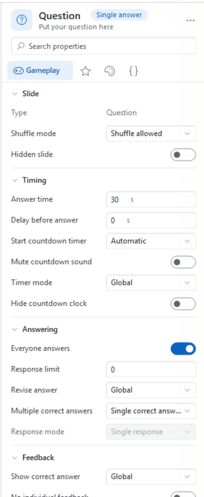
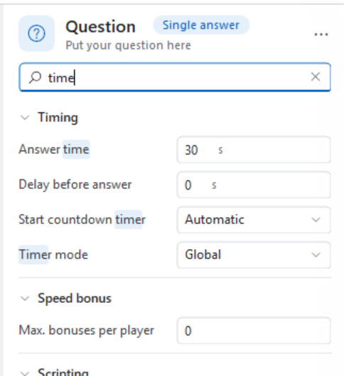
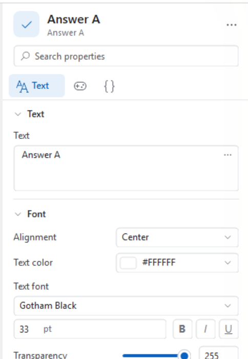
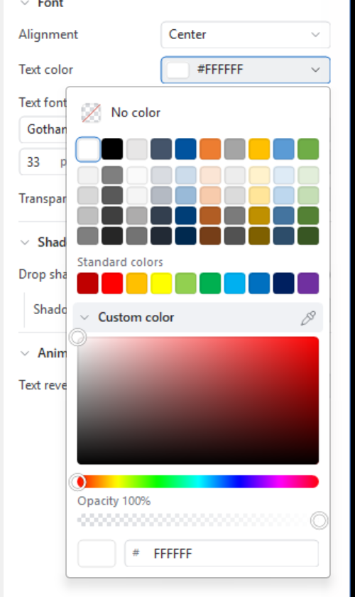
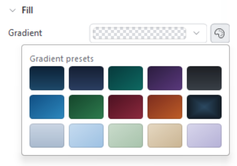
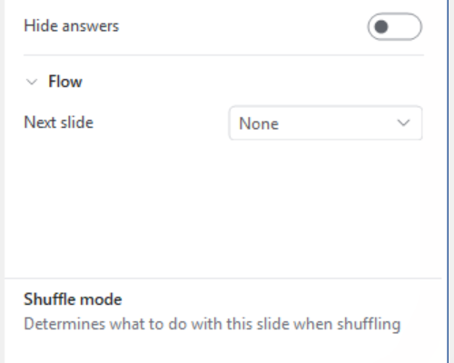
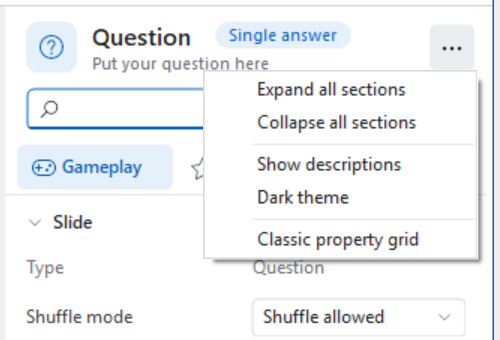
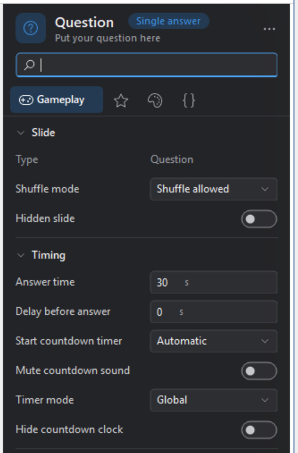
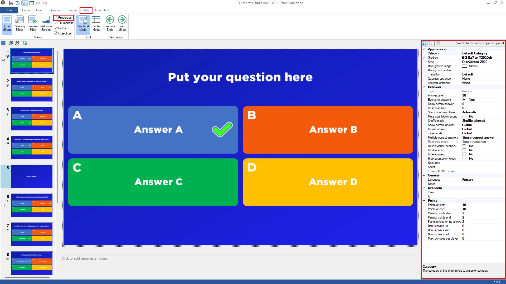

# Geavanceerd eigenschappenraster

Het eigenschappenvenster is de plek waar u snel alle gedetailleerde eigenschappen van het geselecteerde element (of de geselecteerde elementen) instelt. Elk element (zoals vraag, antwoord, dia, video en afbeelding) heeft eigen eigenschappen. U hoeft het niet per se te gebruiken, want de belangrijkste instellingen zijn bereikbaar via het lint, maar voor gevorderde gebruikers kan het een snellere manier zijn om dingen gedaan te krijgen. (Een aantal geavanceerdere/minder bekende eigenschappen is alleen bereikbaar via het eigenschappenvenster.) In de volgende hoofdstukken vindt u een uitleg van de belangrijkste eigenschappen. U toont het eigenschappenvenster via het menu BEELD door een vinkje te plaatsen voor ‘Eigenschappen’ (in de sectie ‘Weergaves’).

QuizXpress toont die eigenschappen in het **eigenschappenpaneel**, dat u standaard krijgt, en biedt daarnaast nog steeds het **klassieke eigenschappenraster** van eerdere versies. Beide tonen precies dezelfde eigenschappen en u kunt er op elk moment tussen wisselen, dus de hoofdstukken hieronder gelden voor allebei.

## Het eigenschappenpaneel

{ width="322" loading=lazy }

In plaats van één lange alfabetische lijst groepeert het paneel de eigenschappen van het geselecteerde element in pagina’s en secties en geeft het elke eigenschap een passend besturingselement: een schakelaar voor een ja/nee-instelling, een schuifregelaar voor een transparantie, een kleurvlak voor een kleur, enzovoort. Alles wat u wijzigt, wordt meteen op de dia toegepast.

**Wat is geselecteerd**

Bovenaan het paneel ziet u wat u bewerkt: een pictogram, het type van het element en een tweede regel met de inhoud ervan (de tekst van een antwoord, de bestandsnaam van een afbeelding). Als u meerdere elementen tegelijk selecteert, bijvoorbeeld alle vier de antwoorden van een vraag, luidt de titel ‘4 objecten geselecteerd’ en toont het paneel de eigenschappen die ze gemeen hebben. Eigenschappen waarvan de waarden tussen de geselecteerde elementen verschillen, worden leeg of als ‘Gemengd’ getoond; zodra u er een instelt, krijgen alle geselecteerde elementen de nieuwe waarde.

**Pagina’s**

Onder het zoekvak staat een rij pagina’s: *Spelverloop*, *Score*, *Ontwerp*, *Tekst*, *Media* en *Geavanceerd*. Alleen de pagina’s die voor de huidige selectie daadwerkelijk eigenschappen hebben, worden getoond, en de pagina die het belangrijkst is voor het geselecteerde element staat vooraan: de pagina *Tekst* voor een tekstelement, *Spelverloop* voor een quizdia. De pagina *Geavanceerd* (het tabblad `{}`) bevat de technische eigenschappen: metagegevens, instellingen voor mobiele apparaten en scripts. Klik op een tabblad om van pagina te wisselen; het paneel onthoudt uw keuze per type element.

**Secties en meer opties**

Elke pagina is verdeeld in secties zoals ‘Timing’, ‘Antwoorden’ of ‘Rand’. Klik op een sectietitel om de sectie in te klappen en gebruik *Alle secties uitvouwen* / *Alle secties samenvouwen* in het optiesmenu om ze allemaal tegelijk te bedienen. Secties die ook zelden gebruikte eigenschappen bevatten, tonen onderaan een koppeling **Meer opties**; klik erop om ze te tonen en op **Minder opties** om ze weer te verbergen. Het paneel onthoudt welke secties u hebt samengevouwen en bij welke secties de extra opties worden getoond.

**Een eigenschap vinden**

{ width="322" loading=lazy }

Als u niet weet waar een eigenschap staat, typt u een woord in het zoekvak bovenaan (of drukt u op *Ctrl+F*). Het paneel toont dan alle overeenkomende eigenschappen van alle pagina’s tegelijk, met het overeenkomende deel van de naam gemarkeerd. De zoekopdracht kijkt ook in de beschrijvingen, dus een woord dat alleen in de uitleg van een eigenschap voorkomt, vindt die eigenschap ook. Klik op de ✕ in het zoekvak om terug te gaan naar de normale weergave.

### Waarden wijzigen

{ width="322" loading=lazy }

De meeste eigenschappen spreken voor zich: typ in een vak, zet een schakelaar om, kies uit een keuzelijst. Een paar verdienen extra aandacht.

**Getallen** kunt u typen, met de kleine pijltjes rechts van het vak ophogen of verlagen, of — vaak sneller — wijzigen door *de naam van de eigenschap* naar links en rechts te slepen. Houd *Shift* ingedrukt tijdens het slepen voor grotere stappen en *Alt* voor fijnere stappen. Eigenschappen met een zinvol minimum en maximum, zoals een transparantie, krijgen een schuifregelaar met een getalvak ernaast; beide blijven met elkaar in de pas.

**Lettertypen** stelt u in met een keuzelijst die een voorbeeld van elk geïnstalleerd lettertype toont, een grootte-vak en knoppen voor vet, cursief en onderstrepen.

**Gegroepeerde eigenschappen** zoals een kleurverloop of een afmeting tonen een samenvatting op één regel. Klik op de naam van de eigenschap om de afzonderlijke instellingen eronder uit te klappen (bij een kleurverloop: Van, Naar en Type).

### Kleuren

{ width="333" loading=lazy }

Een kleureigenschap toont een kleurvlak met de hexwaarde. Klik erop en u krijgt:

- **Geen kleur**, voor eigenschappen die leeg mogen blijven (bijvoorbeeld een transparante achtergrond).
- Een **palet** met tinten bovenaan en daaronder een rij **Standaardkleuren**.
- **Recente kleuren** — de kleuren die u eerder gebruikte, zodat het herhalen van een kleur voor meerdere elementen één klik kost. Deze worden onthouden zolang QuizXpress Studio actief is.
- **Aangepaste kleur**, die een vierkant voor verzadiging/helderheid, een tintbalk, een dekkingsbalk en een vak openklapt waarin u een hexwaarde zoals `#1E4A6B` kunt typen of plakken.

De kleine pipet rechts van de titel ‘Aangepaste kleur’ kiest een kleur **van overal op uw scherm** — ook van buiten QuizXpress. Klik erop en het scherm bevriest; een vergrootglas volgt uw muis en toont de afzonderlijke pixels met de kleur onder de cursor. Klik om die kleur over te nemen, gebruik de pijltoetsen om één pixel tegelijk te verplaatsen (houd *Shift* ingedrukt voor tien) of druk op *Esc* om te annuleren. Omdat het scherm geen transparantie heeft, blijft de dekking van de kleur die u had behouden.

### Kleurverlopen

{ width="313" loading=lazy }

Een kleurverloopeigenschap toont een voorbeeld van het kleurverloop. Ernaast staat een paletknop die een reeks kant-en-klare **kleurverloopvoorinstellingen** opent — met één klik krijgt een dia-achtergrond of een tekstvak een afgewerkte uitstraling. Om een kleurverloop dat u zelf hebt gemaakt te bewaren, klikt u met de rechtermuisknop op de kleurverloopeigenschap en kiest u *Aan mijn kleurverlopen toevoegen*; het verschijnt dan onder **Mijn kleurverlopen** in de kiezer (maximaal vijf). Klik in de kiezer met de rechtermuisknop op een van uw eigen kleurverlopen om het weer te verwijderen. Uw kleurverlopen blijven bewaard tussen sessies.

### Herstellen, kopiëren en plakken

Klik met de rechtermuisknop op een eigenschap voor:

- **Standaardwaarde herstellen** — zet de eigenschap terug op de waarde die ze in een nieuwe dia heeft.
- **Waarde kopiëren** en **Waarde plakken** — handig om een kleur, een lettertype of een kleurverloop van het ene element naar het andere over te zetten. *Ctrl+C* en *Ctrl+V* doen hetzelfde voor de eigenschap waarin u werkt, zodat u hier een kleur kunt kopiëren en rechtstreeks als `#1E4A6B` in een ander programma kunt plakken, of andersom.

### Beschrijvingen

{ width="333" loading=lazy }

Als u de muisaanwijzer op de naam van een eigenschap houdt, verschijnt er een knopinfo die uitlegt wat de eigenschap doet. Als u die uitleg liever permanent in beeld hebt, schakelt u *Beschrijvingen tonen* in het optiesmenu in: onderaan het paneel verschijnt dan een balk met de naam en de uitleg van de eigenschap waarop uw muis staat.

### Opties

{ width="333" loading=lazy }

De knop **…** in de rechterbovenhoek van het paneel bevat de instellingen voor het paneel zelf: alle secties uit- en samenvouwen, beschrijvingen tonen, het donkere thema en overschakelen naar het klassieke eigenschappenraster.

### Donker thema

{ width="333" loading=lazy }

*Donker thema* in het optiesmenu geeft het paneel een donker kleurenschema, dat prettiger is voor de ogen als u lichte dia’s ontwerpt of in een schemerig verlichte ruimte werkt. De keuze wordt onthouden de volgende keer dat u QuizXpress Studio start en is alleen van invloed op het eigenschappenpaneel.

## Het klassieke eigenschappenraster

{ loading=lazy }

Het raster dat eerdere versies van QuizXpress gebruikten, is er nog steeds. Het toont alle eigenschappen van het geselecteerde element in alfabetische groepen en is de snelste manier om alles in één keer te zien. Kies *Klassiek eigenschappenraster* in het menu **…** van het eigenschappenpaneel om ernaar over te schakelen, en de knop *Overschakelen naar het nieuwe eigenschappenvenster* rechts op de eigen werkbalk van het raster om terug te keren. QuizXpress onthoudt welke van de twee u verkiest.

## Eigenschappen van quizdia’s

Deze eigenschappen worden getoond als u op de achtergrond van een vraag klikt. De eigenschappen zijn onderverdeeld in verschillende groepen:

- *Weergave*, die bepaalt hoe de vraag wordt weergegeven.

- *Gedrag*, die het gedrag van de vraag tijdens de gameshow bepaalt.

- *Algemeen*, algemene eigenschappen.

- *Metagegevens, metagegevens voor deze dia (Id en Klasse)*

- *Punten,* sectie voor het toekennen van punten.

<table>
<colgroup>
<col style="width: 100%" />
</colgroup>
<tbody>
<tr class="odd">
<td><table>
<colgroup>
<col style="width: 19%" />
<col style="width: 80%" />
</colgroup>
<thead>
<tr class="header">
<th>Eigenschap</th>
<th>Beschrijving</th>
</tr>
</thead>
<tbody>
<tr class="odd">
<td>Antwoord tijdsspanne</td>
<td>De duur van het aftellen in seconden. Geef de waarde 0 op voor een vraag zonder tijd. U kunt de vraag dan beëindigen met de spatiebalk. Het aftellen kunt u pauzeren door in QuizXpress Live op ‘P’ te drukken.</td>
</tr>
<tr class="even">
<td>Automatisch beoordelen</td>
<td>Deze instelling geldt voor een vraag met snelste drukker (Stemmen = nee) die meerkeuze is. In dat geval geeft de instelling ‘Automatisch beoordelen’ aan of een vraag automatisch door QuizXpress Live wordt beoordeeld wanneer op een meerkeuzeknop van een buzzer/keypad wordt gedrukt (voor buzzers zonder meerkeuze staat automatisch beoordelen altijd automatisch op ‘Nee’).</td>
</tr>
<tr class="odd">
<td>Doorgaan bij einde media</td>
<td>Ga automatisch door naar de volgende dia wanneer een video of geluid op een billboard eindigt. Dit helpt bij het maken van zelfstandig draaiende quizzen. Deze eigenschap is beschikbaar wanneer er een media-element op de dia staat en het dia-Type billboard is.</td>
</tr>
<tr class="even">
<td>Achtergrond afbeelding</td>
<td>De achtergrondafbeelding van de quizdia.</td>
</tr>
<tr class="odd">
<td>Achtergrond weergave</td>
<td>Geeft aan hoe de achtergrondafbeelding op de dia wordt uitgerekt. Dit kan ‘Vullen’ zijn om de hele dia eenvoudig met de afbeelding te vullen (de beeldverhouding blijft niet behouden) of ‘Zoom’ om de juiste beeldverhouding te behouden en mogelijk delen van de afbeelding te verliezen</td>
</tr>
<tr class="odd">
<td>Achtergrondvideo</td>
<td>
Een video die tijdens de quiz achter de dia afspeelt. Een afbeelding of video in een plaatshouder wordt erbovenop afgespeeld. Zodra de eigenschap is ingesteld, verschijnen eronder deze instellingen: <em>Video Opslag Type</em> (ingesloten of gekoppeld), <em>Extern bestand</em> (voor een gekoppelde video), <em>Herhalen</em> (standaard aan), <em>Stil</em> (standaard aan) en, onder ‘Meer opties’, <em>Synchroniseren met quiz</em> (de video pauzeren wanneer een team buzzt, het aftellen wordt gepauzeerd of de vraag eindigt).

Bij een categorie wordt de achtergrondvideo toegepast op elke dia die met die categorie is opgemaakt. Zie <a href="../../backgrounds/#background-video">Achtergrondvideo</a>.
</td>
</tr>
<tr class="even">
<td>Bonus punten</td>
<td>De bonuspunten voor de 1e, 2e en 3e snelste speler die correct antwoordt.</td>
</tr>
<tr class="odd">
<td>Klasse</td>
<td>Een door de gebruiker te bepalen tekst om het type dia te classificeren. Deze gegevens worden geëxporteerd in het scorebestand van Analyzer en naar MessageBroker gestuurd, zodat ze kunnen worden gebruikt om een bepaald gedrag te activeren</td>
</tr>
<tr class="even">
<td>Categorie</td>
<td>De categorie voor deze quizdia. Door een categorie te selecteren, bepaalt u de grafische opmaak. Let op: u kunt uw eigen categorieën definiëren! Voor een uitleg over categorieën verwijzen we u naar [Categorieën gebruiken](../using-categories.md)</td>
</tr>
<tr class="odd">
<td>Continueer vraag na correct antwoord</td>
<td>Wanneer voor een vraag met snelste drukker (van het type ‘standaard’, het antwoord wordt mondeling gegeven en als correct beoordeeld) een correct antwoord wordt gegeven, loopt het aftellen door en kunnen andere spelers drukken (vaak gebruikt voor spellen tijdens een evenement buiten een quiz).</td>
</tr>
<tr class="even">
<td>Correct antwoord</td>
<td>Het correcte antwoord voor deze dia. Alleen van toepassing wanneer de invoermodus (zie hieronder) ‘getal’, ‘letter’ of ‘tekst’ is.</td>
</tr>
<tr class="odd">
<td>Aangepaste HTML-inhoud om weer te geven in de mobiele app</td>
<td>Een aangepaste HTML-pagina die op mobiele apparaten wordt getoond wanneer deze dia wordt geladen <em>(geavanceerd gebruik)</em></td>
</tr>
<tr class="even">
<td>Vertraagd antwoorden</td>
<td>Tijd in seconden die verstrijkt voordat de antwoorden worden getoond. Zo kan een quizmaster de vraag hardop voorlezen voordat de antwoorden verschijnen.</td>
</tr>
<tr class="odd">
<td>Tijd tussen antwoorden*</td>
<td>Wanneer zowel ‘Vertraagd antwoorden’ als ‘verbergen en één voor één tonen’ zijn ingesteld, verschijnt deze eigenschap. Ze bepaalt de tijdspanne die verstrijkt tussen elk antwoord dat verschijnt.</td>
</tr>
<tr class="even">
<td>Demografische groep*</td>
<td>Deze eigenschap kan worden ingesteld wanneer het <strong>Type</strong> van de dia op ‘Demografisch’ staat. Ze definieert een demografische groep. Wanneer de quiz wordt gespeeld, behoren mensen die op hun buzzer drukken terwijl een demografische quizdia wordt getoond, tot de groep die met deze eigenschap is aangegeven. Zie ook [Demografische groepen](../slide-and-game-formats/demographic-groups.md) voor meer informatie over demografische groepen.</td>
</tr>
<tr class="odd">
<td>Einde ronde actie*</td>
<td>Deze eigenschap kan worden ingesteld wanneer het <strong>Type</strong> van de dia op ‘Einde ronde’ staat. De mogelijke waarden zijn ‘Eén verliezer uitschakelen’, waarbij de deelnemer met de minste punten wordt uitgeschakeld, en ‘Quizmaster selecteert verliezers’, waarbij de quizmaster de deelnemers die worden uitgeschakeld één voor één kan selecteren.</td>
</tr>
<tr class="even">
<td>Evaluatiemodus</td>
<td>Geeft aan of de beoordeling van een numeriek antwoord ‘exacte overeenkomst’ is (het gegeven antwoord moet exact overeenkomen met het correcte antwoord van de vraag) of ‘dichtstbijzijnde wint’ (de speler die het dichtst bij het antwoord zit, wint de aangegeven punten).</td>
</tr>
<tr class="odd">
<td>Kleurenverloop</td>
<td>Het kleurverloop voor de achtergrond van de dia. Deze eigenschap geldt alleen als u geen afbeelding op de achtergrond hebt. Er kunnen een ‘van’-kleur en een ‘naar’-kleur voor het kleurverloop worden gekozen, evenals een type kleurverloop.</td>
</tr>
<tr class="even">
<td>Id</td>
<td>Een unieke ID om deze dia te identificeren (bijvoorbeeld voor statische diaroutering met de eigenschap <em>Volgende slide</em>)</td>
</tr>
<tr class="odd">
<td>Invoertype</td>
<td>Voor een open vraag kunt u kiezen tussen ‘standaard’ (vraag met snelste drukker) of voor een antwoord als ‘getal’, ‘letter’ of ‘tekst’. De laatste drie modi gelden alleen bij gebruik van mobiele telefoons (omdat keypads en buzzers geen numerieke of tekstuele invoer bieden).</td>
</tr>
<tr class="even">
<td>Taal</td>
<td>De huidige (bewerk)weergavetaal van de dia voor tweetalige quizzen.</td>
</tr>
<tr class="odd">
<td>Uitsluiten na fout antwoord</td>
<td>Stelt de uitsluitingsmodus in voor een vraag met snelste drukker. De speler wordt bij een fout antwoord uitgesloten, of de speler mag het opnieuw proberen.</td>
</tr>
<tr class="even">
<td>Meerdere goede antwoorden</td>
<td>Geeft aan of deze vraag meer dan één correct antwoord heeft en of meerdere correcte antwoorden in een bepaalde volgorde staan</td>
</tr>
<tr class="odd">
<td>Demp het aftelgeluid</td>
<td>Demp het aftelgeluid voor deze vraag</td>
</tr>
<tr class="even">
<td>Volgende slide</td>
<td>De ID van de dia die na deze dia wordt getoond (statische diaroutering)</td>
</tr>
<tr class="odd">
<td>Opmerkingen</td>
<td>Een tekst (hints) voor de quizmaster die in de PDF-export wordt opgenomen</td>
</tr>
<tr class="even">
<td>Volgorde antwoordmodus</td>
<td>Bij antwoorden in volgorde kunt u aangeven of u wilt dat de reacties exact overeenkomen met de volgorde (Exacte overeenkomst) of dat een gedeeltelijk correct antwoord ook punten oplevert (een percentage van de punten, afhankelijk van hoeveel antwoorden op de juiste plek staan).</td>
</tr>
<tr class="odd">
<td>Strafpunten einde</td>
<td>Aantal punten dat wordt afgetrokken wanneer een deelnemer aan het einde van het aftellen onjuist antwoordt (interpoleert tussen begin – einde)</td>
</tr>
<tr class="even">
<td>Strafpunten start</td>
<td>Aantal punten dat wordt afgetrokken wanneer een deelnemer aan het begin van het aftellen onjuist antwoordt</td>
</tr>
<tr class="odd">
<td>Punten bij eindtijd</td>
<td>Aantal punten dat wordt toegevoegd wanneer een deelnemer aan het einde van het aftellen correct antwoordt. Moet kleiner zijn dan of gelijk aan ‘punten bij starttijd’. De punten worden geïnterpoleerd tussen het begin en het einde van de teller. Als de punten bij eindtijd dus kleiner zijn dan de punten bij starttijd, neemt het aantal te winnen punten af terwijl het aftellen loopt. Als de twee waarden gelijk zijn, blijven de te winnen punten tijdens het hele aftellen gelijk.</td>
</tr>
<tr class="even">
<td>Punten bij starttijd</td>
<td>Aantal punten dat wordt toegevoegd wanneer een deelnemer aan het begin van het aftellen correct antwoordt.</td>
</tr>
<tr class="odd">
<td>Punten aftrek bij geen antwoord</td>
<td>De punten die worden afgetrokken wanneer geen antwoord wordt gegeven. Geldt voor stemvragen en voor vragen met snelste drukker met een ‘Bedenktijd’: daar verliest de speler deze punten wanneer de tijd om is voordat het antwoord is beoordeeld.</td>
</tr>
<tr class="even">
<td>Punten stelen</td>
<td>Wanneer de optie Punten stelen actief is voor een vraag met snelste drukker (buzzer), verliest een speler die een onjuist antwoord geeft geen punten. In plaats daarvan worden de strafpunten zoals voor de dia geconfigureerd aan alle andere spelers toegekend en eindigt de vraag onmiddellijk.</td>
</tr>
<tr class="odd">
<td>Antwoordlimiet</td>
<td>Het maximale aantal teams waarvan het systeem reacties accepteert. Als u bijvoorbeeld met 100 teams speelt, kunt u deze waarde op 25 zetten, zodat alleen de eerste 25 teams de vraag mogen beantwoorden.</td>
</tr>
<tr class="even">
<td>Respons mode</td>
<td>Geeft aan of deze vraag slechts één antwoord per speler accepteert of meerdere (te gebruiken in combinatie met ‘Meerdere goede antwoorden’). Als u deze optie op ‘meerdere antwoorden, exacte overeenkomst’ zet, moet het antwoord met meerdere antwoorden exact overeenkomen met de correcte antwoorden om punten te winnen.</td>
</tr>
<tr class="odd">
<td>Antwoord herzien</td>
<td>Hier kunt u de globale optie overschrijven waarmee spelers hun antwoord mogen herzien (globaal ingesteld in Quiz Setup voor alle dia’s).</td>
</tr>
<tr class="even">
<td>Vangnet*</td>
<td>Gebruikt voor Trivia Ladder-vragen. Wanneer een speler in een Trivia Ladder-ronde onjuist antwoordt, valt hij of zij terug naar het dichtstbijzijnde vangnet op de Trivia Ladder.</td>
</tr>
<tr class="odd">
<td>Script</td>
<td>Aangepast diagedrag, gecodeerd in JavaScript <em>(geavanceerd gebruik)</em></td>
</tr>
<tr class="even">
<td>Antwoord tonen actie*</td>
<td>Wanneer ‘Vertraagd antwoorden’ is ingesteld, verschijnt deze eigenschap. Als u haar op ‘verbergen en in één keer tonen’ zet, worden de antwoorden in één keer getoond nadat de vertragingstijd is verstreken. Als u haar op ‘verbergen en één voor één tonen’ zet, worden de antwoorden één voor één getoond nadat de vertragingstijd is verstreken.</td>
</tr>
<tr class="odd">
<td>Toon correct antwoord</td>
<td>Modus voor het tonen van het correcte antwoord op deze dia. Ofwel de globale instelling uit Quiz Setup volgen, het correcte antwoord nooit tonen, of het correcte antwoord altijd tonen.</td>
</tr>
<tr class="even">
<td>Shuffle instelling</td>
<td>Bepaalt wat er gebeurt wanneer de quiz wordt geschud</td>
</tr>
<tr class="odd">
<td>Klok starten</td>
<td>Geeft aan of de aftelklok automatisch moet starten wanneer de vraag verschijnt of door een handmatige actie.</td>
</tr>
<tr class="odd">
<td>Stijl</td>
<td>De weergavestijl voor de vraag. Meer over stijlen vindt u in het hoofdstuk “Stijlen”.</td>
</tr>
<tr class="even">
<td>Tekst evaluatie</td>
<td>Geeft aan of de beoordeling van een tekstantwoord ‘exacte overeenkomst’ is (het gegeven antwoord moet exact overeenkomen met het correcte antwoord) of ‘fuzzy match’ (een algoritme staat een bepaald percentage verschil toe tussen het gegeven antwoord en het correcte antwoord, zodat spelers kleine spelfouten kunnen maken).</td>
</tr>
<tr class="odd">
<td>Bedenktijd</td>
<td>Alleen voor vragen met snelste drukker: het aantal seconden dat de speler die heeft gebuzzd heeft om te antwoorden (0 = geen limiet). Een balk bovenaan het scherm toont de tijd die wegtikt; wanneer de quizmaster het antwoord dan nog niet heeft beoordeeld, telt het als fout met de ‘Punten aftrek bij geen antwoord’. Zie <a href="../../../live/starting-a-quiz/the-quiz-screen-voting-everybody-answers/#time-to-answer">Bedenktijd</a>.</td>
</tr>
<tr class="even">
<td>Tolerantie</td>
<td>Toegestane afwijking tussen het correcte antwoord en de gegeven antwoorden. Geldt voor vragen met invoertype ‘tekst’ waarbij ‘tekst evaluatie’ op ‘fuzzy match’ staat.</td>
</tr>
<tr class="even">
<td>Onderwerp*</td>
<td>Het onderwerp van de vraag. Dit wordt gebruikt om automatisch een voorafgaand Trivia Bord te genereren.</td>
</tr>
<tr class="odd">
<td>Transitie</td>
<td>De specifieke transitie-animatie bij het doorgaan naar de volgende dia (standaard wordt door het systeem een willekeurige transitie gekozen)</td>
</tr>
<tr class="even">
<td>Type</td>
<td>
Alleen-lezen veld dat het type van de dia toont:

<ul>
<li>
<em>Vraag</em>: dia is een normale quizvraag.
</li>
<li>
<em>Billboard</em>: dia is alleen ter weergave.
</li>
<li>
<em>Einde ronde</em>: dia geeft het einde van een quizronde aan. Tussenstanden worden getoond en de quizmaster heeft de mogelijkheid om teams uit te schakelen. Zie ook de eigenschap: ‘Einde ronde’.
</li>
<li>
<em>Testvraag</em>: dia die wordt gebruikt om het systeem aan de deelnemers te demonstreren. Er worden geen punten opgeteld/afgetrokken.
</li>
<li>
<em>Demografisch</em>: deze dia dient om alle deelnemers in te delen in concurrerende groepen. Zie ook de eigenschap ‘Demografische groep’.
</li>
<li>
<em>Last Man Standing</em>: dia is een quizvraag. Deelnemers die de vraag onjuist beantwoorden, worden uit de quiz verwijderd.
</li>
<li>
<em>Vraag het publiek</em>: dia om eenvoudigweg een reactie van het publiek te verzamelen zonder quizscores te wijzigen. De reactiegegevens kunnen in een grafiek worden getoond.
</li>
<li>
<em>Weddenschap</em>: laat het publiek een percentage van hun score inzetten op de volgende vraag.
</li>
<li>
<em>Meerderheid bepaalt</em>: een dia waarbij het correcte antwoord afhangt van wat het publiek het vaakst kiest
</li>
<li>
<em>Koppelvraag</em>: spelers koppelen tekstlabels aan afbeeldingen (bijvoorbeeld landen aan vlaggen).
</li>
<li>
<em>Minigame</em>: een dia die de geselecteerde minigame start
</li>
<li>
<em>Trivia Bord</em>: een dia die een ronde start waarin vragen per Onderwerp/Punten zijn georganiseerd en als raster worden gepresenteerd
</li>
<li>
<em>Trivia Ladder:</em> start een Trivia Ladder-ronde waarin spelers bij elke correcte vraag een trede omhoog gaan
</li>
<li>
<em>Snelheidsronde:</em> start een ronde waarin een speler in een vaste hoeveelheid tijd zoveel mogelijk vragen moet beantwoorden.
</li>
<li>
<em>Trivia Bingo:</em> start een Bingo-ronde, ofwel opgebouwd uit opeenvolgende quizdia’s of als een traditioneel nummer-Bingospel.
</li>
<li>
<em>Trivia Feud:</em> een dia waarin spelers een vraag van het type enquête beantwoorden.
</li>
</ul></td>
</tr>
<tr class="odd">
<td>Stemmen</td>
<td>Geeft aan of alle deelnemers kunnen antwoorden of dat alleen de deelnemer die als eerste buzzt kan antwoorden.</td>
</tr>
</tbody>
</table>

* zichtbaarheid van de eigenschap hangt af van andere eigenschappen
</td>
</tr>
</tbody>
</table>

## Vraageigenschappen

Deze eigenschappen worden getoond wanneer u op het vraagvak op een dia klikt

| Eigenschap              | Beschrijving                                                                                         |
|-------------------------|------------------------------------------------------------------------------------------------------|
| Uitlijning              | De tekstuitlijning van de vraagtekst                                                                 |
| Schaduw                 | Geeft aan of er een schaduw onder de vraagtekst wordt aangebracht                                    |
| Kleurenverloop          | Het kleurverloop voor de achtergrond van de vraag.                                                   |
| Kleur schaduw           | Geeft de kleur van de schaduw aan                                                                    |
| Tekst                   | De tekst van de vraag                                                                                |
| Tekst kleur             | De kleur van de vraagtekst                                                                           |
| Lettertype              | Het lettertype dat voor de vraagtekst wordt gebruikt                                                 |
| Tekst onthullen         | Hoe de tekst wordt onthuld. Tonen (standaard: toont direct), Letter voor letter tonen of Woord voor woord tonen |
| Vertraging bij het onthullen van tekst (sec) | De vertraging waarna de tekst wordt getoond                                     |
| Snelheid waarmee de tekst wordt onthuld | Snelheid van het onthullen van de tekst                                          |
| Transparantie           | Transparantie van de achtergrond van de vraag                                                        |

## Antwoordeigenschappen

Deze eigenschappen worden getoond wanneer u op een antwoordvak op een dia klikt

| Eigenschap | Beschrijving |
|-------------------------|------------------------------------------------------------|
| Uitlijning | De tekstuitlijning van de antwoordtekst |
| Correct antwoord | Geeft aan of het geselecteerde antwoord het correcte antwoord is. Zet op ‘waar’ als het geselecteerde antwoord het correcte antwoord is. |
| Correctheid | Van toepassing op vragen met meerdere correcte antwoorden; deze waarde stelt de correctheid van het antwoord in (als percentage van het totaal aantal punten van de vraag). |
| Schaduw | Geeft aan of er een schaduw onder de antwoordtekst wordt aangebracht |
| Kleurenverloop | Het kleurverloop voor de achtergrond van het antwoord. Of deze eigenschap van toepassing is, hangt af van de gebruikte stijl. |
| Kleur schaduw | De kleur van de schaduw |
| Tekst | De tekst van het antwoord |
| Tekst onthullen | Hoe de tekst wordt onthuld. Tonen (standaard: toont direct), Letter voor letter tonen of Woord voor woord tonen |
| Vertraging bij het onthullen van tekst (sec) | De vertraging waarna de tekst wordt getoond |
| Snelheid waarmee de tekst wordt onthuld | Snelheid van het onthullen van de tekst |
| Tekstkleur | De kleur van de antwoordtekst |
| Lettertype | Het lettertype van de antwoordtekst |
| Transparantie | Transparantie van de achtergrond van het antwoordpaneel |

## Afbeeldingseigenschappen

Deze eigenschappen worden getoond wanneer u op een afbeeldingsvak op een dia klikt

| Eigenschap          | Beschrijving                                                                                                                                                                                                                                                                                                                                                                                                   |
|---------------------|----------------------------------------------------------------------------------------------------------------------------------------------------------------------------------------------------------------------------------------------------------------------------------------------------------------------------------------------------------------------------------------------------------------|
| Rand                | Geeft aan of er een rand rond de afbeelding wordt getekend                                                                                                                                                                                                                                                                                                                                                     |
| Randkleur           | De kleur van de rand, indien ingeschakeld                                                                                                                                                                                                                                                                                                                                                                      |
| Rand dikte          | Dikte van de rand in pixels (indien ingeschakeld)                                                                                                                                                                                                                                                                                                                                                              |
| Hoekradius          | Hoekradius voor de randlijn om een afgeronde rand te maken                                                                                                                                                                                                                                                                                                                                                     |
| Correct antwoord    | Geeft aan of de afbeelding het correcte antwoord bevat. Dit kan alleen voor afbeeldingen worden ingesteld wanneer de dia alleen afbeeldingen bevat en een meerkeuzedia is.                                                                                                                                                                                                                                      |
| Schaduw             | Geeft aan of er een schaduw onder de afbeelding wordt aangebracht                                                                                                                                                                                                                                                                                                                                              |
| Effect              | Stelt een effect op de afbeelding in. Zie [Effecten toepassen](../adding-multimedia-content/pictures.md#effecten-toepassen) voor een uitgebreidere uitleg over effecten.                                                                                                                                                                                                                                         |
| Verborgen           | Verberg de afbeelding tijdens de quiz                                                                                                                                                                                                                                                                                                                                                                          |
| Verborgen op mobiel | Geeft aan of een afbeelding op een quizdia op de mobiele telefoon moet worden verborgen. Een scenario hiervoor is wanneer u op de mobiele telefoon een andere afbeelding wilt tonen dan op het grote scherm voor het publiek. U wilt bijvoorbeeld dat de mobiele afbeelding een andere beeldverhouding heeft. In dat geval wilt u niet dat de afbeelding op het grote scherm ook op de mobiele telefoon verschijnt. |
| Afbeelding          | Een miniatuur van de afbeelding. Klik op de bladerknop (…) van deze eigenschap om naar een afbeelding te bladeren.                                                                                                                                                                                                                                                                                             |
| Uitvergroten        | Bepaalt of de afbeelding het hele gebied moet vullen door in te zoomen                                                                                                                                                                                                                                                                                                                                         |
| Label               | Een tekstuele beschrijving van de afbeelding (gebruikt wanneer de afbeelding niet kan worden getoond)                                                                                                                                                                                                                                                                                                          |
| Afbeelding voor mobiel | Een alternatieve versie van de afbeelding voor gebruik op mobiele apparaten                                                                                                                                                                                                                                                                                                                                 |
| Vullen              | Rek de afbeelding in beide richtingen uit om het gebied te vullen (kan de afbeelding vervormen)                                                                                                                                                                                                                                                                                                                |

## Geluidseigenschappen

Deze eigenschappen worden getoond wanneer u op een geluidsitem op een dia klikt

| Eigenschap              | Beschrijving                                                                                                                                                                                                                                                                                            |
|-------------------------|---------------------------------------------------------------------------------------------------------------------------------------------------------------------------------------------------------------------------------------------------------------------------------------------------------|
| Afspeelduur             | De duur van het geluid. In eerste instantie wordt de volledige duur getoond.                                                                                                                                                                                                                            |
| Intro Pauze             | De tijd die wordt gewacht voordat het geluid begint. Zo kan de quizmaster eerst de vraag voorlezen.                                                                                                                                                                                                     |
| Blijf spelen            | Standaard stopt de muziek die u op een dia zet wanneer de aftelklok afloopt. Met deze vlag kunt u de muziek laten doorspelen totdat u naar de volgende dia gaat.                                                                                                                                         |
| Toonhoogte              | De toonhoogte aan het begin van het aftellen                                                                                                                                                                                                                                                            |
| Zang verwijderen        | Effect om zang te verwijderen (resultaten kunnen wisselen)                                                                                                                                                                                                                                              |
| Herhaal                 | Geeft aan of het geluid zichzelf moet herhalen.                                                                                                                                                                                                                                                         |
| Herhaling               | Speelt het geluid opnieuw af nadat het correcte antwoord in de vraag is getoond.                                                                                                                                                                                                                        |
| Afspeelvertraging       | Wordt getoond wanneer herhaling is ingeschakeld. Toont het aantal seconden waarna de herhaling begint                                                                                                                                                                                                   |
| Herhaling starten       | Stelt het tijdstip in waarop het geluidsfragment begint te spelen                                                                                                                                                                                                                                       |
| Einde afspelen          | Stelt het tijdstip in waarop het geluidsfragment stopt met spelen                                                                                                                                                                                                                                       |
| Audio omkeren           | Speel het geluidsfragment achterstevoren af                                                                                                                                                                                                                                                             |
| Geluid opslagtype       | Geeft aan of de geluidsgegevens ingesloten in het quizbestand worden opgeslagen of op de lokale schijf (gekoppeld)                                                                                                                                                                                      |
| Snelheidspercentage     | De snelheid van het geluid wanneer het begint te spelen.                                                                                                                                                                                                                                                |
| Begin bij               | De positie in het geluidsbestand vanaf waar het geluid wordt gestart.                                                                                                                                                                                                                                   |
| Stop bij                | Het tijdstip waarop het geluid stopt                                                                                                                                                                                                                                                                    |
| Doel toonhoogte         | De toonhoogte aan het einde van het aftellen (de toonhoogte interpoleert van begin naar einde)                                                                                                                                                                                                          |
| Doel snelheidspercentage | De snelheid van het geluid wanneer het ophoudt met spelen. Let op: door te spelen met het ‘snelheidspercentage’ en het ‘doel snelheidspercentage’ kunt u geluiden ‘van langzaam naar normaal’ of ‘van snel naar normaal’ afspelen. Als u beide percentages op 100% zet, wordt het geluidsfragment gewoon van begin tot einde op normale snelheid afgespeeld. |
| Volume                  | Het volume waarmee de muziek wordt afgespeeld                                                                                                                                                                                                                                                           |
| Volume fade             | Infaden/uitfaden bij het starten/stoppen van de muziek                                                                                                                                                                                                                                                  |

## Minigame-eigenschappen

| Eigenschap     | Beschrijving                                                                                                                                                                                         |
|----------------|------------------------------------------------------------------------------------------------------------------------------------------------------------------------------------------------------|
| Minigametitel | Standaard toont de mobiele buzzer de naam van de minigame op het scherm. U kunt dit overschrijven en uw eigen tekst opgeven. Zo ziet u in plaats van “Paardenrace” nu iets spannenders. |

## Video-eigenschappen

Deze eigenschappen worden getoond wanneer u op een video op een dia klikt

| Eigenschap                     | Beschrijving                                                                                                                                                                                                                                                                                                                                                                                                                                                                                                             |
|--------------------------------|--------------------------------------------------------------------------------------------------------------------------------------------------------------------------------------------------------------------------------------------------------------------------------------------------------------------------------------------------------------------------------------------------------------------------------------------------------------------------------------------------------------------------|
| Beeldverhouding                | (alleen-lezen) beeldverhouding                                                                                                                                                                                                                                                                                                                                                                                                                                                                                           |
| Codec                          | (alleen-lezen) gebruikte videodecoder                                                                                                                                                                                                                                                                                                                                                                                                                                                                                    |
| Afspeelduur                    | (alleen-lezen) lengte van de video                                                                                                                                                                                                                                                                                                                                                                                                                                                                                       |
| Effect                         | Optioneel effect op de video                                                                                                                                                                                                                                                                                                                                                                                                                                                                                             |
| Einde                          | Tijdstip waarop de video eindigt                                                                                                                                                                                                                                                                                                                                                                                                                                                                                         |
| Intro Pauze                    | Vertraging tussen het tonen van de dia en het starten van de video                                                                                                                                                                                                                                                                                                                                                                                                                                                       |
| Extern bestand                 | Bestandsnaam van het externe videobestand indien gekoppeld                                                                                                                                                                                                                                                                                                                                                                                                                                                               |
| Herhalen                       | Herhaal de video nadat deze is gestopt                                                                                                                                                                                                                                                                                                                                                                                                                                                                                   |
| Herhaling                      | Speelt de video opnieuw af nadat het correcte antwoord in de vraag is getoond.                                                                                                                                                                                                                                                                                                                                                                                                                                           |
| Afspeelvertraging              | Het aantal seconden waarna de herhaling begint                                                                                                                                                                                                                                                                                                                                                                                                                                                                           |
| Herhaling starten              | Stelt het afspeeltijdstip in waarop de video begint                                                                                                                                                                                                                                                                                                                                                                                                                                                                      |
| Einde afspelen                 | Stelt het afspeeltijdstip in waarop de video eindigt                                                                                                                                                                                                                                                                                                                                                                                                                                                                     |
| Stil                           | Onderdruk het geluid in de video                                                                                                                                                                                                                                                                                                                                                                                                                                                                                         |
| Begin                          | Tijdstip waarop de video start                                                                                                                                                                                                                                                                                                                                                                                                                                                                                           |
| Videohoogte                    | (alleen-lezen) hoogte van de video                                                                                                                                                                                                                                                                                                                                                                                                                                                                                       |
| Video Opslag Type              | Geeft aan of het videofragment is ingesloten of gekoppeld. Een videofragment in een quiz insluiten betekent dat het videofragment in het quizbestand wordt opgenomen. Een videofragment koppelen betekent dat vanuit het quizbestand een verwijzing wordt gemaakt naar een video op het bestandssysteem. Over het algemeen wordt het koppelen van video’s aanbevolen. *Let op: wanneer u video’s koppelt, zorg er dan voor dat u de videobestanden niet van uw bestandssysteem verwijdert. Wanneer u de quiz naar een andere computer verplaatst, moeten de video’s naar dezelfde map als het quizbestand worden gekopieerd.* |
| Breedte                        | (alleen-lezen) breedte van de video                                                                                                                                                                                                                                                                                                                                                                                                                                                                                      |

## Vormeigenschappen

Deze eigenschappen worden getoond wanneer u op een afbeeldingsvorm of tekstvorm op een dia klikt.

| Eigenschap              | Beschrijving                                                                                                                                                                                                                           |
|-------------------------|----------------------------------------------------------------------------------------------------------------------------------------------------------------------------------------------------------------------------------------|
| Uitlijning              | De tekstuitlijning van de tekstvorm                                                                                                                                                                                                    |
| Transparantie achtergrond | Van toepassing op tekstvormen. Stelt de transparantie in van de kleur die voor de achtergrond wordt gebruikt (de eigenschap Kleurenverloop).                                                                                         |
| Randkleur               | De randkleur van een tekstvorm                                                                                                                                                                                                         |
| Randbreedte             | De breedte van de rand van een tekstvorm                                                                                                                                                                                               |
| Hoekradius              | De straal van de rand van een tekstvorm. Hiermee maakt u afgeronde hoeken.                                                                                                                                                             |
| Schaduw                 | Geeft aan of een slagschaduw voor een tekstvorm wordt gebruikt                                                                                                                                                                         |
| Kleurenverloop          | Het kleurverloop voor de achtergrond van een tekstvorm. Er kunnen een ‘van’-kleur en een ‘naar’-kleur voor het kleurverloop worden gekozen, evenals een type kleurverloop.                                                              |
| Afbeelding              | Van toepassing op afbeeldingsvormen. Een miniatuur van de afbeelding. Klik op de bladerknop (…) om naar een afbeelding te bladeren.                                                                                                    |
| Rotatiehoek             | De rotatiehoek van de afbeelding of tekst                                                                                                                                                                                              |
| Kleur schaduw           | Schaduwkleur van de slagschaduw voor een tekstvorm                                                                                                                                                                                     |
| Vullen                  | Van toepassing op afbeeldingsvormen. Rekt de afbeelding uit tot het volledige gebied van het omringende selectiekader                                                                                                                  |
| Tekst                   | De tekst van de tekstvorm                                                                                                                                                                                                              |
| Tekstkleur              | De kleur van de tekst van een tekstvorm                                                                                                                                                                                                |
| Lettertype              | Het lettertype dat voor de tekstvorm wordt gebruikt                                                                                                                                                                                    |
| Transparantie           | Stel de transparantie van de afbeelding of tekst in                                                                                                                                                                                    |
| Zichtbaarheid           | Geeft aan of een vorm (afbeelding of tekst) altijd zichtbaar is, zichtbaar wordt wanneer een antwoord wordt getoond, wordt verborgen wanneer een antwoord wordt getoond, of getimed is (verschijnt op een bepaald moment tijdens het aftellen). |

## Spraakeigenschappen

Deze eigenschappen worden getoond wanneer u op een spraakitem op een dia klikt.

| Eigenschap | Beschrijving                                                       |
|----------|--------------------------------------------------------------------|
| Intro Pauze | Geeft het aantal seconden aan dat wordt gewacht voordat de spraak begint   |
| Snelheid     | De snelheid waarmee de tekst van het spraakitem wordt voorgelezen             |
| Tekst     | De tekst die moet worden voorgelezen                                                |
| Stem    | De te gebruiken stem (kies er een uit de in Windows geïnstalleerde stemmen) |
| Volume   | Het volume van de gesproken tekst                                      |

## Grafiekeigenschappen

Deze eigenschappen worden getoond wanneer u op een grafiek op een dia klikt

| Eigenschap          | Beschrijving                                                                                                                                                   |
|---------------------|----------------------------------------------------------------------------------------------------------------------------------------------------------------|
| Uitlijning          | Uitlijning van de titel van de grafiek                                                                                                                         |
| Achtergrondkleur grafiek | Stel de achtergrondkleur van het gegevensgebied van de grafiek in                                                                                         |
| As kleur            | De kleur die voor de as wordt gebruikt                                                                                                                         |
| As label autmatische grootte | Stel de grootte van de labels op de as automatisch in. Als dit niet is ingesteld, kunt u expliciet een lettertype en grootte voor de labels kiezen     |
| As label kleur      | De kleur die voor de labels op de as wordt gebruikt                                                                                                            |
| Grafiek achtergrond | Stel de achtergrondkleur in van het gebied buiten de grafiekgegevens                                                                                           |
| Grafiek type        | Het type grafiek. Kies tussen Balk, Kolom, Donut of Taart.                                                                                                     |
| Hoekradius          | Straal van de hoeken van het grafiekelement                                                                                                                    |
| Schaduw offset      | Toon een schaduw voor het gegevensgebied van de grafiek                                                                                                        |
| Raster kleur        | De kleur die voor het raster in het gegevensgebied van de grafiek wordt gebruikt                                                                               |
| Label kleur         | Kleur van de labels die voor elk element in de grafiek worden getoond                                                                                          |
| Label weergave      | Toon voor de labels absolute waarden, percentages of beide                                                                                                     |
| Lettertype label    | Lettertype van de labels                                                                                                                                       |
| Label stijl         | Geeft aan waar de labels worden geplaatst                                                                                                                      |
| Modus               | Geeft het type gegevens aan dat in de grafiek wordt getoond: reactie (percentage van elk gegeven antwoord) of goed/fout (percentage spelers dat goed/fout had) |
| Toon 3D             | Toon een 3D-weergave van de grafiek                                                                                                                            |
| Toon legenda        | Toon een legenda voor de grafiekgegevens (percentage reacties per antwoord)                                                                                    |
| Titel               | Titel van de grafiek                                                                                                                                           |
| Titel kleur         | Kleur van de titel van de grafiek                                                                                                                              |
| Titel font          | Lettertype van de titel van de grafiek                                                                                                                         |
| Zichtbaarheid       | Geeft aan of de grafiek altijd zichtbaar is (met live updates tijdens het aftellen) of alleen nadat de vraag is gesloten                                       |

## Eigenschappen van woordspellen

Deze eigenschappen worden getoond wanneer u op een woordspel op een dia klikt

| Eigenschap             | Beschrijving                                                                                                                                                             |
|------------------------|--------------------------------------------------------------------------------------------------------------------------------------------------------------------------|
| Uitlijning             | Uitlijning van de tekst                                                                                                                                                  |
| Achtergrondvulling     | Het kleurverloop voor de achtergrond van het woordspel. Er kunnen een ‘van’-kleur en een ‘naar’-kleur voor het kleurverloop worden gekozen, evenals een type kleurverloop. |
| Middenindex            | Geeft bij een woordwielspel de letter aan die in het midden verschijnt                                                                                                   |
| Schaduw                | Geeft aan of een slagschaduw voor de letters in het woordspel wordt gebruikt                                                                                             |
| Einde onthulling bij   | Percentage van de aftelduur waarop het onthullen eindigt                                                                                                                 |
| Lettertype             | Het lettertype dat voor de tekst wordt gebruikt                                                                                                                          |
| Interval               | Bij woordspellen met husselen en onthullen: bepaalt de tijd tussen de stappen in het spel: lineair, vertragend of sterk vertragend.                                      |
| Indeling               | Bij woordspellen met onthullen of husselen: dynamisch lettersraster of vast lettersraster met 52 cellen.                                                                 |
| Letter achtergrond vulling | Het kleurverloop voor de achtergrond van de letterblokjes in het woordspel. Er kunnen een ‘van’-kleur en een ‘naar’-kleur voor het kleurverloop worden gekozen, evenals een type kleurverloop. |
| Hoekradius van letterachtergrond | Straal voor de hoeken van het woordspel                                                                                                                        |
| Letterafstand          | Ruimte tussen de letters in het woordspel                                                                                                                                |
| Handmatige bediening   | Geeft aan of letters automatisch worden onthuld of handmatig door de quizmaster vanuit QuizXpress Director worden onthuld                                                |
| Opvulling              | Opvulling rond de letters van het raster                                                                                                                                 |
| Omgekeerd              | Keer bij een woordwielspel de richting van de letters om                                                                                                                 |
| Kleur schaduw          | Kleur van de slagschaduw voor de letters                                                                                                                                 |
| Draaien                | Laat de letters in het woordwiel ronddraaien voor een extra uitdaging                                                                                                    |
| Starthoek              | Bij een woordwielspel de starthoek waar de eerste letter van het woord verschijnt                                                                                        |
| Begin onthullen bij    | Percentage van de aftelduur waarop het onthullen begint                                                                                                                  |
| Tekst                  | De tekst van het woordspel                                                                                                                                               |
| Tekstkleur             | De tekstkleur van de tekst                                                                                                                                               |
| Teksttransparantie     | De transparantie van de tekst                                                                                                                                            |

## Trivia Bord-eigenschappen

Deze eigenschappen worden getoond wanneer een trivia bord is geselecteerd. Eigenschappen met de markering *Aangepast* worden alleen getoond wanneer 'Positie van het bord' op Aangepast staat; zie [Uw eigen bord ontwerpen](../slide-and-game-formats/trivia-board-round.md#uw-eigen-bord-ontwerpen).

| Eigenschap                        | Beschrijving                                                                                                                                                                                                                   |
|-----------------------------------|--------------------------------------------------------------------------------------------------------------------------------------------------------------------------------------------------------------------------------|
| Automatisch selecteren            | Selecteer automatisch een willekeurige tegel met een animatie wanneer het bord wordt geselecteerd                                                                                                                              |
| Animatieduur (sec.)               | Duur in seconden van de animatie voor willekeurige selectie                                                                                                                                                                    |
| Animatie-interval (sec.)          | Interval tussen het wisselen van de selectie tijdens de animatie voor willekeurige selectie                                                                                                                                    |
| Achtergrondkleur (Onderwerp vakken) | Stel de achtergrondkleur van de onderwerptegels in                                                                                                                                                                           |
| Achtergrondkleur (Vraag vakken)   | Stel de achtergrondkleur van de vraagtegels in                                                                                                                                                                                 |
| Positie van het bord              | Automatisch vult het scherm (het klassieke bord). Aangepast plaatst het bord waar het op de dia staat, zodat u het kunt verplaatsen en van grootte kunt veranderen om bij uw achtergrond te passen                              |
| Ronde tegels (Onderwerp vakken)   | Maak de tegels rond (standaard is rechthoekig)                                                                                                                                                                                 |
| Kolomafstand                      | De ruimte tussen de kolommen met tegels                                                                                                                                                                                        |
| Effectkleur                       | De kleur van de tekstschaduw of -omtrek                                                                                                                                                                                        |
| Lettertype (Onderwerp vakken)     | Stel het lettertype van de onderwerptegels in                                                                                                                                                                                  |
| Lettertype (Vraag vakken)         | Stel het lettertype van de vraagtegels in                                                                                                                                                                                      |
| Markeerkleur                      | De kleur van de willekeurige selectie                                                                                                                                                                                          |
| Positie afbeelding (Onderwerp vakken) | *Aangepast.* Waar de onderwerpafbeelding komt: over de hele tegel, of links van, rechts van of boven de onderwerpnaam                                                                                                      |
| Schalen van afbeelding            | *Aangepast.* Hoe een tegelafbeelding in een tegel wordt ingepast: Vullen, Passend, Opvullen of Hoeken behouden                                                                                                                 |
| Max. aantal te spelen vragen      | Het maximale aantal te spelen vragen of 0 voor alle vragen                                                                                                                                                                     |
| Gespeelde tegels                  | Hoe een tegel eruitziet nadat al zijn vragen zijn gespeeld: Gedimd, Verborgen of Geen tekst                                                                                                                                    |
| Willekeurig vragen                | Als meerdere vragen aan een tegel zijn gekoppeld, wordt er één willekeurig geselecteerd. Als de optie ‘Willekeurig vragen’ echter niet is ingeschakeld, worden de vragen achter de tegel gepresenteerd in de volgorde waarin ze in de quiz staan. |
| Rijafstand                        | De ruimte tussen de rijen met tegels                                                                                                                                                                                           |
| Zelfde tekstgrootte voor alle tegels | Eén tekstgrootte voor alle onderwerpnamen en één voor alle puntwaarden, nooit groter dan de lettergrootte; lange onderwerpnamen lopen over twee regels. Wanneer uitgeschakeld, vult elke tekst zijn eigen tegel           |
| Selectiemarkering                 | Hoe de willekeurige selectie een tegel toont: Vulling, Tint, Omtrek of Gloed                                                                                                                                                   |
| Onderwerpnaam tonen (Onderwerp vakken) | *Aangepast.* Toon de onderwerpnaam op de tegel; schakel het uit wanneer de onderwerpafbeeldingen de naam al bevatten                                                                                                      |
| Tekstkleur (Vraag vakken)         | Stel de tekstkleur van de vraagtegels in                                                                                                                                                                                       |
| Tekstkleur (Onderwerp vakken)     | Stel de tekstkleur van de onderwerptegels in                                                                                                                                                                                   |
| Teksteffect                       | Een schaduw of een omtrek rond de tekst van de tegels                                                                                                                                                                          |
| Tegelafbeelding                   | *Aangepast.* Een afbeelding voor de onderwerptegels of de vraagtegels, in plaats van de achtergrondkleur                                                                                                                       |
| Onderwerpafbeeldingen (Onderwerp vakken) | *Aangepast.* Een aparte afbeelding voor elk onderwerp van het bord                                                                                                                                                      |
| Hoogte onderwerprij               | De hoogte van de onderwerprij ten opzichte van een rij vraagtegels                                                                                                                                                             |
| Toon alleen onderwerpen           | Toon alleen onderwerpen op het bord                                                                                                                                                                                            |
| Tegels variëren (Vraag vakken)    | *Aangepast.* Spiegel de tegelafbeelding op elke tegel anders                                                                                                                                                                   |

## Trivia Ladder-eigenschappen

Deze eigenschappen worden getoond wanneer een Trivia Ladder-dia is geselecteerd.

| Eigenschap              | Beschrijving                                                                                                                                                                                    |
|-------------------------|-------------------------------------------------------------------------------------------------------------------------------------------------------------------------------------------------|
| Achtergrondkleur        | Stel de achtergrondkleur van de trivia ladder in                                                                                                                                                |
| Achtergrond afbeelding  | Stel de achtergrondafbeelding van de ladder in                                                                                                                                                  |
| Achtergrond weergave    | Uitrekmodus van de achtergrondafbeelding                                                                                                                                                        |
| Randkleur               | Stel de kleur van de rand van de trivia ladder in                                                                                                                                               |
| Weergave mode           | Waar de ladder op het scherm wordt getoond: van rechts het scherm in schuiven, naar het midden van het scherm schuiven, schermvullend tonen, of altijd tonen (aan de rechterkant van het scherm). |
| Kleur keypad nummers    | Stel de kleur van de keypads in                                                                                                                                                                 |
| Ladderstijl             | De visuele stijl van de ladder, bijvoorbeeld *MillionairePurple*           |
| Vangnet kleur           | Stel de kleur van de vangnettreden in                                                                                                                                                           |
| Scheidingsteken kleur   | Stel de kleur van de scheidingslijnen in                                                                                                                                                        |
| Toon rand               | Toon de rand van de trivia ladder                                                                                                                                                               |
| Trede kleur             | Stel de kleur van de treden in                                                                                                                                                                  |
| Aktie onjuist antwoord  | Geeft aan wat er moet gebeuren wanneer een speler onjuist antwoordt: een trede omlaag gaan, op dezelfde trede blijven, opnieuw beginnen op de ladder, of terugvallen naar het dichtstbijzijnde vangnet. |

## Bingo-eigenschappen

Wanneer u uw Bingospel configureert, zijn de volgende eigenschappen beschikbaar:

| Eigenschap                  | Beschrijving                                                                                                                                                           |
|-----------------------------|------------------------------------------------------------------------------------------------------------------------------------------------------------------------|
| Automatisch verder na claim | Wanneer een claim op het scherm wordt afgehandeld en die optie is ingeschakeld, gaat het spel na de claim automatisch verder. Zo niet, dan wacht het spel tot de host op Volgende drukt. |
| Lege cellen per rij         | Het aantal lege cellen per rij op de bingokaart. Dit kan worden gebruikt om het spel te versnellen                                                                     |
| Middenafbeelding            | De (bonus)afbeelding in het midden die op de mobiele Bingokaart verschijnt                                                                                             |
| Claimmodus                  | Geeft aan of alleen de eerste speler die bingo claimt wordt afgehandeld of alle spelers                                                                                |
| Afteltijd bij Bingo (sec)   | De aftelduur bij het afhandelen van een bingoclaim op het scherm.                                                                                                      |
| Virtuele omroeper           | Schakel de spraaksynthesizer van Windows in om de ballen/kleuren voor een gewoon Bingospel om te roepen                                                                |
| Afhandeling van valse bingo | Hoe valse bingo’s worden afgehandeld (voor het publiek, of stilletjes)                                                                                                 |
| Valse Bingo-modus           | Wat er gebeurt wanneer een speler een valse Bingo claimt                                                                                                               |
| Eerste patroon…Vijfde patroon | De patronen waarvoor wordt gespeeld (in één ronde kunnen maximaal 5 patronen worden gespeeld)                                                                        |
| Speltype                    | Trivia Bingo, Nummer (traditionele) Bingo of Emoji Bingo.                                                                                                              |
| Limiet voor valse bingo op het scherm | Het maximale aantal valse Bingo-claims per patroon dat live op het scherm wordt getoond voordat het spel overschakelt naar stille afhandeling. 0 betekent geen limiet. |
| Strafpunten per patroon     | De punten die verloren gaan voor een valse bingo (per patroon)                                                                                                         |
| Punten per patroon          | De punten die te winnen zijn voor een geldige bingo (per patroon)                                                                                                      |
| Willekeurig vragen          | Bij het spelen van Trivia Bingo geeft deze vlag aan dat de vragen in willekeurige volgorde worden gespeeld                                                             |
| Spreek kleuren uit          | Zeg de kolomkleuren bij de nummers (bijvoorbeeld ‘Blauw 4’)                                                                                                            |

## Trivia Feud-eigenschappen

Wanneer u een Trivia Feud-dia configureert, zijn de volgende eigenschappen beschikbaar:

<table>
<colgroup>
<col style="width: 28%" />
<col style="width: 71%" />
</colgroup>
<thead>
<tr class="header">
<th>Eigenschap</th>
<th>Beschrijving</th>
</tr>
</thead>
<tbody>
<tr class="odd">
<td>Tekst automatisch schalen</td>
<td>Schaal de tekst van de antwoorden zodat ze in de vakken passen (resulteert in verschillende lettergroottes voor de antwoorden)</td>
</tr>
<tr class="even">
<td>Schaduw</td>
<td>Voeg een slagschaduw toe aan de antwoordteksten</td>
</tr>
<tr class="odd">
<td>Voorloopnullen</td>
<td>Toon voorloopnullen bij de enquêtescores</td>
</tr>
<tr class="even">
<td>Vraag lettertype</td>
<td>Lettertype van de enquêtevraag</td>
</tr>
<tr class="odd">
<td>Vraag tekstkleur</td>
<td>Kleur van de enquêtevraag</td>
</tr>
<tr class="even">
<td>Laat lichtraster zien</td>
<td>Toon het lichte raster op de achtergrond</td>
</tr>
<tr class="odd">
<td>Vragenlijst</td>
<td>Bewerk de enquêteantwoorden</td>
</tr>
<tr class="even">
<td>Enquêtevraag</td>
<td>Bewerk de enquêtevragen</td>
</tr>
<tr class="odd">
<td>Uitlijning enquêtetekst</td>
<td>Uitlijning van de enquêtetekst</td>
</tr>
<tr class="even">
<td>Enquête tekstkleur</td>
<td>Kleur van de enquêteantwoorden</td>
</tr>
<tr class="odd">
<td>Spelmodus</td>
<td>Handmatig, Snelste drukker, Meerdere spelers</td>
</tr>
<tr class="even">
<td>Enquêtevraag verbergen</td>
<td>Verberg de enquêtevraag (quizmaster leest hem liever voor)</td>
</tr>
<tr class="odd">
<td>Max. goede antwoorden</td>
<td>Het maximale aantal correcte antwoorden dat een speler kan geven (alleen snelste drukker).</td>
</tr>
<tr class="even">
<td>Max. foutieve antwoorden</td>
<td>
Het maximale aantal onjuiste antwoorden dat een speler mag geven voordat het aftellen hervat wordt (modus snelste drukker)

Het maximale aantal onjuiste antwoorden voordat de beurt naar het andere team gaat (handmatige modus)
</td>
</tr>
<tr class="odd">
<td>Strafpunten</td>
<td>Het aantal strafpunten wanneer een gegeven antwoord onjuist is (modus snelste drukker)</td>
</tr>
<tr class="even">
<td>Punten vermenigvuldiger</td>
<td>Pas een vermenigvuldiger van 2 of 3 toe op de enquêteantwoorden, zodat een speler 2 of 3 keer zoveel punten kan winnen</td>
</tr>
<tr class="odd">
<td>Onthulvolgorde</td>
<td>De volgorde waarin de overige panelen worden onthuld (‘van eerste naar laatste’ of ‘van laatste naar eerste’)</td>
</tr>
<tr class="even">
<td>Onthulvertraging (ms)</td>
<td>De vertraging in milliseconden tussen het onthullen van elk enquêteantwoord. Hiermee kan de host de antwoorden één voor één voorlezen terwijl ze worden getoond.</td>
</tr>
<tr class="odd">
<td>Verkeerde-antwoordmodus</td>
<td>Wanneer een speler het aantal onjuiste antwoorden heeft gegeven dat in ‘max. foutieve antwoorden’ is gedefinieerd, geeft u met deze modus aan of een speler voor deze vraag wordt uitgesloten of opnieuw mag buzzen (doorgaan) (modus snelste drukker)</td>
</tr>
</tbody>
</table>
