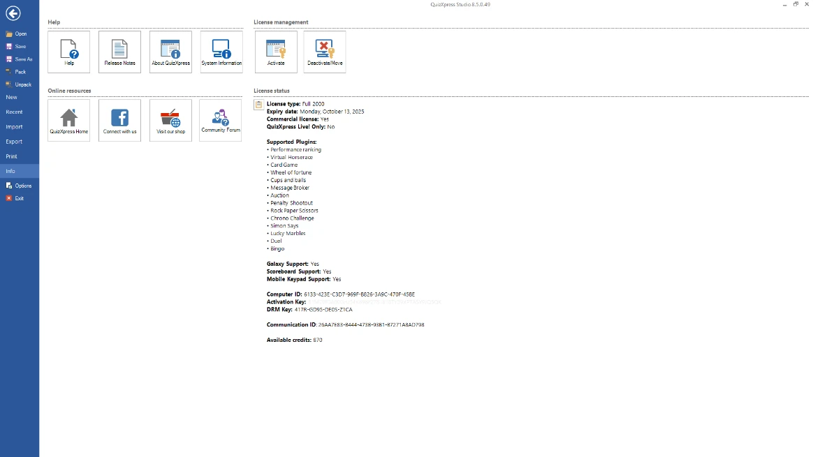

# Menu Backstage

Facendo clic sulla scheda FILE o premendo F1, viene visualizzato il menu backstage. { width="501" loading=lazy }

Da qui si accede alle funzionalità globali dell’applicazione, i cui dettagli sono disponibili in diverse altre schede:

| **New**                              | Creare un nuovo quiz e selezionare il rapporto d’aspetto delle diapositive            |
|--------------------------------------|------------------------------------------------------------------------|
| **Recent**                           | Aprire file recenti e di esempio                                          |
| **Import**                           | Importare domande da Excel o da un altro file di quiz                  |
| **Export questions to Excel or PDF** | Esportare le domande in Excel o PDF                                        |
| **Print**                            | Stampare le diapositive del quiz                                                 |
| **Info**                             | Accedere al file della Guida, a varie risorse online e gestire la licenza |
