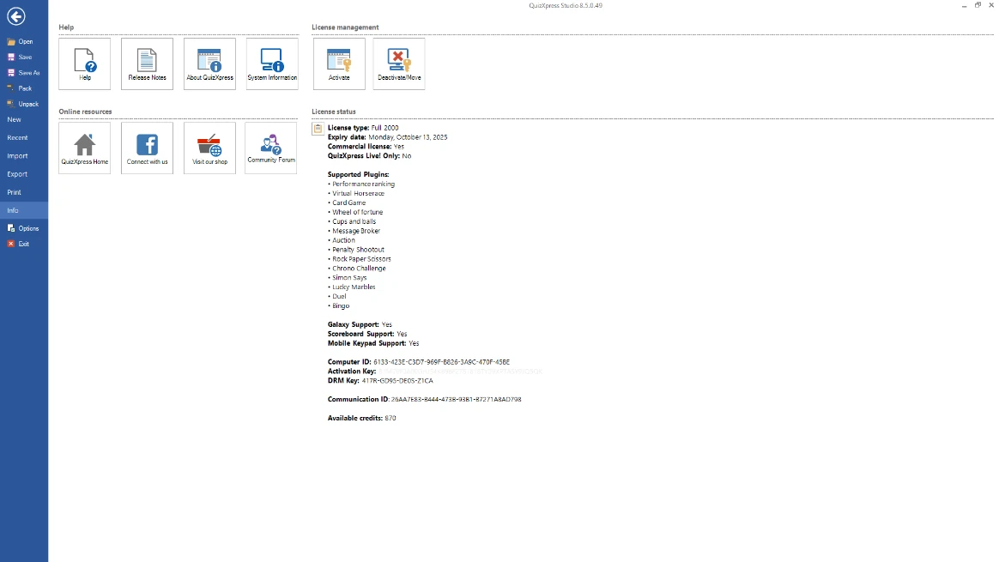

# Menu Backstage

Facendo clic sulla scheda FILE o premendo F1, viene visualizzato il menu backstage. { width="501" loading=lazy }

Da qui si accede alle funzionalità globali dell’applicazione, i cui dettagli sono disponibili in diverse altre schede:

| **Nuovo** | Crea un nuovo quiz e seleziona le proporzioni delle diapositive |
|--------------------------------------|------------------------------------------------------------------------|
| **Recenti** | Apre i file recenti e i file di esempio |
| **Importa** | Importa le domande da Excel o da un altro file quiz |
| **Esporta** | Esporta le domande in Excel, in PDF o come immagini |
| **Stampa** | Stampa le diapositive del quiz |
| **Info** | Consente di accedere al File Aiuto, alle risorse online e alla gestione della licenza |
