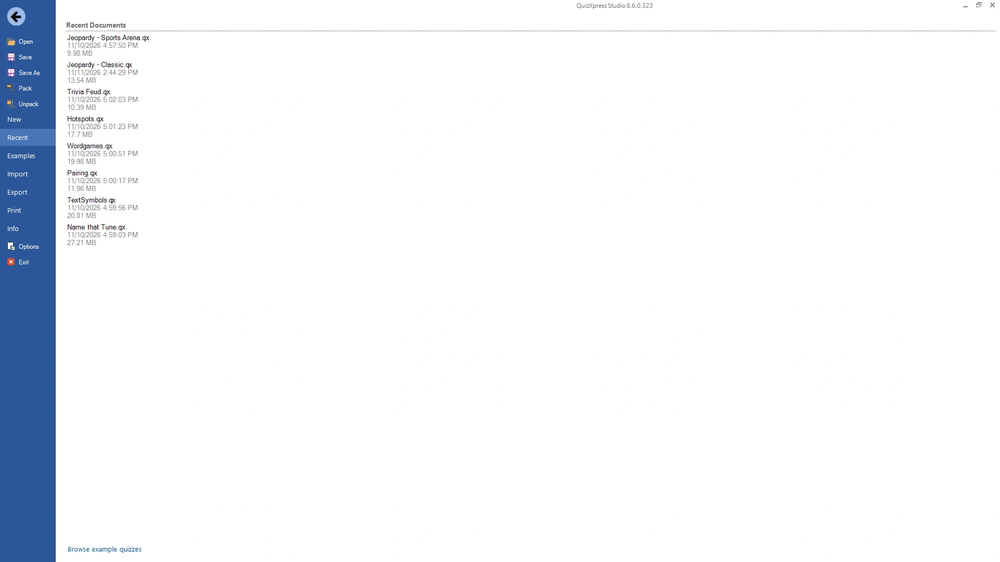

# Backstage-menu

Wanneer u op het tabblad BESTAND klikt of op F1 drukt, verschijnt het backstage-menu. { width="700" loading=lazy }

Hier vindt u algemene functies van de toepassing. De details ervan vindt u op verschillende andere tabbladen:

| **Nieuw**                               | Maak een nieuwe quiz en kies de beeldverhouding van de dia’s           |
|-----------------------------------------|------------------------------------------------------------------------|
| **Recent**                              | Open recente bestanden en voorbeeldbestanden                           |
| **Importeren**                          | Importeer vragen uit Excel of uit een ander quizbestand                |
| **Vragen exporteren naar Excel of PDF** | Exporteer vragen naar Excel of PDF                                     |
| **Afdrukken**                           | Druk uw quizdia’s af                                                   |
| **Info**                                | Open het Help-bestand en diverse online bronnen en beheer uw licentie  |
