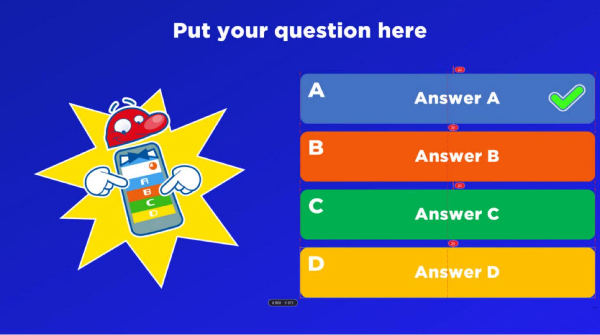
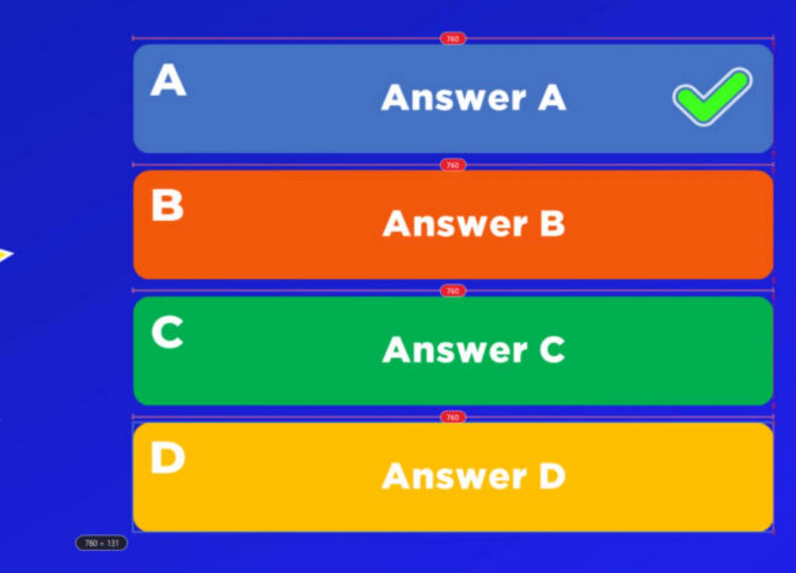
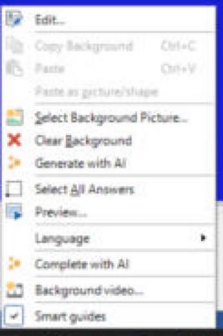
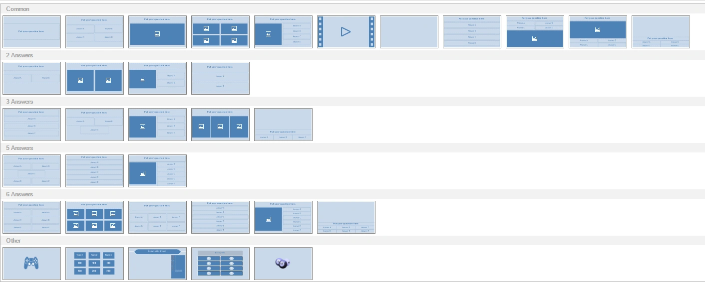

# Zone de conception

La zone de conception contient une représentation visuelle de ce que nous appelons une « diapositive de quiz ». Elle affiche la diapositive de quiz exactement telle qu’elle sera présentée pendant le jeu. Une diapositive de quiz se compose de plusieurs éléments : une question, des réponses à choix multiples, des images, des formes et du texte, une vidéo ou un élément sonore, etc. Les éléments peuvent être sélectionnés individuellement ou en groupe, puis modifiés. La diapositive de quiz dans son ensemble peut aussi être sélectionnée pour en modifier les propriétés. Pour sélectionner une diapositive de quiz, cliquez sur l’arrière-plan de la diapositive. Voir [Quiz slide properties](advanced-properties-grid.md#proprietes-des-diapositives-de-quiz) pour un aperçu de toutes les propriétés d’une diapositive.

Les éléments de la diapositive peuvent être sélectionnés et redimensionnés en cliquant avec le bouton gauche sur l’une des poignées de redimensionnement et en la faisant glisser jusqu’à la taille souhaitée. Lorsque plusieurs éléments sont sélectionnés, soit avec la touche Ctrl, soit en traçant un cadre de sélection à la souris, la modification des propriétés affichées dans le volet des propriétés (ou à l’aide des commandes du ruban) change les propriétés de tous les éléments sélectionnés en une seule fois. C’est pratique, par exemple, pour définir la police de toutes les réponses d’une question à la fois : sélectionnez d’abord toutes les réponses, puis modifiez la propriété ‘font’ dans le volet des propriétés. Lorsque vous déplacez des objets, ils s’alignent sur les [guides intelligents](#guides-intelligents) et sur une grille invisible ; maintenez la touche *Ctrl* enfoncée pendant le glissement pour désactiver cet alignement magnétique.

## Guides intelligents

Lorsque vous déplacez ou redimensionnez des éléments sur une diapositive, Quiz Studio affiche des guides intelligents : des lignes rouges qui indiquent quand des éléments sont alignés, et l’élément se cale en place dès qu’il s’en approche. Cela permet de créer des diapositives soignées et homogènes sans rien mesurer.

{ loading=lazy }

- **Alignement des bords** : une ligne rouge en pointillés apparaît lorsqu’un bord de l’élément est aligné avec un bord d’un autre élément ou avec le bord de la diapositive. De petites croix rouges signalent les éléments alignés.
- **Alignement des centres** : une ligne rouge en traits et points apparaît lorsque le centre de l’élément est aligné avec le centre d’un autre élément ou avec le centre de la diapositive.
- **Espacement égal** : lorsque l’élément est exactement à la même distance de l’élément situé au-dessus (ou avant) que de celui situé en dessous (ou après), ou à la même distance que celle qui sépare d’autres éléments d’une même ligne ou colonne, des flèches indiquant la distance en pixels apparaissent dans chaque espace égal. Dans l’image ci-dessus, les quatre réponses sont espacées de 20 pixels.
- **Taille égale** : pendant que vous redimensionnez un élément, il se cale sur la largeur ou la hauteur d’un autre élément de la diapositive, et un repère de taille s’affiche sur chaque élément de cette taille.

{ loading=lazy }

Pendant que vous faites glisser, une copie transparente de l’élément indique où il ira, et une petite étiquette affiche sa position (X et Y) ou, lors d’un redimensionnement, sa taille, en pixels de diapositive. Les guides intelligents fonctionnent aussi lorsque vous déplacez ensemble plusieurs éléments sélectionnés.

- Maintenez la touche *Ctrl* enfoncée pendant le glissement pour placer un élément librement, sans guides intelligents ni grille.
- Appuyez sur *Esc* pendant le glissement pour annuler le déplacement et laisser l’élément où il était.

Pour désactiver (ou réactiver) les guides intelligents, faites un clic droit sur l’arrière-plan de la diapositive et cliquez sur ‘Smart guides’. Quiz Studio mémorise ce réglage. Les éléments ne s’alignent alors que sur la grille invisible.

{ width="200" loading=lazy }

!!! tip
    Pour aligner plusieurs éléments en une seule fois, sélectionnez-les et utilisez les [outils d’alignement](../other-functionality/home-alignment-size-order.md) du ruban HOME.

## Insérer une diapositive

Pour insérer une nouvelle diapositive, allez dans le menu INSERT et choisissez l’une des mises en page prédéfinies dans la section ‘Quiz Slides’. Les cadres bleu foncé représentent des emplacements réservés pour insérer une image ou une vidéo.

{ loading=lazy }

En choisissant les mises en page de la rangée du bas, vous pouvez respectivement insérer un mini-jeu, un Trivia Board, un Trivia Ladder, un jeu Trivia Feud ou une manche de Bingo.

Vous pouvez également modifier la mise en page d’une diapositive existante depuis le menu DESIGN en cliquant sur la flèche de la liste déroulante dans la section ‘Change Layout’. La même liste déroulante que ci-dessus apparaît et vous permet de choisir une nouvelle mise en page. Les éléments de la mise en page actuelle qui conviennent à la nouvelle mise en page seront copiés. Par exemple, lorsque vous passez d’une mise en page avec une question, une image et trois réponses à une mise en page avec une question, une image et quatre réponses, l’image, la question et les trois réponses sont toutes copiées dans la nouvelle mise en page.
