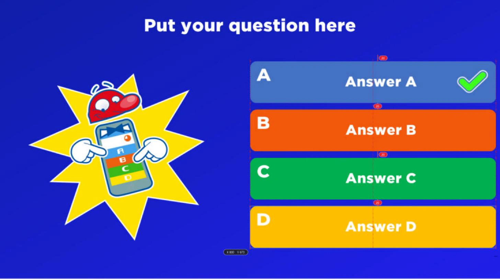
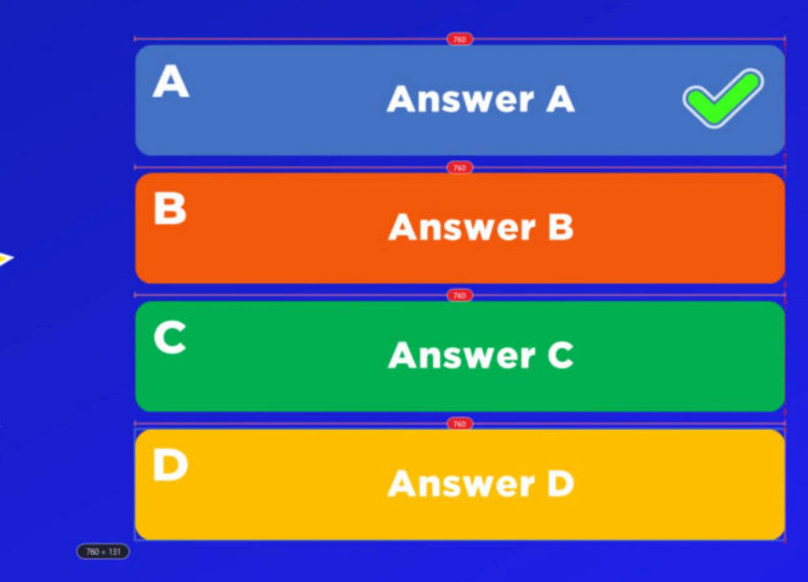
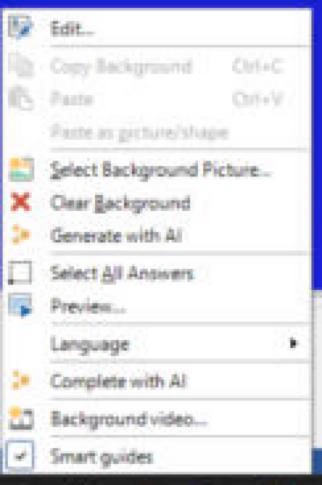
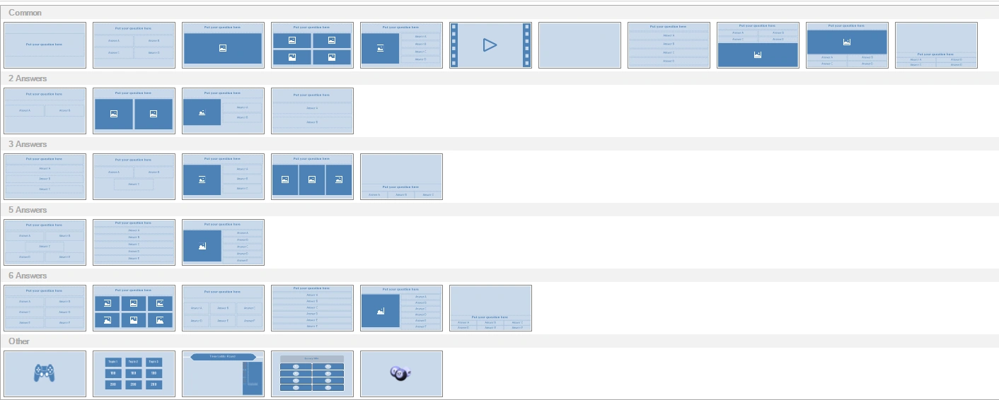

# Ontwerpgebied

Het ontwerpgebied toont een visuele weergave van wat we een ‘quizdia’ noemen. Het laat de ‘quizdia’ precies zien zoals deze tijdens de gameshow te zien zal zijn. Een ‘quizdia’ bestaat uit meerdere items: een vraag, meerkeuzeantwoorden, afbeeldingen, vormen en tekst, een video of een geluidsitem enzovoort. Items kunnen afzonderlijk of als groep worden geselecteerd, waarna u ze kunt aanpassen. Ook de quizdia als geheel kan worden geselecteerd om de eigenschappen ervan te bewerken. Klik op de achtergrond van de dia om een quizdia te selecteren. Zie [Eigenschappen van de quizdia](advanced-properties-grid.md#eigenschappen-van-quizdias) voor een overzicht van alle eigenschappen van een dia.

U selecteert en vergroot of verkleint dia-items door op een van de formaatgrepen te klikken en deze naar het gewenste formaat te slepen. Wanneer u meerdere items selecteert, met de Ctrl-toets of door met de muis een selectiekader te slepen, worden bij het bewerken van eigenschappen in het eigenschappenvenster (of met bedieningselementen in het lint) de eigenschappen van alle geselecteerde items tegelijk gewijzigd. Dat is handig als u bijvoorbeeld het lettertype van alle antwoorden van een vraag in één keer wilt instellen: selecteer eerst alle antwoorden en wijzig daarna de eigenschap ‘lettertype’ in het eigenschappenvenster. Tijdens het verplaatsen van objecten worden ze uitgelijnd op [slimme hulplijnen](#slimme-hulplijnen) en op een onzichtbaar raster. Houd de toets *Ctrl* ingedrukt tijdens het slepen om dit uitlijnen uit te schakelen.

## Slimme hulplijnen

Terwijl u items op een dia verplaatst of van formaat verandert, toont Quiz Studio slimme hulplijnen: rode lijnen die laten zien wanneer items op één lijn liggen. Het item klikt vast zodra het dichtbij komt. Zo bouwt u eenvoudig nette, consistente dia’s zonder iets te hoeven meten.

{ loading=lazy }

- **Randen liggen op één lijn**: er verschijnt een rode onderbroken lijn wanneer een rand van het item op één lijn ligt met een rand van een ander item of met de rand van de dia. Kleine rode kruisjes markeren de items die op één lijn liggen.
- **Middens liggen op één lijn**: er verschijnt een rode streep-punt-lijn wanneer het midden van het item op één lijn ligt met het midden van een ander item of met het midden van de dia.
- **Gelijke afstand**: wanneer het item even ver van het item erboven (of ervoor) staat als van het item eronder (of erna), of even ver als andere items in dezelfde rij of kolom van elkaar staan, verschijnen er in elke gelijke tussenruimte pijlen met de afstand in pixels. In de afbeelding hierboven staan alle vier de antwoorden 20 pixels uit elkaar.
- **Gelijk formaat**: terwijl u een item van formaat verandert, klikt het vast op de breedte of hoogte van een ander item op de dia en verschijnt er een formaatmarkering op elk item met dat formaat.

{ loading=lazy }

Tijdens het slepen toont een doorschijnende kopie van het item waar het terechtkomt en geeft een klein label de positie (X en Y) aan, of bij het vergroten of verkleinen het formaat, in dia-pixels. Slimme hulplijnen werken ook wanneer u meerdere geselecteerde items samen verplaatst.

- Houd de toets *Ctrl* ingedrukt tijdens het slepen om een item vrij te plaatsen, zonder slimme hulplijnen of raster.
- Druk tijdens het slepen op *Esc* om het verplaatsen te annuleren en het item op zijn plaats te laten staan.

Om slimme hulplijnen uit (of weer aan) te zetten, klikt u met de rechtermuisknop op de achtergrond van de dia en klikt u op ‘Slimme hulplijnen’. Quiz Studio onthoudt deze instelling. Items klikken dan alleen nog vast op het onzichtbare raster.

{ width="200" loading=lazy }

!!! tip
    Om meerdere items in één keer uit te lijnen, selecteert u ze en gebruikt u de [uitlijnopties](../other-functionality/home-alignment-size-order.md) op het lint START.

## Een dia invoegen

Om een nieuwe dia in te voegen, gaat u naar het menu INVOEGEN en kiest u een van de vooraf gedefinieerde indelingen in de sectie ‘Quiz Vragen’. Donkerblauwe vakken stellen plaatshouders voor waarin u een afbeelding of video kunt invoegen.

{ loading=lazy }

Met de indelingen op de onderste rij kunt u respectievelijk een minigame, een Trivia Bord, een Trivia Ladder, een Trivia Feud-spel of een Bingo-ronde invoegen.

U kunt ook de indeling van een bestaande dia wijzigen via het menu ONTWERP door op het uitklappijltje in de sectie ‘Verander layout’ te klikken. Dezelfde keuzelijst als hierboven verschijnt, waarin u een nieuwe indeling kunt kiezen. Items uit de huidige indeling die in de nieuwe indeling passen, worden overgenomen. Als u bijvoorbeeld overstapt van een indeling met een vraag, een afbeelding en drie antwoorden naar een indeling met een vraag, een afbeelding en vier antwoorden, worden de afbeelding, de vraag en de drie antwoorden allemaal naar de nieuwe indeling gekopieerd.
