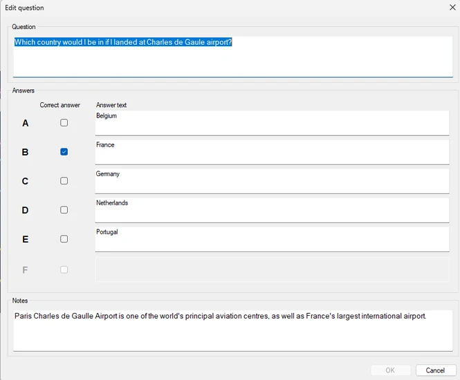
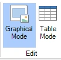
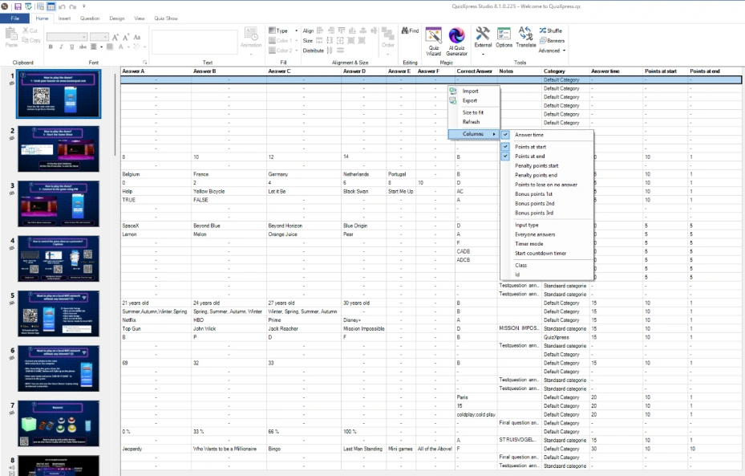
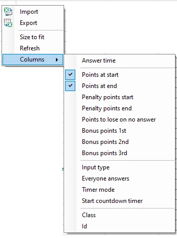

# Modificare il contenuto

Per modificare il contenuto, fare clic sugli elementi della diapositiva e cambiare le proprietà dell’elemento selezionato nella barra multifunzione o nel riquadro delle proprietà.

Per modificare la domanda e tutte le risposte, usare la voce ‘Edit...’ del menu contestuale della diapositiva (fare clic con il tasto destro sulla diapositiva e selezionare ‘Edit...’). Viene visualizzato il modulo ‘Edit question’. In alternativa, è possibile fare doppio clic sulla diapositiva.

{ width="333" loading=lazy }

In questo modulo è facile modificare domanda e risposte in un’unica operazione.

Inoltre, Studio offre due viste per modificare il contenuto: Graphical Mode e Table Mode. È possibile selezionare una delle modalità nella barra multifunzione VIEW.

{ width="85" loading=lazy }

## Graphical Mode

La modalità grafica mostra una rappresentazione grafica della diapositiva nell’area di progettazione. È una vista “what you see is what you get”: la diapositiva appare esattamente come verrà visualizzata nel lettore del quiz. Nota: premere F5 o il pulsante Preview Slide sulla barra multifunzione per un’anteprima a schermo intero della diapositiva.

## Table Mode

In modalità tabella si ottiene una panoramica di tutte le diapositive in una tabella. Si vedono il tipo di diapositiva, la domanda, le risposte, la risposta corretta e le note (se applicabile, a seconda del tipo di diapositiva), che possono essere modificati comodamente in un’unica vista.

{ width="593" loading=lazy }

{ width="193" loading=lazy }

È possibile mostrare e modificare altre proprietà di uso frequente in colonne facendo clic con il tasto destro nella tabella.

Fare clic sul sottomenu Columns e scegliere le proprietà che si desidera far comparire nella tabella.

Oltre a poter modificare i valori in una tabella, è utile anche vedere a colpo d’occhio tutti i valori di tutte le domande, così da verificare più facilmente che sia tutto impostato come previsto.

L’opzione ‘Size to fit’ ridimensiona le colonne a una larghezza in cui tutto il contenuto è leggibile.

### Import Export in modalità tabella

È possibile importare ed esportare il contenuto della tabella in Excel.

Un’esportazione produce un file Excel con colonne per la domanda, tutte le risposte, la risposta corretta e le note della diapositiva.

| Q   | A1  | A2  | A3  | A4  | A5  | A6  | CORRECT | NOTES |     |
|-----|-----|-----|-----|-----|-----|-----|---------|-------|-----|

Le altre colonne attualmente non vengono esportate.

Se si importa un file con le colonne indicate sopra, il contenuto della tabella verrà sostituito uno a uno.

Import Export dalla vista tabella consente di sostituire facilmente il contenuto *esistente* usando dati di Excel. Tutto il resto della formattazione e la struttura del quiz rimangono intatti. Vengono sostituite solo la domanda, le risposte, la risposta corretta e le note.

QuizXpress offre anche una funzionalità di importazione ed esportazione Excel più avanzata, che consente di importare un intero quiz da Excel, comprese varie proprietà e il design stesso del quiz. Per maggiori dettagli, vedere [Import of Excel format](../import-and-export-of-questions.md#importazione-in-formato-excel)
