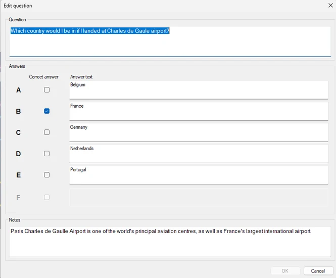
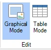
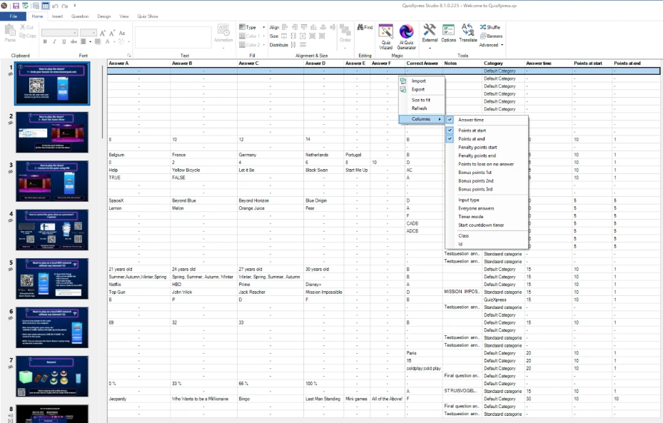
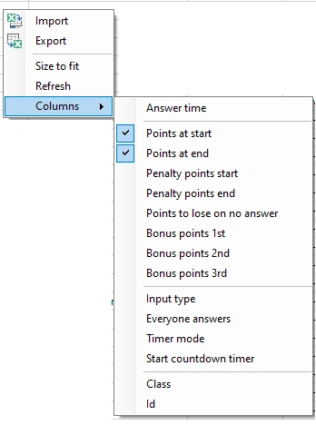

# Modificare il contenuto

Per modificare i contenuti, fare clic sugli elementi nella diapositiva e cambiare le proprietà dell’elemento selezionato tramite la barra multifunzione o il pannello delle proprietà.

Per modificare la domanda e tutte le risposte, usare la voce ‘Modifica...’ del menu contestuale della diapositiva (fare clic con il tasto destro sulla diapositiva e selezionare ‘Modifica...’). Viene visualizzata la finestra ‘Modifica Domanda’. In alternativa, è possibile fare doppio clic sulla diapositiva.

{ width="333" loading=lazy }

In questa finestra è possibile modificare facilmente le domande e le risposte in un'unica operazione.

Inoltre, Studio offre due viste per modificare il contenuto: Modalità Grafica e Modalità Tabella. È possibile selezionare una delle modalità nella scheda VISTA della barra multifunzione.

{ width="85" loading=lazy }

## Modalità Grafica { #graphical-mode }

La Modalità Grafica mostra una rappresentazione grafica della diapositiva nell’area di progettazione. È una vista “quello che vedi è quello che ottieni”: la diapositiva appare esattamente come verrà visualizzata durante il quiz. Nota: premere F5 o il pulsante ‘Anteprima Diapositiva’ nella barra multifunzione per un’anteprima a schermo intero della diapositiva.

## Modalità Tabella { #table-mode }

In Modalità Tabella si ottiene una panoramica di tutte le diapositive in una tabella. Si vedono il tipo di diapositiva, la domanda, le risposte, la risposta corretta e le note (se applicabile, a seconda del tipo di diapositiva), che possono essere modificati comodamente in un’unica vista.

{ width="593" loading=lazy }

{ width="193" loading=lazy }

È possibile mostrare e modificare altre proprietà di uso frequente in colonne facendo clic con il tasto destro nella tabella.

Fare clic sul sottomenu ‘Colonne’ e scegliere le proprietà che si desidera far comparire nella tabella.

Oltre a poter modificare i valori in una tabella, è utile anche vedere a colpo d’occhio tutti i valori di tutte le domande, così da verificare più facilmente che sia tutto impostato come previsto.

L’opzione ‘Adatta alle dimensioni’ ridimensiona le colonne a una larghezza in cui tutto il contenuto è leggibile.

### Importare ed esportare in Modalità Tabella { #import-export-in-modalita-tabella }

È possibile importare ed esportare il contenuto della tabella in Excel.

L'esportazione si tradurrà in un file Excel con colonne per la domanda, tutte le risposte, la risposta corretta e le note della diapositiva.

| Q   | A1  | A2  | A3  | A4  | A5  | A6  | CORRECT | NOTES |     |
|-----|-----|-----|-----|-----|-----|-----|---------|-------|-----|

Le altre colonne attualmente non vengono esportate.

Se si importa un file con le colonne sopra indicate, il contenuto della tabella verrà sostituito **uno a uno** con quello del file.

L’importazione/esportazione dalla vista tabella consente di sostituire facilmente i contenuti esistenti utilizzando dati da Excel. Tutti gli altri elementi grafici e la struttura del quiz rimarranno invariati. Verranno sostituiti solo la domanda, le risposte, la risposta corretta e le eventuali note.

QuizXpress offre anche una funzionalità di importazione ed esportazione Excel più avanzata, che consente di importare un intero quiz da Excel, comprese varie proprietà e il design stesso del quiz. Per maggiori dettagli, vedere [Importazione in formato Excel](../import-and-export-of-questions.md#importazione-in-formato-excel).
