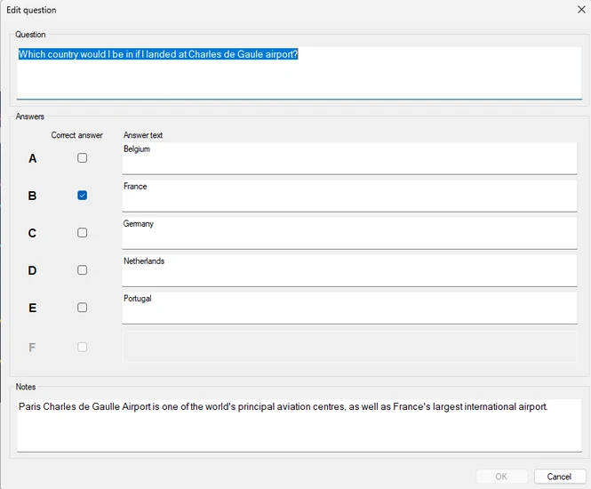
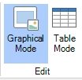
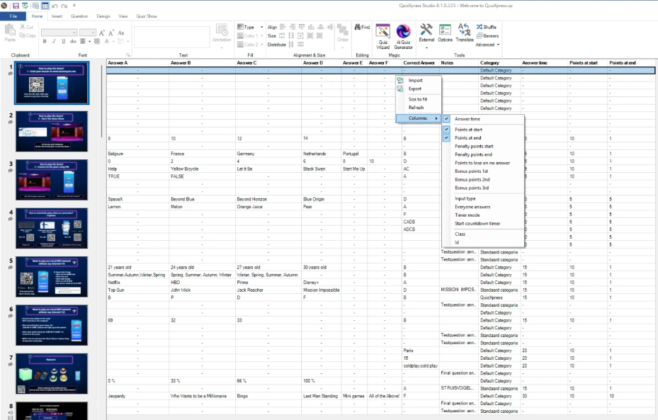
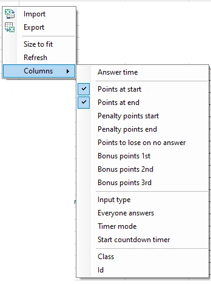

# Inhoud bewerken

Om inhoud te bewerken, klikt u op de elementen op de dia en wijzigt u de eigenschappen van het geselecteerde element in het lint of in het eigenschappenvenster.

Om de vraag en alle antwoorden te bewerken, gebruikt u de optie ‘Bewerken...’ in het contextmenu van de dia (klik met de rechtermuisknop op de dia en kies ‘Bewerken...’). Hiermee opent u het formulier ‘Vraag bewerken’. U kunt ook dubbelklikken op de dia.

{ width="333" loading=lazy }

In dit formulier wijzigt u de vraag en de antwoorden eenvoudig in één keer.

Verder biedt Studio twee weergaven voor het bewerken van inhoud: de grafische modus en de tabelmodus. U kiest een van de modi op het lint BEELD.

{ width="85" loading=lazy }

## Grafische modus

De grafische modus toont een grafische weergave van de dia in het ontwerpgebied. Het is een ‘what you see is what you get’-weergave: u ziet de dia precies zoals deze in de quizspeler zal verschijnen. Let op: druk op F5 of op de knop ‘Voorbeeld’ in het lint voor een voorbeeld van de dia op volledig scherm.

## Tabelmodus

In de tabelmodus ziet u een overzicht van alle dia’s in een tabel. U ziet het diatype, de vraag, de antwoorden, het juiste antwoord en de notities (indien van toepassing, afhankelijk van het diatype), die u gemakkelijk in één weergave kunt bewerken.

{ width="593" loading=lazy }

{ width="193" loading=lazy }

U kunt extra veelgebruikte eigenschappen in kolommen tonen en bewerken door met de rechtermuisknop in de tabel te klikken.

Klik op het submenu Kolommen en kies de eigenschappen die u in de tabel wilt laten verschijnen.

Naast het bewerken van de waarden in een tabel is het ook handig om alle waarden van alle vragen in één oogopslag te zien, zodat u gemakkelijker kunt controleren of alles is ingesteld zoals verwacht.

Met de optie ‘Maak passend’ wordt de breedte van de kolommen aangepast, zodat alle kolominhoud leesbaar is.

### Importeren en exporteren in de tabelmodus

U kunt de inhoud van de tabel importeren uit en exporteren naar Excel.

Een export levert een Excel-bestand op met kolommen voor de vraag, alle antwoorden, het juiste antwoord en de dianotities.

| Q   | A1  | A2  | A3  | A4  | A5  | A6  | CORRECT | NOTES |     |
|-----|-----|-----|-----|-----|-----|-----|---------|-------|-----|

Andere kolommen worden momenteel niet geëxporteerd.

Als u een bestand met bovenstaande kolommen importeert, wordt de inhoud van de tabel één op één vervangen.

Met importeren en exporteren vanuit de tabelweergave vervangt u eenvoudig *bestaande* inhoud met gegevens uit Excel. Alle andere ontwerpopmaak en de structuur van de quiz blijven intact. Alleen de vraag, de antwoorden, het juiste antwoord en de notities worden vervangen.

QuizXpress biedt ook een geavanceerdere functionaliteit voor het importeren en exporteren met Excel, waarmee u een complete quiz uit Excel kunt importeren, inclusief diverse eigenschappen en het quizontwerp zelf. Zie voor meer informatie [Import van Excel-indeling](../import-and-export-of-questions.md#importeren-van-excel)
