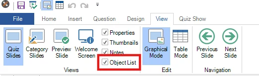
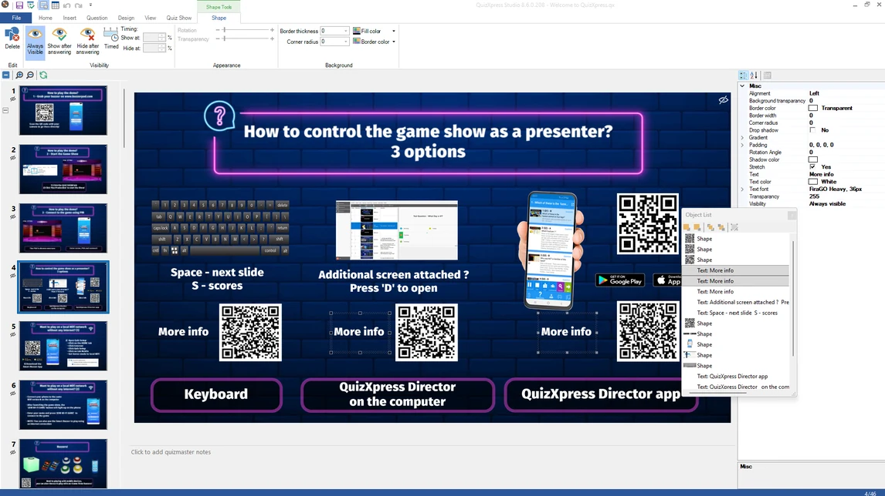

# Vue Object List

Le formulaire Object List peut être activé ou désactivé dans le ruban View :

{ width="485" loading=lazy }

Lorsque cet outil est activé, une fenêtre flottante apparaît et affiche la liste de tous les objets de la diapositive de quiz actuelle. Lorsque vous sélectionnez un élément dans la liste, l’élément visuel correspondant sur la diapositive est également sélectionné (et inversement). Vous pouvez sélectionner plusieurs éléments et les faire glisser dans la liste pour réorganiser leur ordre Z (ordre visuel avant/arrière). Vous pouvez aussi double-cliquer sur une entrée de la liste pour lancer l’action ‘Edit’ par défaut de l’élément. Par exemple, pour modifier le texte de la question, il suffit de double-cliquer sur l’élément de la question dans la liste.

{ loading=lazy }
